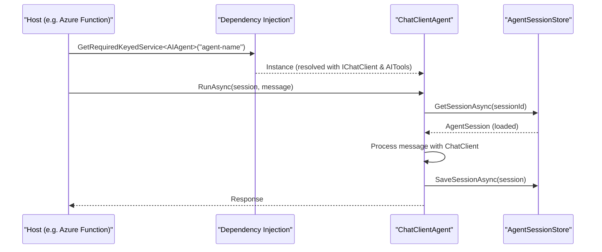

<!-- source: DeepWiki mcp.deepwiki.com · repo microsoft/agent-framework · extra page Azure Functions Integration · fetched 2026-10-26 -->

# Azure Functions Integration

<details>
<summary>Relevant source files</summary>

The following files were used as context for generating this wiki page:

- [dotnet/src/Microsoft.Agents.AI.Foundry.Hosting/FoundryToolboxBearerTokenHandler.cs](dotnet/src/Microsoft.Agents.AI.Foundry.Hosting/FoundryToolboxBearerTokenHandler.cs)
- [dotnet/src/Microsoft.Agents.AI.Foundry.Hosting/Microsoft.Agents.AI.Foundry.Hosting.csproj](dotnet/src/Microsoft.Agents.AI.Foundry.Hosting/Microsoft.Agents.AI.Foundry.Hosting.csproj)
- [dotnet/src/Microsoft.Agents.AI.Hosting/AIHostAgent.cs](dotnet/src/Microsoft.Agents.AI.Hosting/AIHostAgent.cs)
- [dotnet/src/Microsoft.Agents.AI.Hosting/AgentHostingServiceCollectionExtensions.cs](dotnet/src/Microsoft.Agents.AI.Hosting/AgentHostingServiceCollectionExtensions.cs)
- [dotnet/src/Microsoft.Agents.AI.Hosting/HostApplicationBuilderAgentExtensions.cs](dotnet/src/Microsoft.Agents.AI.Hosting/HostApplicationBuilderAgentExtensions.cs)
- [dotnet/src/Microsoft.Agents.AI.Hosting/HostApplicationBuilderWorkflowExtensions.cs](dotnet/src/Microsoft.Agents.AI.Hosting/HostApplicationBuilderWorkflowExtensions.cs)
- [dotnet/src/Microsoft.Agents.AI.Hosting/HostedAgentBuilder.cs](dotnet/src/Microsoft.Agents.AI.Hosting/HostedAgentBuilder.cs)
- [dotnet/src/Microsoft.Agents.AI.Hosting/HostedAgentBuilderExtensions.cs](dotnet/src/Microsoft.Agents.AI.Hosting/HostedAgentBuilderExtensions.cs)
- [dotnet/src/Microsoft.Agents.AI.Hosting/HostedWorkflowBuilderExtensions.cs](dotnet/src/Microsoft.Agents.AI.Hosting/HostedWorkflowBuilderExtensions.cs)
- [dotnet/src/Microsoft.Agents.AI.Hosting/IHostedAgentBuilder.cs](dotnet/src/Microsoft.Agents.AI.Hosting/IHostedAgentBuilder.cs)
- [dotnet/src/Microsoft.Agents.AI.Workflows.Declarative.Mcp/DefaultMcpToolHandler.cs](dotnet/src/Microsoft.Agents.AI.Workflows.Declarative.Mcp/DefaultMcpToolHandler.cs)
- [dotnet/src/Microsoft.Agents.AI.Workflows.Declarative.Mcp/Microsoft.Agents.AI.Workflows.Declarative.Mcp.csproj](dotnet/src/Microsoft.Agents.AI.Workflows.Declarative.Mcp/Microsoft.Agents.AI.Workflows.Declarative.Mcp.csproj)
- [dotnet/src/Shared/OriginPinning/OriginPinningHandler.cs](dotnet/src/Shared/OriginPinning/OriginPinningHandler.cs)
- [dotnet/src/Shared/OriginPinning/README.md](dotnet/src/Shared/OriginPinning/README.md)
- [dotnet/tests/Microsoft.Agents.AI.Foundry.Hosting.UnitTests/FoundryToolboxBearerTokenHandlerTests.cs](dotnet/tests/Microsoft.Agents.AI.Foundry.Hosting.UnitTests/FoundryToolboxBearerTokenHandlerTests.cs)
- [dotnet/tests/Microsoft.Agents.AI.Hosting.UnitTests/AgentHostingServiceCollectionExtensionsTests.cs](dotnet/tests/Microsoft.Agents.AI.Hosting.UnitTests/AgentHostingServiceCollectionExtensionsTests.cs)
- [dotnet/tests/Microsoft.Agents.AI.Hosting.UnitTests/HostApplicationBuilderAgentExtensionsTests.cs](dotnet/tests/Microsoft.Agents.AI.Hosting.UnitTests/HostApplicationBuilderAgentExtensionsTests.cs)
- [dotnet/tests/Microsoft.Agents.AI.Hosting.UnitTests/HostApplicationBuilderWorkflowExtensionsTests.cs](dotnet/tests/Microsoft.Agents.AI.Hosting.UnitTests/HostApplicationBuilderWorkflowExtensionsTests.cs)
- [dotnet/tests/Microsoft.Agents.AI.Hosting.UnitTests/HostedAgentBuilderToolsExtensionsTests.cs](dotnet/tests/Microsoft.Agents.AI.Hosting.UnitTests/HostedAgentBuilderToolsExtensionsTests.cs)
- [dotnet/tests/Microsoft.Agents.AI.Workflows.Declarative.Mcp.UnitTests/DefaultMcpToolHandlerTests.cs](dotnet/tests/Microsoft.Agents.AI.Workflows.Declarative.Mcp.UnitTests/DefaultMcpToolHandlerTests.cs)
- [dotnet/tests/Microsoft.Agents.AI.Workflows.Declarative.Mcp.UnitTests/Shared/OriginPinningHandlerTests.cs](dotnet/tests/Microsoft.Agents.AI.Workflows.Declarative.Mcp.UnitTests/Shared/OriginPinningHandlerTests.cs)

</details>


This page documents deploying agents and workflows to Azure Functions using the `Microsoft.Agents.AI.Hosting` and specialized integration packages. The framework provides patterns for HTTP-triggered agents, durable orchestrations with workflow persistence, and Model Context Protocol (MCP) hosting.

## Overview

Azure Functions provides a serverless compute platform for running agents with automatic scaling and consumption-based billing. The Agent Framework supports two primary deployment models:

1.  **HTTP-Triggered Agents**: Direct agent invocations via HTTP endpoints using standard Function triggers [dotnet/src/Microsoft.Agents.AI.Hosting/AgentHostingServiceCollectionExtensions.cs:25-35]().
2.  **Durable Orchestrations**: Multi-agent workflows with checkpoint persistence and state management using Durable Task Framework [dotnet/src/Microsoft.Agents.AI.Hosting/HostApplicationBuilderWorkflowExtensions.cs:29-50]().

The integration includes specialized support for long-running workflows, human-in-the-loop (HITL) interactions, and hosting agents as keyed services within the dependency injection (DI) container [dotnet/src/Microsoft.Agents.AI.Hosting/AgentHostingServiceCollectionExtensions.cs:107-115]().

Sources: [dotnet/src/Microsoft.Agents.AI.Hosting/AgentHostingServiceCollectionExtensions.cs:1-120](), [dotnet/src/Microsoft.Agents.AI.Hosting/HostApplicationBuilderWorkflowExtensions.cs:1-51]()

## Package Architecture

### Core Hosting Packages

The Azure Functions integration relies on specialized hosting and task management packages:

| Package | Purpose |
| :--- | :--- |
| `Microsoft.Agents.AI.Hosting` | Base hosting abstractions and `IHostedAgentBuilder` for DI registration [dotnet/src/Microsoft.Agents.AI.Hosting/Microsoft.Agents.AI.Hosting.csproj:1-30]() |
| `Microsoft.Agents.AI.Hosting.AzureStorage` | Provides Azure Blob Storage implementation for `AgentSessionStore` [dotnet/src/Microsoft.Agents.AI.Hosting.AzureStorage/Microsoft.Agents.AI.Hosting.AzureStorage.csproj:1-20]() |
| `Microsoft.Agents.AI.Workflows.Declarative.Mcp` | Provides MCP server integration for declarative workflows and handlers like `DefaultMcpToolHandler` [dotnet/src/Microsoft.Agents.AI.Workflows.Declarative.Mcp/DefaultMcpToolHandler.cs:35-55]() |

Sources: [dotnet/src/Microsoft.Agents.AI.Hosting/Microsoft.Agents.AI.Hosting.csproj:1-47](), [dotnet/src/Microsoft.Agents.AI.Workflows.Declarative.Mcp/DefaultMcpToolHandler.cs:35-90]()

### Hosting Entity Mapping

Diagram: Hosting Entity Mapping

```mermaid
graph TB
    subgraph "NaturalLanguageSpace ["Natural Language / Configuration"]"
        "AgentName" --> "KeyedService"
        "Instructions" --> "ChatClientAgent"
    end
    
    subgraph "CodeEntitySpace ["Code Entities"]"
        "KeyedService" -- "resolved by" --> "AgentHostingServiceCollectionExtensions.AddAIAgent"
        "AgentHostingServiceCollectionExtensions.AddAIAgent" -- "creates" --> "ChatClientAgent"
        "ChatClientAgent" -- "uses" --> "IChatClient"
        "ChatClientAgent" -- "manages" --> "AITool"
    end
    
    subgraph "HostingSpace ["Hosting Infrastructure"]"
        "IHostedAgentBuilder" -- "configures" --> "HostedAgentBuilderExtensions.WithAITool"
        "HostedAgentBuilderExtensions.WithSessionStore" -- "provides" --> "AgentSessionStore"
    end
```

Sources: [dotnet/src/Microsoft.Agents.AI.Hosting/AgentHostingServiceCollectionExtensions.cs:25-35](), [dotnet/src/Microsoft.Agents.AI.Hosting/HostedAgentBuilderExtensions.cs:63-92](), [dotnet/src/Microsoft.Agents.AI.Hosting/HostedAgentBuilderExtensions.cs:43-45]()

## Durable Workflow Integration

The integration allows workflows to be registered as keyed services, enabling stateful execution within host environments like Azure Functions [dotnet/src/Microsoft.Agents.AI.Hosting/HostApplicationBuilderWorkflowExtensions.cs:29-47]().

### Workflow Registration

Workflows are registered using a unique name and a factory delegate [dotnet/src/Microsoft.Agents.AI.Hosting/HostApplicationBuilderWorkflowExtensions.cs:29-33]().

- **Keyed Registration**: Workflows are added as `KeyedService` using the workflow name as the key [dotnet/src/Microsoft.Agents.AI.Hosting/HostApplicationBuilderWorkflowExtensions.cs:35-40]().
- **Workflow as Agent**: A registered workflow can be exposed as an `AIAgent` using the `AddAsAIAgent` extension [dotnet/src/Microsoft.Agents.AI.Hosting/HostedWorkflowBuilderExtensions.cs:34-47]().
- **Validation**: The framework ensures the workflow name returned by the factory matches the registration key [dotnet/src/Microsoft.Agents.AI.Hosting/HostApplicationBuilderWorkflowExtensions.cs:41-44]().

Sources: [dotnet/src/Microsoft.Agents.AI.Hosting/HostApplicationBuilderWorkflowExtensions.cs:29-50](), [dotnet/src/Microsoft.Agents.AI.Hosting/HostedWorkflowBuilderExtensions.cs:20-48]()

## Model Context Protocol (MCP) Hosting

Model Context Protocol integration allows agents and workflows running in Azure Functions to discover and invoke tools hosted on remote MCP servers.

### Default MCP Tool Handler

The `DefaultMcpToolHandler` class implements `IMcpToolHandler` using the MCP C# SDK to handle dynamic tool discovery (`tools/list`) and invocation [dotnet/src/Microsoft.Agents.AI.Workflows.Declarative.Mcp/DefaultMcpToolHandler.cs:35-45]().

- **Per-Server Authentication**: Supports an optional `httpClientProvider` callback that returns a pre-configured `HttpClient` for each server [dotnet/src/Microsoft.Agents.AI.Workflows.Declarative.Mcp/DefaultMcpToolHandler.cs:47-78]().
- **Session Caching**: When no custom client provider is supplied, MCP client sessions are cached by server URL, label, connection name, and header hashes [dotnet/src/Microsoft.Agents.AI.Workflows.Declarative.Mcp/DefaultMcpToolHandler.cs:48-51]().

Diagram: MCP Tool Invocation Flow

```mermaid
graph TB
    subgraph "NaturalLanguageSpace ["Tool Request"]"
        "ToolName" --> "DefaultMcpToolHandler.InvokeToolAsync"
    end

    subgraph "CodeEntitySpace ["MCP Execution"]"
        "DefaultMcpToolHandler.InvokeToolAsync" --> "DefaultMcpToolHandler.CreateClientAsync"
        "DefaultMcpToolHandler.CreateClientAsync" --> "ClientConnection"
        "ClientConnection" --> "McpClient"
    end
```

Sources: [dotnet/src/Microsoft.Agents.AI.Workflows.Declarative.Mcp/DefaultMcpToolHandler.cs:35-135]()

## Request and Response Flow

Diagram: Request Processing for Hosted Agents



Sources: [dotnet/src/Microsoft.Agents.AI.Hosting/AgentHostingServiceCollectionExtensions.cs:25-78](), [dotnet/src/Microsoft.Agents.AI.Hosting/HostedAgentBuilderExtensions.cs:63-90]()

---

