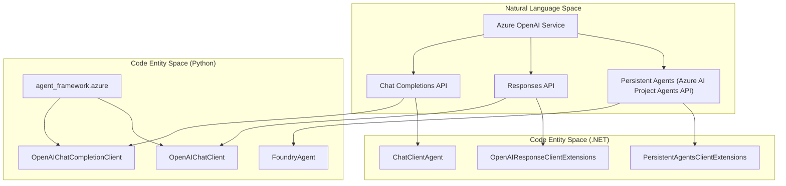
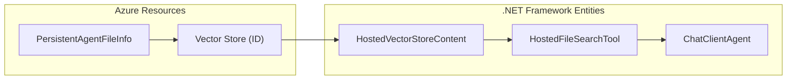

<!-- source: DeepWiki mcp.deepwiki.com · repo microsoft/agent-framework · extra page Azure OpenAI Integration · fetched 2026-10-26 -->

# Azure OpenAI Integration

Relevant source files

The following files were used as context for generating this wiki page:

- [dotnet/.vscode/settings.json](dotnet/.vscode/settings.json)
- [dotnet/src/Microsoft.Agents.AI.AzureAI.Persistent/PersistentAgentsClientExtensions.cs](dotnet/src/Microsoft.Agents.AI.AzureAI.Persistent/PersistentAgentsClientExtensions.cs)
- [dotnet/src/Microsoft.Agents.AI.OpenAI/Extensions/OpenAIChatClientExtensions.cs](dotnet/src/Microsoft.Agents.AI.OpenAI/Extensions/OpenAIChatClientExtensions.cs)
- [dotnet/src/Microsoft.Agents.AI.OpenAI/Extensions/OpenAIResponseClientExtensions.cs](dotnet/src/Microsoft.Agents.AI.OpenAI/Extensions/OpenAIResponseClientExtensions.cs)
- [dotnet/tests/AzureAIAgentsPersistent.IntegrationTests/AzureAIAgentsPersistent.IntegrationTests.csproj](dotnet/tests/AzureAIAgentsPersistent.IntegrationTests/AzureAIAgentsPersistent.IntegrationTests.csproj)
- [dotnet/tests/AzureAIAgentsPersistent.IntegrationTests/AzureAIAgentsPersistentCreateTests.cs](dotnet/tests/AzureAIAgentsPersistent.IntegrationTests/AzureAIAgentsPersistentCreateTests.cs)
- [dotnet/tests/Microsoft.Agents.AI.AzureAI.Persistent.UnitTests/Extensions/PersistentAgentsClientExtensionsTests.cs](dotnet/tests/Microsoft.Agents.AI.AzureAI.Persistent.UnitTests/Extensions/PersistentAgentsClientExtensionsTests.cs)
- [dotnet/tests/Microsoft.Agents.AI.Foundry.UnitTests/ProjectResponsesClientExtensionsTests.cs](dotnet/tests/Microsoft.Agents.AI.Foundry.UnitTests/ProjectResponsesClientExtensionsTests.cs)
- [dotnet/tests/Microsoft.Agents.AI.OpenAI.UnitTests/Extensions/OpenAIResponseClientExtensionsTests.cs](dotnet/tests/Microsoft.Agents.AI.OpenAI.UnitTests/Extensions/OpenAIResponseClientExtensionsTests.cs)
- [python/packages/core/agent_framework/azure/__init__.py](python/packages/core/agent_framework/azure/__init__.py)
- [python/packages/core/agent_framework/azure/__init__.pyi](python/packages/core/agent_framework/azure/__init__.pyi)
- [python/samples/02-agents/middleware/exception_handling_with_middleware.py](python/samples/02-agents/middleware/exception_handling_with_middleware.py)
- [python/samples/02-agents/multimodal_input/azure_chat_multimodal.py](python/samples/02-agents/multimodal_input/azure_chat_multimodal.py)
- [python/samples/02-agents/multimodal_input/azure_responses_multimodal.py](python/samples/02-agents/multimodal_input/azure_responses_multimodal.py)
- [python/samples/02-agents/multimodal_input/openai_chat_multimodal.py](python/samples/02-agents/multimodal_input/openai_chat_multimodal.py)

## Purpose and Scope

This page documents the Azure OpenAI Service integration in the Agent Framework. Azure OpenAI Service provides enterprise-grade access to OpenAI models hosted on Microsoft Azure infrastructure with enhanced security, compliance, and regional availability features.

**Scope clarification:**
- For standard OpenAI API integration, see [OpenAI Integration (3.2.1)](3.2.1).
- For Azure AI Foundry (Agents API v1/v2) integration, see [Azure AI Foundry Integration (3.2.3)](3.2.3).
- This page focuses on Azure-hosted OpenAI models (Chat Completions, Responses API, and Embeddings) accessed via Azure OpenAI Service endpoints.

Sources: [python/packages/core/agent_framework/azure/__init__.py:1-46]()

## Architecture Overview

Azure OpenAI integration is layered as a specialized extension over the base OpenAI implementations. 

- In **Python**, this involves configuring specialized clients with Azure-specific settings and custom API versions, lazy-loading Azure-specific connectors through `agent_framework.azure`.
- In **.NET**, extension methods bridge Azure SDKs (`Azure.AI.Agents.Persistent`, `OpenAI.Responses`) with the Microsoft Agent Framework abstractions.

### Mapping Natural Language Concepts to Code Entities

This diagram clarifies how natural language services map to specific client classes and extension methods exposed by the Agent Framework.

Sources:  
- [python/packages/core/agent_framework/azure/__init__.py:1-46]()  
- [dotnet/src/Microsoft.Agents.AI.OpenAI/Extensions/OpenAIResponseClientExtensions.cs:23-101]()  
- [dotnet/src/Microsoft.Agents.AI.AzureAI.Persistent/PersistentAgentsClientExtensions.cs:21-119]()

## Service Configuration and API Versions

Azure OpenAI integration requires explicit configuration of service endpoint URLs and sometimes API version overrides due to Azure's evolving preview APIs.

### Service Settings and Client Extensions (.NET & Python)

- The entry point for Azure AI Project and Persistent Agents in .NET is the `PersistentAgentsClient` requiring an HTTPs service endpoint URL and an Azure `TokenCredential` [dotnet/tests/AzureAIAgentsPersistent.IntegrationTests/AzureAIAgentsPersistentCreateTests.cs:22-22]().
- Agents are constructed via extension methods such as `CreateAIAgentAsync()` or retrieved via `GetAIAgentAsync()` [dotnet/src/Microsoft.Agents.AI.AzureAI.Persistent/PersistentAgentsClientExtensions.cs:23-119]().
- `OpenAIResponseClientExtensions.AsAIAgent()` wraps `ResponsesClient` to expose the Azure Responses API as an `IChatClient` implementation suitable for agent use [dotnet/src/Microsoft.Agents.AI.OpenAI/Extensions/OpenAIResponseClientExtensions.cs:39-67]().

Sources:  
- [dotnet/tests/AzureAIAgentsPersistent.IntegrationTests/AzureAIAgentsPersistentCreateTests.cs:22-51]()  
- [dotnet/src/Microsoft.Agents.AI.OpenAI/Extensions/OpenAIResponseClientExtensions.cs:39-101]()  
- [dotnet/src/Microsoft.Agents.AI.AzureAI.Persistent/PersistentAgentsClientExtensions.cs:23-119]()

## Azure-Specific Tool Support

The framework integrates Azure-hosted tools allowing AI agents to extend capabilities using Azure-specific resources.

### Vector Store and File Search Integration

Azure supports vector stores as hosted resources linked to agent files. The framework exposes:

- `HostedFileSearchTool` in .NET, which references `HostedVectorStoreContent` identifying vector stores by ID [dotnet/tests/AzureAIAgentsPersistent.IntegrationTests/AzureAIAgentsPersistentCreateTests.cs:106-118]().
- Corresponding file management and vector store creation methods via `PersistentAgentsClient` [dotnet/tests/AzureAIAgentsPersistent.IntegrationTests/AzureAIAgentsPersistentCreateTests.cs:87-98]().

Workflow:

- User uploads a file representing data.
- This file is indexed into an Azure vector store.
- The vector store ID is passed to the tool configurations.
- The AI agent uses the vector store for semantic file search [dotnet/tests/AzureAIAgentsPersistent.IntegrationTests/AzureAIAgentsPersistentCreateTests.cs:87-128]().

Sources:  
- [dotnet/tests/AzureAIAgentsPersistent.IntegrationTests/AzureAIAgentsPersistentCreateTests.cs:74-137]()  
- [dotnet/src/Microsoft.Agents.AI.AzureAI.Persistent/PersistentAgentsClientExtensions.cs:23-119]()

## API and Client Extensions

The Agent Framework extends Azure OpenAI clients with additional capabilities and configuration options.

### Disabling Output Storage

Developers can disable server-side persistent storage of chat completions and responses using:

- `.AsIChatClientWithStoredOutputDisabled()` extension on `ResponsesClient` or `ProjectResponsesClient` [dotnet/src/Microsoft.Agents.AI.OpenAI/Extensions/OpenAIResponseClientExtensions.cs:120-125](), [dotnet/tests/Microsoft.Agents.AI.Foundry.UnitTests/ProjectResponsesClientExtensionsTests.cs:45-51]().
- This configures `StoredOutputEnabled` to `false` and optionally manages `IncludedResponseProperty.ReasoningEncryptedContent` [dotnet/tests/Microsoft.Agents.AI.Foundry.UnitTests/ProjectResponsesClientExtensionsTests.cs:76-110]().

Sources:  
- [dotnet/src/Microsoft.Agents.AI.OpenAI/Extensions/OpenAIResponseClientExtensions.cs:120-125]()  
- [dotnet/tests/Microsoft.Agents.AI.Foundry.UnitTests/ProjectResponsesClientExtensionsTests.cs:45-110]()

### Client Factory and Service Provider Customization

Both OpenAI and Azure response/chat client extensions accept custom `clientFactory` delegates and `IServiceProvider` instances to wrap or augment underlying chat clients and resolve dependency-injected services [dotnet/src/Microsoft.Agents.AI.OpenAI/Extensions/OpenAIResponseClientExtensions.cs:39-48](), [dotnet/tests/Microsoft.Agents.AI.OpenAI.UnitTests/Extensions/OpenAIResponseClientExtensionsTests.cs:70-93]().

Sources:  
- [dotnet/src/Microsoft.Agents.AI.OpenAI/Extensions/OpenAIResponseClientExtensions.cs:39-101]()  
- [dotnet/tests/Microsoft.Agents.AI.OpenAI.UnitTests/Extensions/OpenAIResponseClientExtensionsTests.cs:70-194]()

---

# Summary Table

| Feature | Python Implementation | .NET Implementation |
|---------|-----------------------|---------------------|
| Service Endpoint Configuration | Lazy-loaded via `agent_framework.azure` | `PersistentAgentsClient` with credentials |
| Responses API Wrapping | `OpenAIChatClient` / standard models | `OpenAIResponseClientExtensions.AsAIAgent()` |
| Persistent Agents Lifecycle | Optional package lazy imports | PersistentAgentsClient extensions with Async methods |
| Vector Store Integration | Azure AI Search / Cosmos connectors | `HostedFileSearchTool` & `HostedVectorStoreContent` |
| Stored Output Control | Configurable client properties | `AsIChatClientWithStoredOutputDisabled()` |
| Client Customization | Middleware and custom clients | `clientFactory` & `IServiceProvider` integration |

---

Sources:  
- [python/packages/core/agent_framework/azure/__init__.py:1-46]()  
- [dotnet/src/Microsoft.Agents.AI.OpenAI/Extensions/OpenAIResponseClientExtensions.cs:23-125]()  
- [dotnet/src/Microsoft.Agents.AI.AzureAI.Persistent/PersistentAgentsClientExtensions.cs:20-119]()  
- [dotnet/tests/AzureAIAgentsPersistent.IntegrationTests/AzureAIAgentsPersistentCreateTests.cs:20-137]()  
- [dotnet/tests/Microsoft.Agents.AI.Foundry.UnitTests/ProjectResponsesClientExtensionsTests.cs:45-110]()

---

