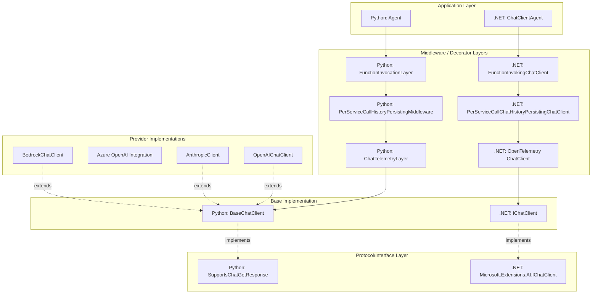
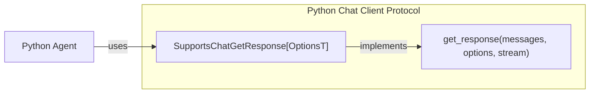
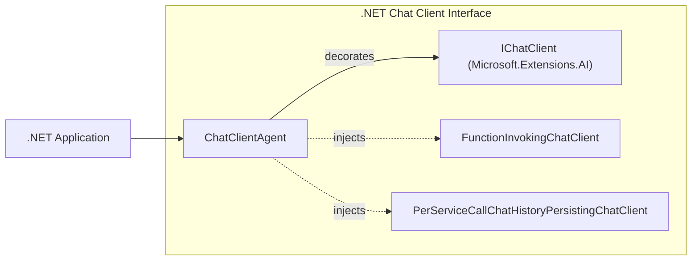
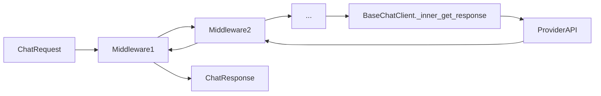

<!-- source: DeepWiki mcp.deepwiki.com · repo microsoft/agent-framework · extra page Chat Client Architecture · fetched 2026-10-26 -->

# Chat Client Architecture

<details>
<summary>Relevant source files</summary>

The following files were used as context for generating this wiki page:

- [docs/decisions/0022-chat-history-persistence-consistency.md](docs/decisions/0022-chat-history-persistence-consistency.md)
- [dotnet/samples/02-agents/Agents/Agent_Step19_InFunctionLoopCheckpointing/Program.cs](dotnet/samples/02-agents/Agents/Agent_Step19_InFunctionLoopCheckpointing/Program.cs)
- [dotnet/samples/02-agents/Agents/Agent_Step19_InFunctionLoopCheckpointing/README.md](dotnet/samples/02-agents/Agents/Agent_Step19_InFunctionLoopCheckpointing/README.md)
- [dotnet/src/Microsoft.Agents.AI.Abstractions/AdditionalPropertiesExtensions.cs](dotnet/src/Microsoft.Agents.AI.Abstractions/AdditionalPropertiesExtensions.cs)
- [dotnet/src/Microsoft.Agents.AI/ChatClient/ChatClientAgent.cs](dotnet/src/Microsoft.Agents.AI/ChatClient/ChatClientAgent.cs)
- [dotnet/src/Microsoft.Agents.AI/ChatClient/ChatClientAgentContinuationToken.cs](dotnet/src/Microsoft.Agents.AI/ChatClient/ChatClientAgentContinuationToken.cs)
- [dotnet/src/Microsoft.Agents.AI/ChatClient/ChatClientAgentLogMessages.cs](dotnet/src/Microsoft.Agents.AI/ChatClient/ChatClientAgentLogMessages.cs)
- [dotnet/src/Microsoft.Agents.AI/ChatClient/ChatClientAgentOptions.cs](dotnet/src/Microsoft.Agents.AI/ChatClient/ChatClientAgentOptions.cs)
- [dotnet/src/Microsoft.Agents.AI/ChatClient/ChatClientBuilderExtensions.cs](dotnet/src/Microsoft.Agents.AI/ChatClient/ChatClientBuilderExtensions.cs)
- [dotnet/src/Microsoft.Agents.AI/ChatClient/ChatClientExtensions.cs](dotnet/src/Microsoft.Agents.AI/ChatClient/ChatClientExtensions.cs)
- [dotnet/tests/Microsoft.Agents.AI.Abstractions.UnitTests/AdditionalPropertiesExtensionsTests.cs](dotnet/tests/Microsoft.Agents.AI.Abstractions.UnitTests/AdditionalPropertiesExtensionsTests.cs)
- [dotnet/tests/Microsoft.Agents.AI.UnitTests/ChatClient/ChatClientAgentContinuationTokenTests.cs](dotnet/tests/Microsoft.Agents.AI.UnitTests/ChatClient/ChatClientAgentContinuationTokenTests.cs)
- [dotnet/tests/Microsoft.Agents.AI.UnitTests/ChatClient/ChatClientAgentOptionsTests.cs](dotnet/tests/Microsoft.Agents.AI.UnitTests/ChatClient/ChatClientAgentOptionsTests.cs)
- [dotnet/tests/Microsoft.Agents.AI.UnitTests/ChatClient/ChatClientAgentTestHelper.cs](dotnet/tests/Microsoft.Agents.AI.UnitTests/ChatClient/ChatClientAgentTestHelper.cs)
- [dotnet/tests/Microsoft.Agents.AI.UnitTests/ChatClient/ChatClientAgentTests.cs](dotnet/tests/Microsoft.Agents.AI.UnitTests/ChatClient/ChatClientAgentTests.cs)
- [dotnet/tests/Microsoft.Agents.AI.UnitTests/ChatClient/ChatClientAgent_ApprovalsTests.cs](dotnet/tests/Microsoft.Agents.AI.UnitTests/ChatClient/ChatClientAgent_ApprovalsTests.cs)
- [dotnet/tests/Microsoft.Agents.AI.UnitTests/ChatClient/ChatClientAgent_BackgroundResponsesTests.cs](dotnet/tests/Microsoft.Agents.AI.UnitTests/ChatClient/ChatClientAgent_BackgroundResponsesTests.cs)
- [dotnet/tests/Microsoft.Agents.AI.UnitTests/ChatClient/ChatClientAgent_ChatHistoryManagementTests.cs](dotnet/tests/Microsoft.Agents.AI.UnitTests/ChatClient/ChatClientAgent_ChatHistoryManagementTests.cs)
- [dotnet/tests/Microsoft.Agents.AI.UnitTests/ChatClient/ChatClientAgent_ChatOptionsMergingTests.cs](dotnet/tests/Microsoft.Agents.AI.UnitTests/ChatClient/ChatClientAgent_ChatOptionsMergingTests.cs)
- [dotnet/tests/Microsoft.Agents.AI.UnitTests/ChatClient/ChatClientBuilderExtensionsTests.cs](dotnet/tests/Microsoft.Agents.AI.UnitTests/ChatClient/ChatClientBuilderExtensionsTests.cs)
- [dotnet/tests/Microsoft.Agents.AI.UnitTests/ChatClient/ChatClientExtensionsTests.cs](dotnet/tests/Microsoft.Agents.AI.UnitTests/ChatClient/ChatClientExtensionsTests.cs)
- [python/packages/core/agent_framework/_feature_stage.py](python/packages/core/agent_framework/_feature_stage.py)
- [python/packages/core/tests/core/test_feature_stage.py](python/packages/core/tests/core/test_feature_stage.py)
- [python/packages/foundry/README.md](python/packages/foundry/README.md)
- [python/packages/foundry/agent_framework_foundry/_agent.py](python/packages/foundry/agent_framework_foundry/_agent.py)
- [python/packages/foundry/agent_framework_foundry/_chat_client.py](python/packages/foundry/agent_framework_foundry/_chat_client.py)
- [python/packages/foundry/tests/foundry/test_foundry_agent.py](python/packages/foundry/tests/foundry/test_foundry_agent.py)
- [python/packages/foundry/tests/foundry/test_foundry_chat_client.py](python/packages/foundry/tests/foundry/test_foundry_chat_client.py)
- [python/packages/openai/agent_framework_openai/_chat_client.py](python/packages/openai/agent_framework_openai/_chat_client.py)
- [python/packages/openai/agent_framework_openai/_chat_completion_client.py](python/packages/openai/agent_framework_openai/_chat_completion_client.py)
- [python/packages/openai/tests/openai/test_openai_chat_client.py](python/packages/openai/tests/openai/test_openai_chat_client.py)
- [python/packages/openai/tests/openai/test_openai_chat_completion_client.py](python/packages/openai/tests/openai/test_openai_chat_completion_client.py)

</details>


## Purpose and Scope

This document explains the chat client architecture that forms the foundation of the Microsoft Agent Framework. Chat clients serve as the abstraction layer between the framework and Large Language Model (LLM) APIs (OpenAI, Anthropic, Azure AI, Bedrock, Gemini, etc.). They handle message formatting, request/response processing, streaming, and provider-specific protocol translation.

The architecture is designed to be highly extensible via a middleware layering pattern, allowing features like tool calling, history persistence, and telemetry to be injected into the communication pipeline without modifying the core provider implementations.

---

## Architecture Overview

The chat client architecture follows a layered pattern where each layer adds specific functionality while maintaining a consistent interface. In .NET, this is built upon the `Microsoft.Extensions.AI` abstractions, while Python uses a protocol-based design.

**Chat Client Component Stack**



**Sources:**  
- [dotnet/src/Microsoft.Agents.AI/ChatClient/ChatClientAgent.cs:18-37]()  
- [python/packages/core/agent_framework/_clients.py:20-40]()  
- [python/packages/anthropic/agent_framework_anthropic/_chat_client.py:10-32]()  

---

## Chat Client Protocol (Python) and Interface (.NET)

### Python: `SupportsChatGetResponse` Protocol

The `SupportsChatGetResponse` protocol in Python defines the essential interface that all chat clients must implement. It is generic over a type parameter for options to allow provider-specific settings.

The key method:

- `get_response(messages: list[Message], *, options: OptionsT | None = None, stream: bool = False) -> ChatResponse | ResponseStream`  
  Supports both streaming and non-streaming chat completions.

Any class with this method signature can be used as a chat client in the framework, enabling polymorphism based on structural typing.



**Sources:**  
- [python/packages/core/agent_framework/_clients.py:20-35]()  
- [python/packages/core/agent_framework/_agents.py:170-180]()  

### .NET: `IChatClient` Interface

In .NET, chat clients implement the standard interface `Microsoft.Extensions.AI.IChatClient`. The class `ChatClientAgent` wraps any such instance, layering additional behaviors like middleware.

Key points:

- `ChatClientAgent` applies default decorators such as `FunctionInvokingChatClient` to handle function/tool invocation lifecycle unless the user opts out.  
- An optional `PerServiceCallChatHistoryPersistingChatClient` decorator persists chat history after each conversation turn.  

This approach allows seamless extensibility while keeping a consistent backing chat client instance.



**Sources:**  
- [dotnet/src/Microsoft.Agents.AI/ChatClient/ChatClientAgent.cs:18-71]()  
- [dotnet/src/Microsoft.Agents.AI/ChatClient/ChatClientAgent.cs:82-130]()  

---

## Base Chat Client Implementation (Python)

`BaseChatClient` is the foundational Python implementation that supports the `SupportsChatGetResponse` protocol. It provides the plumbing for sending chat requests and receiving responses (streaming or non-streaming). Concrete chat clients for various providers extend it.

### Responsibilities

- Implements `get_response` as an async method routing chat requests through middleware layers.
- Defines an internal method `_inner_get_response` for subclasses to override with actual API calls.
- Manages a middleware pipeline as a chain of callables, allowing layered behaviors.
- Handles request/response transformations and error mapping.

### Data Flow in Python BaseChatClient

```mermaid
flowchart TD
    User["Agent/Caller"] --> GR[get_response(messages, options, stream)]
    GR --> MW[_middleware_pipeline (middlewares chain)]
    MW --> IGR[_inner_get_response(messages, options)]
    IGR --> API["Provider API Call (OpenAI, Anthropic, etc.)"]
    
    API --> Response["ChatResponse / ResponseStream"]
    Response --> MW
    MW --> GR
    GR --> User
```

Concrete providers (e.g., `OpenAIChatClient`) override `_inner_get_response` to call their specific APIs after middleware processing.

**Sources:**  
- [python/packages/core/agent_framework/_clients.py:10-40]()  
- [python/packages/openai/agent_framework_openai/_chat_client.py:30-50]()  
- [python/packages/anthropic/agent_framework_anthropic/_chat_client.py:10-30]()  

---

## Middleware and Layering Pattern

The chat client architecture employs middleware layers to enable cross-cutting features without changing core client logic.

### .NET Middleware Layers

Middleware layers are implemented by wrapping `IChatClient` implementations within decorator classes:

- **FunctionInvokingChatClient**: Manages function/tool invocation loops, handling approval, execution, and response chaining.  
- **PerServiceCallChatHistoryPersistingChatClient**: Persists and reloads chat history at each service call during the agent run.  
- **Telemetry Layers**: Wrap clients to instrument OpenTelemetry tracing and metrics.

These layers compose into a call chain so that requests flow down through layers to the raw client and responses flow back up.

### Python Middleware Layers

Python implements middleware as classes conforming to interfaces such as `ChatMiddlewareLayer` and `FunctionInvocationLayer`. Middleware intercepts the chat interaction lifecycle and can inject or modify messages, responses, or function calls.

| Layer Type              | Role / Description                                                                              |
|-------------------------|------------------------------------------------------------------------------------------------|
| **ChatTelemetryLayer**   | Adds OpenTelemetry tracing and metrics to chat calls.                                          |
| **FunctionInvocationLayer** | Handles lifecycle of function/tool invocation, including approvals and streaming results.   |
| **ChatMiddlewareLayer**  | Base abstraction for chat middleware that can modify messages or responses in the pipeline.    |

Middleware pipelines are constructed in a specific order to ensure correct interaction between features and allow injection or override.



This pattern enables extensibility and clean separation of concerns.

**Sources:**  
- [python/packages/core/agent_framework/_middleware.py:10-60]()  
- [python/packages/core/agent_framework/observability.py:50-110]()  
- [dotnet/src/Microsoft.Agents.AI/ChatClient/ChatClientAgent.cs:80-130]()  

---

## Configuration and Options

### `ChatClientAgentOptions` (.NET)

The `ChatClientAgentOptions` class configures the chat client agent's behavior:

- **Id, Name, Description**: Metadata for the agent instance.  
- **ChatOptions**: Default chat options including instructions and tools.  
- **ChatHistoryProvider**: Specifies the provider for chat history persistence.  
- **AIContextProviders**: Providers to inject dynamic context into agent runs.  
- **UseProvidedChatClientAsIs**: Whether to skip default middleware decoration on the provided chat client.  
- **AllowConcurrentInvocation**: Allows concurrent execution of multiple function calls in a single LLM response.  
- **ClearOnChatHistoryProviderConflict**, **WarnOnChatHistoryProviderConflict**, **ThrowOnChatHistoryProviderConflict**: Policies when the AI service manages chat history conflicting with configured providers.  
- **PersistChatHistoryPerCall**: Enables persisting chat history after every individual service call during function invocation loops.

These options enable fine control over the agent’s chat client configuration and lifecycle.

### Python Options Merging

In Python, merging chat options follows a layered approach via a `_merge_options` function:

- **Instructions**: Concatenated preserving leading/trailing newline for structured prompts.  
- **Tools**: Combined with duplicates removed by tool name.  
- **Logit Bias, Metadata**: Merged dictionaries with override precedence.  
- **Other fields**: Overridden unless `None`.

This ensures that default options provided to an agent can be merged sensibly with per-run overrides.

**Sources:**  
- [dotnet/src/Microsoft.Agents.AI/ChatClient/ChatClientAgentOptions.cs:10-105]()  
- [dotnet/src/Microsoft.Agents.AI/ChatClient/ChatClientAgent.cs:115-130]()  
- [python/packages/core/agent_framework/_agents.py:120-165]()  
- [python/packages/anthropic/agent_framework_anthropic/_chat_client.py:185-194]()  

---

## Summary

The Chat Client Architecture in Microsoft Agent Framework provides a robust, layered abstraction over multiple AI providers, enabling consistent, extensible, and maintainable integration. It uses clean separation via protocols (Python) or interfaces (C#), supported by middleware layers to inject features like function invocation, history persistence, and telemetry. This design empowers developers to build advanced conversational AI agents with flexibility and observability across language boundaries.

---

**Sources:**  
- [dotnet/src/Microsoft.Agents.AI/ChatClient/ChatClientAgent.cs:1-130]()  
- [dotnet/src/Microsoft.Agents.AI/ChatClient/ChatClientAgentOptions.cs:10-105]()  
- [python/packages/core/agent_framework/_clients.py:1-40]()  
- [python/packages/core/agent_framework/_agents.py:110-179]()  
- [python/packages/core/agent_framework/_middleware.py:1-80]()  
- [python/packages/anthropic/agent_framework_anthropic/_chat_client.py:1-180]()  
- [python/packages/core/agent_framework/observability.py:1-217]()

---

