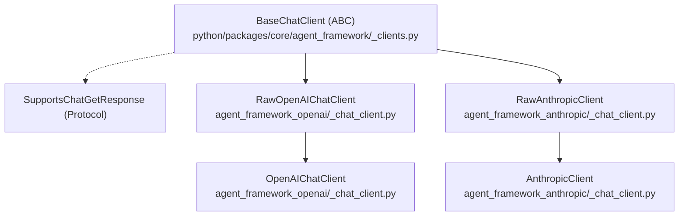
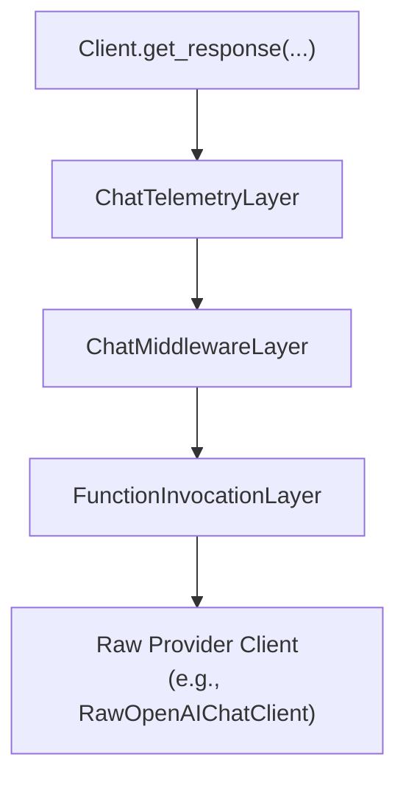
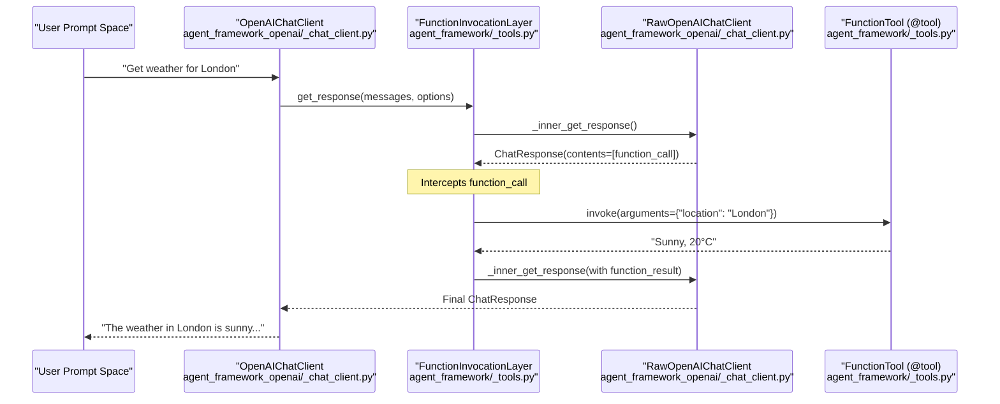
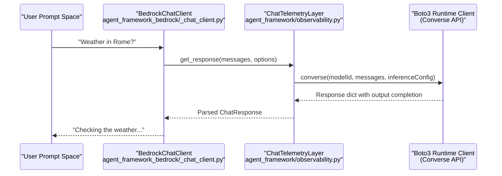
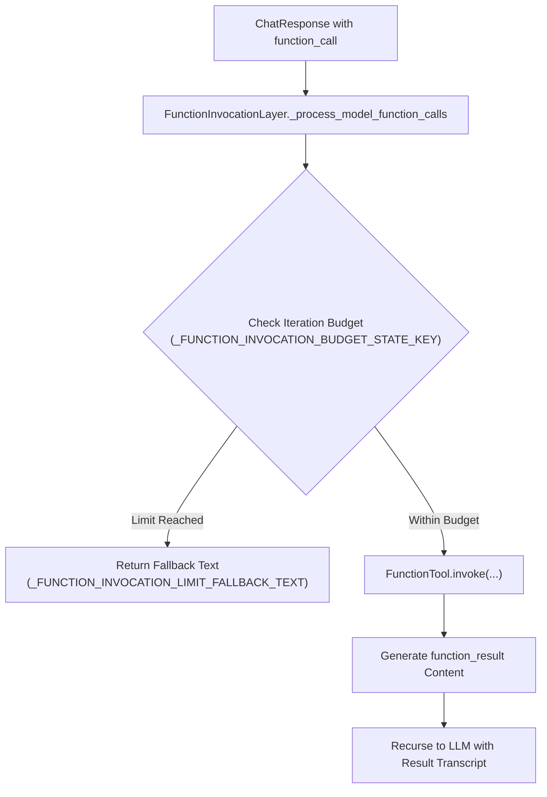

<!-- source: DeepWiki mcp.deepwiki.com · repo microsoft/agent-framework · extra page Chat Client Implementations · fetched 2026-10-26 -->

# Chat Client Implementations

Relevant source files

The following files were used as context for generating this wiki page:

- [python/packages/anthropic/agent_framework_anthropic/_chat_client.py](python/packages/anthropic/agent_framework_anthropic/_chat_client.py)
- [python/packages/anthropic/tests/test_anthropic_client.py](python/packages/anthropic/tests/test_anthropic_client.py)
- [python/packages/bedrock/agent_framework_bedrock/_chat_client.py](python/packages/bedrock/agent_framework_bedrock/_chat_client.py)
- [python/packages/bedrock/tests/test_bedrock_client.py](python/packages/bedrock/tests/test_bedrock_client.py)
- [python/packages/bedrock/tests/test_bedrock_settings.py](python/packages/bedrock/tests/test_bedrock_settings.py)
- [python/packages/bedrock/tests/test_bedrock_structured_output.py](python/packages/bedrock/tests/test_bedrock_structured_output.py)
- [python/packages/core/agent_framework/_feature_stage.py](python/packages/core/agent_framework/_feature_stage.py)
- [python/packages/core/tests/core/test_feature_stage.py](python/packages/core/tests/core/test_feature_stage.py)
- [python/packages/foundry/README.md](python/packages/foundry/README.md)
- [python/packages/foundry/agent_framework_foundry/_agent.py](python/packages/foundry/agent_framework_foundry/_agent.py)
- [python/packages/foundry/agent_framework_foundry/_chat_client.py](python/packages/foundry/agent_framework_foundry/_chat_client.py)
- [python/packages/foundry/tests/foundry/test_foundry_agent.py](python/packages/foundry/tests/foundry/test_foundry_agent.py)
- [python/packages/foundry/tests/foundry/test_foundry_chat_client.py](python/packages/foundry/tests/foundry/test_foundry_chat_client.py)
- [python/packages/gemini/AGENTS.md](python/packages/gemini/AGENTS.md)
- [python/packages/gemini/README.md](python/packages/gemini/README.md)
- [python/packages/gemini/agent_framework_gemini/__init__.py](python/packages/gemini/agent_framework_gemini/__init__.py)
- [python/packages/gemini/agent_framework_gemini/_chat_client.py](python/packages/gemini/agent_framework_gemini/_chat_client.py)
- [python/packages/gemini/tests/test_gemini_client.py](python/packages/gemini/tests/test_gemini_client.py)
- [python/packages/ollama/agent_framework_ollama/_chat_client.py](python/packages/ollama/agent_framework_ollama/_chat_client.py)
- [python/packages/ollama/tests/test_ollama_chat_client.py](python/packages/ollama/tests/test_ollama_chat_client.py)
- [python/packages/openai/agent_framework_openai/_chat_client.py](python/packages/openai/agent_framework_openai/_chat_client.py)
- [python/packages/openai/agent_framework_openai/_chat_completion_client.py](python/packages/openai/agent_framework_openai/_chat_completion_client.py)
- [python/packages/openai/tests/openai/test_openai_chat_client.py](python/packages/openai/tests/openai/test_openai_chat_client.py)
- [python/packages/openai/tests/openai/test_openai_chat_completion_client.py](python/packages/openai/tests/openai/test_openai_chat_completion_client.py)
- [python/packages/orchestrations/agent_framework_orchestrations/_participant_output_config.py](python/packages/orchestrations/agent_framework_orchestrations/_participant_output_config.py)

This page details the implementation architecture for chat clients within the Python `agent-framework`. It covers the protocol-based design, base abstractions (`BaseChatClient` and `SupportsChatGetResponse`), concrete provider implementations (OpenAI, Azure, Anthropic, Bedrock, Gemini, Foundry), and the composable middleware layering architecture governing features like tool execution and telemetry.

## Purpose and Scope

Chat clients form the foundational communication layer between the `agent-framework` and underlying large language model (LLM) backends. The framework decouples raw provider integrations from cross-cutting concerns (such as function calling, telemetry, and message normalization) through a protocol-based design and a composable middleware pipeline.

Sources:
- [python/packages/core/agent_framework/_clients.py:1-40]()
- [python/packages/openai/agent_framework_openai/_chat_client.py:33-76]()

---

## 1. Protocol-Based Design and BaseChatClient

The framework defines chat client capabilities using structural typing (protocols) alongside concrete base classes [python/packages/core/agent_framework/_clients.py:1-40](). 

- **`SupportsChatGetResponse`**: A protocol defining the standard asynchronous contract for generating non-streaming and streaming responses (`get_response` and `stream_response`).
- **`BaseChatClient`**: An abstract base class [python/packages/core/agent_framework/_clients.py:27-27]() that implements foundational logic, error handling hooks, and middleware composition mechanisms.

### Chat Client Class Hierarchy

Sources:
- [python/packages/core/agent_framework/_clients.py:1-40]()
- [python/packages/openai/agent_framework_openai/_chat_client.py:33-65]()
- [python/packages/anthropic/agent_framework_anthropic/_chat_client.py:12-95]()

---

## 2. Middleware Architecture Stack

To avoid mixing provider-specific network calls with operational concerns, clients compose a standard middleware stack [python/packages/openai/agent_framework_openai/_chat_client.py:145-155](). The middleware wraps raw clients in a predictable order:

| Middleware Layer | Module / Class | Functionality |
| :--- | :--- | :--- |
| **Telemetry Layer** | `ChatTelemetryLayer` [python/packages/core/agent_framework/observability.py:96-96]() | Captures OpenTelemetry traces, token usage histograms, and structured event logs. |
| **Function Invocation Layer** | `FunctionInvocationLayer` [python/packages/core/agent_framework/_tools.py:47-47]() | Manages the tool-calling loop, budget enforcement, tool error handling, and approval checkpoints. |
| **Custom Middleware Layer** | `ChatMiddlewareLayer` [python/packages/core/agent_framework/_middleware.py:41-41]() | Permits developers to inject custom request/response interception logic. |

Sources:
- [python/packages/core/agent_framework/_clients.py:1-40]()
- [python/packages/core/agent_framework/_middleware.py:41-55]()
- [python/packages/core/agent_framework/_tools.py:47-60]()
- [python/packages/core/agent_framework/observability.py:96-105]()

---

## 3. OpenAI and Azure OpenAI Implementations

The `agent_framework_openai` package provides `RawOpenAIChatClient` for direct SDK interaction and `OpenAIChatClient` for the fully wrapped agent experience [python/packages/openai/agent_framework_openai/_chat_client.py:62-65]().

- **Responses API**: Integrates with OpenAI's newer Responses API supporting advanced parameters, reasoning models (`gpt-5`, `o-series`), and structured outputs (`ResponseModelT`) [python/packages/openai/agent_framework_openai/_chat_client.py:180-210]().
- **Hosted Tools**: Implements native bindings for provider-hosted tools such as `CodeInterpreter`, `FileSearch`, `WebSearch`, and `ImageGeneration` [python/packages/openai/agent_framework_openai/_chat_client.py:87-111]().
- **Azure OpenAI**: Supports `AsyncAzureOpenAI` via service endpoint configuration, token credential providers, and API version management [python/packages/openai/agent_framework_openai/_chat_client.py:80-82]() [python/packages/openai/agent_framework_openai/_shared.py:115-121]().

### Natural Language to Code Entity Space: OpenAI Tool Invocation

The following diagram bridges natural language input to code entities during a multi-turn tool invocation loop:

Sources:
- [python/packages/openai/agent_framework_openai/_chat_client.py:60-120]()
- [python/packages/core/agent_framework/_tools.py:45-100]()

---

## 4. Anthropic Implementation

The `agent_framework_anthropic` package provides `AnthropicClient` and `RawAnthropicClient` [python/packages/anthropic/agent_framework_anthropic/_chat_client.py:88-92]().

- **Option Translation**: Translates standard `ChatOptions` to Anthropic Messages API parameters (e.g., `stop` maps to `stop_sequences`, `instructions` maps to `system`) [python/packages/anthropic/agent_framework_anthropic/_chat_client.py:142-168]().
- **Extended Thinking**: Supports Claude's extended thinking via `ThinkingConfig`, enforcing a minimum token budget of 1,024 [python/packages/anthropic/agent_framework_anthropic/_chat_client.py:124-140]().
- **Beta Headers**: Automatically manages beta feature flags such as `mcp-client-2025-04-04` [python/packages/anthropic/agent_framework_anthropic/_chat_client.py:98-99]().

Sources:
- [python/packages/anthropic/agent_framework_anthropic/_chat_client.py:77-183]()

---

## 5. Additional Provider Implementations (Bedrock, Gemini, Foundry)

The framework supports multiple additional cloud and local model providers via modular packages:

- **Amazon Bedrock**: `BedrockChatClient` in `agent_framework_bedrock` wraps AWS Bedrock's unified Converse API supporting Bedrock guardrails (`BedrockGuardrailConfig`) and structured outputs [python/packages/bedrock/agent_framework_bedrock/_chat_client.py:19-178]().
- **Google Gemini**: `GeminiChatClient` in `agent_framework_gemini` interfaces with Google's GenAI SDK and Vertex AI, supporting thinking signatures and multimodal generation.
- **Microsoft Foundry**: `FoundryChatClient` and `RawFoundryChatClient` in `agent_framework_foundry` integrate with Azure AI Foundry project endpoints and managed agents via the Responses API [python/packages/foundry/agent_framework_foundry/_chat_client.py:151-172]().

### Natural Language to Code Entity Space: Bedrock Converse Flow

The following diagram maps natural language requests to Amazon Bedrock chat client entities:

Sources:
- [python/packages/bedrock/agent_framework_bedrock/_chat_client.py:19-45]()
- [python/packages/bedrock/tests/test_bedrock_client.py:80-104]()

---

## 6. Function-Calling Loop & Tool Execution

When an LLM response contains a tool call, the `FunctionInvocationLayer` intercepts execution to run local functions or handle hosted tool flows [docs/specs/004-python-function-calling-loop.md:64-123]().

### Local Tool Execution Lifecycle

Sources:
- [python/packages/core/agent_framework/_tools.py:100-135]()
- [docs/specs/004-python-function-calling-loop.md:64-123]()

---

