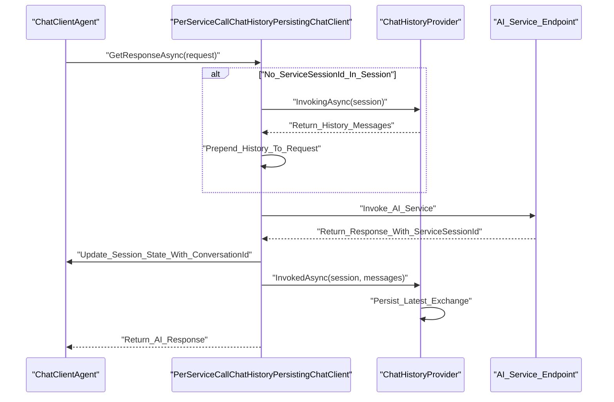

<!-- source: DeepWiki mcp.deepwiki.com · repo microsoft/agent-framework · extra page Chat History Providers · fetched 2026-10-26 -->

# Chat History Providers

<details>
<summary>Relevant source files</summary>

The following files were used as context for generating this wiki page:

- [dotnet/src/Microsoft.Agents.AI.CosmosNoSql/CosmosChatHistoryProvider.cs](dotnet/src/Microsoft.Agents.AI.CosmosNoSql/CosmosChatHistoryProvider.cs)
- [dotnet/src/Microsoft.Agents.AI.CosmosNoSql/CosmosCheckpointStore.cs](dotnet/src/Microsoft.Agents.AI.CosmosNoSql/CosmosCheckpointStore.cs)
- [dotnet/src/Microsoft.Agents.AI.CosmosNoSql/CosmosDBChatExtensions.cs](dotnet/src/Microsoft.Agents.AI.CosmosNoSql/CosmosDBChatExtensions.cs)
- [dotnet/src/Microsoft.Agents.AI.CosmosNoSql/CosmosDBWorkflowExtensions.cs](dotnet/src/Microsoft.Agents.AI.CosmosNoSql/CosmosDBWorkflowExtensions.cs)
- [dotnet/src/Microsoft.Agents.AI.CosmosNoSql/CosmosOptionsHelper.cs](dotnet/src/Microsoft.Agents.AI.CosmosNoSql/CosmosOptionsHelper.cs)
- [dotnet/src/Microsoft.Agents.AI.CosmosNoSql/Microsoft.Agents.AI.CosmosNoSql.csproj](dotnet/src/Microsoft.Agents.AI.CosmosNoSql/Microsoft.Agents.AI.CosmosNoSql.csproj)
- [dotnet/tests/Microsoft.Agents.AI.Abstractions.UnitTests/AIContextProviderTests.cs](dotnet/tests/Microsoft.Agents.AI.Abstractions.UnitTests/AIContextProviderTests.cs)
- [dotnet/tests/Microsoft.Agents.AI.Abstractions.UnitTests/ChatHistoryProviderTests.cs](dotnet/tests/Microsoft.Agents.AI.Abstractions.UnitTests/ChatHistoryProviderTests.cs)
- [dotnet/tests/Microsoft.Agents.AI.Abstractions.UnitTests/InMemoryChatHistoryProviderTests.cs](dotnet/tests/Microsoft.Agents.AI.Abstractions.UnitTests/InMemoryChatHistoryProviderTests.cs)
- [dotnet/tests/Microsoft.Agents.AI.CosmosNoSql.UnitTests/.editorconfig](dotnet/tests/Microsoft.Agents.AI.CosmosNoSql.UnitTests/.editorconfig)
- [dotnet/tests/Microsoft.Agents.AI.CosmosNoSql.UnitTests/CosmosChatHistoryProviderMaxBatchSizeTests.cs](dotnet/tests/Microsoft.Agents.AI.CosmosNoSql.UnitTests/CosmosChatHistoryProviderMaxBatchSizeTests.cs)
- [dotnet/tests/Microsoft.Agents.AI.CosmosNoSql.UnitTests/CosmosChatHistoryProviderTests.cs](dotnet/tests/Microsoft.Agents.AI.CosmosNoSql.UnitTests/CosmosChatHistoryProviderTests.cs)
- [dotnet/tests/Microsoft.Agents.AI.CosmosNoSql.UnitTests/CosmosCheckpointStoreTests.cs](dotnet/tests/Microsoft.Agents.AI.CosmosNoSql.UnitTests/CosmosCheckpointStoreTests.cs)
- [dotnet/tests/Microsoft.Agents.AI.CosmosNoSql.UnitTests/CosmosOptionsHelperTests.cs](dotnet/tests/Microsoft.Agents.AI.CosmosNoSql.UnitTests/CosmosOptionsHelperTests.cs)
- [dotnet/tests/Microsoft.Agents.AI.CosmosNoSql.UnitTests/Microsoft.Agents.AI.CosmosNoSql.UnitTests.csproj](dotnet/tests/Microsoft.Agents.AI.CosmosNoSql.UnitTests/Microsoft.Agents.AI.CosmosNoSql.UnitTests.csproj)
- [python/packages/core/agent_framework/_sessions.py](python/packages/core/agent_framework/_sessions.py)
- [python/packages/core/tests/core/test_sessions.py](python/packages/core/tests/core/test_sessions.py)
- [python/packages/mem0/README.md](python/packages/mem0/README.md)
- [python/packages/mem0/agent_framework_mem0/__init__.py](python/packages/mem0/agent_framework_mem0/__init__.py)
- [python/packages/mem0/agent_framework_mem0/_context_provider.py](python/packages/mem0/agent_framework_mem0/_context_provider.py)
- [python/packages/mem0/tests/test_mem0_context_provider.py](python/packages/mem0/tests/test_mem0_context_provider.py)
- [python/packages/redis/AGENTS.md](python/packages/redis/AGENTS.md)
- [python/packages/redis/README.md](python/packages/redis/README.md)
- [python/packages/redis/agent_framework_redis/_context_provider.py](python/packages/redis/agent_framework_redis/_context_provider.py)
- [python/packages/redis/agent_framework_redis/_history_provider.py](python/packages/redis/agent_framework_redis/_history_provider.py)
- [python/packages/redis/tests/test_context_provider_edges.py](python/packages/redis/tests/test_context_provider_edges.py)
- [python/packages/redis/tests/test_providers.py](python/packages/redis/tests/test_providers.py)
- [python/samples/02-agents/conversations/redis_history_provider.py](python/samples/02-agents/conversations/redis_history_provider.py)

</details>


## Purpose and Scope

This document explains the **Chat History Provider** system in the Microsoft Agent Framework, which manages conversation history for agents. Chat history providers abstract the storage and retrieval of conversation messages, supporting both client-side (local) and server-side (service-managed) history management.

For information about context enrichment beyond message history, see [Context Providers](3.4.2). For session state management, see [Agent Sessions and State](3.4.1). For memory services that provide semantic memory storage, see [Memory Services Integration](3.4.4).

Sources: [dotnet/src/Microsoft.Agents.AI.Abstractions/ChatHistoryProvider.cs:16-32]()

---

## Overview

The chat history provider system enables agents to maintain conversation context across multiple interactions. The framework supports two distinct approaches:

1.  **Client-Side History Management**: Messages are stored locally using implementations like `InMemoryChatHistoryProvider` (.NET) or `InMemoryHistoryProvider` (Python).
2.  **Server-Side History Management**: The AI service manages history using a `conversation_id` or `ServiceSessionId` returned in responses.

These approaches are managed through `ChatHistoryProvider` (.NET) / `HistoryProvider` (Python) and specialized middleware to ensure consistency during complex tool-calling loops.

Sources: [dotnet/src/Microsoft.Agents.AI.Abstractions/ChatHistoryProvider.cs:16-32](), [dotnet/src/Microsoft.Agents.AI/ChatClient/PerServiceCallChatHistoryPersistingChatClient.cs:17-46]()

---

## Architecture Overview

### Chat History System Components

The following diagram illustrates how the `ChatClientAgent` (.NET) or `Agent` (Python) interacts with history providers and sessions, bridging the natural language interaction space with concrete code entities.

```mermaid
graph TB
    subgraph "Natural_Language_Space"
        UserMsg["User_Input_Message"]
        AgentResp["Agent_Response_Output"]
    end

    subgraph "Code_Entity_Space"
        AgentEntity["ChatClientAgent / Agent"]
        Session["AgentSession"]
        StateBag["StateBag"]
        BaseProvider["ChatHistoryProvider / HistoryProvider"]
        InMemory["InMemoryChatHistoryProvider"]
        Cosmos["CosmosChatHistoryProvider"]
        Redis["RedisHistoryProvider"]
        Invoking["InvokingAsync / before_run"]
        Invoked["InvokedAsync / after_run"]
        ConvId["ServiceSessionId / conversation_id"]
        PerCallPersist["PerServiceCallChatHistoryPersistingChatClient"]
    end
    
    UserMsg --> AgentEntity
    AgentEntity -->|"manages"| BaseProvider
    AgentEntity -->|"uses"| Session
    Session -->|"contains"| StateBag
    
    BaseProvider -->|"implemented_by"| InMemory
    BaseProvider -->|"implemented_by"| Cosmos
    BaseProvider -->|"implemented_by"| Redis
    
    BaseProvider -->|"executes"| Invoking
    BaseProvider -->|"executes"| Invoked
    
    InMemory -->|"persists_to"| StateBag
    Cosmos -->|"persists_to"| "CosmosChatHistoryProvider.cs"
    Redis -->|"persists_to"| "_history_provider.py"
    
    PerCallPersist -->|"updates"| ConvId
    PerCallPersist -->|"interacts_with"| BaseProvider
    AgentResp --> PerCallPersist
```

Sources: [dotnet/src/Microsoft.Agents.AI.Abstractions/ChatHistoryProvider.cs:51-56](), [dotnet/src/Microsoft.Agents.AI.CosmosNoSql/CosmosChatHistoryProvider.cs:41-45](), [python/packages/redis/agent_framework_redis/_history_provider.py:53-60]()

---

## Chat History Provider Base Classes

### .NET: ChatHistoryProvider

The `ChatHistoryProvider` is an abstract base class defining the interface and lifecycle for chat history operations. It provides hooks for:

- Retrieving chat history (`InvokingAsync`) before sending requests to the AI service.
- Storing new messages (`InvokedAsync`) after receiving responses.

Providers can supply filters to control what messages are fetched or stored (`ProvideOutputMessageFilter`, `StoreInputRequestMessageFilter`, `StoreInputResponseMessageFilter`). `StateKeys` identifies keys to isolate provider state within the shared `AgentSession.StateBag`.

### Python: HistoryProvider

The Python `HistoryProvider` implements a similar hooks pattern for retrieving and saving chat messages according to the `before_run` and `after_run` lifecycle hooks, aligning conceptually with `ChatHistoryProvider` in .NET.

Sources: [dotnet/src/Microsoft.Agents.AI.Abstractions/ChatHistoryProvider.cs:51-112](), [python/packages/core/agent_framework/_sessions.py:8-14]()

---

## Implementations

### InMemoryChatHistoryProvider

This provider stores chat messages **in-memory** within the current `AgentSession`'s `StateBag`. It persists messages across a conversation in-memory but does not provide durable persistence beyond the lifetime of the application instance.

- Supports an optional reducer mechanism to manage context size by trimming or summarizing.
- Uses the session's serialization mechanism to preserve message state during serialization, allowing long-running conversations with full message history fidelity.

### CosmosChatHistoryProvider

Stores conversation messages in **Azure Cosmos DB** for durable, scalable, and highly available persistence.

- Allows configuration of the partition key schema:
  - Simple partition key (e.g., `/conversationId`) for straightforward scenarios.
  - Hierarchical partition keys (`/tenantId`, `/userId`, `/sessionId`) for multi-tenant and user isolation.
- The property `MessageTtlSeconds` can automatically expire chat messages after a configured retention window.
- Supports `MaxMessagesToRetrieve` to limit how many messages are fetched to avoid exceeding LLM context windows, and `MaxItemCount` to tune query batch sizes.

### RedisHistoryProvider

Stores conversation history in **Redis Lists**, with each session isolated by a scoped key structure combining application ID, tenant ID, agent ID, provider source, and session ID.

- Supports scoped keys by default to prevent cross-tenant/cross-application data leakage.
- Offers `MaxMessages` configuration for automatic trimming of old transcript messages.
- Supports borrowed standalone `redis.asyncio.Redis` clients configured with `decode_responses=True`.

Sources: [dotnet/src/Microsoft.Agents.AI.CosmosNoSql/CosmosChatHistoryProvider.cs:41-127](), [python/packages/redis/agent_framework_redis/_history_provider.py:53-143]()

---

## Conflict Resolution and ConversationId

When AI services manage conversation history themselves, they return a **`conversation_id`** or **`ServiceSessionId`** along with chat responses. This ID represents the authoritative session identity at the service and impacts how local history providers synchronize.

### Middleware: PerServiceCallChatHistoryPersistingChatClient

The `PerServiceCallChatHistoryPersistingChatClient` middleware mediates between the local `ChatHistoryProvider` and the service-managed conversation:

- **Before service call**: If the session has no `ConversationId`, the middleware loads the local history from the provider using `InvokingAsync` and prepends these messages to the request.
- **Receive service response**: If a valid `ConversationId` is returned, it is saved in the session's state immediately. Subsequent calls will bypass local history and use the service-managed `ConversationId`.
- **After service call**: `InvokedAsync` is called to persist the latest messages in the local provider for durability and offline access.

### Conflict Interaction Flow



Sources: [dotnet/src/Microsoft.Agents.AI/ChatClient/PerServiceCallChatHistoryPersistingChatClient.cs:28-50]()

---

## AgentSession Extensions and State Management

### ProviderSessionState<TState>

The `ProviderSessionState<TState>` class manages provider-scoped state within `AgentSession.StateBag` uniquely keyed to avoid collisions.

Key features:
- **State Isolation**: Each provider uses either a configured or default `StateKey` for its stored state dictionary.
- **Lazy Initialization**: State is initialized only on first access, using a provided initializer delegate.

### Message Filtering

`ChatHistoryProvider` supports message filtering delegates to control storage and retrieval of chat messages:

| Filter Name | Purpose | Application Stage |
| --- | --- | --- |
| `ProvideOutputMessageFilter` | Filter messages on retrieval (outbound history) | Before returning history messages |
| `StoreInputRequestMessageFilter` | Filter request messages before storing | Before persisting request messages |
| `StoreInputResponseMessageFilter` | Filter response messages before storing | Before persisting response messages |

Sources: [dotnet/src/Microsoft.Agents.AI.Abstractions/ChatHistoryProvider.cs:65-77]()

---

## Summary Table of Key Classes and Roles

| Class / Component | Language | Role | Data Flow / Persistence |
| --- | --- | --- | --- |
| `ChatHistoryProvider` | .NET | Abstract base for chat history management | Defines history lifecycle, message filters |
| `InMemoryChatHistoryProvider` | .NET | Stores history in `AgentSession.StateBag` | Immediate in-memory persistence |
| `CosmosChatHistoryProvider` | .NET | Durable history using Azure Cosmos DB | Persists messages partitioned by conversation or hierarchies |
| `RedisHistoryProvider` | Python | Redis-backed persistent history provider | Stores message history in Redis Lists, scoped by keys |
| `PerServiceCallChatHistoryPersistingChatClient` | .NET | Middleware resolving service-managed `ConversationId` conflicts | Intercepts and merges local and service history |
| `ProviderSessionState<TState>` | .NET | Wrapper for provider-specific session state in `StateBag` | Manages isolated state with lazy initialization |

Sources: [dotnet/src/Microsoft.Agents.AI.Abstractions/ChatHistoryProvider.cs:16-112](), [dotnet/src/Microsoft.Agents.AI.CosmosNoSql/CosmosChatHistoryProvider.cs:41-137](), [python/packages/redis/agent_framework_redis/_history_provider.py:44-143]()

---

