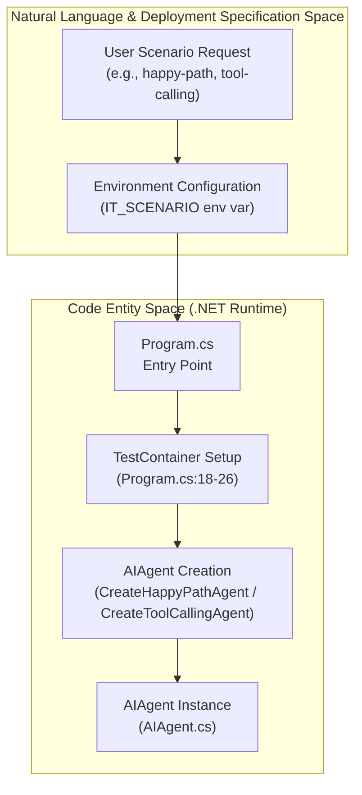
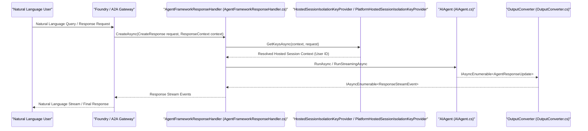

<!-- source: DeepWiki mcp.deepwiki.com · repo microsoft/agent-framework · extra page Containerized Deployment · fetched 2026-10-26 -->

# Containerized Deployment

Relevant source files

The following files were used as context for generating this wiki page:

- [.github/dependabot.yml](.github/dependabot.yml)
- [.github/labeler.yml](.github/labeler.yml)
- [.github/pull_request_template.md](.github/pull_request_template.md)
- [.github/scripts/title_prefix.js](.github/scripts/title_prefix.js)
- [.github/workflows/merge-gatekeeper.yml](.github/workflows/merge-gatekeeper.yml)
- [dotnet/samples/02-agents/AgentWithMemory/AgentWithMemory_Step06_MemoryUsingAgentMemory/AgentWithMemory_Step06_MemoryUsingAgentMemory.csproj](dotnet/samples/02-agents/AgentWithMemory/AgentWithMemory_Step06_MemoryUsingAgentMemory/AgentWithMemory_Step06_MemoryUsingAgentMemory.csproj)
- [dotnet/samples/02-agents/AgentWithRAG/AgentWithRAG_Step05_Neo4jGraphRAG/AgentWithRAG_Step05_Neo4jGraphRAG.csproj](dotnet/samples/02-agents/AgentWithRAG/AgentWithRAG_Step05_Neo4jGraphRAG/AgentWithRAG_Step05_Neo4jGraphRAG.csproj)
- [dotnet/samples/04-hosting/FoundryHostedAgents/invocations/Hosted-Invocations-EchoAgent/Hosted-Invocations-EchoAgent.csproj](dotnet/samples/04-hosting/FoundryHostedAgents/invocations/Hosted-Invocations-EchoAgent/Hosted-Invocations-EchoAgent.csproj)
- [dotnet/samples/04-hosting/FoundryHostedAgents/responses/Hosted-AzureSearchRag/.env.example](dotnet/samples/04-hosting/FoundryHostedAgents/responses/Hosted-AzureSearchRag/.env.example)
- [dotnet/samples/04-hosting/FoundryHostedAgents/responses/Hosted-AzureSearchRag/HostedAzureSearchRag.csproj](dotnet/samples/04-hosting/FoundryHostedAgents/responses/Hosted-AzureSearchRag/HostedAzureSearchRag.csproj)
- [dotnet/samples/04-hosting/FoundryHostedAgents/responses/Hosted-AzureSearchRag/Program.cs](dotnet/samples/04-hosting/FoundryHostedAgents/responses/Hosted-AzureSearchRag/Program.cs)
- [dotnet/samples/04-hosting/FoundryHostedAgents/responses/Hosted-ChatClientAgent-Dockerfile/HostedChatClientAgentDocker.csproj](dotnet/samples/04-hosting/FoundryHostedAgents/responses/Hosted-ChatClientAgent-Dockerfile/HostedChatClientAgentDocker.csproj)
- [dotnet/samples/04-hosting/FoundryHostedAgents/responses/Hosted-LocalCodeAct/HostedLocalCodeAct.csproj](dotnet/samples/04-hosting/FoundryHostedAgents/responses/Hosted-LocalCodeAct/HostedLocalCodeAct.csproj)
- [dotnet/samples/04-hosting/FoundryHostedAgents/responses/Hosted_Shared_Contributor_Setup/Hosted_Shared_Contributor_Setup.csproj](dotnet/samples/04-hosting/FoundryHostedAgents/responses/Hosted_Shared_Contributor_Setup/Hosted_Shared_Contributor_Setup.csproj)
- [dotnet/src/Microsoft.Agents.AI/ChatClient/MessageInjectingChatClient.cs](dotnet/src/Microsoft.Agents.AI/ChatClient/MessageInjectingChatClient.cs)
- [dotnet/src/Shared/IntegrationTests/TestSettings.cs](dotnet/src/Shared/IntegrationTests/TestSettings.cs)
- [dotnet/tests/Foundry.Hosting.IntegrationTests.TestContainer/Foundry.Hosting.IntegrationTests.TestContainer.csproj](dotnet/tests/Foundry.Hosting.IntegrationTests.TestContainer/Foundry.Hosting.IntegrationTests.TestContainer.csproj)
- [dotnet/tests/Foundry.Hosting.IntegrationTests.TestContainer/Program.cs](dotnet/tests/Foundry.Hosting.IntegrationTests.TestContainer/Program.cs)
- [dotnet/tests/Foundry.Hosting.IntegrationTests/AzureSearchToolAnnotationsHostedAgentTests.cs](dotnet/tests/Foundry.Hosting.IntegrationTests/AzureSearchToolAnnotationsHostedAgentTests.cs)
- [dotnet/tests/Foundry.Hosting.IntegrationTests/Fixtures/AzureSearchToolAnnotationsHostedAgentFixture.cs](dotnet/tests/Foundry.Hosting.IntegrationTests/Fixtures/AzureSearchToolAnnotationsHostedAgentFixture.cs)
- [dotnet/tests/Foundry.Hosting.IntegrationTests/Fixtures/HostedAgentFixture.cs](dotnet/tests/Foundry.Hosting.IntegrationTests/Fixtures/HostedAgentFixture.cs)
- [dotnet/tests/Foundry.Hosting.IntegrationTests/Fixtures/WebSearchAnnotationsHostedAgentFixture.cs](dotnet/tests/Foundry.Hosting.IntegrationTests/Fixtures/WebSearchAnnotationsHostedAgentFixture.cs)
- [dotnet/tests/Foundry.Hosting.IntegrationTests/Foundry.Hosting.IntegrationTests.csproj](dotnet/tests/Foundry.Hosting.IntegrationTests/Foundry.Hosting.IntegrationTests.csproj)
- [dotnet/tests/Foundry.Hosting.IntegrationTests/README.md](dotnet/tests/Foundry.Hosting.IntegrationTests/README.md)
- [dotnet/tests/Foundry.Hosting.IntegrationTests/WebSearchAnnotationsHostedAgentTests.cs](dotnet/tests/Foundry.Hosting.IntegrationTests/WebSearchAnnotationsHostedAgentTests.cs)
- [dotnet/tests/Foundry.Hosting.IntegrationTests/scripts/it-bootstrap-agents.ps1](dotnet/tests/Foundry.Hosting.IntegrationTests/scripts/it-bootstrap-agents.ps1)
- [dotnet/tests/Foundry.Hosting.IntegrationTests/scripts/it-build-image.ps1](dotnet/tests/Foundry.Hosting.IntegrationTests/scripts/it-build-image.ps1)
- [dotnet/tests/Microsoft.Agents.AI.Foundry.Hosting.UnitTests/AgentFrameworkResponseHandlerTelemetryTests.cs](dotnet/tests/Microsoft.Agents.AI.Foundry.Hosting.UnitTests/AgentFrameworkResponseHandlerTelemetryTests.cs)
- [dotnet/tests/Microsoft.Agents.AI.Foundry.Hosting.UnitTests/AgentFrameworkResponseHandlerTests.cs](dotnet/tests/Microsoft.Agents.AI.Foundry.Hosting.UnitTests/AgentFrameworkResponseHandlerTests.cs)
- [dotnet/tests/Microsoft.Agents.AI.Foundry.Hosting.UnitTests/AgentFrameworkResponseHandlerWorkflowTests.cs](dotnet/tests/Microsoft.Agents.AI.Foundry.Hosting.UnitTests/AgentFrameworkResponseHandlerWorkflowTests.cs)
- [dotnet/tests/Microsoft.Agents.AI.Foundry.Hosting.UnitTests/WorkflowTestAgents.cs](dotnet/tests/Microsoft.Agents.AI.Foundry.Hosting.UnitTests/WorkflowTestAgents.cs)
- [dotnet/tests/Microsoft.Agents.AI.UnitTests/ChatClient/MessageInjectingChatClientTests.cs](dotnet/tests/Microsoft.Agents.AI.UnitTests/ChatClient/MessageInjectingChatClientTests.cs)

## Purpose and Scope
This document explains how to deploy Microsoft Agent Framework applications as Docker containers, focusing on multi-stage build patterns, .NET runtime integration, and orchestration via **.NET Aspire**. It also covers cloud-native hosting patterns for **Azure AI Foundry Hosted Agents** using `AgentFrameworkResponseHandler` [dotnet/src/Microsoft.Agents.AI.Foundry.Hosting/AgentFrameworkResponseHandler.cs:30-36](), protocol conversion via `OutputConverter` [dotnet/src/Microsoft.Agents.AI.Foundry.Hosting/OutputConverter.cs:39-45](), and session persistence using Azure Blob Storage or local storage stores [dotnet/samples/05-end-to-end/AgentWebChat/AgentWebChat.AgentHost/Program.cs:51-66]().

Sources: [dotnet/src/Microsoft.Agents.AI.Foundry.Hosting/AgentFrameworkResponseHandler.cs:30-36](), [dotnet/src/Microsoft.Agents.AI.Foundry.Hosting/OutputConverter.cs:39-45](), [dotnet/samples/05-end-to-end/AgentWebChat/AgentWebChat.AgentHost/Program.cs:51-66]()

---

## Container Architecture Overview
The framework's containerization strategy uses Docker multi-stage builds to minimize container size while providing a complete .NET runtime environment. The framework integrates deeply with **.NET Aspire** to manage distributed dependencies like LLM endpoints, local tool servers, and observability dashboards. The framework provides pre-configured container runtimes and test containers (such as the integration test container in `Foundry.Hosting.IntegrationTests.TestContainer`) that select agent behavior dynamically via environment variables like `IT_SCENARIO` [dotnet/tests/Foundry.Hosting.IntegrationTests.TestContainer/Program.cs:18-26]().

Title: Container Architecture and Scenario Wiring Bridge

Sources: [dotnet/tests/Foundry.Hosting.IntegrationTests.TestContainer/Program.cs:18-26](), [dotnet/tests/Foundry.Hosting.IntegrationTests.TestContainer/Program.cs:34-55]()

---

## Azure AI Foundry Hosted Agents & Protocol Bridging
A specialized containerization pattern is used for **Foundry Hosted Agents**. These agents are packaged as containers and hosted within the Azure AI Foundry infrastructure, communicating via the `responses` protocol v2.0.

### Implementation Architecture
The bridging between Azure AI Responses Server SDK and agent-framework `AIAgent` instances is performed by `AgentFrameworkResponseHandler` [dotnet/src/Microsoft.Agents.AI.Foundry.Hosting/AgentFrameworkResponseHandler.cs:30-36](). Stream updates produced by agents are translated into SDK response stream events using `OutputConverter` [dotnet/src/Microsoft.Agents.AI.Foundry.Hosting/OutputConverter.cs:39-45]().

| Code Entity | Role |
|-----------|------|
| `AgentFrameworkResponseHandler` | Bridges Azure AI Responses Server SDK with `AIAgent` instances [dotnet/src/Microsoft.Agents.AI.Foundry.Hosting/AgentFrameworkResponseHandler.cs:30-36](). |
| `OutputConverter` | Converts `AgentResponseUpdate` streams into `ResponseStreamEvent` sequences [dotnet/src/Microsoft.Agents.AI.Foundry.Hosting/OutputConverter.cs:39-45](). |
| `AgentIsolationKeyProvider` | Resolves per-user identity (e.g., `x-agent-user-id`) to ensure session isolation [dotnet/src/Microsoft.Agents.AI.Hosting.A2A/A2AServerServiceCollectionExtensions.cs:32-46](). |
| `A2AAgentHandler` | Bridges an `AIAgent` to the A2A (Agent2Agent) protocol [dotnet/src/Microsoft.Agents.AI.Hosting.A2A/A2AAgentHandler.cs:16-19](). |

### Data Flow: Natural Language to Code Entity (Foundry / A2A Bridge)
The following diagram bridges Natural Language Space to Code Entity Space, detailing how inbound requests flow through isolation and response handling components.

Title: Foundry Hosted Agent Request Processing Flow

Sources: [dotnet/src/Microsoft.Agents.AI.Foundry.Hosting/AgentFrameworkResponseHandler.cs:30-36](), [dotnet/src/Microsoft.Agents.AI.Foundry.Hosting/OutputConverter.cs:39-45](), [dotnet/src/Microsoft.Agents.AI.Hosting.A2A/A2AServerServiceCollectionExtensions.cs:32-46](), [dotnet/src/Microsoft.Agents.AI.Hosting.A2A/A2AAgentHandler.cs:16-19]()

---

## Session Persistence in Containers
In containerized environments, local filesystems are ephemeral. The framework provides robust persistence options.

- **Storage Options**: Configuration supports `InMemoryAgentSessionStore`, `FileSystemAgentSessionStore`, or Azure Blob Storage integration [dotnet/samples/05-end-to-end/AgentWebChat/AgentWebChat.AgentHost/Program.cs:38-66]().
- **Aspire Integration**: Aspire applications wire client defaults and session stores [dotnet/samples/05-end-to-end/AgentWebChat/AgentWebChat.AgentHost/Program.cs:13-16](). When `AZURE_STORAGE_BLOB_CONNECTION_STRING` is configured, `BlobContainerClient` initializes `WithAzureBlobSessionStore` [dotnet/samples/05-end-to-end/AgentWebChat/AgentWebChat.AgentHost/Program.cs:51-66]().

Sources: [dotnet/samples/05-end-to-end/AgentWebChat/AgentWebChat.AgentHost/Program.cs:13-66]()

---

## Multi-User Isolation in Containers
When hosting agents in a shared container (e.g., a web API serving multiple users), isolation is critical to prevent data leaks.

- **Isolation Provider**: Hosts can register an `AgentIsolationKeyProvider` or use claims-based isolation [dotnet/src/Microsoft.Agents.AI.Hosting.A2A/A2AServerServiceCollectionExtensions.cs:32-46]().
- **Scoped Stores**: `IsolationKeyScopedTaskStore` wraps underlying task and session stores, scoping identifiers with tenant or user keys [dotnet/tests/Microsoft.Agents.AI.Hosting.A2A.UnitTests/A2AServerServiceCollectionExtensions.cs:113-144]().

Sources: [dotnet/src/Microsoft.Agents.AI.Hosting.A2A/A2AServerServiceCollectionExtensions.cs:32-46](), [dotnet/tests/Microsoft.Agents.AI.Hosting.A2A.UnitTests/A2AServerServiceCollectionExtensions.cs:113-144]()

---

