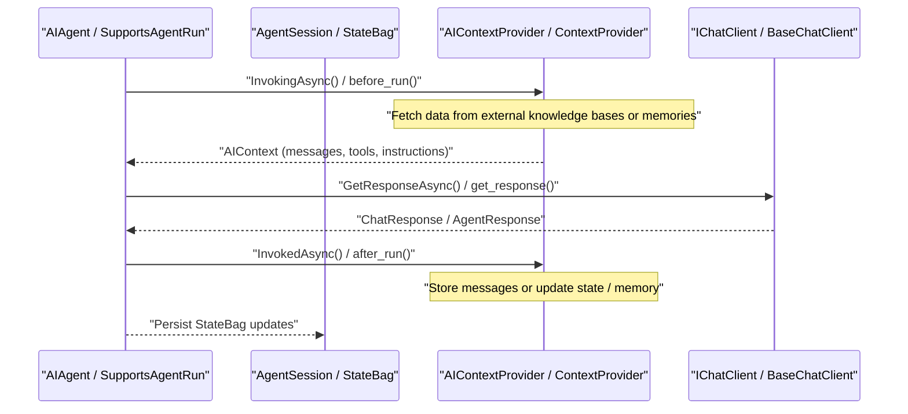
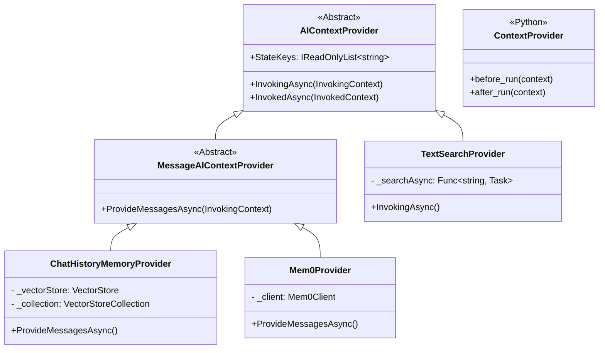

<!-- source: DeepWiki mcp.deepwiki.com · repo microsoft/agent-framework · extra page Context Providers · fetched 2026-10-26 -->

# Context Providers

<details>
<summary>Relevant source files</summary>

The following files were used as context for generating this wiki page:

- [dotnet/samples/02-agents/Harness/BuildYourOwnClaw/Claw_Step02_WorkingWithData/Claw_Step02_WorkingWithData.csproj](dotnet/samples/02-agents/Harness/BuildYourOwnClaw/Claw_Step02_WorkingWithData/Claw_Step02_WorkingWithData.csproj)
- [dotnet/samples/02-agents/Harness/BuildYourOwnClaw/Claw_Step02_WorkingWithData/Program.cs](dotnet/samples/02-agents/Harness/BuildYourOwnClaw/Claw_Step02_WorkingWithData/Program.cs)
- [dotnet/samples/02-agents/Harness/BuildYourOwnClaw/Claw_Step02_WorkingWithData/StockTools.cs](dotnet/samples/02-agents/Harness/BuildYourOwnClaw/Claw_Step02_WorkingWithData/StockTools.cs)
- [dotnet/samples/02-agents/Harness/BuildYourOwnClaw/Claw_Step02_WorkingWithData/TradingTools.cs](dotnet/samples/02-agents/Harness/BuildYourOwnClaw/Claw_Step02_WorkingWithData/TradingTools.cs)
- [dotnet/samples/02-agents/Harness/BuildYourOwnClaw/Claw_Step02_WorkingWithData/working/portfolio.csv](dotnet/samples/02-agents/Harness/BuildYourOwnClaw/Claw_Step02_WorkingWithData/working/portfolio.csv)
- [dotnet/src/Microsoft.Agents.AI.Abstractions/AIContextProvider.cs](dotnet/src/Microsoft.Agents.AI.Abstractions/AIContextProvider.cs)
- [dotnet/src/Microsoft.Agents.AI.Abstractions/ChatHistoryProvider.cs](dotnet/src/Microsoft.Agents.AI.Abstractions/ChatHistoryProvider.cs)
- [dotnet/src/Microsoft.Agents.AI.Abstractions/MessageAIContextProvider.cs](dotnet/src/Microsoft.Agents.AI.Abstractions/MessageAIContextProvider.cs)
- [dotnet/src/Microsoft.Agents.AI.Abstractions/ProviderSessionState{TState}.cs](dotnet/src/Microsoft.Agents.AI.Abstractions/ProviderSessionState{TState}.cs)
- [dotnet/src/Microsoft.Agents.AI.Mem0/Mem0Provider.cs](dotnet/src/Microsoft.Agents.AI.Mem0/Mem0Provider.cs)
- [dotnet/src/Microsoft.Agents.AI.Mem0/Mem0ProviderOptions.cs](dotnet/src/Microsoft.Agents.AI.Mem0/Mem0ProviderOptions.cs)
- [dotnet/src/Microsoft.Agents.AI/Memory/ChatHistoryMemoryProvider.cs](dotnet/src/Microsoft.Agents.AI/Memory/ChatHistoryMemoryProvider.cs)
- [dotnet/src/Microsoft.Agents.AI/Memory/ChatHistoryMemoryProviderOptions.cs](dotnet/src/Microsoft.Agents.AI/Memory/ChatHistoryMemoryProviderOptions.cs)
- [dotnet/src/Microsoft.Agents.AI/TextSearchProvider.cs](dotnet/src/Microsoft.Agents.AI/TextSearchProvider.cs)
- [dotnet/src/Microsoft.Agents.AI/TextSearchProviderOptions.cs](dotnet/src/Microsoft.Agents.AI/TextSearchProviderOptions.cs)
- [dotnet/tests/Microsoft.Agents.AI.Abstractions.UnitTests/ProviderSessionStateTests.cs](dotnet/tests/Microsoft.Agents.AI.Abstractions.UnitTests/ProviderSessionStateTests.cs)
- [dotnet/tests/Microsoft.Agents.AI.Mem0.IntegrationTests/Mem0ProviderTests.cs](dotnet/tests/Microsoft.Agents.AI.Mem0.IntegrationTests/Mem0ProviderTests.cs)
- [dotnet/tests/Microsoft.Agents.AI.Mem0.UnitTests/Mem0ProviderTests.cs](dotnet/tests/Microsoft.Agents.AI.Mem0.UnitTests/Mem0ProviderTests.cs)
- [dotnet/tests/Microsoft.Agents.AI.UnitTests/Data/TextSearchProviderTests.cs](dotnet/tests/Microsoft.Agents.AI.UnitTests/Data/TextSearchProviderTests.cs)
- [dotnet/tests/Microsoft.Agents.AI.UnitTests/Memory/ChatHistoryMemoryProviderTests.cs](dotnet/tests/Microsoft.Agents.AI.UnitTests/Memory/ChatHistoryMemoryProviderTests.cs)
- [python/packages/core/agent_framework/_filesystem.py](python/packages/core/agent_framework/_filesystem.py)
- [python/packages/core/agent_framework/_harness/_memory.py](python/packages/core/agent_framework/_harness/_memory.py)
- [python/packages/core/agent_framework/_harness/_mode.py](python/packages/core/agent_framework/_harness/_mode.py)
- [python/packages/core/agent_framework/_harness/_todo.py](python/packages/core/agent_framework/_harness/_todo.py)
- [python/packages/core/tests/core/test_filesystem.py](python/packages/core/tests/core/test_filesystem.py)
- [python/packages/core/tests/core/test_harness_memory.py](python/packages/core/tests/core/test_harness_memory.py)
- [python/packages/core/tests/core/test_harness_mode.py](python/packages/core/tests/core/test_harness_mode.py)
- [python/packages/core/tests/core/test_harness_todo.py](python/packages/core/tests/core/test_harness_todo.py)
- [python/samples/02-agents/context_providers/README.md](python/samples/02-agents/context_providers/README.md)
- [python/samples/02-agents/context_providers/agent_mode_provider.py](python/samples/02-agents/context_providers/agent_mode_provider.py)
- [python/samples/02-agents/context_providers/file_memory_provider.py](python/samples/02-agents/context_providers/file_memory_provider.py)
- [python/samples/02-agents/context_providers/todo_provider.py](python/samples/02-agents/context_providers/todo_provider.py)

</details>


## Purpose and Scope

Context Providers are components that dynamically enrich agent conversations by injecting additional messages, tools, and instructions at runtime. This enables agents to adapt context-aware capabilities such as retrieval-augmented generation (RAG), memory services, or custom logic without modifying the agent core. The main abstractions are `AIContextProvider` in .NET and `ContextProvider` in Python, reflecting parallel conceptual designs across both runtime implementations of the Microsoft Agent Framework.

Context providers engage in a two-phase lifecycle:
- **Invoking Phase:** Called at the start of agent invocation to supply additional context, system instructions, or function tools.
- **Invoked Phase:** Called optionally after agent execution to process results, update state, or augment memory.

They operate closely with `AgentSession.StateBag` for session-scoped state persistence and manage filtering of input and output messages to and from the context.

Sources: [dotnet/src/Microsoft.Agents.AI.Abstractions/AIContextProvider.cs:15-41](), [python/packages/core/agent_framework/_middleware.py:346-353]()

---

## AIContextProvider Abstraction

The core abstract class `AIContextProvider` defines the contract for components that can enhance AI context during an agent's run. It focuses on:

- Listening to conversation changes.
- Providing additional messages and function tools to the agent.
- Processing invocation results for state update or learning.

### Key Design Features

- **Message Filtering:** Three filters control messages considered for context provision and storage:
  - `ProvideInputMessageFilter`: Filters messages before context provision. Defaults to selecting external user messages (via `AgentRequestMessageSourceType.External`).
  - `StoreInputRequestMessageFilter`: Filters request messages to consider before storing context.
  - `StoreInputResponseMessageFilter`: Filters response messages before storing context.

- **State Keys:** Providers declare keys used in the session state dictionary (usually a single key with the provider's type name) to separate state among possible multiple providers.

- **Lifecycle Methods:**
  - `InvokingAsync(InvokingContext context, CancellationToken cancellationToken)`: Called before the LLM invocation to provide additional messages, system instructions, or tools.
  - `InvokedAsync(InvokedContext context, CancellationToken cancellationToken)`: Called after the agent completes, allowing the provider to inspect and store relevant messages or results.

- **Security Considerations:** Providers may inject system-role messages which deeply impact LLM behavior and trust boundaries. Data from external sources must be validated and sanitized to avoid indirect prompt injection attacks.

### Example Signature

```csharp
public abstract class AIContextProvider
{
    protected Func<IEnumerable<ChatMessage>, IEnumerable<ChatMessage>> ProvideInputMessageFilter { get; }
    protected Func<IEnumerable<ChatMessage>, IEnumerable<ChatMessage>> StoreInputRequestMessageFilter { get; }
    protected Func<IEnumerable<ChatMessage>, IEnumerable<ChatMessage>> StoreInputResponseMessageFilter { get; }

    public virtual IReadOnlyList<string> StateKeys { get; }
    
    public abstract Task<AIContext> InvokingAsync(InvokingContext context, CancellationToken cancellationToken = default);
    public virtual Task InvokedAsync(InvokedContext context, CancellationToken cancellationToken = default);
}
```

Sources: [dotnet/src/Microsoft.Agents.AI.Abstractions/AIContextProvider.cs:42-115]()

---

## Context Provider Lifecycle

Context Providers participate in the agent invocation lifecycle across the following execution phases:

1. **Invoking Phase:**
   - `InvokingAsync` (C#) / `before_run` (Python) is called before the LLM request.
   - Providers may:
     - Inject additional messages (e.g., search results, memories).
     - Supply function tools the agent can invoke.
     - Add system instructions or directives.

2. **Agent Run:**
   - The augmented messages and tools are included in the LLM request.
   - The agent invokes the model and obtains a response.

3. **Invoked Phase:**
   - `InvokedAsync` (C#) / `after_run` (Python) is called after the agent run completes.
   - Providers may:
     - Update vector stores or memory services with conversation history.
     - Process metadata or logs.
     - Adjust state in `AgentSession` or external systems.

### Title: Context Provider Lifecycle and State Integration


Sources: [dotnet/src/Microsoft.Agents.AI.Abstractions/AIContextProvider.cs:29-32](), [dotnet/src/Microsoft.Agents.AI.Abstractions/AIContextProvider.cs:115-125](), [python/packages/core/agent_framework/_middleware.py:154-180]()

---

## Specialized Provider Types

### MessageAIContextProvider (C#)

A specialized subclass focusing on providers that only inject chat messages into the context. It simplifies implementations by exposing an abstract `ProvideMessagesAsync` method that returns messages to add during invocation.

Sources: [dotnet/src/Microsoft.Agents.AI.Abstractions/MessageAIContextProvider.cs:15-33]()

### Example Providers in .NET

- **TextSearchProvider:** Performs text search over external knowledge and injects results as user-role messages into the LLM context or exposes a search tool for on-demand querying.
- **ChatHistoryMemoryProvider:** Stores and retrieves chat history in a vector store for RAG via semantic similarity.
- **Mem0Provider:** Integrates with the Mem0 memory service, persisting messages and searching relevant memories by scopes like user or session.

### Built-in Providers and Memory (Python Sample Highlights)

- **TodoProvider:** Provides todo-list tools attached via context providers.
- **AgentModeProvider:** Tracks and switches agent modes dynamically.
- **FileMemoryProvider:** Stores memories as files on disk scoped by session or user.
- **FileAccessProvider:** Enables file read/write/search functions for external data access.

Sources:
- [dotnet/src/Microsoft.Agents.AI/TextSearchProvider.cs:48-80]()
- [dotnet/src/Microsoft.Agents.AI/Memory/ChatHistoryMemoryProvider.cs:18-32]()
- [dotnet/src/Microsoft.Agents.AI.Mem0/Mem0Provider.cs:18-27]()
- [python/samples/02-agents/context_providers/README.md:7-19]()
- [python/packages/core/agent_framework/_harness/_memory.py:30-68]()

---

## Implementation Architecture and Data Flow

### Chat History Memory Provider (.NET)

This provider stores chat messages in an external vector store and manages retrieval with semantic search, injecting relevant historical messages before an LLM call. It supports both automatic context injection and on-demand function calls for searches.

It uses:
- `VectorStore` and `VectorStoreCollection` for abstraction over vector databases.
- Options to configure search behavior, max results, prompts, and message filters.
- Session state to manage provider-scoped information.

### Mem0 Provider (.NET)

Integrates with the Mem0 service over HTTP, persisting full conversation messages and retrieving relevant memories on demand using semantic search. It manages security by requiring a configured `HttpClient` with base address and authentication headers.

### Text Search Provider (.NET)

Accepts a custom search delegate for queries, performs text search over external knowledge, and injects formatted search results as user messages with source citations. Its configuration allows switching between automatic search before LLM invocation or search exposed as an on-demand function tool.

### Title: Context Provider Class Relationships and Implementation


Sources: 
[dotnet/src/Microsoft.Agents.AI.Abstractions/AIContextProvider.cs:42-42](), 
[dotnet/src/Microsoft.Agents.AI.Abstractions/MessageAIContextProvider.cs:15-15](), 
[dotnet/src/Microsoft.Agents.AI/Memory/ChatHistoryMemoryProvider.cs:55-55](), 
[dotnet/src/Microsoft.Agents.AI.Mem0/Mem0Provider.cs:47-47](), 
[dotnet/src/Microsoft.Agents.AI/TextSearchProvider.cs:48-48](), 
[python/packages/core/agent_framework/_middleware.py:346-346]()

---

## State Management and Security

### Provider State Persistence

Context providers store session-related state data in the `AgentSession.StateBag`. The `ProviderSessionState<T>` abstraction encapsulates safe state management, ensuring unique keys per provider and serializability.

### Security Considerations

- **Trust Boundary:** Context providers can inject messages with any role, including `system`. Only trusted providers should be attached to agents to avoid adversarial manipulation.
- **Indirect Prompt Injection:** Data fetched from external knowledge bases or vector stores is injected verbatim. Validation or sanitization must be implemented by provider authors.
- **PII and Sensitivity:** Logs or telemetry may contain sensitive user data. Providers employ redaction mechanisms by default unless configured to enable sensitive data logging (e.g., via `Redactor` or options like `EnableSensitiveTelemetryData`).

Sources: 
[dotnet/src/Microsoft.Agents.AI.Abstractions/AIContextProvider.cs:34-39](), 
[dotnet/src/Microsoft.Agents.AI.Mem0/Mem0Provider.cs:94-96](), 
[dotnet/src/Microsoft.Agents.AI/Memory/ChatHistoryMemoryProvider.cs:122-122]()

---

## Bridging Natural Language Space to Code Entity Space

### Title: Agent Invocation Incorporating Context Providers
```mermaid
graph TD
    subgraph NaturalLanguageSpace["Natural Language Space"]
        UserInput["User Input Messages"]
        ExternalData["External Knowledge / Memories"]
        AIRequest["AI Model Request"]
    end
    
    subgraph CodeEntitySpace["Code Entity Space"]
        Agent["AIAgent / SupportsAgentRun"]
        Session["AgentSession / StateBag"]
        ContextProvider["AIContextProvider / ContextProvider"]
        LLM["IChatClient / BaseChatClient"]
        VectorStore["VectorStore / VectorStoreCollection"]
        Mem0Client["Mem0Client"]
        SearchDelegate["TextSearchDelegate"]
    end

    UserInput --> Agent
    ExternalData --> ContextProvider
    Agent -->|InvokingAsync(InvokingContext)| ContextProvider
    ContextProvider -->|ProvideAIContextAsync| Agent
    Agent -->|GetResponseAsync| LLM
    LLM --> Agent
    Agent -->|InvokedAsync(InvokedContext)| ContextProvider
    ContextProvider --> Session
    Session --> ContextProvider
    ContextProvider --> VectorStore
    ContextProvider --> Mem0Client
    ContextProvider --> SearchDelegate
```

### Diagram Explanation

This diagram associates natural language concepts (user questions, retrieved memories, AI prompts) directly with their corresponding code entities (`AIContextProvider`, `VectorStore`, `Mem0Client`, `TextSearchDelegate`). When a run occurs, the framework coordinates these components to enrich requests without coupling business logic to chat execution.

Sources: [dotnet/src/Microsoft.Agents.AI.Abstractions/AIContextProvider.cs:29-32](), [dotnet/src/Microsoft.Agents.AI/Memory/ChatHistoryMemoryProvider.cs:18-32](), [dotnet/src/Microsoft.Agents.AI.Mem0/Mem0Provider.cs:47-126]()

---

# Summary

Context Providers are a foundational pattern in the Microsoft Agent Framework that enable extensible and composable enrichment of AI agent conversations. The two-phase lifecycle (`InvokingAsync` and `InvokedAsync`), integration with session state, configurable message filtering, and support for external knowledge sources (vector stores, Mem0, search) provide a flexible, secure, and powerful mechanism for adding context and capabilities to AI agents across both .NET and Python implementations.

---

