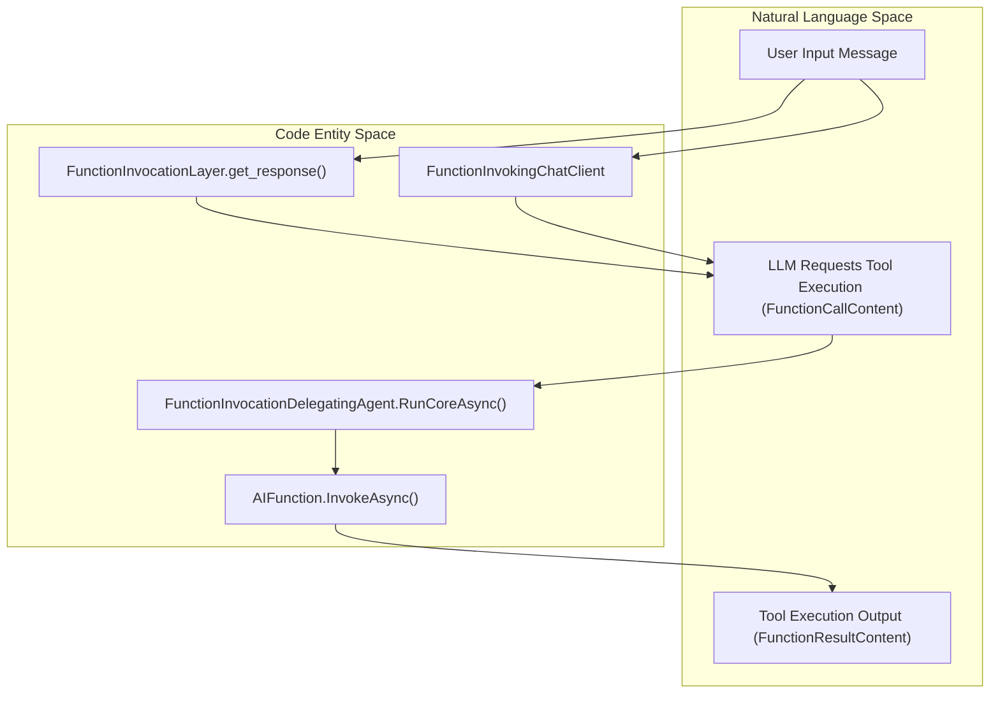
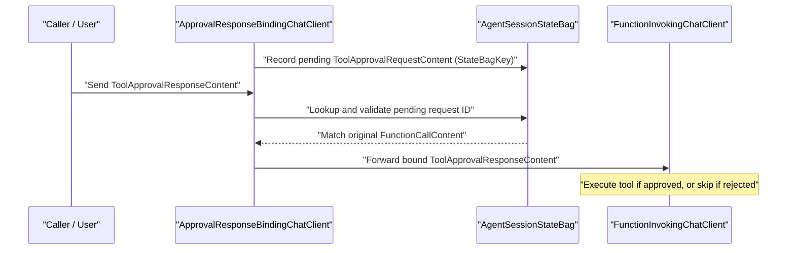

<!-- source: DeepWiki mcp.deepwiki.com · repo microsoft/agent-framework · extra page Function Invocation and Approval · fetched 2026-10-26 -->

# Function Invocation and Approval

Relevant source files

The following files were used as context for generating this wiki page:

- [dotnet/samples/05-end-to-end/AGUIClientServer/AGUIDojoServer/ChatClientAgentFactory.cs](dotnet/samples/05-end-to-end/AGUIClientServer/AGUIDojoServer/ChatClientAgentFactory.cs)
- [dotnet/samples/05-end-to-end/AGUIClientServer/AGUIDojoServer/Program.cs](dotnet/samples/05-end-to-end/AGUIClientServer/AGUIDojoServer/Program.cs)
- [dotnet/samples/05-end-to-end/AGUIClientServer/AGUIServer/AGUIServer.csproj](dotnet/samples/05-end-to-end/AGUIClientServer/AGUIServer/AGUIServer.csproj)
- [dotnet/samples/05-end-to-end/AGUIClientServer/AGUIServer/Program.cs](dotnet/samples/05-end-to-end/AGUIClientServer/AGUIServer/Program.cs)
- [dotnet/samples/05-end-to-end/AGUIClientServer/README.md](dotnet/samples/05-end-to-end/AGUIClientServer/README.md)
- [dotnet/src/Microsoft.Agents.AI.Hosting.AGUI.AspNetCore/AGUIEndpointRouteBuilderExtensions.cs](dotnet/src/Microsoft.Agents.AI.Hosting.AGUI.AspNetCore/AGUIEndpointRouteBuilderExtensions.cs)
- [dotnet/src/Microsoft.Agents.AI/ChatClient/ApprovalNotRequiredFunctionBypassingChatClient.cs](dotnet/src/Microsoft.Agents.AI/ChatClient/ApprovalNotRequiredFunctionBypassingChatClient.cs)
- [dotnet/src/Microsoft.Agents.AI/ChatClient/ApprovalRequirement.cs](dotnet/src/Microsoft.Agents.AI/ChatClient/ApprovalRequirement.cs)
- [dotnet/src/Microsoft.Agents.AI/ChatClient/ApprovalResponseBindingChatClient.cs](dotnet/src/Microsoft.Agents.AI/ChatClient/ApprovalResponseBindingChatClient.cs)
- [dotnet/src/Microsoft.Agents.AI/ChatClient/InvocableFunctionBypassingChatClient.cs](dotnet/src/Microsoft.Agents.AI/ChatClient/InvocableFunctionBypassingChatClient.cs)
- [dotnet/src/Microsoft.Agents.AI/FunctionInvocationContextExtensions.cs](dotnet/src/Microsoft.Agents.AI/FunctionInvocationContextExtensions.cs)
- [dotnet/src/Microsoft.Agents.AI/FunctionInvocationDelegatingAgent.cs](dotnet/src/Microsoft.Agents.AI/FunctionInvocationDelegatingAgent.cs)
- [dotnet/src/Microsoft.Agents.AI/FunctionInvocationDelegatingAgentBuilderExtensions.cs](dotnet/src/Microsoft.Agents.AI/FunctionInvocationDelegatingAgentBuilderExtensions.cs)
- [dotnet/src/Microsoft.Agents.AI/Harness/ToolApproval/AlwaysApproveToolApprovalResponseContent.cs](dotnet/src/Microsoft.Agents.AI/Harness/ToolApproval/AlwaysApproveToolApprovalResponseContent.cs)
- [dotnet/src/Microsoft.Agents.AI/Harness/ToolApproval/ToolApprovalAgent.cs](dotnet/src/Microsoft.Agents.AI/Harness/ToolApproval/ToolApprovalAgent.cs)
- [dotnet/src/Microsoft.Agents.AI/Harness/ToolApproval/ToolApprovalAgentBuilderExtensions.cs](dotnet/src/Microsoft.Agents.AI/Harness/ToolApproval/ToolApprovalAgentBuilderExtensions.cs)
- [dotnet/src/Microsoft.Agents.AI/Harness/ToolApproval/ToolApprovalAgentOptions.cs](dotnet/src/Microsoft.Agents.AI/Harness/ToolApproval/ToolApprovalAgentOptions.cs)
- [dotnet/src/Microsoft.Agents.AI/Harness/ToolApproval/ToolApprovalRequestContentExtensions.cs](dotnet/src/Microsoft.Agents.AI/Harness/ToolApproval/ToolApprovalRequestContentExtensions.cs)
- [dotnet/src/Microsoft.Agents.AI/Harness/ToolApproval/ToolApprovalRule.cs](dotnet/src/Microsoft.Agents.AI/Harness/ToolApproval/ToolApprovalRule.cs)
- [dotnet/src/Microsoft.Agents.AI/Harness/ToolApproval/ToolApprovalState.cs](dotnet/src/Microsoft.Agents.AI/Harness/ToolApproval/ToolApprovalState.cs)
- [dotnet/src/Microsoft.Agents.AI/PublicAPI/net10.0/PublicAPI.Unshipped.txt](dotnet/src/Microsoft.Agents.AI/PublicAPI/net10.0/PublicAPI.Unshipped.txt)
- [dotnet/src/Microsoft.Agents.AI/PublicAPI/net472/PublicAPI.Unshipped.txt](dotnet/src/Microsoft.Agents.AI/PublicAPI/net472/PublicAPI.Unshipped.txt)
- [dotnet/src/Microsoft.Agents.AI/PublicAPI/net8.0/PublicAPI.Unshipped.txt](dotnet/src/Microsoft.Agents.AI/PublicAPI/net8.0/PublicAPI.Unshipped.txt)
- [dotnet/src/Microsoft.Agents.AI/PublicAPI/net9.0/PublicAPI.Unshipped.txt](dotnet/src/Microsoft.Agents.AI/PublicAPI/net9.0/PublicAPI.Unshipped.txt)
- [dotnet/src/Microsoft.Agents.AI/PublicAPI/netstandard2.0/PublicAPI.Unshipped.txt](dotnet/src/Microsoft.Agents.AI/PublicAPI/netstandard2.0/PublicAPI.Unshipped.txt)
- [dotnet/tests/Microsoft.Agents.AI.Hosting.AGUI.AspNetCore.IntegrationTests/ToolCallingTests.cs](dotnet/tests/Microsoft.Agents.AI.Hosting.AGUI.AspNetCore.IntegrationTests/ToolCallingTests.cs)
- [dotnet/tests/Microsoft.Agents.AI.Hosting.OpenAI.UnitTests/AgentHostingServiceCollectionExtensionsTests.cs](dotnet/tests/Microsoft.Agents.AI.Hosting.OpenAI.UnitTests/AgentHostingServiceCollectionExtensionsTests.cs)
- [dotnet/tests/Microsoft.Agents.AI.UnitTests/ChatClient/ApprovalNotRequiredFunctionBypassingChatClientTests.cs](dotnet/tests/Microsoft.Agents.AI.UnitTests/ChatClient/ApprovalNotRequiredFunctionBypassingChatClientTests.cs)
- [dotnet/tests/Microsoft.Agents.AI.UnitTests/ChatClient/ApprovalRequirementTests.cs](dotnet/tests/Microsoft.Agents.AI.UnitTests/ChatClient/ApprovalRequirementTests.cs)
- [dotnet/tests/Microsoft.Agents.AI.UnitTests/ChatClient/ApprovalResponseBindingChatClientTests.cs](dotnet/tests/Microsoft.Agents.AI.UnitTests/ChatClient/ApprovalResponseBindingChatClientTests.cs)
- [dotnet/tests/Microsoft.Agents.AI.UnitTests/ChatClient/ChatClientAgent_ApprovalBypassTests.cs](dotnet/tests/Microsoft.Agents.AI.UnitTests/ChatClient/ChatClientAgent_ApprovalBypassTests.cs)
- [dotnet/tests/Microsoft.Agents.AI.UnitTests/ChatClient/ChatClientAgent_ApprovalRetryTests.cs](dotnet/tests/Microsoft.Agents.AI.UnitTests/ChatClient/ChatClientAgent_ApprovalRetryTests.cs)
- [dotnet/tests/Microsoft.Agents.AI.UnitTests/ChatClient/ChatClientAgent_DuplicateToolNameTests.cs](dotnet/tests/Microsoft.Agents.AI.UnitTests/ChatClient/ChatClientAgent_DuplicateToolNameTests.cs)
- [dotnet/tests/Microsoft.Agents.AI.UnitTests/ChatClient/InvocableFunctionBypassingChatClientTests.cs](dotnet/tests/Microsoft.Agents.AI.UnitTests/ChatClient/InvocableFunctionBypassingChatClientTests.cs)
- [dotnet/tests/Microsoft.Agents.AI.UnitTests/FunctionInvocationDelegatingAgentTests.cs](dotnet/tests/Microsoft.Agents.AI.UnitTests/FunctionInvocationDelegatingAgentTests.cs)
- [dotnet/tests/Microsoft.Agents.AI.UnitTests/Harness/ToolApproval/ToolApprovalAgentTests.cs](dotnet/tests/Microsoft.Agents.AI.UnitTests/Harness/ToolApproval/ToolApprovalAgentTests.cs)
- [dotnet/tests/Microsoft.Agents.AI.UnitTests/Harness/ToolApproval/ToolApprovalRuleTests.cs](dotnet/tests/Microsoft.Agents.AI.UnitTests/Harness/ToolApproval/ToolApprovalRuleTests.cs)

This page explains the function invocation lifecycle, tool approval modes, human-in-the-loop patterns, and invocation limits across both .NET and Python implementations of the Microsoft Agent Framework.

## Purpose and Scope

Function invocation is the mechanism by which the framework coordinates tool calling between Large Language Models and executable code (such as `@tool` decorated functions in Python or `AIFunction` instances in .NET). This lifecycle covers detection of function calls, execution loops, error handling, invocation limits, and human-in-the-loop approval mechanisms.

Sources:
- `python/packages/core/agent_framework/_tools.py:691-858`
- `dotnet/src/Microsoft.Agents.AI/ChatClient/ChatClientAgent.cs:39-40`

---

## Function Invocation Lifecycle and Middleware

The framework manages tool invocation through middleware layers that wrap underlying chat clients or agents.

- **Python**: `FunctionInvocationLayer` intercepts calls to handle streaming and non-streaming responses, executing tool calls iteratively [python/packages/core/agent_framework/_tools.py:691-858]().
- **.NET**: `ChatClientAgent` orchestrates runs using `FunctionInvokingChatClient` from Microsoft.Extensions.AI, complemented by `FunctionInvocationDelegatingAgent` for custom callback interception [dotnet/src/Microsoft.Agents.AI/FunctionInvocationDelegatingAgent.cs:16-23]().

### Execution Flow: Natural Language to Code Entities

Sources:
- `python/packages/core/agent_framework/_tools.py:691-858`
- `dotnet/src/Microsoft.Agents.AI/FunctionInvocationDelegatingAgent.cs:16-27`

---

## Approval Workflow and Human-in-the-Loop Patterns

When tools require human consent or validation before running, the framework uses approval request and response content types stored within `AgentSessionStateBag`.

### .NET Approval Architecture

In .NET, specialized chat client decorators and harness agents manage approval flows:
- `ApprovalResponseBindingChatClient`: Intercepts outbound `ToolApprovalRequestContent` items and records them in session state (`_pendingApprovalRequests`). On inbound requests, validates `ToolApprovalResponseContent` to prevent forged approvals and binds them back to original model-originated calls [dotnet/src/Microsoft.Agents.AI/ChatClient/ApprovalResponseBindingChatClient.cs:15-62]().
- `ApprovalNotRequiredFunctionBypassingChatClient`: Automatically bypasses approval requirements for tools that do not require human sign-off, storing auto-approved results in the session [dotnet/src/Microsoft.Agents.AI/ChatClient/ApprovalNotRequiredFunctionBypassingChatClient.cs:15-57]().
- `ToolApprovalAgent`: A delegating agent middleware that implements "don't ask again" standing rules and queues multiple approval requests to present them to callers one at a time [dotnet/src/Microsoft.Agents.AI/Harness/ToolApproval/ToolApprovalAgent.cs:16-52]().

### Approval Binding Sequence

Sources:
- `dotnet/src/Microsoft.Agents.AI/ChatClient/ApprovalResponseBindingChatClient.cs:15-103`
- `dotnet/src/Microsoft.Agents.AI/Harness/ToolApproval/ToolApprovalAgent.cs:16-52`

---

## Content Types in Invocation and Approval

The framework relies on a robust content type model to represent tool operations across language boundaries:

| Content Type | Purpose | Key Attributes |
|---|---|---|
| `FunctionCallContent` / `AIFunctionCall` | Represents a request from the LLM to invoke a tool. | `call_id`, `name`, `arguments` |
| `FunctionResultContent` / `AIFunctionResult` | Encapsulates the output or error resulting from tool execution. | `call_id`, `result`, `error` |
| `ToolApprovalRequestContent` | Signals that a tool call requires explicit human approval. | `RequestId`, `ToolCall` |
| `ToolApprovalResponseContent` | Carries the user's approval or rejection decision. | `RequestId`, `Approved`, `ToolCall` |

Sources:
- `dotnet/src/Microsoft.Agents.AI/Harness/ToolApproval/ToolApprovalAgent.cs:26-41`
- `python/packages/core/agent_framework/_types.py:1101-1243`

---

## Configuration and Invocation Limits

To prevent infinite loops and runaway costs, the framework enforces strict iteration and error limits:
- **Max Iterations**: Bounds the number of consecutive function invocation turns per run (default is typically `40`) [python/packages/core/agent_framework/_tools.py:95-96]().
- **Max Consecutive Errors**: Limits the number of consecutive tool execution errors before terminating a run.
- **Auto-Approval Iterations**: Configured via `ToolApprovalAgentOptions.MaxAutoApprovalIterations` in .NET [dotnet/src/Microsoft.Agents.AI/Harness/ToolApproval/ToolApprovalAgent.cs:54-77]().

Sources:
- `dotnet/src/Microsoft.Agents.AI/Harness/ToolApproval/ToolApprovalAgent.cs:54-77`
- `python/packages/core/agent_framework/_tools.py:95-96`

---

## Observability

The function invocation lifecycle is fully instrumented with OpenTelemetry tracing and metrics:
- Tool execution durations are recorded via metric histograms.
- Spans track tool execution identifiers, names, and arguments (`gen_ai.tool.name`, `gen_ai.tool.call.id`, `gen_ai.tool.call.arguments`).

Sources:
- `python/packages/core/agent_framework/observability.py:43-55`

---

