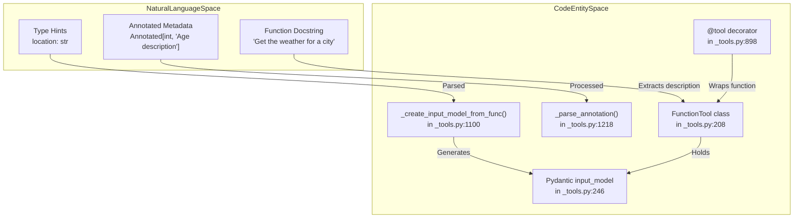

<!-- source: DeepWiki mcp.deepwiki.com · repo microsoft/agent-framework · extra page Function Tools · fetched 2026-10-26 -->

# Function Tools

<details>
<summary>Relevant source files</summary>

The following files were used as context for generating this wiki page:

- [docs/specs/004-python-function-calling-loop.md](docs/specs/004-python-function-calling-loop.md)
- [python/packages/core/agent_framework/_agents.py](python/packages/core/agent_framework/_agents.py)
- [python/packages/core/agent_framework/_clients.py](python/packages/core/agent_framework/_clients.py)
- [python/packages/core/agent_framework/_compaction.py](python/packages/core/agent_framework/_compaction.py)
- [python/packages/core/agent_framework/_harness/_tool_approval.py](python/packages/core/agent_framework/_harness/_tool_approval.py)
- [python/packages/core/agent_framework/_middleware.py](python/packages/core/agent_framework/_middleware.py)
- [python/packages/core/agent_framework/_tools.py](python/packages/core/agent_framework/_tools.py)
- [python/packages/core/agent_framework/_types.py](python/packages/core/agent_framework/_types.py)
- [python/packages/core/agent_framework/observability.py](python/packages/core/agent_framework/observability.py)
- [python/packages/core/tests/core/test_agent_hooks.py](python/packages/core/tests/core/test_agent_hooks.py)
- [python/packages/core/tests/core/test_agents.py](python/packages/core/tests/core/test_agents.py)
- [python/packages/core/tests/core/test_clients.py](python/packages/core/tests/core/test_clients.py)
- [python/packages/core/tests/core/test_compaction.py](python/packages/core/tests/core/test_compaction.py)
- [python/packages/core/tests/core/test_function_invocation_logic.py](python/packages/core/tests/core/test_function_invocation_logic.py)
- [python/packages/core/tests/core/test_harness_tool_approval.py](python/packages/core/tests/core/test_harness_tool_approval.py)
- [python/packages/core/tests/core/test_middleware_with_agent.py](python/packages/core/tests/core/test_middleware_with_agent.py)
- [python/packages/core/tests/core/test_middleware_with_chat.py](python/packages/core/tests/core/test_middleware_with_chat.py)
- [python/packages/core/tests/core/test_observability.py](python/packages/core/tests/core/test_observability.py)
- [python/packages/core/tests/core/test_tools.py](python/packages/core/tests/core/test_tools.py)
- [python/packages/core/tests/core/test_types.py](python/packages/core/tests/core/test_types.py)
- [python/samples/02-agents/context_providers/cross_session_observer.py](python/samples/02-agents/context_providers/cross_session_observer.py)
- [python/samples/02-agents/observability/README.md](python/samples/02-agents/observability/README.md)
- [python/samples/02-agents/observability/microsoft_opentelemetry_distro.py](python/samples/02-agents/observability/microsoft_opentelemetry_distro.py)

</details>


This page documents the `FunctionTool` class and the `@tool` decorator in Python, along with the integration of `AIFunction` and `ChatClientAgent` in .NET. These abstractions wrap code functions as callable tools accessible by AI models. Function tools manage automatic schema generation from type annotations, argument validation, and result serialization for LLM interactions.

For advanced execution and approval mechanisms, see [Function Invocation and Approval (page://3.3.2)]. For hosted tools like code interpreters, see [Hosted Tools (page://3.3.3)]. For integration with external tool servers, refer to [Model Context Protocol (MCP) (page://3.3.4)].

---

## Overview

Function tools serve as a bridge from the AI model's "Natural Language Space" to application "Code Entity Space." Key features provided by the framework include:

- **Automatic generation of JSON schemas** from Python function signatures using type annotations. This supports a rich spectrum of types including literals, optional fields, and annotated metadata [python/packages/core/agent_framework/_tools.py:1100-1216]().
- **Pydantic-powered argument validation** to ensure input conforms to expected schema before execution [python/packages/core/agent_framework/_tools.py:448-463]().
- **Result parsing** to serialize function return values into strings or structured content consumable by models [python/packages/core/agent_framework/_tools.py:580-602]().
- **Approval modes** for secure control over sensitive tools via explicit user or automated consent [python/packages/core/agent_framework/_tools.py:238]().
- **Invocation limits** and error thresholds to avoid runaway executions and infinite loops [python/packages/core/agent_framework/_tools.py:394-407]().
- **OpenTelemetry observability** with tracing spans and invocation duration histograms for monitoring tool usage [python/packages/core/agent_framework/observability.py:39-68](), [python/packages/core/agent_framework/_tools.py:220]().

Sources: [python/packages/core/agent_framework/_tools.py:208-1216](), [python/packages/core/agent_framework/observability.py:39-68]()

---

## Architecture and Data Flow

### Mapping Natural Language to Code (Python)

This diagram illustrates how documentation, type hints, and annotated metadata in natural language source code are parsed and transformed into code entities, namely the `FunctionTool` and corresponding Pydantic input models.


Sources: [python/packages/core/agent_framework/_tools.py:208-1218]()

### FunctionTool Invocation Lifecycle

The invocation lifecycle bridges the model’s function call request to the actual execution of the function tool, validating inputs, executing the code, and returning the response.

```mermaid
graph TB
    subgraph "NaturalLanguageSpace"
        MODEL_CALL["Model function call<br/>e.g. 'get_weather(city=\"Seattle\")'"]
        MODEL_RESULT["Model receives result<br/>e.g. 'It is 72°F'"]
    end

    subgraph "CodeEntitySpace"
        INVOKE["FunctionTool.invoke()<br/>(validates and executes)"]
        VALIDATE["Argument validation<br/>via Pydantic's model_validate()"]
        EXECUTE["FunctionTool.__call__()<br/>calls user function"]
        OTEL["OpenTelemetry span<br/>get_function_span()"]
        HISTOGRAM["Invocation duration histogram"]
    end

    MODEL_CALL -->|Passes args| INVOKE
    INVOKE -->|Validate args| VALIDATE
    VALIDATE -->|Valid data| EXECUTE
    INVOKE -.->|Collects metrics| OTEL
    EXECUTE -.->|Measures duration| HISTOGRAM
    EXECUTE -->|Return serialized string| MODEL_RESULT
```

Sources: [python/packages/core/agent_framework/_tools.py:208-246](), [python/packages/core/agent_framework/_tools.py:391-417](), [python/packages/core/agent_framework/observability.py:39-68](), [python/packages/core/agent_framework/_tools.py:220]()

---

## Python Implementation: `@tool` Decorator and `FunctionTool`

### The `@tool` Decorator

The `@tool` decorator is the recommended entry point for creating function tools in Python. It can be applied directly to a function or configured with custom parameters such as name, description, schema overrides, approval mode, and invocation limits.

| Parameter          | Type                     | Description                                                           |
|--------------------|--------------------------|-----------------------------------------------------------------------|
| `name`             | `str`                    | Optional tool name; by default, the Python function's name is used.   |
| `description`      | `str`                    | Optional description, defaults to function docstring if omitted.      |
| `schema`           | `BaseModel` or `dict`    | Optional override for the JSON Schema model inferred from the function.|
| `approval_mode`    | `str`                    | `"always_require"` or `"never_require"` to control user approval flow.|
| `max_invocations`  | `int`                    | Maximum number of allowed invocations during a single agent run.      |

Usage example:

```python
from agent_framework import tool

@tool(description="Add two numbers")
def add(x: int, y: int) -> int:
    return x + y
```

This decorates `add` as a `FunctionTool` automatically.

### Schema Generation

The system creates Pydantic input models from the function signature and type annotations. It supports:

- **Literal types**: Converted to JSON Schema enum constraints via `_parse_annotation()` [python/packages/core/agent_framework/_tools.py:1232-1234]().
- **Annotated types**: Metadata strings in `Annotated[T, "description"]` are extracted as parameter descriptions for docs and schema [python/packages/core/agent_framework/_tools.py:1248-1250]().
- **Pydantic Field instances**: Constraints such as `ge`, `le`, or defaults declared via `Field()` are preserved for validation and schema generation [python/packages/core/agent_framework/_tools.py:1255-1260]().

This produces detailed and accurate interface descriptions for LLM tooling and model prompts.

### Result Parsing

The `FunctionTool` class includes a `parse_result()` method that converts Python return values into serializable strings suitable for AI consumption:

- If the result is a **Pydantic model**, `model_dump()` is used for serialization.
- If the return type is a **Content** object (the framework’s content abstraction), it is serialized with `.to_dict()` [python/packages/core/agent_framework/_types.py:1506-1517]().
- Special marker `SKIP_PARSING` allows returning raw Python objects instead of stringified content [python/packages/core/agent_framework/_tools.py:132-133]().

This parsing translates raw computation results into structured or text outputs understandable by the LLM.

Sources: [python/packages/core/agent_framework/_tools.py:208-1389](), [python/packages/core/agent_framework/_types.py:1506-1517](), [python/packages/core/tests/core/test_tools.py:25-109]()

---

## .NET Implementation: `AIFunction` and `ChatClientAgent`

In the .NET ecosystem, the primary function tool abstraction is `AIFunction` from the `Microsoft.Extensions.AI` library, with integration handled by `ChatClientAgent`.

### ChatClientAgent Integration

`ChatClientAgent` consumes an `IChatClient` to manage chat and tool execution. Tools including functions (`AIFunction`) are injected via `ChatClientAgentOptions` or directly passed in the constructor to the agent.

Key points:

- Tools are collected and passed into the agent as a list of `AITool` objects, where `AIFunction` represents code functions [dotnet/src/Microsoft.Agents.AI/ChatClient/ChatClientAgent.cs:82-98]().
- The agent does not assume the safety of LLM-generated arguments and warns clients to treat such inputs as untrusted for security [dotnet/src/Microsoft.Agents.AI/ChatClient/ChatClientAgent.cs:22-34]().
- The agent leverages .NET reflection and JSON schema generation to build schemas and perform method invocation safely.

Example snippet:

```csharp
var options = new ChatClientAgentOptions()
{
    Tools = new List<AITool>
    {
        AIFunction.Create(nameof(MyFunction), (string input) => { return "result"; }, "Function description")
    }
};

var agent = new ChatClientAgent(chatClient, options);
```

### Key Implementation Aspects

- The `ChatClientAgent` constructor initializes tools and manages invocation lifecycle within a conversation [dotnet/src/Microsoft.Agents.AI/ChatClient/ChatClientAgent.cs:18-120]().
- The schema generation and validation utilize reflection metadata, aligning with Python’s Pydantic model usage conceptually but respecting .NET idioms.

Sources: [dotnet/src/Microsoft.Agents.AI/ChatClient/ChatClientAgent.cs:18-120](), [dotnet/src/Microsoft.Agents.AI/ChatClient/ChatClientAgentOptions.cs:1-50]()

---

## Parameter Validation and Error Handling

### Validation Logic

- **Python**: Arguments passed to the function tool invocation are validated against a Pydantic-generated `input_model` created from the function signature [python/packages/core/agent_framework/_tools.py:448-463]().
  When validation fails, `ValidationError` is caught and converted to an error message, enabling the model to correct arguments.

- **.NET**: Method parameters are validated according to `AIFunction` and reflected metadata during method invocation, adhering to expected argument types.

### Invocation Limits

To prevent infinite or runaway tool execution caused by repeating error cycles:

- `max_invocations`: Caps the total number of calls to a single tool within one agent run. Exceeding this limit raises a controlled failure [python/packages/core/agent_framework/_tools.py:254]().
- `max_consecutive_errors_per_request`: If a tool fails consecutively more times than this threshold (default is 3), a `ToolException` is raised to halt invocation attempts, preventing runaway loops [python/packages/core/agent_framework/_tools.py:96-103](), [python/packages/core/agent_framework/_tools.py:399-407]().

This provides a robust safety net in the function invocation control flow.

Sources: [python/packages/core/agent_framework/_tools.py:96-103](), [python/packages/core/agent_framework/_tools.py:254-407](), [python/packages/core/agent_framework/_tools.py:448-463]()

---

## Comparison: Python vs .NET

| Feature                  | Python Implementation                          | .NET Implementation                                       |
|--------------------------|-----------------------------------------------|-----------------------------------------------------------|
| **Core Abstraction**     | `FunctionTool` class [python/packages/core/agent_framework/_tools.py:208]() | `AIFunction` class (Microsoft.Extensions.AI)               |
| **Creation Method**      | `@tool` decorator                              | `AIFunctionFactory.Create`                                 |
| **Schema Engine**        | Pydantic models and JSON Schema generation    | System.Reflection and JSON Schema                         |
| **Argument Validation**  | Pydantic `model_validate()`                    | Type-safe method invocation with reflected metadata       |
| **Telemetry/Observability** | OpenTelemetry spans with `get_function_span()` [python/packages/core/agent_framework/observability.py:39]() | Standard .NET diagnostics (`ActivitySource`)             |
| **Tool Approval**        | Configurable approval modes                     | Approval via custom agent/user logic                       |

This parity in design allows developers fluent in either language to create robust, validated AI-callable tools with consistent conceptual behavior.

Sources: [python/packages/core/agent_framework/_tools.py:208](), [python/packages/core/agent_framework/observability.py:39]()

---

# Summary

Function tools in Microsoft Agent Framework are key abstractions enabling AI models to call typed code routines with semantic schema validation, controlled execution, and observability. The Python `@tool` decorator and `FunctionTool` class provide flexible, Pydantic-powered schema generation and parameter validation. The .NET framework counterpart, `AIFunction`, integrates tightly with the `ChatClientAgent` to safely expose code functions to AI.

By encapsulating parameter typing, validation, result serialization, and invocation controls, function tools ensure that AI-generated calls are executed reliably and securely, forming the foundational mechanism for tool-augmented agent interactions across languages.

Sources:  
- [python/packages/core/agent_framework/_tools.py:208-246,391-417,448-463,580-602,894-966,1100-1218,96-103,254-407]()  
- [python/packages/core/agent_framework/_types.py:1506-1517]()  
- [python/packages/core/tests/core/test_tools.py:25-109]()  
- [dotnet/src/Microsoft.Agents.AI/ChatClient/ChatClientAgent.cs:18-120]()  
- [dotnet/src/Microsoft.Agents.AI/ChatClient/ChatClientAgentOptions.cs:1-50]()  
- [python/packages/core/agent_framework/observability.py:39-68]()  
- [docs/specs/004-python-function-calling-loop.md:66-123]()

---

