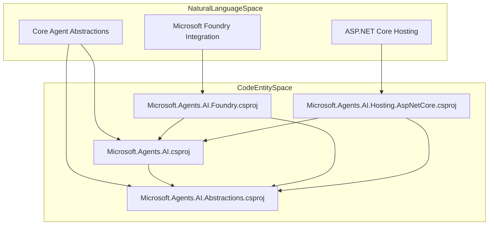
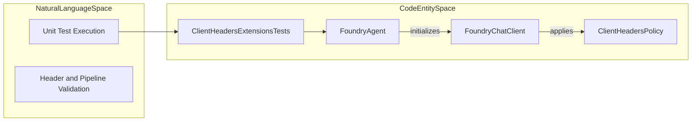

<!-- source: DeepWiki mcp.deepwiki.com · repo microsoft/agent-framework · extra page .NET Development Setup · fetched 2026-10-26 -->

# .NET Development Setup

<details>
<summary>Relevant source files</summary>

The following files were used as context for generating this wiki page:

- [.vscode/settings.json](.vscode/settings.json)
- [.vscode/tasks.json](.vscode/tasks.json)
- [dotnet/agent-framework-release.slnf](dotnet/agent-framework-release.slnf)
- [dotnet/agent-framework-src-and-tests.slnf](dotnet/agent-framework-src-and-tests.slnf)
- [dotnet/global.json](dotnet/global.json)
- [dotnet/samples/04-hosting/FoundryHostedAgents/responses/Using-Samples/SessionFilesClient/SessionFilesClient.csproj](dotnet/samples/04-hosting/FoundryHostedAgents/responses/Using-Samples/SessionFilesClient/SessionFilesClient.csproj)
- [dotnet/samples/04-hosting/FoundryHostedAgents/responses/Using-Samples/SimpleAgent/SimpleAgent.csproj](dotnet/samples/04-hosting/FoundryHostedAgents/responses/Using-Samples/SimpleAgent/SimpleAgent.csproj)
- [dotnet/samples/04-hosting/FoundryHostedAgents/responses/Using-Samples/UserIsolationAgent/Program.cs](dotnet/samples/04-hosting/FoundryHostedAgents/responses/Using-Samples/UserIsolationAgent/Program.cs)
- [dotnet/samples/04-hosting/FoundryHostedAgents/responses/Using-Samples/UserIsolationAgent/README.md](dotnet/samples/04-hosting/FoundryHostedAgents/responses/Using-Samples/UserIsolationAgent/README.md)
- [dotnet/src/Microsoft.Agents.AI.Foundry.Hosting/HostedAgentUserAgentPolicy.cs](dotnet/src/Microsoft.Agents.AI.Foundry.Hosting/HostedAgentUserAgentPolicy.cs)
- [dotnet/src/Microsoft.Agents.AI.Foundry/ClientHeadersAgent.cs](dotnet/src/Microsoft.Agents.AI.Foundry/ClientHeadersAgent.cs)
- [dotnet/src/Microsoft.Agents.AI.Foundry/ClientHeadersExtensions.cs](dotnet/src/Microsoft.Agents.AI.Foundry/ClientHeadersExtensions.cs)
- [dotnet/src/Microsoft.Agents.AI.Foundry/ClientHeadersPolicy.cs](dotnet/src/Microsoft.Agents.AI.Foundry/ClientHeadersPolicy.cs)
- [dotnet/src/Microsoft.Agents.AI.Foundry/ClientHeadersScope.cs](dotnet/src/Microsoft.Agents.AI.Foundry/ClientHeadersScope.cs)
- [dotnet/src/Microsoft.Agents.AI.Foundry/FoundryAgent.cs](dotnet/src/Microsoft.Agents.AI.Foundry/FoundryAgent.cs)
- [dotnet/src/Microsoft.Agents.AI.Foundry/FoundryChatOptionsExtensions.cs](dotnet/src/Microsoft.Agents.AI.Foundry/FoundryChatOptionsExtensions.cs)
- [dotnet/src/Microsoft.Agents.AI.Foundry/FoundryHostedRequestAgent.cs](dotnet/src/Microsoft.Agents.AI.Foundry/FoundryHostedRequestAgent.cs)
- [dotnet/src/Microsoft.Agents.AI.Foundry/UserIdentityScope.cs](dotnet/src/Microsoft.Agents.AI.Foundry/UserIdentityScope.cs)
- [dotnet/tests/Foundry.Hosting.IntegrationTests/HostedSessionAndUserIdentityTests.cs](dotnet/tests/Foundry.Hosting.IntegrationTests/HostedSessionAndUserIdentityTests.cs)
- [dotnet/tests/Microsoft.Agents.AI.Foundry.Hosting.UnitTests/HostedOutboundUserAgentTests.cs](dotnet/tests/Microsoft.Agents.AI.Foundry.Hosting.UnitTests/HostedOutboundUserAgentTests.cs)
- [dotnet/tests/Microsoft.Agents.AI.Foundry.UnitTests/ClientHeadersExtensionsTests.cs](dotnet/tests/Microsoft.Agents.AI.Foundry.UnitTests/ClientHeadersExtensionsTests.cs)
- [dotnet/tests/Microsoft.Agents.AI.Foundry.UnitTests/FoundryAgentTests.cs](dotnet/tests/Microsoft.Agents.AI.Foundry.UnitTests/FoundryAgentTests.cs)
- [dotnet/tests/Microsoft.Agents.AI.Foundry.UnitTests/Microsoft.Agents.AI.Foundry.UnitTests.csproj](dotnet/tests/Microsoft.Agents.AI.Foundry.UnitTests/Microsoft.Agents.AI.Foundry.UnitTests.csproj)

</details>


This page describes how to set up a local .NET development environment for building, testing, and contributing to the Microsoft Agent Framework's .NET implementation. It covers SDK requirements, solution file configurations, build commands, and testing workflows.

For Python development setup, see [Python Development Setup](9.1.2). For CI/CD pipeline architecture details, see [Pipeline Architecture](9.2.1).

Sources: [dotnet/global.json:1-9](), [dotnet/agent-framework-release.slnf:1-43]()

## Prerequisites and SDK Requirements

The .NET codebase relies on modern .NET SDK versions and containerized development tooling. The primary SDK version is specified in `dotnet/global.json` and supported across multi-targeted build frameworks [dotnet/global.json:1-9]().

| Tool | Version | Purpose | Code Reference |
|------|---------|---------|----------------|
| .NET SDK | 10.0.401 | Primary SDK version for development and CI | [dotnet/global.json:3-3]() |
| Test Runner | Microsoft.Testing.Platform | Modern high-performance test execution platform | [dotnet/global.json:8-8]() |
| Azure CLI | Latest | Authentication for services and integration tests | [.devcontainer/dotnet/devcontainer.json:5-5]() |
| Docker | Latest | Container builds and dev containers | [.devcontainer/dotnet/devcontainer.json:6-6]() |

**SDK Environment:**
The development container configuration explicitly sets up runtime versions to support multi-targeted builds across `net10.0`, `net9.0`, `net8.0`, `netstandard2.0`, and `net472`.

Sources: [dotnet/global.json:1-9](), [.devcontainer/dotnet/devcontainer.json:1-35]()

## Build and Project Configuration

The framework uses solution filters like `dotnet/agent-framework-release.slnf` to organize projects into manageable compilation groups, including core abstractions, providers (`Microsoft.Agents.AI.Foundry`, `Microsoft.Agents.AI.OpenAI`), and hosting packages [dotnet/agent-framework-release.slnf:1-43]().

### Project Dependency Architecture (Natural Language to Code Entity)


Sources: [dotnet/agent-framework-release.slnf:1-43](), [dotnet/src/Microsoft.Agents.AI.Foundry/FoundryAgent.cs:1-70]()

## Development Workflows

### Build Commands
Developers should utilize the `dotnet` CLI with the release solution filter or full solution file. 

```bash
# Build the solution using the release filter
dotnet build dotnet/agent-framework-release.slnf -c Debug

# Run unit tests for Foundry integration
dotnet test dotnet/tests/Microsoft.Agents.AI.Foundry.UnitTests/Microsoft.Agents.AI.Foundry.UnitTests.csproj
```

Sources: [dotnet/agent-framework-release.slnf:1-43](), [dotnet/tests/Microsoft.Agents.AI.Foundry.UnitTests/Microsoft.Agents.AI.Foundry.UnitTests.csproj:1-45]()

## Testing Infrastructure

The testing framework relies on XUnit alongside `Microsoft.Testing.Platform` configured in `global.json` [dotnet/global.json:7-9](). Unit tests are isolated per project, such as `Microsoft.Agents.AI.Foundry.UnitTests` [dotnet/tests/Microsoft.Agents.AI.Foundry.UnitTests/Microsoft.Agents.AI.Foundry.UnitTests.csproj:1-45]().

### Test Integration Lifecycle (Natural Language to Code Entity)


Sources: [dotnet/tests/Microsoft.Agents.AI.Foundry.UnitTests/ClientHeadersExtensionsTests.cs:22-50](), [dotnet/src/Microsoft.Agents.AI.Foundry/FoundryAgent.cs:37-70]()

### Key Test Utilities
*   **Header Extensions Tests**: Unit tests such as `ClientHeadersExtensionsTests` validate per-call header pipelines and validation rules (`WithClientHeader`, `UseClientHeaders`) [dotnet/tests/Microsoft.Agents.AI.Foundry.UnitTests/ClientHeadersExtensionsTests.cs:22-68]().
*   **Pipeline Verification**: Tests ensure request policies like `ClientHeadersPolicy` correctly stamp headers onto outbound requests [dotnet/src/Microsoft.Agents.AI.Foundry/ClientHeadersPolicy.cs:27-68]().

Sources: [dotnet/tests/Microsoft.Agents.AI.Foundry.UnitTests/ClientHeadersExtensionsTests.cs:1-185](), [dotnet/src/Microsoft.Agents.AI.Foundry/ClientHeadersPolicy.cs:1-68]()

---

