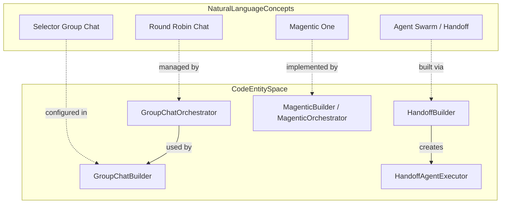
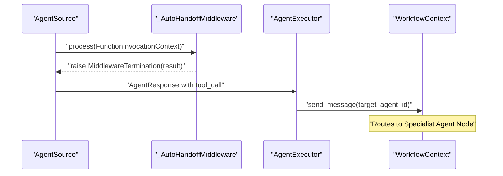
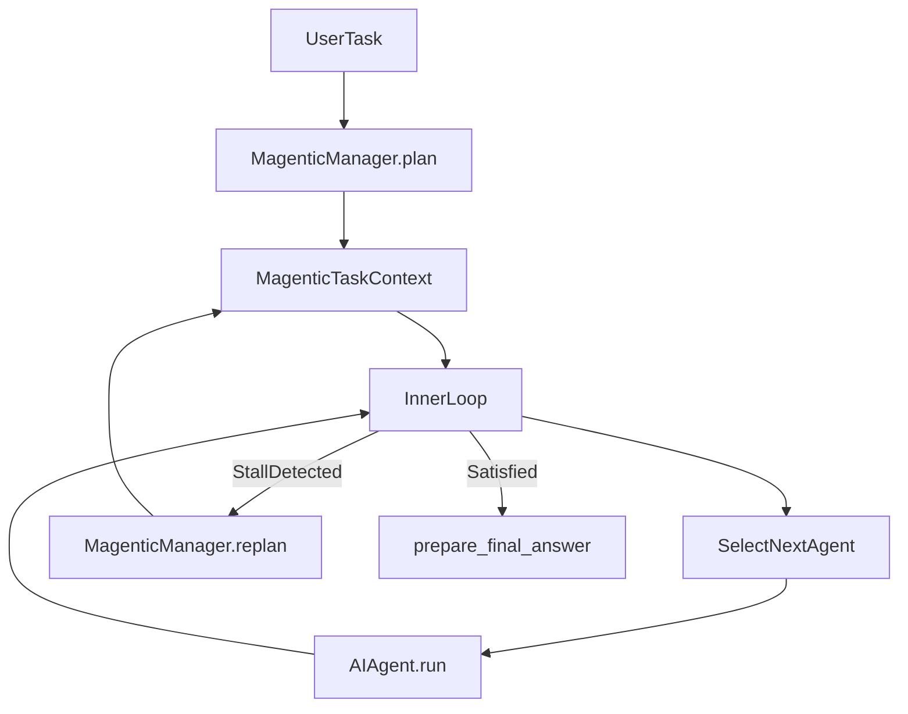

<!-- source: DeepWiki mcp.deepwiki.com · repo microsoft/agent-framework · extra page Group Chat and Advanced Patterns · fetched 2026-10-26 -->

# Group Chat and Advanced Patterns

Relevant source files

The following files were used as context for generating this wiki page:

- [dotnet/samples/03-workflows/Orchestration/Magentic/Magentic.csproj](dotnet/samples/03-workflows/Orchestration/Magentic/Magentic.csproj)
- [dotnet/samples/03-workflows/Orchestration/Magentic/Program.cs](dotnet/samples/03-workflows/Orchestration/Magentic/Program.cs)
- [dotnet/src/Microsoft.Agents.AI.Workflows/ExecutorEvent.cs](dotnet/src/Microsoft.Agents.AI.Workflows/ExecutorEvent.cs)
- [dotnet/src/Microsoft.Agents.AI.Workflows/MagenticDefaultPrompts.cs](dotnet/src/Microsoft.Agents.AI.Workflows/MagenticDefaultPrompts.cs)
- [dotnet/src/Microsoft.Agents.AI.Workflows/MagenticPlanReviewRequest.cs](dotnet/src/Microsoft.Agents.AI.Workflows/MagenticPlanReviewRequest.cs)
- [dotnet/src/Microsoft.Agents.AI.Workflows/MagenticPlanReviewResponse.cs](dotnet/src/Microsoft.Agents.AI.Workflows/MagenticPlanReviewResponse.cs)
- [dotnet/src/Microsoft.Agents.AI.Workflows/MagenticProgressLedger.cs](dotnet/src/Microsoft.Agents.AI.Workflows/MagenticProgressLedger.cs)
- [dotnet/src/Microsoft.Agents.AI.Workflows/MagenticPromptOverrides.cs](dotnet/src/Microsoft.Agents.AI.Workflows/MagenticPromptOverrides.cs)
- [dotnet/src/Microsoft.Agents.AI.Workflows/MagenticWorkflowBuilder.cs](dotnet/src/Microsoft.Agents.AI.Workflows/MagenticWorkflowBuilder.cs)
- [dotnet/src/Microsoft.Agents.AI.Workflows/ResetChatSignal.cs](dotnet/src/Microsoft.Agents.AI.Workflows/ResetChatSignal.cs)
- [dotnet/src/Microsoft.Agents.AI.Workflows/Specialized/HandoffMessagesFilter.cs](dotnet/src/Microsoft.Agents.AI.Workflows/Specialized/HandoffMessagesFilter.cs)
- [dotnet/src/Microsoft.Agents.AI.Workflows/Specialized/Magentic/ChatMessageExtensions.cs](dotnet/src/Microsoft.Agents.AI.Workflows/Specialized/Magentic/ChatMessageExtensions.cs)
- [dotnet/src/Microsoft.Agents.AI.Workflows/Specialized/Magentic/ExecutorAgentHarness.cs](dotnet/src/Microsoft.Agents.AI.Workflows/Specialized/Magentic/ExecutorAgentHarness.cs)
- [dotnet/src/Microsoft.Agents.AI.Workflows/Specialized/Magentic/MagenticConstants.cs](dotnet/src/Microsoft.Agents.AI.Workflows/Specialized/Magentic/MagenticConstants.cs)
- [dotnet/src/Microsoft.Agents.AI.Workflows/Specialized/Magentic/MagenticManager.cs](dotnet/src/Microsoft.Agents.AI.Workflows/Specialized/Magentic/MagenticManager.cs)
- [dotnet/src/Microsoft.Agents.AI.Workflows/Specialized/Magentic/MagenticOrchestrator.cs](dotnet/src/Microsoft.Agents.AI.Workflows/Specialized/Magentic/MagenticOrchestrator.cs)
- [dotnet/src/Microsoft.Agents.AI.Workflows/Specialized/Magentic/MagenticTaskContext.cs](dotnet/src/Microsoft.Agents.AI.Workflows/Specialized/Magentic/MagenticTaskContext.cs)
- [dotnet/src/Microsoft.Agents.AI.Workflows/Specialized/Magentic/PromptTemplates.cs](dotnet/src/Microsoft.Agents.AI.Workflows/Specialized/Magentic/PromptTemplates.cs)
- [dotnet/tests/Microsoft.Agents.AI.Workflows.UnitTests/HandoffMessageFilterTests.cs](dotnet/tests/Microsoft.Agents.AI.Workflows.UnitTests/HandoffMessageFilterTests.cs)
- [dotnet/tests/Microsoft.Agents.AI.Workflows.UnitTests/MagenticOrchestrationTests.cs](dotnet/tests/Microsoft.Agents.AI.Workflows.UnitTests/MagenticOrchestrationTests.cs)
- [dotnet/tests/Microsoft.Agents.AI.Workflows.UnitTests/MagenticWorkflowBuilderTests.cs](dotnet/tests/Microsoft.Agents.AI.Workflows.UnitTests/MagenticWorkflowBuilderTests.cs)
- [dotnet/tests/Microsoft.Agents.AI.Workflows.UnitTests/Microsoft.Agents.AI.Workflows.UnitTests.csproj](dotnet/tests/Microsoft.Agents.AI.Workflows.UnitTests/Microsoft.Agents.AI.Workflows.UnitTests.csproj)
- [dotnet/tests/Microsoft.Agents.AI.Workflows.UnitTests/PromptTemplatesTests.cs](dotnet/tests/Microsoft.Agents.AI.Workflows.UnitTests/PromptTemplatesTests.cs)
- [dotnet/tests/Microsoft.Agents.AI.Workflows.UnitTests/RecordingEchoAgent.cs](dotnet/tests/Microsoft.Agents.AI.Workflows.UnitTests/RecordingEchoAgent.cs)
- [dotnet/tests/Microsoft.Agents.AI.Workflows.UnitTests/RecordingReplayAgent.cs](dotnet/tests/Microsoft.Agents.AI.Workflows.UnitTests/RecordingReplayAgent.cs)
- [python/packages/core/agent_framework/_workflows/_agent_utils.py](python/packages/core/agent_framework/_workflows/_agent_utils.py)
- [python/packages/orchestrations/README.md](python/packages/orchestrations/README.md)
- [python/packages/orchestrations/agent_framework_orchestrations/_concurrent.py](python/packages/orchestrations/agent_framework_orchestrations/_concurrent.py)
- [python/packages/orchestrations/agent_framework_orchestrations/_group_chat.py](python/packages/orchestrations/agent_framework_orchestrations/_group_chat.py)
- [python/packages/orchestrations/agent_framework_orchestrations/_handoff.py](python/packages/orchestrations/agent_framework_orchestrations/_handoff.py)
- [python/packages/orchestrations/agent_framework_orchestrations/_magentic.py](python/packages/orchestrations/agent_framework_orchestrations/_magentic.py)
- [python/packages/orchestrations/agent_framework_orchestrations/_orchestration_request_info.py](python/packages/orchestrations/agent_framework_orchestrations/_orchestration_request_info.py)
- [python/packages/orchestrations/agent_framework_orchestrations/_orchestrator_helpers.py](python/packages/orchestrations/agent_framework_orchestrations/_orchestrator_helpers.py)
- [python/packages/orchestrations/agent_framework_orchestrations/_sequential.py](python/packages/orchestrations/agent_framework_orchestrations/_sequential.py)
- [python/packages/orchestrations/tests/test_concurrent.py](python/packages/orchestrations/tests/test_concurrent.py)
- [python/packages/orchestrations/tests/test_group_chat.py](python/packages/orchestrations/tests/test_group_chat.py)
- [python/packages/orchestrations/tests/test_handoff.py](python/packages/orchestrations/tests/test_handoff.py)
- [python/packages/orchestrations/tests/test_magentic.py](python/packages/orchestrations/tests/test_magentic.py)
- [python/packages/orchestrations/tests/test_orchestration_request_info.py](python/packages/orchestrations/tests/test_orchestration_request_info.py)
- [python/packages/orchestrations/tests/test_sequential.py](python/packages/orchestrations/tests/test_sequential.py)
- [python/samples/03-workflows/orchestrations/sequential_chain_only_agent_responses.py](python/samples/03-workflows/orchestrations/sequential_chain_only_agent_responses.py)

This page explains group chat orchestration, selector strategies, magentic workflows, and advanced multi-agent patterns within the Microsoft Agent Framework. These advanced patterns enable complex multi-agent interactions where control flow is determined dynamically by agents, selection logic, or specialized orchestration builders.

Sources: [python/packages/orchestrations/agent_framework_orchestrations/_handoff.py:1-30](), [dotnet/src/Microsoft.Agents.AI.Workflows/MagenticWorkflowBuilder.cs:17-29]()

---

## Group Chat Orchestration

Group chat orchestration enables multiple agents to participate in a shared conversational space. Unlike simple sequential flows, group chats involve dynamic turn-taking or centralized orchestration.

### Centralized vs. Decentralized Orchestration
The framework distinguishes between two primary multi-agent communication models:
*   **Group Chat**: Centralized orchestration where an orchestrator or manager decides who speaks next `[python/packages/orchestrations/agent_framework_orchestrations/_handoff.py:20]()`.
*   **Handoff**: Decentralized routing where agents themselves decide who to hand off to by invoking specific tools `[python/packages/orchestrations/agent_framework_orchestrations/_handoff.py:21-25]()`.

### Architecture: Natural Language Space to Code Entity Space

The following diagram bridges conceptual multi-agent patterns with the specific code entities that implement them in the Agent Framework.

**Multi-Agent Orchestration Mapping**

Sources: [python/packages/orchestrations/agent_framework_orchestrations/_handoff.py:16-30](), [python/packages/orchestrations/agent_framework_orchestrations/_magentic.py:32-40](), [dotnet/src/Microsoft.Agents.AI.Workflows/MagenticWorkflowBuilder.cs:31-40](), [dotnet/src/Microsoft.Agents.AI.Workflows/Specialized/Magentic/MagenticOrchestrator.cs:82-84](), [python/packages/orchestrations/agent_framework_orchestrations/_group_chat.py:100-118]()

### GroupChatOrchestrator and GroupChatState
The `GroupChatOrchestrator` manages conversations using a pluggable `GroupChatSelectionFunction` that evaluates the immutable `GroupChatState` (containing `current_round`, `participants`, and `conversation`) to return the name of the next speaker `[python/packages/orchestrations/agent_framework_orchestrations/_group_chat.py:75-118]()`.

Sources: [python/packages/orchestrations/agent_framework_orchestrations/_group_chat.py:75-146]()

---

## Swarm and Handoff Patterns

The "Swarm" or "Handoff" pattern allows agents to autonomously transfer control to specialists using function calling.

### Handoff Implementation
1.  **Handoff Tools**: The framework generates standardized tool names like `handoff_to_{target_id}` `[python/packages/orchestrations/agent_framework_orchestrations/_handoff.py:130-136]()`.
2.  **Middleware Interception**: The `_AutoHandoffMiddleware` intercepts these tool calls and injects synthetic results to short-circuit the agent's execution and signal the workflow to route to the next agent `[python/packages/orchestrations/agent_framework_orchestrations/_handoff.py:142-170]()`.
3.  **Conversation Cleaning**: Before handing off, the conversation is cleaned using `clean_conversation_for_handoff` to ensure the target agent receives a relevant history without internal orchestration artifacts `[python/packages/orchestrations/agent_framework_orchestrations/_orchestrator_helpers.py:22-68]()`.
4.  **Handoff Events**: When a handoff occurs, a `HandoffSentEvent` is emitted, capturing the `source` and `target` agent identifiers `[python/packages/orchestrations/agent_framework_orchestrations/_handoff.py:81-88]()`.
5.  **Filtering**: In .NET, `HandoffMessagesFilter` can be used to prune handoff-related function calls and results from the message history `[dotnet/src/Microsoft.Agents.AI.Workflows/Specialized/HandoffMessagesFilter.cs:9-33]()`.

**Handoff Internal Flow**

Sources: [python/packages/orchestrations/agent_framework_orchestrations/_handoff.py:132-170](), [python/packages/orchestrations/agent_framework_orchestrations/_handoff.py:81-88]()

---

## Magentic-One and Advanced Orchestrators

Magentic-One is a sophisticated multi-agent pattern where a "Manager" agent coordinates a team through dynamic planning and progress tracking.

### Magentic Orchestration Lifecycle
The `MagenticOrchestrator` manages a multi-step loop:
1.  **Planning**: Upon receiving a task, the manager creates a task ledger containing verified facts and a step-by-step plan `[dotnet/src/Microsoft.Agents.AI.Workflows/Specialized/Magentic/MagenticOrchestrator.cs:65-66]()`.
2.  **Inner Loop**: The orchestrator tracks progress using a progress ledger, which determines the next speaker and checks for task completion or stalling `[dotnet/src/Microsoft.Agents.AI.Workflows/Specialized/Magentic/MagenticOrchestrator.cs:67-71]()`.
3.  **Replanning**: If the team stalls (fails to make progress over multiple rounds), the manager performs a replan to update the fact sheet and strategy `[dotnet/src/Microsoft.Agents.AI.Workflows/Specialized/Magentic/MagenticOrchestrator.cs:73-74]()`.
4.  **Events**: Orchestration progress is surfaced via `MagenticPlanCreatedEvent`, `MagenticReplannedEvent`, and `MagenticProgressLedgerUpdatedEvent` `[dotnet/src/Microsoft.Agents.AI.Workflows/Specialized/Magentic/MagenticOrchestrator.cs:28-58]()`.

### Magentic Components and Data Flow

| Component | Role | Code Entity |
| :--- | :--- | :--- |
| **Manager** | LLM-powered lead that plans and selects agents. | `MagenticManager` / `MagenticManagerBase` `[dotnet/src/Microsoft.Agents.AI.Workflows/Specialized/Magentic/MagenticOrchestrator.cs:85]()` |
| **Task Ledger** | Stores current facts and the active plan. | `TaskLedger` / `MagenticTaskContext` `[dotnet/src/Microsoft.Agents.AI.Workflows/Specialized/Magentic/MagenticOrchestrator.cs:93]()` |
| **Progress Ledger** | Dynamic state tracking for the current round. | `MagenticProgressLedger` `[dotnet/src/Microsoft.Agents.AI.Workflows/Specialized/Magentic/MagenticOrchestrator.cs:52]()` |
| **Signoff** | HITL step to approve plans. | `MagenticPlanReviewRequest` `[dotnet/src/Microsoft.Agents.AI.Workflows/Specialized/Magentic/MagenticOrchestrator.cs:119]()` |

**Magentic Data Flow**

Sources: [python/packages/orchestrations/agent_framework_orchestrations/_magentic.py:125-152](), [dotnet/src/Microsoft.Agents.AI.Workflows/Specialized/Magentic/MagenticOrchestrator.cs:60-85]()

---

## Specialized Orchestration Builders

The framework provides high-level builders in the Python `orchestrations` package and .NET `Workflows` namespace to simplify complex wiring.

### Sequential and Concurrent Patterns
*   **SequentialBuilder**: Chains agents where each agent receives the full conversation history from previous turns, or restricted via intermediate output configuration `[python/packages/orchestrations/README.md:13-27]()`.
*   **ConcurrentBuilder**: Implements fan-out/fan-in patterns by broadcasting requests to all participants in parallel and aggregating results `[python/packages/orchestrations/README.md:29-37]()`.

### Magentic Builders
*   **MagenticWorkflowBuilder (.NET)**: Configures the Magentic-One pattern, allowing for limits on rounds, stalls, and resets, alongside experimental features like `WithResponseLanguage` and `WithPromptOverrides` `[dotnet/src/Microsoft.Agents.AI.Workflows/MagenticWorkflowBuilder.cs:34-146]()`.
*   **MagenticBuilder (Python)**: Provides a high-level interface utilizing `MagenticManagerBase` and `MagenticOrchestrator` `[python/packages/orchestrations/README.md:81-93]()`.

### State and Persistence
Orchestrations rely on a robust checkpointing system to persist multi-agent state. In Python, `MagenticManagerBase` implements checkpoint serialization hooks to manage internal task ledgers and iteration counters `[python/packages/orchestrations/tests/test_magentic.py:98-124]()`.

Sources: [dotnet/src/Microsoft.Agents.AI.Workflows/MagenticWorkflowBuilder.cs:31-146](), [python/packages/orchestrations/README.md:13-93](), [python/packages/orchestrations/tests/test_magentic.py:98-124]()

---

