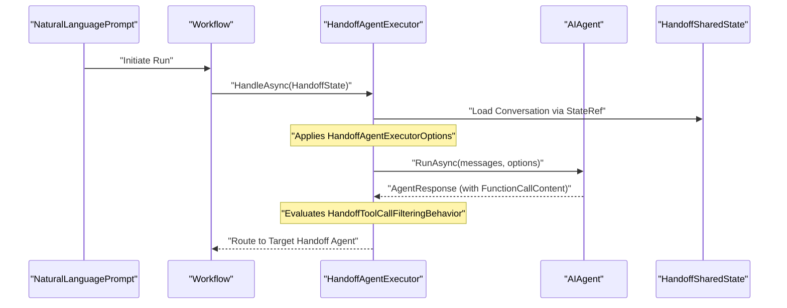

<!-- source: DeepWiki mcp.deepwiki.com · repo microsoft/agent-framework · extra page Handoff Pattern · fetched 2026-10-26 -->

# Handoff Pattern

<details>
<summary>Relevant source files</summary>

The following files were used as context for generating this wiki page:

- [dotnet/src/Microsoft.Agents.AI.Abstractions/AgentRunOptions.cs](dotnet/src/Microsoft.Agents.AI.Abstractions/AgentRunOptions.cs)
- [dotnet/src/Microsoft.Agents.AI.Workflows/AgentWorkflowBuilder.cs](dotnet/src/Microsoft.Agents.AI.Workflows/AgentWorkflowBuilder.cs)
- [dotnet/src/Microsoft.Agents.AI.Workflows/HandoffWorkflowBuilder.cs](dotnet/src/Microsoft.Agents.AI.Workflows/HandoffWorkflowBuilder.cs)
- [dotnet/src/Microsoft.Agents.AI.Workflows/MessageMerger.cs](dotnet/src/Microsoft.Agents.AI.Workflows/MessageMerger.cs)
- [dotnet/src/Microsoft.Agents.AI.Workflows/Specialized/HandoffAgentExecutor.cs](dotnet/src/Microsoft.Agents.AI.Workflows/Specialized/HandoffAgentExecutor.cs)
- [dotnet/src/Microsoft.Agents.AI.Workflows/Specialized/HandoffEndExecutor.cs](dotnet/src/Microsoft.Agents.AI.Workflows/Specialized/HandoffEndExecutor.cs)
- [dotnet/src/Microsoft.Agents.AI.Workflows/Specialized/HandoffStartExecutor.cs](dotnet/src/Microsoft.Agents.AI.Workflows/Specialized/HandoffStartExecutor.cs)
- [dotnet/src/Microsoft.Agents.AI.Workflows/Specialized/HandoffState.cs](dotnet/src/Microsoft.Agents.AI.Workflows/Specialized/HandoffState.cs)
- [dotnet/src/Microsoft.Agents.AI.Workflows/Specialized/Magentic/StreamingToolCallResultPairMatcher.cs](dotnet/src/Microsoft.Agents.AI.Workflows/Specialized/Magentic/StreamingToolCallResultPairMatcher.cs)
- [dotnet/src/Microsoft.Agents.AI.Workflows/Specialized/MultiPartyConversation.cs](dotnet/src/Microsoft.Agents.AI.Workflows/Specialized/MultiPartyConversation.cs)
- [dotnet/tests/Microsoft.Agents.AI.Abstractions.UnitTests/AgentRunOptionsTests.cs](dotnet/tests/Microsoft.Agents.AI.Abstractions.UnitTests/AgentRunOptionsTests.cs)
- [dotnet/tests/Microsoft.Agents.AI.Workflows.UnitTests/AgentWorkflowBuilderTests.cs](dotnet/tests/Microsoft.Agents.AI.Workflows.UnitTests/AgentWorkflowBuilderTests.cs)
- [dotnet/tests/Microsoft.Agents.AI.Workflows.UnitTests/HandoffAgentExecutorTests.cs](dotnet/tests/Microsoft.Agents.AI.Workflows.UnitTests/HandoffAgentExecutorTests.cs)
- [dotnet/tests/Microsoft.Agents.AI.Workflows.UnitTests/HandoffOrchestrationTests.cs](dotnet/tests/Microsoft.Agents.AI.Workflows.UnitTests/HandoffOrchestrationTests.cs)
- [dotnet/tests/Microsoft.Agents.AI.Workflows.UnitTests/MessageMergerTests.cs](dotnet/tests/Microsoft.Agents.AI.Workflows.UnitTests/MessageMergerTests.cs)
- [dotnet/tests/Microsoft.Agents.AI.Workflows.UnitTests/Sample/06_GroupChat_Workflow.cs](dotnet/tests/Microsoft.Agents.AI.Workflows.UnitTests/Sample/06_GroupChat_Workflow.cs)
- [dotnet/tests/Microsoft.Agents.AI.Workflows.UnitTests/Sample/07_GroupChat_Workflow_HostAsAgent.cs](dotnet/tests/Microsoft.Agents.AI.Workflows.UnitTests/Sample/07_GroupChat_Workflow_HostAsAgent.cs)
- [dotnet/tests/Microsoft.Agents.AI.Workflows.UnitTests/Sample/10_Sequential_HostAsAgent.cs](dotnet/tests/Microsoft.Agents.AI.Workflows.UnitTests/Sample/10_Sequential_HostAsAgent.cs)
- [dotnet/tests/Microsoft.Agents.AI.Workflows.UnitTests/Sample/11_Concurrent_HostAsAgent.cs](dotnet/tests/Microsoft.Agents.AI.Workflows.UnitTests/Sample/11_Concurrent_HostAsAgent.cs)
- [dotnet/tests/Microsoft.Agents.AI.Workflows.UnitTests/Sample/12_HandOff_HostAsAgent.cs](dotnet/tests/Microsoft.Agents.AI.Workflows.UnitTests/Sample/12_HandOff_HostAsAgent.cs)
- [python/packages/core/agent_framework/_workflows/_agent_utils.py](python/packages/core/agent_framework/_workflows/_agent_utils.py)
- [python/packages/orchestrations/README.md](python/packages/orchestrations/README.md)
- [python/packages/orchestrations/agent_framework_orchestrations/_concurrent.py](python/packages/orchestrations/agent_framework_orchestrations/_concurrent.py)
- [python/packages/orchestrations/agent_framework_orchestrations/_group_chat.py](python/packages/orchestrations/agent_framework_orchestrations/_group_chat.py)
- [python/packages/orchestrations/agent_framework_orchestrations/_handoff.py](python/packages/orchestrations/agent_framework_orchestrations/_handoff.py)
- [python/packages/orchestrations/agent_framework_orchestrations/_magentic.py](python/packages/orchestrations/agent_framework_orchestrations/_magentic.py)
- [python/packages/orchestrations/agent_framework_orchestrations/_orchestration_request_info.py](python/packages/orchestrations/agent_framework_orchestrations/_orchestration_request_info.py)
- [python/packages/orchestrations/agent_framework_orchestrations/_orchestrator_helpers.py](python/packages/orchestrations/agent_framework_orchestrations/_orchestrator_helpers.py)
- [python/packages/orchestrations/agent_framework_orchestrations/_sequential.py](python/packages/orchestrations/agent_framework_orchestrations/_sequential.py)
- [python/packages/orchestrations/tests/test_concurrent.py](python/packages/orchestrations/tests/test_concurrent.py)
- [python/packages/orchestrations/tests/test_group_chat.py](python/packages/orchestrations/tests/test_group_chat.py)
- [python/packages/orchestrations/tests/test_handoff.py](python/packages/orchestrations/tests/test_handoff.py)
- [python/packages/orchestrations/tests/test_magentic.py](python/packages/orchestrations/tests/test_magentic.py)
- [python/packages/orchestrations/tests/test_orchestration_request_info.py](python/packages/orchestrations/tests/test_orchestration_request_info.py)
- [python/packages/orchestrations/tests/test_sequential.py](python/packages/orchestrations/tests/test_sequential.py)
- [python/samples/03-workflows/orchestrations/sequential_chain_only_agent_responses.py](python/samples/03-workflows/orchestrations/sequential_chain_only_agent_responses.py)

</details>


## Purpose and Scope

The Handoff Pattern is a multi-agent orchestration approach that enables autonomous agent-to-agent transitions based on conversation context and agent capabilities. Unlike fixed-order orchestration patterns, the handoff pattern allows agents to dynamically transfer control to the most appropriate specialist for the next step of a task.

In this pattern, agents themselves decide when and to whom to transfer control by invoking a standardized handoff tool. This decentralized routing distinguishes it from Group Chat (centralized orchestration) and Sequential patterns (fixed pipelines).

Sources: [python/packages/orchestrations/agent_framework_orchestrations/_handoff.py:3-30](), [dotnet/src/Microsoft.Agents.AI.Workflows/HandoffWorkflowBuilder.cs:33-43]()

## Core Concepts

### Autonomous Handoffs
Agents signal a handoff by calling a tool (e.g., `handoff_to_specialist`). In the Python implementation, the `_AutoHandoffMiddleware` intercepts these tool calls and injects synthetic results into the participant's execution flow [python/packages/orchestrations/agent_framework_orchestrations/_handoff.py:142-170](). In .NET, the `HandoffWorkflowBuilder` manages the transition logic by creating `HandoffAgentExecutor` instances for each participant and defining handoff function declarations using `HandoffWorkflowBuilder.FunctionPrefix` [dotnet/src/Microsoft.Agents.AI.Workflows/HandoffWorkflowBuilder.cs:28-43](), [dotnet/src/Microsoft.Agents.AI.Workflows/Specialized/HandoffAgentExecutor.cs:84-86]().

### Context Preservation
The entire conversation history is maintained and passed to the target agent during every hop. This ensures the specialist has full context of the preceding interaction. The `clean_conversation_for_handoff` utility is used in Python to prepare the message list before the next agent takes its turn [python/packages/orchestrations/agent_framework_orchestrations/_handoff.py:24-24](), [python/packages/orchestrations/agent_framework_orchestrations/_handoff.py:57-57](). In .NET, this is managed via `HandoffSharedState` accessed by `HandoffStartExecutor` and `HandoffAgentExecutor` [dotnet/src/Microsoft.Agents.AI.Workflows/Specialized/HandoffAgentExecutor.cs:56-63](), [dotnet/src/Microsoft.Agents.AI.Workflows/Specialized/HandoffAgentExecutor.cs:100-118]().

### Human-in-the-Loop (HITL) vs. Autonomous Mode
*   **Human-in-the-Loop (Default):** The workflow requests user input after every agent response that does not trigger a handoff [python/packages/orchestrations/agent_framework_orchestrations/_handoff.py:26-27]().
*   **Autonomous Mode:** Agents continue responding and handing off until they reach a termination condition or a maximum turn limit. If the turn limit is reached without a handoff, the system may prompt the user to continue [python/packages/orchestrations/agent_framework_orchestrations/_handoff.py:28-30](). In .NET, this is configured via `_autonomousTurnLimit` and `_autonomousContinuationPrompt` [dotnet/src/Microsoft.Agents.AI.Workflows/HandoffWorkflowBuilder.cs:58-63]().

Sources: [python/packages/orchestrations/agent_framework_orchestrations/_handoff.py:3-30](), [dotnet/src/Microsoft.Agents.AI.Workflows/Specialized/HandoffAgentExecutor.cs:100-118](), [dotnet/src/Microsoft.Agents.AI.Workflows/HandoffWorkflowBuilder.cs:58-63]()

## Architecture and Data Flow

### Handoff Tool Mechanism
The framework uses a specialized middleware or filtering layer to intercept handoff tool calls. Instead of executing a real function, the system identifies the target agent ID from the tool call and routes the workflow execution to that agent's executor.

### Diagram: Python Handoff Routing (Natural Language to Code Entity Space)

```mermaid
graph TB
    subgraph NaturalLanguageSpace["Natural Language Space"]
        UserPrompt[""I need a refund for order 123""]
        AgentThought[""I am Triage. I should send this to RefundAgent.""]
    end

    subgraph CodeEntitySpacePython["Code Entity Space (Python)"]
        Agent[""Agent (Triage)""]
        Tool[""get_handoff_tool_name""]
        Middleware[""_AutoHandoffMiddleware""]
        WorkflowBuilder[""WorkflowBuilder""]
        Executor[""HandoffAgentExecutor""]
        ResultKey[""HANDOFF_FUNCTION_RESULT_KEY""]
    end

    UserPrompt --> Agent
    Agent --> AgentThought
    AgentThought --> Tool
    Tool -- "Intercepted by" --> Middleware
    Middleware -- "Parses" --> ResultKey
    ResultKey -- "Terminates via" --> WorkflowBuilder
    WorkflowBuilder -- "Activates" --> Executor
```

Sources: [python/packages/orchestrations/agent_framework_orchestrations/_handoff.py:130-170](), [python/packages/orchestrations/agent_framework_orchestrations/_handoff.py:139-139]()

### .NET Handoff Implementation
In .NET, the `HandoffAgentExecutor` manages the agent's turn and responds to `HandoffState` events. It utilizes state bindings to access the shared conversation history across the workflow [dotnet/src/Microsoft.Agents.AI.Workflows/Specialized/HandoffAgentExecutor.cs:65-81](), [dotnet/src/Microsoft.Agents.AI.Workflows/Specialized/HandoffAgentExecutor.cs:84-86]().

### Diagram: .NET Handoff Execution Flow (Natural Language to Code Entity Space)



Sources: [dotnet/src/Microsoft.Agents.AI.Workflows/Specialized/HandoffAgentExecutor.cs:16-38](), [dotnet/src/Microsoft.Agents.AI.Workflows/Specialized/HandoffAgentExecutor.cs:65-81](), [dotnet/src/Microsoft.Agents.AI.Workflows/Specialized/HandoffAgentExecutor.cs:84-115]()

## Implementation Details

### Participant Factories
In Python, participants can be provided as a static sequence or via factories, enabling dynamic resolution during workflow construction [python/packages/orchestrations/agent_framework_orchestrations/_handoff.py:32-40]().

### Tool Call Filtering
To prevent agents from seeing the internal plumbing of handoffs, the framework filters conversation history. In .NET, `HandoffToolCallFilteringBehavior` controls this:
*   `HandoffOnly`: Removes only tool calls and results prefixed with `handoff_to_` [dotnet/src/Microsoft.Agents.AI.Workflows/HandoffWorkflowBuilder.cs:39-43](), [dotnet/src/Microsoft.Agents.AI.Workflows/Specialized/HandoffAgentExecutor.cs:32-32]().
*   `All`: Strips all function calls and results from the history before the agent sees it.
*   `None`: Preserves all tool interactions in the history.

Sources: [dotnet/src/Microsoft.Agents.AI.Workflows/HandoffWorkflowBuilder.cs:39-50](), [dotnet/src/Microsoft.Agents.AI.Workflows/Specialized/HandoffAgentExecutor.cs:32-32]()

### Checkpoint and Resume
Handoff workflows support state persistence to allow resuming after a user turn. In .NET, `HandoffAgentExecutor` manages `HandoffAgentHostState` which includes a `ConversationBookmark` to track progress within the shared state [dotnet/src/Microsoft.Agents.AI.Workflows/Specialized/HandoffAgentExecutor.cs:56-63]().

Sources: [dotnet/src/Microsoft.Agents.AI.Workflows/Specialized/HandoffAgentExecutor.cs:56-63](), [dotnet/src/Microsoft.Agents.AI.Workflows/Specialized/HandoffAgentExecutor.cs:100-118]()

### Workflow as Agent Pattern
Workflows can be exposed as standard `AIAgent` instances using workflow hosting extensions, enabling hierarchical composition where a handoff workflow acts as a single agent.

Sources: [dotnet/tests/Microsoft.Agents.AI.Workflows.UnitTests/Sample/12_HandOff_HostAsAgent.cs:1-70]()

## Example: Customer Support Handoff

A triage agent routes to a specialist based on the user's request.

```python
# Python Example
from agent_framework.orchestrations import HandoffBuilder

triage = Agent(name="triage", instructions="Handoff to refund_agent for money issues.")
refund = Agent(name="refund_agent", instructions="Process refunds.")

builder = HandoffBuilder(participants=[triage, refund])
workflow = builder.build()
```

```csharp
// .NET Example
var builder = AgentWorkflowBuilder.CreateHandoffBuilderWith(triageAgent)
    .WithHandoff(triageAgent, refundAgent)
    .WithHandoffInstructions("You can hand off the conversation to another agent if appropriate.");
var workflow = builder.Build();
```

Sources: [python/packages/orchestrations/agent_framework_orchestrations/_handoff.py:3-30](), [dotnet/src/Microsoft.Agents.AI.Workflows/HandoffWorkflowBuilder.cs:88-94](), [dotnet/src/Microsoft.Agents.AI.Workflows/HandoffWorkflowBuilder.cs:105-109]()

### Data Structure: Handoff Agent User Request
When the workflow requires human intervention (non-autonomous mode), it handles requests using dedicated orchestration components and response wrappers [python/packages/orchestrations/agent_framework_orchestrations/_handoff.py:42-53]().

Sources: [python/packages/orchestrations/agent_framework_orchestrations/_handoff.py:42-53]()

---

