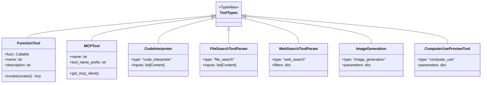
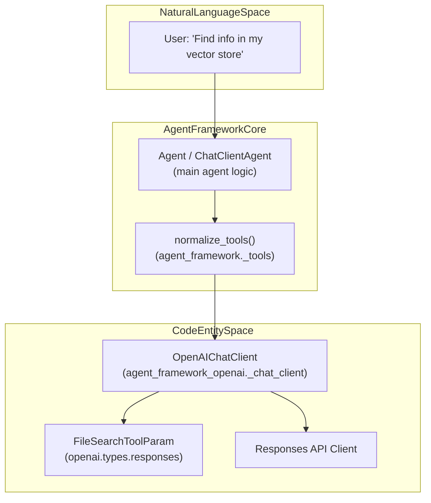
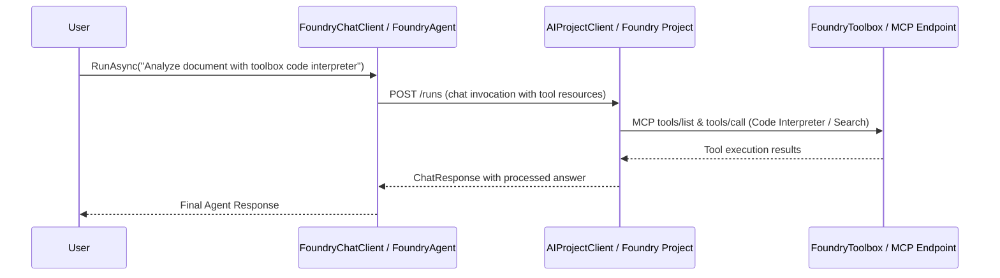

<!-- source: DeepWiki mcp.deepwiki.com · repo microsoft/agent-framework · extra page Hosted Tools · fetched 2026-10-26 -->

# Hosted Tools

Relevant source files

The following files were used as context for generating this wiki page:

- [python/packages/core/agent_framework/_feature_stage.py](python/packages/core/agent_framework/_feature_stage.py)
- [python/packages/core/tests/core/test_feature_stage.py](python/packages/core/tests/core/test_feature_stage.py)
- [python/packages/foundry/README.md](python/packages/foundry/README.md)
- [python/packages/foundry/agent_framework_foundry/_agent.py](python/packages/foundry/agent_framework_foundry/_agent.py)
- [python/packages/foundry/agent_framework_foundry/_chat_client.py](python/packages/foundry/agent_framework_foundry/_chat_client.py)
- [python/packages/foundry/tests/foundry/test_foundry_agent.py](python/packages/foundry/tests/foundry/test_foundry_agent.py)
- [python/packages/foundry/tests/foundry/test_foundry_chat_client.py](python/packages/foundry/tests/foundry/test_foundry_chat_client.py)
- [python/packages/foundry_hosting/agent_framework_foundry_hosting/_toolbox.py](python/packages/foundry_hosting/agent_framework_foundry_hosting/_toolbox.py)
- [python/packages/foundry_hosting/tests/test_toolbox.py](python/packages/foundry_hosting/tests/test_toolbox.py)
- [python/packages/openai/agent_framework_openai/_chat_client.py](python/packages/openai/agent_framework_openai/_chat_client.py)
- [python/packages/openai/agent_framework_openai/_chat_completion_client.py](python/packages/openai/agent_framework_openai/_chat_completion_client.py)
- [python/packages/openai/tests/openai/test_openai_chat_client.py](python/packages/openai/tests/openai/test_openai_chat_client.py)
- [python/packages/openai/tests/openai/test_openai_chat_completion_client.py](python/packages/openai/tests/openai/test_openai_chat_completion_client.py)
- [python/samples/04-hosting/foundry-hosted-agents/responses/files/README.md](python/samples/04-hosting/foundry-hosted-agents/responses/files/README.md)
- [python/samples/04-hosting/foundry-hosted-agents/responses/files/main.py](python/samples/04-hosting/foundry-hosted-agents/responses/files/main.py)
- [python/samples/04-hosting/foundry-hosted-agents/responses/foundry_toolbox/README.md](python/samples/04-hosting/foundry-hosted-agents/responses/foundry_toolbox/README.md)
- [python/samples/04-hosting/foundry-hosted-agents/responses/foundry_toolbox/main.py](python/samples/04-hosting/foundry-hosted-agents/responses/foundry_toolbox/main.py)
- [python/samples/04-hosting/foundry-hosted-agents/responses/foundry_toolbox_mcp_skills/README.md](python/samples/04-hosting/foundry-hosted-agents/responses/foundry_toolbox_mcp_skills/README.md)
- [python/samples/04-hosting/foundry-hosted-agents/responses/foundry_toolbox_mcp_skills/main.py](python/samples/04-hosting/foundry-hosted-agents/responses/foundry_toolbox_mcp_skills/main.py)

Hosted Tools in the Microsoft Agent Framework refer to service-managed capabilities that execute within the provider’s infrastructure rather than locally. Distinct from **Function Tools** (see [3.3.1]()), which execute code in your application environment, hosted tools leverage specialized infrastructure provided by large language model (LLM) providers such as OpenAI, Azure AI Foundry, Anthropic, and others. These tools perform complex tasks like code interpretation, file and web search, image generation, and computer interaction on behalf of the agent.

This page documents the key abstractions, data flow, provider-specific implementations, and integration details for hosted tools across supported providers.

---

## Tool Type Hierarchy

The framework supports a unified type alias `ToolTypes` that encompasses both local function tools and a variety of hosted tool types. This union enables agents to reference different tool categories consistently regardless of the underlying implementation or hosting environment.

### Primary Hosted Tool Types:

- **FunctionTool**: Local callable functions, defined via decorators or classes, executing in the agent host process.
- **MCPTool**: Tools integrated with the Model Context Protocol (MCP), enabling dynamic discovery and invocation of hosted skills or APIs.
- **HostedCodeInterpreterTool**: A hosted provider-side code interpreter, operating within the provider’s managed environment.
- **HostedFileSearchTool**: Hosted tools that perform file or vector store searches using provider-managed indexes.
- **HostedWebSearchTool**: Tools that conduct web searches directly through provider services.
- **HostedImageGenerationTool**: Hosted image generators invoking provider APIs.
- **HostedComputerUseTool**: Hosted tools that enable stateful interaction with computers or automation (supported in Foundry preview).

Diagram: Tool Type Hierarchy

Sources:
[python/packages/openai/agent_framework_openai/_chat_client.py:49-112]()
[python/packages/foundry/agent_framework_foundry/_chat_client.py:26-55]()

---

## Supported Hosted Tools by Provider

The following table summarizes which hosted tools are supported and their corresponding specific SDK representations in major providers:

| Tool Type          | OpenAI (Responses API)                      | OpenAI (Chat Completions)                  | Azure AI Foundry (Persistent Agents / FoundryChatClient) |
|--------------------|--------------------------------------------|--------------------------------------------|-----------------------------------------------------------|
| **Code Interpreter**| `CodeInterpreter` (`openai.types.responses.tool_param`) | Not supported                              | `CodeInterpreterTool` / `AutoCodeInterpreterToolParam` |
| **File Search**     | `FileSearchToolParam` (`openai.types.responses.file_search_tool_param`) | Not supported              | `ProjectsFileSearchTool` / `AzureAISearchTool` |
| **Web Search**      | `WebSearchToolParam` (`openai.types.responses.web_search_tool_param`) | `WebSearchOptions` (chat completion params) | `WebSearchTool` / `BingGroundingTool` |
| **Image Generation**| `ImageGeneration` (`openai.types.responses.tool_param`) | Not supported                      | `ImageGenTool` |
| **Computer Use**    | Not supported                              | Not supported                              | `ComputerUsePreviewTool` (preview feature) |
| **MCP Integration** | `Mcp` tool type natively supported         | No direct integration                      | `FoundryMCPTool` / Toolbox MCP endpoints |

Sources:
[python/packages/openai/agent_framework_openai/_chat_client.py:95-112]()
[python/packages/foundry/agent_framework_foundry/_chat_client.py:26-55]()
[python/packages/core/agent_framework/_feature_stage.py:43-70]()

---

## Hosted Content Types and Resource Resolvers

Hosted tools frequently work with "hosted content" that references entity IDs or provider-managed resources instead of raw data bytes. These content types represent references required by hosted tools for operation.

- `Content.from_hosted_file`: References to a file previously uploaded to the provider, providing a `file_id` for code interpreter or file search inputs.
- `Content.from_hosted_vector_store`: References an external vector store for retrieval operations.
- `resolve_file_ids`: Utility function in `agent_framework_foundry._chat_client` that resolves file IDs from strings or hosted-file `Content` objects before submitting requests to Foundry clients [python/packages/foundry/agent_framework_foundry/_chat_client.py:114-138]().

Sources:
[python/packages/foundry/agent_framework_foundry/_chat_client.py:114-138]()
[python/packages/openai/tests/openai/test_openai_chat_client.py:173-192]()

---

## Data Flow: Natural Language to Hosted Tool Invocation

The following diagram traces the flow from user natural language to invocation of provider-hosted tool APIs, bridging Natural Language Space to Code Entity Space.

Diagram: Natural Language to Hosted Tool Data Flow

This data flow shows that user requests are parsed and routed by the agent, which normalizes declared tools into provider-compatible formats. The OpenAI client then invokes the provider’s Responses API with hosted tool parameters, obtaining conversational results.

Sources:
[python/packages/openai/agent_framework_openai/_chat_client.py:44-59]()
[python/packages/openai/agent_framework_openai/_chat_completion_client.py:28-34]()

---

## Implementation Details: OpenAI Responses API & Azure AI Foundry Toolboxes

### Hosted Code Interpreter vs Local Shell Execution

- **Hosted Code Interpreter**: The OpenAI Responses API natively supports a hosted code interpreter as a managed external tool. The tool parameter `CodeInterpreter` triggers provider-executed code interpretations within a secure sandbox [python/packages/openai/agent_framework_openai/_chat_client.py:107-109]().
- **Local Shell Execution**: The framework supports invoking a local shell tool represented by a special kind (`SHELL_TOOL_KIND_VALUE`) and intercepts these calls via `FunctionInvocationLayer` middleware to safely execute code locally [python/packages/openai/agent_framework_openai/_chat_client.py:51-53](). Local shell call metadata is handled with keys like `OPENAI_LOCAL_SHELL_CALL_ITEM_ID_KEY` to correlate inputs and outputs in chat responses [python/packages/openai/agent_framework_openai/_chat_client.py:167]().

### Handling Hosted Tool Outputs

Hosted tools return specialized output content types which are parsed by the client:
- The client detects output types (e.g., `OPENAI_SHELL_OUTPUT_TYPE_SHELL_CALL`) embedded in response message contents and maps them back into conversation history with proper attribution [python/packages/openai/agent_framework_openai/_chat_client.py:169]().
- Hosted tool results are encapsulated as `Content` objects with relevant metadata for downstream processing or storage.

### Hosted Tool Approval Mechanism

Certain hosted tools (e.g., file or code interpreters) may require explicit human approval before execution.
- The framework uses an internal private utility `_is_hosted_tool_approval` to detect if a particular function call requires hosted tool approval [python/packages/openai/agent_framework_openai/_chat_client.py:56]().
- Approval calls from a hosted tool carry server and session context to ensure human-in-the-loop consent flows are honored securely.

Sources:
[python/packages/openai/agent_framework_openai/_chat_client.py:51-59,107-111,165-170]()

---

## Data Flow: Foundry Toolboxes and Persistent Agent Vector Search

Azure AI Foundry agents and `FoundryChatClient` demonstrate integration with hosted toolboxes (named, versioned bundles of hosted tool configurations stored in a Foundry project). Each toolbox is reachable as an MCP server connected via `MCPStreamableHTTPTool` or `FoundryToolbox` [python/packages/foundry_hosting/agent_framework_foundry_hosting/_toolbox.py:111-161]().

Diagram: Foundry Toolbox and Persistent Agent Data Flow

This sequence demonstrates how persistent agents or `FoundryChatClient` offload tool execution to cloud-managed toolboxes and vector search resources without requiring local sandboxes or indexing infrastructure.

Sources:
[python/packages/foundry/agent_framework_foundry/_agent.py:100-116]()
[python/packages/foundry/agent_framework_foundry/_chat_client.py:26-55]()
[python/packages/foundry_hosting/agent_framework_foundry_hosting/_toolbox.py:161-163]()
[python/packages/foundry/README.md:110-140]()

---

