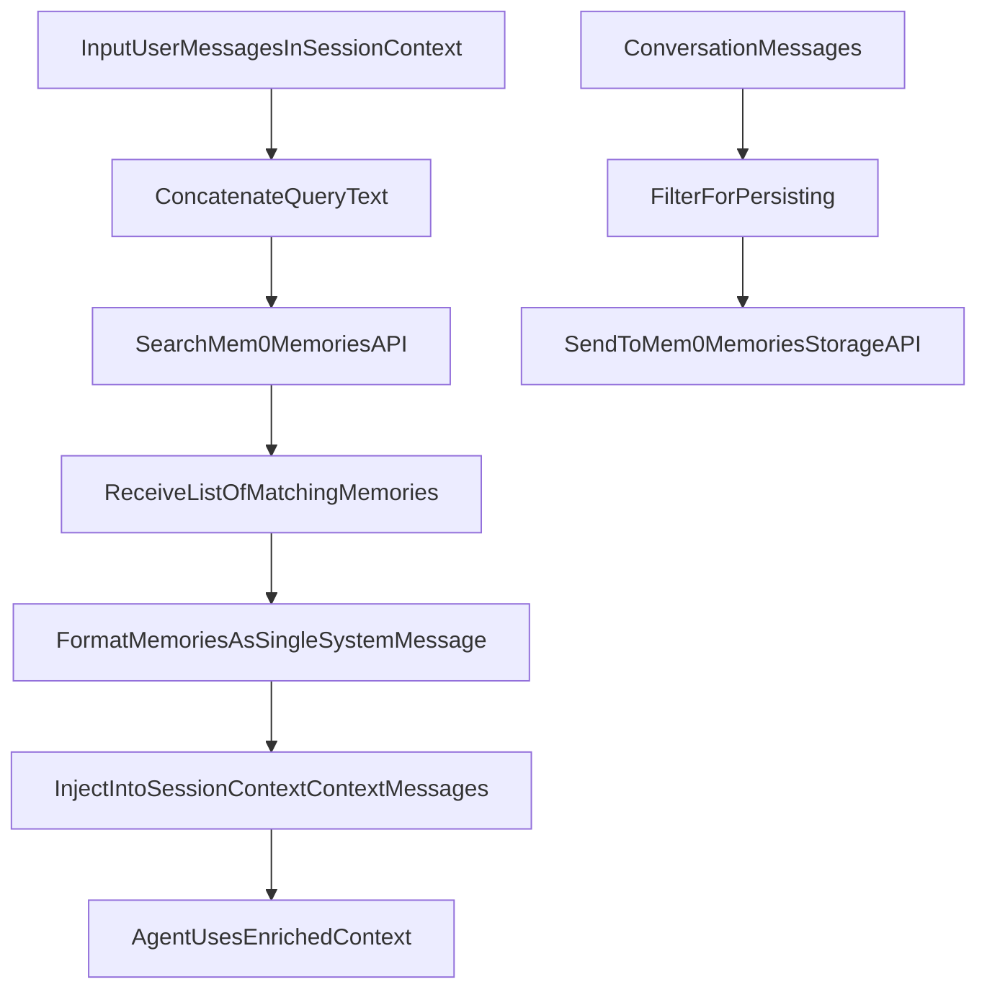
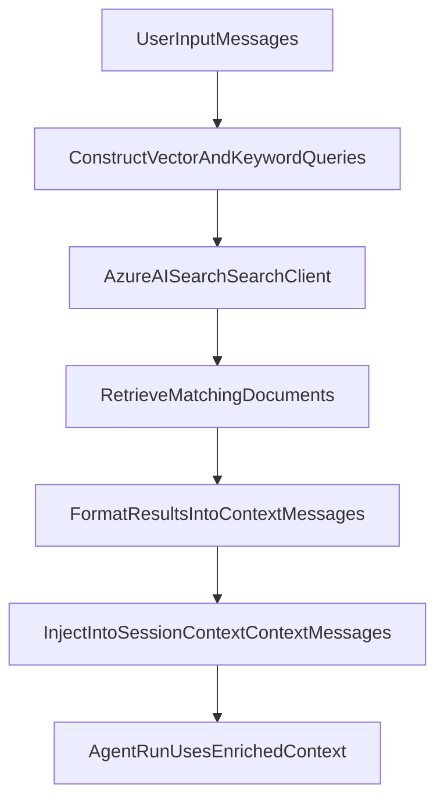
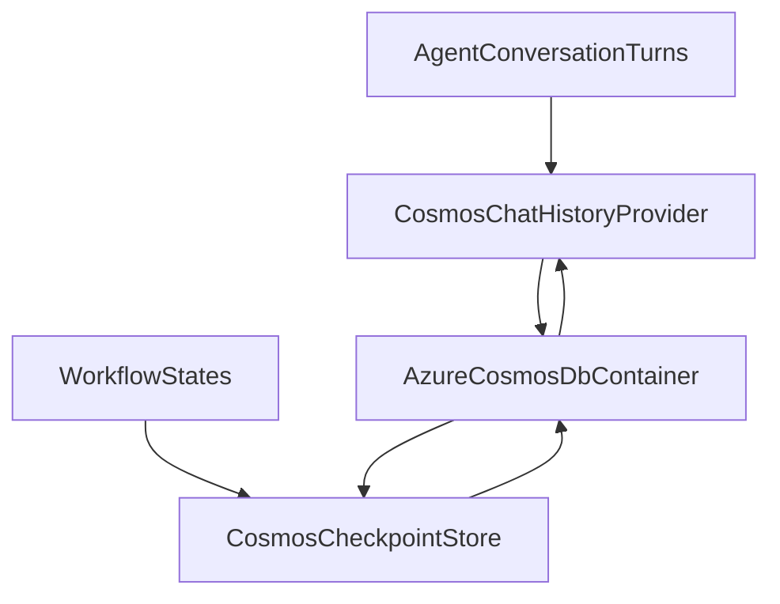
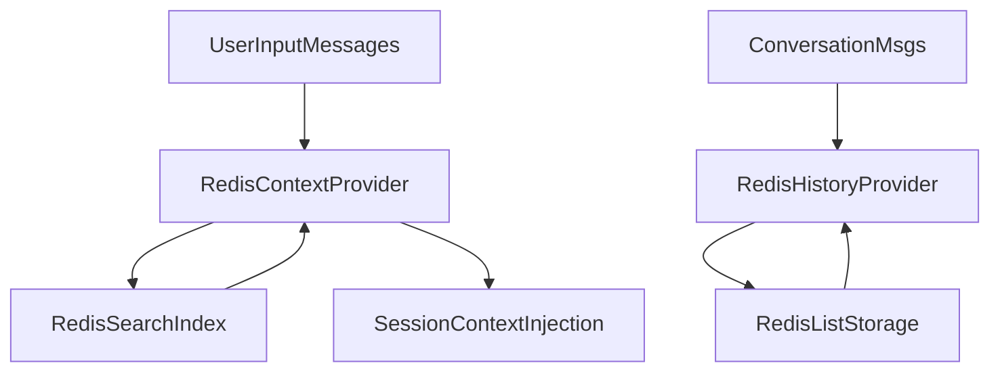
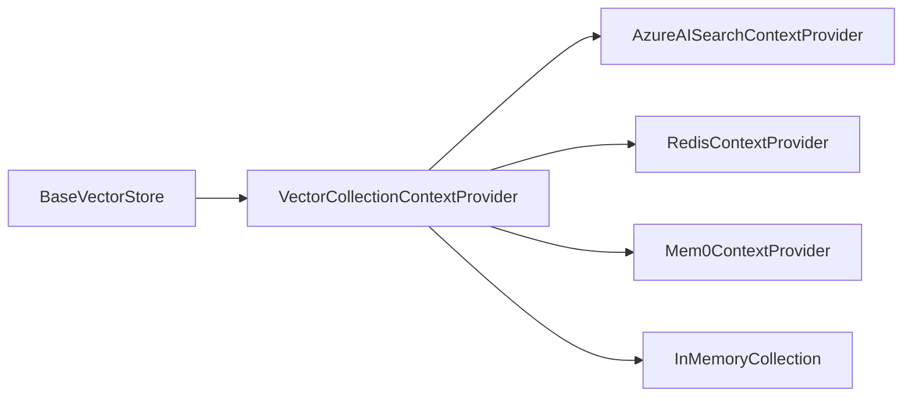
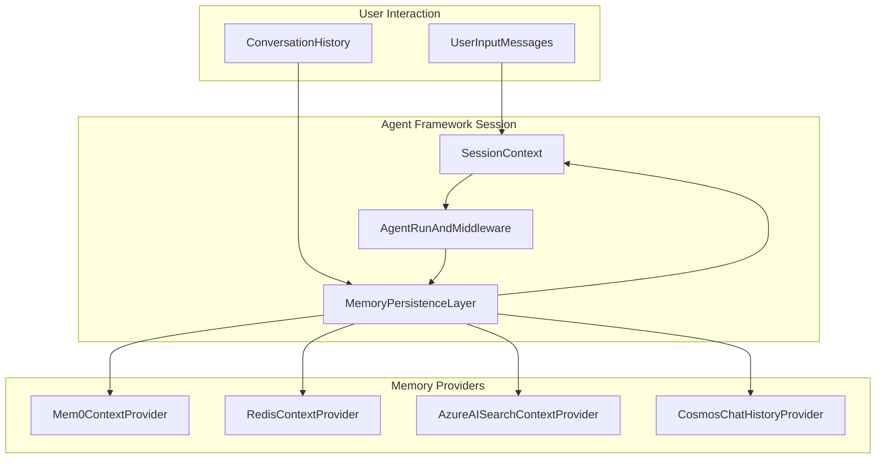

<!-- source: DeepWiki mcp.deepwiki.com · repo microsoft/agent-framework · extra page Memory Services Integration · fetched 2026-10-26 -->

# Memory Services Integration

Relevant source files

The following files were used as context for generating this wiki page:

- [.github/CODEOWNERS](.github/CODEOWNERS)
- [docs/features/vector-stores-and-embeddings/README.md](docs/features/vector-stores-and-embeddings/README.md)
- [dotnet/src/Microsoft.Agents.AI.CosmosNoSql/CosmosChatHistoryProvider.cs](dotnet/src/Microsoft.Agents.AI.CosmosNoSql/CosmosChatHistoryProvider.cs)
- [dotnet/src/Microsoft.Agents.AI.CosmosNoSql/CosmosCheckpointStore.cs](dotnet/src/Microsoft.Agents.AI.CosmosNoSql/CosmosCheckpointStore.cs)
- [dotnet/src/Microsoft.Agents.AI.CosmosNoSql/CosmosDBChatExtensions.cs](dotnet/src/Microsoft.Agents.AI.CosmosNoSql/CosmosDBChatExtensions.cs)
- [dotnet/src/Microsoft.Agents.AI.CosmosNoSql/CosmosDBWorkflowExtensions.cs](dotnet/src/Microsoft.Agents.AI.CosmosNoSql/CosmosDBWorkflowExtensions.cs)
- [dotnet/src/Microsoft.Agents.AI.CosmosNoSql/CosmosOptionsHelper.cs](dotnet/src/Microsoft.Agents.AI.CosmosNoSql/CosmosOptionsHelper.cs)
- [dotnet/src/Microsoft.Agents.AI.CosmosNoSql/Microsoft.Agents.AI.CosmosNoSql.csproj](dotnet/src/Microsoft.Agents.AI.CosmosNoSql/Microsoft.Agents.AI.CosmosNoSql.csproj)
- [dotnet/tests/Microsoft.Agents.AI.Abstractions.UnitTests/AIContextProviderTests.cs](dotnet/tests/Microsoft.Agents.AI.Abstractions.UnitTests/AIContextProviderTests.cs)
- [dotnet/tests/Microsoft.Agents.AI.Abstractions.UnitTests/ChatHistoryProviderTests.cs](dotnet/tests/Microsoft.Agents.AI.Abstractions.UnitTests/ChatHistoryProviderTests.cs)
- [dotnet/tests/Microsoft.Agents.AI.Abstractions.UnitTests/InMemoryChatHistoryProviderTests.cs](dotnet/tests/Microsoft.Agents.AI.Abstractions.UnitTests/InMemoryChatHistoryProviderTests.cs)
- [dotnet/tests/Microsoft.Agents.AI.CosmosNoSql.UnitTests/.editorconfig](dotnet/tests/Microsoft.Agents.AI.CosmosNoSql.UnitTests/.editorconfig)
- [dotnet/tests/Microsoft.Agents.AI.CosmosNoSql.UnitTests/CosmosChatHistoryProviderMaxBatchSizeTests.cs](dotnet/tests/Microsoft.Agents.AI.CosmosNoSql.UnitTests/CosmosChatHistoryProviderMaxBatchSizeTests.cs)
- [dotnet/tests/Microsoft.Agents.AI.CosmosNoSql.UnitTests/CosmosChatHistoryProviderTests.cs](dotnet/tests/Microsoft.Agents.AI.CosmosNoSql.UnitTests/CosmosChatHistoryProviderTests.cs)
- [dotnet/tests/Microsoft.Agents.AI.CosmosNoSql.UnitTests/CosmosCheckpointStoreTests.cs](dotnet/tests/Microsoft.Agents.AI.CosmosNoSql.UnitTests/CosmosCheckpointStoreTests.cs)
- [dotnet/tests/Microsoft.Agents.AI.CosmosNoSql.UnitTests/CosmosOptionsHelperTests.cs](dotnet/tests/Microsoft.Agents.AI.CosmosNoSql.UnitTests/CosmosOptionsHelperTests.cs)
- [dotnet/tests/Microsoft.Agents.AI.CosmosNoSql.UnitTests/Microsoft.Agents.AI.CosmosNoSql.UnitTests.csproj](dotnet/tests/Microsoft.Agents.AI.CosmosNoSql.UnitTests/Microsoft.Agents.AI.CosmosNoSql.UnitTests.csproj)
- [python/packages/azure-ai-search/AGENTS.md](python/packages/azure-ai-search/AGENTS.md)
- [python/packages/azure-ai-search/README.md](python/packages/azure-ai-search/README.md)
- [python/packages/azure-ai-search/agent_framework_azure_ai_search/__init__.py](python/packages/azure-ai-search/agent_framework_azure_ai_search/__init__.py)
- [python/packages/azure-ai-search/agent_framework_azure_ai_search/_context_provider.py](python/packages/azure-ai-search/agent_framework_azure_ai_search/_context_provider.py)
- [python/packages/azure-ai-search/agent_framework_azure_ai_search/_vector_store.py](python/packages/azure-ai-search/agent_framework_azure_ai_search/_vector_store.py)
- [python/packages/azure-ai-search/agent_framework_azure_ai_search/py.typed](python/packages/azure-ai-search/agent_framework_azure_ai_search/py.typed)
- [python/packages/azure-ai-search/tests/test_aisearch_context_provider.py](python/packages/azure-ai-search/tests/test_aisearch_context_provider.py)
- [python/packages/azure-ai-search/tests/test_vector_store.py](python/packages/azure-ai-search/tests/test_vector_store.py)
- [python/packages/azure-ai-search/tests/test_vector_store_integration.py](python/packages/azure-ai-search/tests/test_vector_store_integration.py)
- [python/packages/core/agent_framework/_in_memory.py](python/packages/core/agent_framework/_in_memory.py)
- [python/packages/core/agent_framework/_vector_filters.py](python/packages/core/agent_framework/_vector_filters.py)
- [python/packages/core/agent_framework/_vectors.py](python/packages/core/agent_framework/_vectors.py)
- [python/packages/core/tests/core/test_in_memory.py](python/packages/core/tests/core/test_in_memory.py)
- [python/packages/core/tests/core/test_vectors.py](python/packages/core/tests/core/test_vectors.py)
- [python/packages/mongodb/LICENSE](python/packages/mongodb/LICENSE)
- [python/packages/mongodb/README.md](python/packages/mongodb/README.md)
- [python/packages/mongodb/agent_framework_mongodb/__init__.py](python/packages/mongodb/agent_framework_mongodb/__init__.py)
- [python/packages/mongodb/agent_framework_mongodb/_vector_store.py](python/packages/mongodb/agent_framework_mongodb/_vector_store.py)
- [python/packages/mongodb/agent_framework_mongodb/py.typed](python/packages/mongodb/agent_framework_mongodb/py.typed)
- [python/packages/mongodb/pyproject.toml](python/packages/mongodb/pyproject.toml)
- [python/packages/mongodb/samples/README.md](python/packages/mongodb/samples/README.md)
- [python/packages/mongodb/samples/mongodb_agent_rag.py](python/packages/mongodb/samples/mongodb_agent_rag.py)
- [python/packages/mongodb/samples/mongodb_vectors.py](python/packages/mongodb/samples/mongodb_vectors.py)
- [python/packages/mongodb/tests/mongodb/test_vector_store.py](python/packages/mongodb/tests/mongodb/test_vector_store.py)
- [python/packages/purview/agent_framework_purview/_client.py](python/packages/purview/agent_framework_purview/_client.py)
- [python/samples/02-agents/context_providers/azure_ai_search/README.md](python/samples/02-agents/context_providers/azure_ai_search/README.md)
- [python/samples/02-agents/context_providers/azure_ai_search/search_context_agentic.py](python/samples/02-agents/context_providers/azure_ai_search/search_context_agentic.py)
- [python/samples/02-agents/vector_stores/README.md](python/samples/02-agents/vector_stores/README.md)

## Purpose and Scope

The Agent Framework integrates with specialized memory services to enable persistent, semantically rich memory management for AI agents. These services support retrieval-augmented generation (RAG), long-term session history, context enrichment, and checkpointing workflows. This page covers the implementations and patterns for the following memory service providers:

- **Mem0**: a managed semantic memory service offering user- and agent-scoped memory APIs.
- **Redis**: high-performance context and history storage with optional vector search.
- **Azure Cosmos DB**: durable NoSQL storage for chat history and workflow checkpointing via `CosmosChatHistoryProvider` and `CosmosCheckpointStore` [dotnet/src/Microsoft.Agents.AI.CosmosNoSql/CosmosChatHistoryProvider.cs:18-42](), [dotnet/tests/Microsoft.Agents.AI.CosmosNoSql.UnitTests/CosmosCheckpointStoreTests.cs:135-146]().
- **Azure AI Search**: semantic and hybrid vector+keyword search powering context enrichment via `AzureAISearchContextProvider` [python/packages/azure-ai-search/agent_framework_azure_ai_search/_context_provider.py:3-7]().
- **Foundry Memory Store**: foundational memory abstractions integrated in the framework.
- **Vector Stores and Context Providers**: vector-index-backed context providers allowing advanced filtering and retrieval (`InMemoryCollection`, `VectorStoreField`) [python/packages/core/agent_framework/_in_memory.py:3-4](), [python/packages/core/agent_framework/_vectors.py:186-190]().

---

## Architecture: Natural Language to Code Entity Space

The following diagrams illustrate the mapping from conceptual memory services to their main code implementations in .NET and Python. This bridges system-level understanding with concrete codebase artifacts.

### Title: Memory Service Integration Overview

```mermaid
graph TD
    subgraph NaturalLanguageSpace["Natural Language Space"]
        SemMem["Semantic Memory"]
        LongTerm["Long-Term Memory Persistence"]
        ContextInj["Context Injection and Enrichment"]
        RAG["Retrieval Augmented Generation (RAG)"]
        HistStore["Durable Chat History"]
    end

    subgraph DotNetCodeEntities[".NET Code Entities"]
        CHMP["ChatHistoryMemoryProvider"]
        M0P_NET["Mem0Provider"]
        TSP["TextSearchProvider"]
        CCHP["CosmosChatHistoryProvider"]
        CCP["CosmosCheckpointStore"]
    end

    subgraph PythonCodeEntities["Python Code Entities"]
        M0P_PY["Mem0ContextProvider"]
        AISCP["AzureAISearchContextProvider"]
        RCP["RedisContextProvider"]
        RHP["RedisHistoryProvider"]
        VCP["VectorCollectionContextProvider"]
        VS["VectorStore Base Classes"]
    end

    SemMem --- CHMP
    LongTerm --- RCP
    LongTerm --- M0P_NET
    ContextInj --- TSP
    ContextInj --- M0P_PY
    RAG --- AISCP
    HistStore --- CCHP
    HistStore --- RHP
    HistStore --- CCP

    CHMP -.->|"uses"| VectorStore["Microsoft.Extensions.VectorData.VectorStore"]
    M0P_NET -.->|"uses"| M0Client["Microsoft.Agents.AI.Mem0.Mem0Client"]
    CCHP -.->|"uses"| CosmosClient["Microsoft.Azure.Cosmos.CosmosClient"]
    AISCP -.->|"uses"| SearchClient["azure.search.documents.aio.SearchClient"]
    RCP -.->|"uses"| RedisClient["redis.asyncio.Redis"]
    RHP -.->|"uses"| RedisClient

    VCP -.-> VS
```

Sources:
- [dotnet/src/Microsoft.Agents.AI/Memory/ChatHistoryMemoryProvider.cs:18-98]()
- [dotnet/src/Microsoft.Agents.AI.Mem0/Mem0Provider.cs:19-178]()
- [dotnet/src/Microsoft.Agents.AI.TextSearchProvider.cs:10-75]()
- [dotnet/src/Microsoft.Agents.AI.CosmosNoSql/CosmosChatHistoryProvider.cs:18-132]()
- [dotnet/src/Microsoft.Agents.AI.CosmosNoSql/CosmosCheckpointStore.cs:22-128]()
- [python/packages/mem0/agent_framework_mem0/_context_provider.py:44-187]()
- [python/packages/azure-ai-search/agent_framework_azure_ai_search/_context_provider.py:35-50]()
- [python/packages/redis/agent_framework_redis/_context_provider.py:60-165]()
- [python/packages/redis/agent_framework_redis/_history_provider.py:44-164]()
- [python/packages/core/agent_framework/_vectors.py:20-120]()
- [python/packages/core/agent_framework/_sessions.py:160-210]()

---

## Mem0 Integration

Mem0 is a managed semantic memory service designed for application- and user-scoped memory storage with strong separation of storage and retrieval concerns.

### .NET Implementation: `Mem0Provider`

- **Base:** Inherits from `MessageAIContextProvider`.
- **Mem0Client:** Uses `Microsoft.Agents.AI.Mem0.Mem0Client` to interact with the Mem0 HTTP API [dotnet/src/Microsoft.Agents.AI.Mem0/Mem0Provider.cs:19-60]().
- **Scope Validation:** Requires at least one of `AgentId`, `ThreadId`, `UserId`, or `ApplicationId` set for scoping memories [dotnet/src/Microsoft.Agents.AI.Mem0/Mem0Provider.cs:101-116]().
- **Search:** Concatenates the text of request messages as a query prompt for `/v1/memories/search/`. The service returns relevant memories, converted into system messages for the context [dotnet/src/Microsoft.Agents.AI.Mem0/Mem0Provider.cs:119-140]().
- **Storage:** Filters conversation messages by role and posts them as memories to Mem0 using `/v1/memories` [dotnet/src/Microsoft.Agents.AI.Mem0/Mem0Provider.cs:152-178]().

### Python Implementation: `Mem0ContextProvider`

- **Base:** Implements the `ContextProvider` hooks pattern.
- **Mem0 Client:** Uses `mem0.AsyncMemoryClient` or OSS client (`mem0.AsyncMemory`). Auto-creates clients if none are supplied [python/packages/mem0/agent_framework_mem0/_context_provider.py:67-132]().
- **Separation of Scopes:** Separates storage scope (`application_id`, `agent_id`, `user_id`) from retrieval scope (`search_application_id`, `search_agent_id`, `search_user_id`) to enforce data partitioning [python/packages/mem0/agent_framework_mem0/_context_provider.py:44-62]().
- **Independent Partition Queries:** Performs independent searches against user and agent partitions via `asyncio.gather` and merges results [python/packages/mem0/agent_framework_mem0/_context_provider.py:162-180]().
- **Context Injection:** Formats retrieved memories into a single message prefixed by `context_prompt` and injects them into `SessionContext.context_messages` [python/packages/mem0/agent_framework_mem0/_context_provider.py:136-186]().

### Title: Data Flow for Mem0 Context Injection

Sources:
- [dotnet/src/Microsoft.Agents.AI.Mem0/Mem0Provider.cs:19-178]()
- [python/packages/mem0/agent_framework_mem0/_context_provider.py:44-186]()
- [python/packages/mem0/README.md:22-34]()

---

## Azure AI Search Integration (Python)

The `AzureAISearchContextProvider` provides advanced semantic search and retrieval backed by `azure.search.documents.aio.SearchClient` [python/packages/azure-ai-search/agent_framework_azure_ai_search/_context_provider.py:35-36]().

### Modes

- **Semantic Mode:** Uses a hybrid vector + keyword search index with semantic ranking [python/packages/azure-ai-search/agent_framework_azure_ai_search/_context_provider.py:175-185]().
- **Agentic Mode:** Supports Knowledge Base retrieval with multi-hop reasoning and query intent processing [python/packages/azure-ai-search/agent_framework_azure_ai_search/_context_provider.py:180-250]().

### SDK Version Feature Detection

- Detects installed `azure-search-documents` library version at runtime via `_installed_search_documents_version` [python/packages/azure-ai-search/agent_framework_azure_ai_search/_context_provider.py:144-150]().
- Enables extended reasoning options only when preview SDK features are available [python/packages/azure-ai-search/agent_framework_azure_ai_search/_context_provider.py:70-130]().

### Per-Request Authorization

- Supports `query_source_credential` for passing OAuth tokens at query time, enabling document-level security [python/packages/azure-ai-search/README.md:34-42]().

### Title: Data Flow for Azure AI Search Context Injection

Sources:
- [python/packages/azure-ai-search/agent_framework_azure_ai_search/_context_provider.py:35-250]()
- [python/packages/azure-ai-search/README.md:9-51]()

---

## Azure Cosmos DB Integration (.NET)

Azure Cosmos DB stores durable chat history and workflow checkpoints in .NET applications using `CosmosClient` [dotnet/src/Microsoft.Agents.AI.CosmosNoSql/CosmosChatHistoryProvider.cs:48-50]().

### Chat History: `CosmosChatHistoryProvider`

- Persists conversation turns as documents with hierarchical partition keys (tenant, user, session IDs) [dotnet/src/Microsoft.Agents.AI.CosmosNoSql/CosmosChatHistoryProvider.cs:18-132]().
- Supports automatic message expiry via `MessageTtlSeconds` (default 86400 seconds) [dotnet/src/Microsoft.Agents.AI.CosmosNoSql/CosmosChatHistoryProvider.cs:93-97]().
- Restricts loaded message count via `MaxMessagesToRetrieve` [dotnet/src/Microsoft.Agents.AI.CosmosNoSql/CosmosChatHistoryProvider.cs:86-91]().

### Workflow Checkpointing: `CosmosCheckpointStore`

- Implements workflow checkpoint storage persisting state and progress [dotnet/src/Microsoft.Agents.AI.CosmosNoSql/CosmosCheckpointStore.cs:22-128]().
- Saves JSON-serializable checkpoint data per session ID in Cosmos DB containers.

### Title: Data Flow for Azure Cosmos DB Persistence

Sources:
- [dotnet/src/Microsoft.Agents.AI.CosmosNoSql/CosmosChatHistoryProvider.cs:18-132]()
- [dotnet/src/Microsoft.Agents.AI.CosmosNoSql/CosmosCheckpointStore.cs:22-128]()

---

## Redis Integration (Python)

Redis serves as both a context provider with vector search and a chat history provider.

### Redis Context Provider

- Implements `ContextProvider` using Redisearch for vector similarity search.
- Supports scoping via user, agent, and application IDs [python/packages/redis/agent_framework_redis/_context_provider.py:60-165]().

### Redis History Provider

- Implements `HistoryProvider` for durable message storage using Redis Lists.
- Configures scoped keys by tenant, application, agent, and session identifiers with auto-trimming [python/packages/redis/agent_framework_redis/_history_provider.py:44-164]().

### Title: Data Flow for Redis Integration

Sources:
- [python/packages/redis/agent_framework_redis/_context_provider.py:60-165]()
- [python/packages/redis/agent_framework_redis/_history_provider.py:44-164]()

---

## Vector Stores and Context Providers

Vector Stores generalize storage and retrieval of vectorized data for RAG workflows (`BaseVectorStore`, `BaseVectorCollection`, `InMemoryCollection`) [python/packages/core/agent_framework/_in_memory.py:27-30](), [python/packages/core/agent_framework/_vectors.py:25-30]().

### Key Concepts

- **VectorStore Models:** Registered models annotated with vector metadata using `@vectorstoremodel` and `VectorStoreField` [python/packages/core/tests/core/test_vectors.py:57-86]().
- **In-Memory & Persisted Collections:** Implement `ensure_collection_exists`, `upsert`, `get`, `delete`, and `search` [python/packages/core/tests/core/test_vectors.py:107-195]().
- **Portable Filters:** Composable filter expressions evaluated in-memory or translated by backends (`Filter`, `FilterGroup`) [python/packages/core/agent_framework/_vector_filters.py:39-62]().

### Title: Vector Store and Context Provider Hierarchy

Sources:
- [python/packages/core/agent_framework/_vectors.py:25-50]()
- [python/packages/core/agent_framework/_in_memory.py:27-40]()
- [python/packages/core/tests/core/test_vectors.py:22-60]()

---

## Summary

| Service | Primary Language | Purpose | Key Classes |
| --- | --- | --- | --- |
| Mem0 | .NET + Python | Semantic memory with separated storage/retrieval scopes | `Mem0Provider`, `Mem0ContextProvider` |
| Redis | Python | Context & history storage with vector search | `RedisContextProvider`, `RedisHistoryProvider` |
| Azure Cosmos DB | .NET | Durable chat history and workflow checkpointing | `CosmosChatHistoryProvider`, `CosmosCheckpointStore` |
| Azure AI Search | Python | Hybrid semantic search and Knowledge Base retrieval | `AzureAISearchContextProvider` |
| Vector Stores | Python | Schema-driven vector models and collections | `InMemoryCollection`, `VectorStoreField`, `VectorCollectionContextProvider` |

### Title: Overall Memory Services Integration Flow

---

## References

- Mem0: [python/packages/mem0/agent_framework_mem0/_context_provider.py:44-186](), [dotnet/src/Microsoft.Agents.AI.Mem0/Mem0Provider.cs:19-178]()
- Azure AI Search: [python/packages/azure-ai-search/agent_framework_azure_ai_search/_context_provider.py:35-250](), [python/packages/azure-ai-search/README.md:9-51]()
- Azure Cosmos DB: [dotnet/src/Microsoft.Agents.AI.CosmosNoSql/CosmosChatHistoryProvider.cs:18-132](), [dotnet/src/Microsoft.Agents.AI.CosmosNoSql/CosmosCheckpointStore.cs:22-128]()
- Redis: [python/packages/redis/agent_framework_redis/_context_provider.py:60-165](), [python/packages/redis/agent_framework_redis/_history_provider.py:44-164]()
- Vector Stores & Context Providers: [python/packages/core/agent_framework/_vectors.py:25-50](), [python/packages/core/agent_framework/_in_memory.py:27-40]()

---

