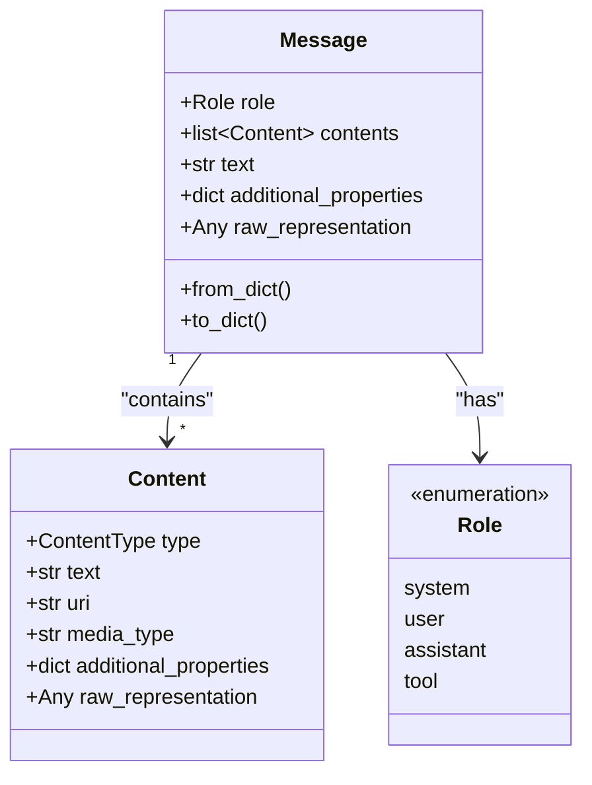
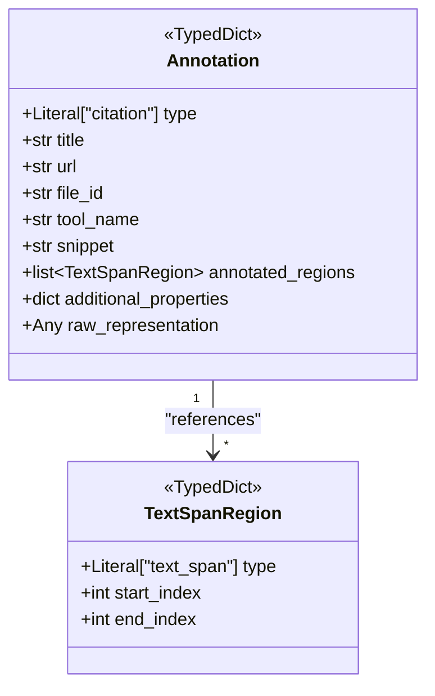
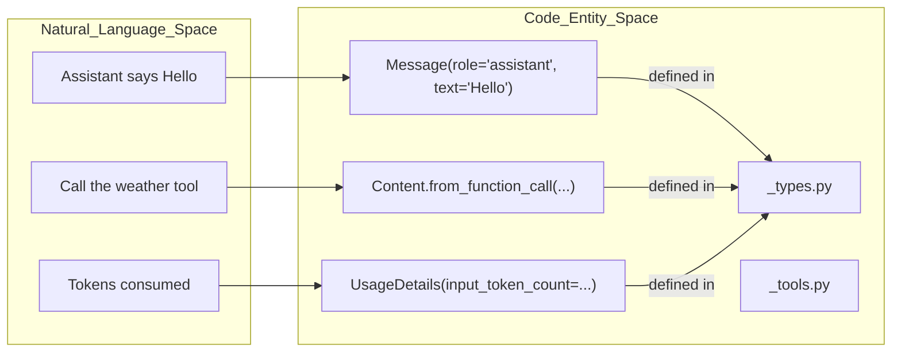
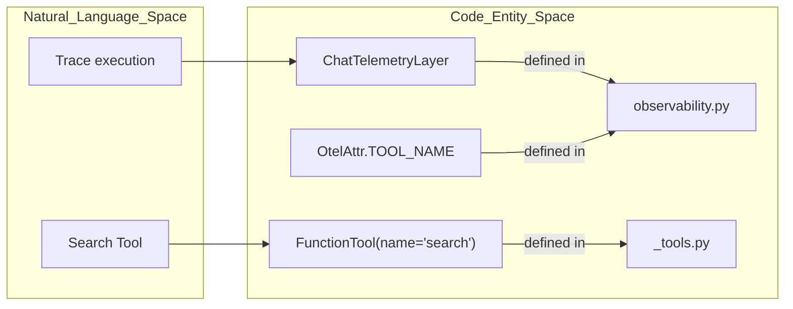

<!-- source: DeepWiki mcp.deepwiki.com · repo microsoft/agent-framework · extra page Message Types and Content · fetched 2026-10-26 -->

# Message Types and Content

<details>
<summary>Relevant source files</summary>

The following files were used as context for generating this wiki page:

- [docs/specs/004-python-function-calling-loop.md](docs/specs/004-python-function-calling-loop.md)
- [python/packages/core/agent_framework/_agents.py](python/packages/core/agent_framework/_agents.py)
- [python/packages/core/agent_framework/_clients.py](python/packages/core/agent_framework/_clients.py)
- [python/packages/core/agent_framework/_compaction.py](python/packages/core/agent_framework/_compaction.py)
- [python/packages/core/agent_framework/_harness/_tool_approval.py](python/packages/core/agent_framework/_harness/_tool_approval.py)
- [python/packages/core/agent_framework/_middleware.py](python/packages/core/agent_framework/_middleware.py)
- [python/packages/core/agent_framework/_serialization.py](python/packages/core/agent_framework/_serialization.py)
- [python/packages/core/agent_framework/_tools.py](python/packages/core/agent_framework/_tools.py)
- [python/packages/core/agent_framework/_types.py](python/packages/core/agent_framework/_types.py)
- [python/packages/core/agent_framework/observability.py](python/packages/core/agent_framework/observability.py)
- [python/packages/core/tests/core/test_agent_hooks.py](python/packages/core/tests/core/test_agent_hooks.py)
- [python/packages/core/tests/core/test_agents.py](python/packages/core/tests/core/test_agents.py)
- [python/packages/core/tests/core/test_clients.py](python/packages/core/tests/core/test_clients.py)
- [python/packages/core/tests/core/test_compaction.py](python/packages/core/tests/core/test_compaction.py)
- [python/packages/core/tests/core/test_function_invocation_logic.py](python/packages/core/tests/core/test_function_invocation_logic.py)
- [python/packages/core/tests/core/test_harness_tool_approval.py](python/packages/core/tests/core/test_harness_tool_approval.py)
- [python/packages/core/tests/core/test_middleware_with_agent.py](python/packages/core/tests/core/test_middleware_with_agent.py)
- [python/packages/core/tests/core/test_middleware_with_chat.py](python/packages/core/tests/core/test_middleware_with_chat.py)
- [python/packages/core/tests/core/test_observability.py](python/packages/core/tests/core/test_observability.py)
- [python/packages/core/tests/core/test_serializable_mixin.py](python/packages/core/tests/core/test_serializable_mixin.py)
- [python/packages/core/tests/core/test_tools.py](python/packages/core/tests/core/test_tools.py)
- [python/packages/core/tests/core/test_types.py](python/packages/core/tests/core/test_types.py)
- [python/samples/02-agents/context_providers/cross_session_observer.py](python/samples/02-agents/context_providers/cross_session_observer.py)
- [python/samples/02-agents/observability/README.md](python/samples/02-agents/observability/README.md)
- [python/samples/02-agents/observability/microsoft_opentelemetry_distro.py](python/samples/02-agents/observability/microsoft_opentelemetry_distro.py)

</details>


This page documents the message and content type system in the Agent Framework. It covers the `Message` and `Content` classes, content type variants, factory methods for content creation, annotations, and serialization patterns. This is the foundational type system used throughout the framework for representing communication between users, agents, LLMs, and tools.

For information about how messages flow through chat clients and middleware, see [Chat Client Architecture](3.1.2). For information about streaming responses and content updates, see [Response Processing and Streaming](3.1.4).

---

## Message Structure

The `Message` class represents a single message in a conversation. Each message has a role and one or more content items encapsulated as a list of `Content` objects. It also provides convenience properties such as aggregated `text` content and supports serialization/deserialization [python/packages/core/agent_framework/_types.py:681-904]().

### Message and Content Class Relationship



Sources: [python/packages/core/agent_framework/_types.py:681-904]()

The `Message` type supports several construction patterns allowing simple to complex message representation:

| Pattern        | Example                                 | Description                                           |
|----------------|-----------------------------------------|-------------------------------------------------------|
| Text string    | `Message("user", "Hello")`               | Creates a single text content automatically           |
| Role + text    | `Message(role="user", text="Hello")`     | Explicit role and text                                 |
| Role + contents| `Message(role="assistant", contents=[...])` | Explicit multiple content items                        |
| Content list   | `Message("user", [Content.from_text(...), ...])` | Flexible mixed content types                         |

The `text` property concatenates all text from the content items joined by newlines for convenience [python/packages/core/agent_framework/_types.py:773-780]().

Sources: [python/packages/core/agent_framework/_types.py:681-904]()

---

## Content Type System Overview

The framework uses a unified `Content` class with a discriminated union type system. All content, regardless of source or role, is represented with the same `Content` data model.

### Unified Content Model Variants

```mermaid
graph TB
    Content["Content<br/>(Unified Type)"]

    subgraph "Text_Content"
        Text["text"]
        TextReasoning["text_reasoning"]
    end

    subgraph "Media_Content"
        Data["data<br/>(embedded binary)"]
        URI["uri<br/>(reference)"]
    end

    subgraph "Function_Content"
        FunctionCall["function_call"]
        FunctionResult["function_result"]
        FunctionApprovalReq["function_approval_request"]
        FunctionApprovalResp["function_approval_response"]
    end

    subgraph "Hosted_Content"
        HostedFile["hosted_file"]
        HostedVector["hosted_vector_store"]
    end

    subgraph "Tool_Results"
        CodeInterpreterCall["code_interpreter_tool_call"]
        CodeInterpreterResult["code_interpreter_tool_result"]
        ImageGenCall["image_generation_tool_call"]
        ImageGenResult["image_generation_tool_result"]
        MCPCall["mcp_server_tool_call"]
        MCPResult["mcp_server_tool_result"]
    end

    subgraph "Other"
        Error["error"]
        Usage["usage"]
    end

    Content --> Text
    Content --> TextReasoning
    Content --> Data
    Content --> URI
    Content --> FunctionCall
    Content --> FunctionResult
    Content --> FunctionApprovalReq
    Content --> FunctionApprovalResp
    Content --> HostedFile
    Content --> HostedVector
    Content --> CodeInterpreterCall
    Content --> CodeInterpreterResult
    Content --> ImageGenCall
    Content --> ImageGenResult
    Content --> MCPCall
    Content --> MCPResult
    Content --> Error
    Content --> Usage
```



Sources: [python/packages/core/agent_framework/_types.py:315-334](), [python/packages/core/agent_framework/_types.py:906-1198]()

The allowed content types are enumerated in the `ContentType` literal [python/packages/core/agent_framework/_types.py:315-334]().

| Content Type            | Purpose                              | Key Attributes/Fields                                     |
|------------------------|------------------------------------|-----------------------------------------------------------|
| `text`                 | Plain textual messages             | `text` string                                             |
| `text_reasoning`       | Chain-of-thought / reasoning text | `text`, `annotations`                                     |
| `data`                 | Embedded binary data               | `uri` (data URI with base64), `media_type`               |
| `uri`                  | External resource references       | `uri`, `media_type`                                       |
| `function_call`        | Request to invoke a function/tool  | `call_id`, `name`, `arguments` (JSON str)                |
| `function_result`      | Result from function execution     | `call_id`, `result` (str or Content list), `exception`   |
| `function_approval_request` | Tool invocation approval request | `id`, `function_call` (Content), additional metadata      |
| `function_approval_response` | Approval response (approved/rejected) | `id`, `approved`, `reason`, `function_call`             |
| `hosted_file`          | Provider-hosted file reference     | `file_id`                                                |
| `hosted_vector_store`  | Provider-hosted vector store       | `vector_store_id`                                        |
| `code_interpreter_tool_call` | Code interpreter tool call      | ---                                                     |
| `code_interpreter_tool_result` | Code interpreter result        | ---                                                     |
| `image_generation_tool_call` | Image generation tool call      | ---                                                     |
| `image_generation_tool_result` | Image generation result        | ---                                                     |
| `mcp_server_tool_call` | MCP protocol tool call             | ---                                                     |
| `mcp_server_tool_result` | MCP protocol tool result           | ---                                                     |
| `error`                 | Error messages or exceptions       | `text`, `exception`                                      |
| `usage`                 | Token usage statistics              | Structured usage detail object                           |

Sources: [python/packages/core/agent_framework/_types.py:315-334](), [python/packages/core/agent_framework/_types.py:906-1198]()

---

## Text and Reasoning Content

### Text Content

This is the default content type representing plain text messages.

- Created via `Content.from_text()`
- Encapsulates string text and optional raw/metadata fields
- Supports additional properties and serialization [python/packages/core/agent_framework/_types.py:1212-1234]()

```python
# Factory usage
content = Content.from_text(text="Hello, world!")

# Serialized dictionary representation
{
    "type": "text",
    "text": "Hello, world!"
}
```

### Text Reasoning Content

Special content type to encode chain-of-thought or reasoning text produced by models.

- Created with `Content.from_text_reasoning()`
- Includes optional `annotations` to link references or citations to spans inside the text [python/packages/core/agent_framework/_types.py:1236-1262]()

```python
content = Content.from_text_reasoning(
    text="Let me think through this step by step...",
    annotations=[...]
)
```

Sources: [python/packages/core/agent_framework/_types.py:906-1198](), [python/packages/core/agent_framework/_types.py:1212-1262]()

---

## Media Content

### Data Content (Embedded Binary)

Binary data can be embedded directly into messages encoded as base64 data URIs.

- Created via `Content.from_data()`
- Accepts raw bytes and media type (MIME type)
- Internally stores content as a `data:` URI [python/packages/core/agent_framework/_types.py:1264-1313]()

Example:

```python
image_bytes = b'\x89PNG...'
content = Content.from_data(
    data=image_bytes,
    media_type="image/png"
)
```

### URI Content (External Reference)

A generic content type for external references (e.g., URLs).

- Created via `Content.from_uri()`
- Stores a URI string and optional media type [python/packages/core/agent_framework/_types.py:1315-1351]()

Example:

```python
content = Content.from_uri(
    uri="https://example.com/myfile.png",
    media_type="image/png"
)
```

### Media Type Detection

The framework supports media type detection via `detect_media_type_from_base64()` which inspects magic bytes to identify common media types like PNG, JPEG, GIF, PDF, WAV, MP3, etc. It supports various inputs including raw bytes, base64 strings, and full data URIs [python/packages/core/agent_framework/_types.py:79-167]().

Sources: [python/packages/core/agent_framework/_types.py:79-167](), [python/packages/core/agent_framework/_types.py:1264-1351]()

---

## Function Call and Result Content

### Function Call Content

Represents an LLM's request to invoke a function or tool.

- Created through `Content.from_function_call()`
- Key fields: `call_id` (unique), `name` (function/tool name), `arguments` (JSON string) [python/packages/core/agent_framework/_types.py:1353-1389]()

### Function Result Content

Carries the output of the executed function.

- Created via `Content.from_function_result()`
- Contains the original `call_id` and either a `result` (string or list of Content) or `exception` details in case of failure [python/packages/core/agent_framework/_types.py:1391-1430]()

### Function Approval Content

Supports human-in-the-loop approval workflows for tool execution.

- Requests approval with `Content.from_function_approval_request()`
- Receives approval/rejection via `Content.from_function_approval_response()`
- Includes fields like `approved` (bool), `reason` (optional string), and linked `function_call` [python/packages/core/agent_framework/_types.py:1593-1672]()

Example:

```python
approval_request = Content.from_function_approval_request(
    call_id="call_123",
    name="delete_file",
    arguments='{"path": "/tmp/file.txt"}'
)

approval_response = Content.from_function_approval_response(
    call_id="call_123",
    approved=True,
    reason="Approved by user"
)
```

Sources: [python/packages/core/agent_framework/_types.py:1353-1389](), [python/packages/core/agent_framework/_types.py:1391-1430](), [python/packages/core/agent_framework/_types.py:1593-1672]()

---

## Error and Usage Content

### Error Content

Wraps error messages and exceptions encountered during function execution or processing.

- Created with `Content.from_error()`
- Carries `text` and optional serializable `exception` fields [python/packages/core/agent_framework/_types.py:1515-1542]()

### Usage Content

Reports token consumption and usage statistics from the AI model calls.

- Created with `Content.from_usage()`
- Uses the `UsageDetails` class to hold detailed counts such as:
  - `input_token_count`
  - `output_token_count`
  - `total_token_count`
  - `reasoning_token_count` (for o1 chain-of-thought) [python/packages/core/agent_framework/_types.py:359-412]()

Sources: [python/packages/core/agent_framework/_types.py:1515-1567](), [python/packages/core/agent_framework/_types.py:359-412]()

---

## Annotations

Annotations enrich text content with metadata like citations referencing external documents or tools.

### Annotation and TextSpanRegion Structure



Sources: [python/packages/core/agent_framework/_types.py:337-357]()

- Each `Annotation` references one or more `TextSpanRegion` which specify character index ranges in the associated text.
- This allows marking specific spans of text as citations or references to external sources [python/packages/core/agent_framework/_types.py:337-357]().

Sources: [python/packages/core/agent_framework/_types.py:337-357]()

---

## Content Serialization and Parsing

### Serialization to Dictionary

The `Content` class supports serialization to dictionaries suitable for JSON encoding through the `to_dict()` method.

- This produces a normalized dict representation including type, content fields, and additional properties [python/packages/core/agent_framework/_types.py:1145-1198]()

### Parsing from Dictionary

Content objects can be recreated from dictionaries via the `from_dict()` class method.

- Uses the `type` discriminator field to parse into the correct `Content` variant
- Raises `ContentError` if unrecognized types or invalid data are encountered [python/packages/core/agent_framework/_types.py:1019-1143]()

Sources: [python/packages/core/agent_framework/_types.py:1019-1198]()

---

## Content Parsing Utilities

### Parsing Content Lists

The framework includes a `_parse_content_list()` helper to convert a sequence of mixed content data into a safe list of `Content` objects.

- Handles input data as strings (converted to text content), dicts (parsed as content), or already-constructed `Content`
- Unrecognized or invalid content types produce warnings and are skipped [python/packages/core/agent_framework/_types.py:49-74]()

### Tool Input Parsing

Within the tool system, `_parse_inputs()` handles translating varied input formats into typed content objects.

- Converts strings into `UriContent` if they look like URIs
- Converts dicts using `Content.from_dict` to appropriate content types
- Supports input validation before function/tool invocation [python/packages/core/agent_framework/_tools.py:150-202]()

Sources: [python/packages/core/agent_framework/_types.py:49-74](), [python/packages/core/agent_framework/_tools.py:150-202]()

---

## Bridging Natural Language to Code Entity Space

### Diagram: Natural Language Space to Code Entity Space (Message & Content)



Sources: [python/packages/core/agent_framework/_types.py:315-412](), [python/packages/core/agent_framework/_types.py:681-904]()

### Diagram: Natural Language Space to Code Entity Space (Tooling & Observability)



Sources: [python/packages/core/agent_framework/_tools.py:1-50](), [python/packages/core/agent_framework/observability.py:90-110]()

These diagrams illustrate how natural language concepts like a user message or a tool invocation correspond directly to key classes and functions in the codebase, primarily in the `_types.py` and `_tools.py` modules, with observability linked to `observability.py`.

---

# Summary

The Agent Framework builds all conversation and tool invocation flows on a unified `Message` and `Content` type system that supports:

- Multiple content types: text, data, URIs, function calls, approval workflows, tool results, errors, usage reports
- Rich annotations linking text spans to external references
- Serialization mechanisms for safe transmission and storage
- Parsing utilities to normalize varied inbound content representations
- Integration with tool invocation and function approval subsystems
- Observability hooks through telemetry layers

Understanding this system is critical for working with agents, chat clients, multi-agent workflows, and tool integration across both .NET and Python implementations in Agent Framework.

Sources: [python/packages/core/agent_framework/_types.py:315-412](), [python/packages/core/agent_framework/_types.py:681-904](), [python/packages/core/agent_framework/_types.py:906-1198](), [python/packages/core/agent_framework/_types.py:1212-1351](), [python/packages/core/agent_framework/_types.py:1515-1672](), [python/packages/core/agent_framework/_tools.py:150-202](), [python/packages/core/agent_framework/observability.py:191-230]()

---

