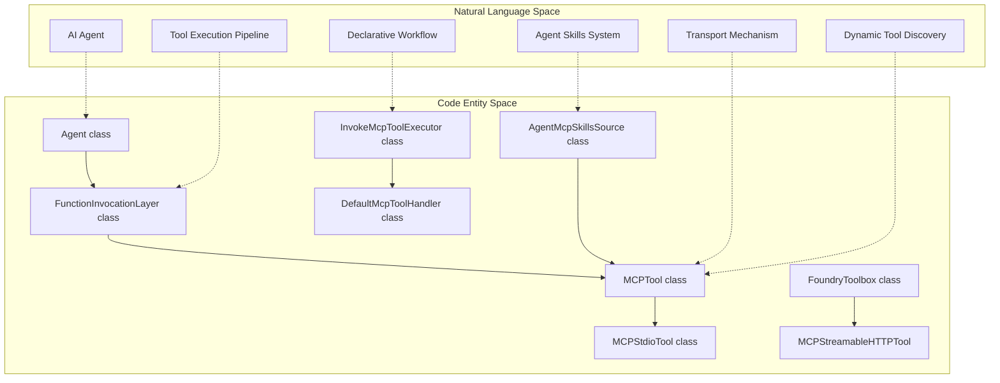
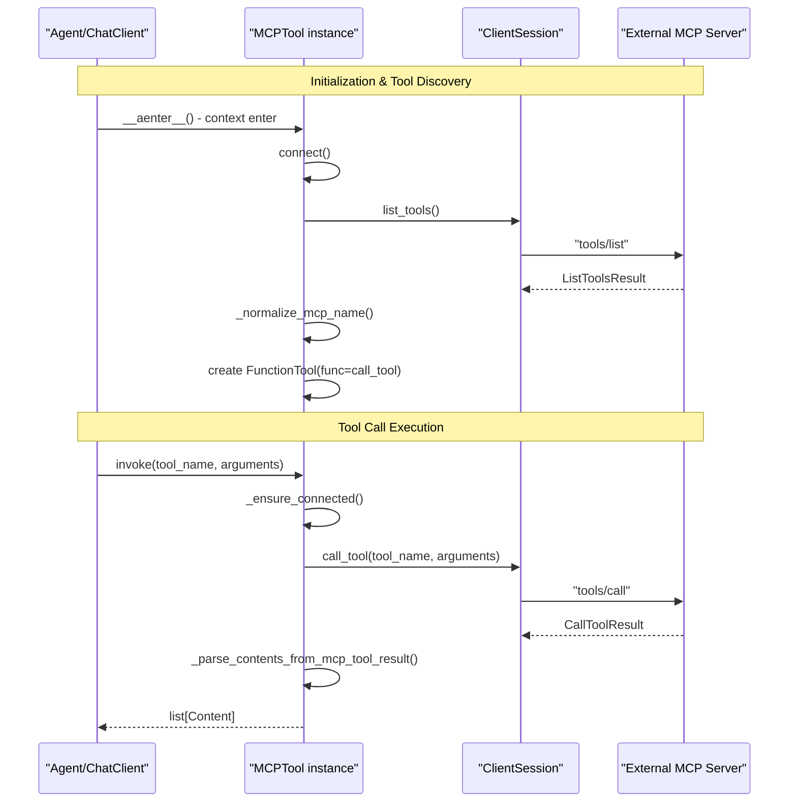
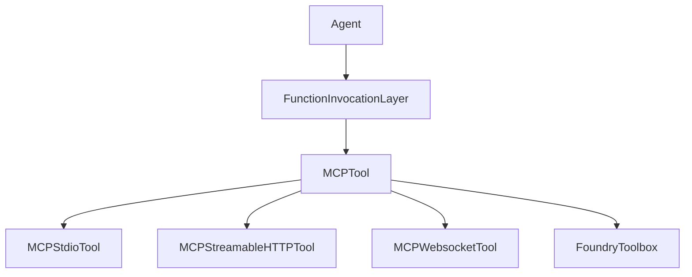
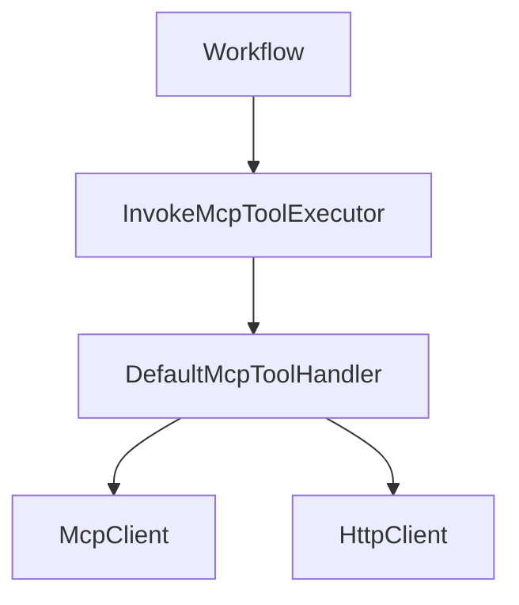

<!-- source: DeepWiki mcp.deepwiki.com · repo microsoft/agent-framework · extra page Model Context Protocol (MCP) · fetched 2026-10-26 -->

# Model Context Protocol (MCP)

<details>
<summary>Relevant source files</summary>

The following files were used as context for generating this wiki page:

- [docs/decisions/0024-prompt-injection-defense.md](docs/decisions/0024-prompt-injection-defense.md)
- [docs/features/FIDES_IMPLEMENTATION_SUMMARY.md](docs/features/FIDES_IMPLEMENTATION_SUMMARY.md)
- [dotnet/src/Microsoft.Agents.AI.Mcp/Skills/AgentMcpSkill.cs](dotnet/src/Microsoft.Agents.AI.Mcp/Skills/AgentMcpSkill.cs)
- [dotnet/src/Microsoft.Agents.AI.Mcp/Skills/AgentMcpSkillsSource.cs](dotnet/src/Microsoft.Agents.AI.Mcp/Skills/AgentMcpSkillsSource.cs)
- [dotnet/src/Microsoft.Agents.AI.Mcp/Skills/Loaders/AgentMcpSkillArchiveExtractor.cs](dotnet/src/Microsoft.Agents.AI.Mcp/Skills/Loaders/AgentMcpSkillArchiveExtractor.cs)
- [dotnet/src/Microsoft.Agents.AI.Mcp/Skills/Loaders/ArchiveEntryLoader.cs](dotnet/src/Microsoft.Agents.AI.Mcp/Skills/Loaders/ArchiveEntryLoader.cs)
- [dotnet/src/Microsoft.Agents.AI.Mcp/Skills/Loaders/ArchiveFormat.cs](dotnet/src/Microsoft.Agents.AI.Mcp/Skills/Loaders/ArchiveFormat.cs)
- [dotnet/src/Microsoft.Agents.AI.Mcp/Skills/Loaders/IMcpSkillEntryLoader.cs](dotnet/src/Microsoft.Agents.AI.Mcp/Skills/Loaders/IMcpSkillEntryLoader.cs)
- [dotnet/src/Microsoft.Agents.AI.Mcp/Skills/Loaders/SkillMdEntryLoader.cs](dotnet/src/Microsoft.Agents.AI.Mcp/Skills/Loaders/SkillMdEntryLoader.cs)
- [dotnet/tests/Microsoft.Agents.AI.FeatureRegistry.UnitTests/FeatureRegistryTests.cs](dotnet/tests/Microsoft.Agents.AI.FeatureRegistry.UnitTests/FeatureRegistryTests.cs)
- [dotnet/tests/Microsoft.Agents.AI.Mcp.UnitTests/Skills/AgentMcpSkillsSourceArchiveTests.cs](dotnet/tests/Microsoft.Agents.AI.Mcp.UnitTests/Skills/AgentMcpSkillsSourceArchiveTests.cs)
- [dotnet/tests/Microsoft.Agents.AI.Mcp.UnitTests/Skills/AgentMcpSkillsSourceTests.cs](dotnet/tests/Microsoft.Agents.AI.Mcp.UnitTests/Skills/AgentMcpSkillsSourceTests.cs)
- [python/packages/core/agent_framework/_mcp.py](python/packages/core/agent_framework/_mcp.py)
- [python/packages/core/agent_framework/security.py](python/packages/core/agent_framework/security.py)
- [python/packages/core/tests/core/test_mcp.py](python/packages/core/tests/core/test_mcp.py)
- [python/packages/core/tests/core/test_mcp_observability.py](python/packages/core/tests/core/test_mcp_observability.py)
- [python/packages/core/tests/core/test_mcp_skills.py](python/packages/core/tests/core/test_mcp_skills.py)
- [python/packages/core/tests/test_security.py](python/packages/core/tests/test_security.py)
- [python/samples/02-agents/mcp/README.md](python/samples/02-agents/mcp/README.md)
- [python/samples/02-agents/mcp/agent_as_mcp_server.py](python/samples/02-agents/mcp/agent_as_mcp_server.py)
- [python/samples/02-agents/mcp/mcp_api_key_auth.py](python/samples/02-agents/mcp/mcp_api_key_auth.py)
- [python/samples/02-agents/mcp/mcp_github_pat.py](python/samples/02-agents/mcp/mcp_github_pat.py)
- [python/samples/02-agents/mcp/mcp_long_running_task.py](python/samples/02-agents/mcp/mcp_long_running_task.py)
- [python/samples/02-agents/mcp/mcp_progressive_disclosure.py](python/samples/02-agents/mcp/mcp_progressive_disclosure.py)
- [python/samples/02-agents/mcp/mcp_sampling_approval.py](python/samples/02-agents/mcp/mcp_sampling_approval.py)
- [python/samples/02-agents/security/FIDES_DEVELOPER_GUIDE.md](python/samples/02-agents/security/FIDES_DEVELOPER_GUIDE.md)
- [python/samples/02-agents/security/README.md](python/samples/02-agents/security/README.md)
- [python/samples/02-agents/security/email_security_example.py](python/samples/02-agents/security/email_security_example.py)
- [python/samples/02-agents/security/github_mcp_example.py](python/samples/02-agents/security/github_mcp_example.py)
- [python/samples/02-agents/security/repo_confidentiality_example.py](python/samples/02-agents/security/repo_confidentiality_example.py)
- [python/samples/02-agents/security/user_identity_security_example.py](python/samples/02-agents/security/user_identity_security_example.py)
- [python/samples/02-agents/skills/mcp_based_skill/README.md](python/samples/02-agents/skills/mcp_based_skill/README.md)

</details>


This page explains the integration of the Model Context Protocol (MCP) in the Microsoft Agent Framework `[python/packages/core/agent_framework/_mcp.py:1-218]()`. MCP is an open protocol standard that enables AI agents to connect to external tools and data sources in a standardized, interoperable manner. This integration enables agents to dynamically discover, invoke, and interact with remote tools exposed by MCP servers, bridging natural language interaction with structured, function-callable interfaces `[python/packages/core/agent_framework/_mcp.py:397-477]()`.

The Agent Framework supports MCP natively on both Python and .NET through a layered approach that includes:

- The `MCPTool` base class in Python and the `DefaultMcpToolHandler` in .NET as core MCP client implementations `[python/packages/core/agent_framework/_mcp.py:202-218]()`.
- Multiple transport mechanisms tailored for different communication protocols: stdio subprocess, HTTP/SSE (`MCPStreamableHTTPTool`), and WebSocket (`MCPWebsocketTool`) `[python/packages/core/agent_framework/_mcp.py:776-1061]()`, `[python/packages/core/tests/core/test_mcp.py:31-33]()`.
- Dynamic discovery of remote tools and prompts to generate local function-callable tool representations `[python/packages/core/agent_framework/_mcp.py:647-693]()`.
- Integration with the agent skills system and declarative workflows for seamless MCP tool invocation and approval flows `[dotnet/src/Microsoft.Agents.AI.Workflows.Declarative/ObjectModel/InvokeMcpToolExecutor.cs:25-133]()`.

For context on core tool and function calling concepts, see Function Tools (3.3.1). For hosted AI-executed tools, see Hosted Tools (3.3.3).

---

## MCP Architecture Overview

MCP integration is realized primarily through the `MCPTool` family (Python) and the `DefaultMcpToolHandler` class (.NET). They serve as adapters translating between the MCP protocol surface and the agent framework’s internal function invocation model (`FunctionTool`) `[python/packages/core/agent_framework/_mcp.py:397-477]()`.

The following diagram relates MCP conceptual components in natural language to precise code entities:



**Sources:**  
[python/packages/core/agent_framework/_mcp.py:202-218](),  
[dotnet/src/Microsoft.Agents.AI.Workflows.Declarative/ObjectModel/InvokeMcpToolExecutor.cs:25-30](),  
[dotnet/src/Microsoft.Agents.AI.Workflows.Declarative.Mcp/DefaultMcpToolHandler.cs:29-30](),  
[dotnet/src/Microsoft.Agents.AI.Mcp/Skills/AgentMcpSkillsSource.cs:97-105]()

---

## Local MCP Tools (Client-Side Execution)

Local MCP tools run within the client application and talk directly to MCP servers. These clients handle connection lifecycle, tool discovery, command invocation, and response parsing `[python/packages/core/agent_framework/_mcp.py:397-477]`.

### MCPTool Base Class (Python)

The `MCPTool` class is the primary MCP client integration point in Python `[python/packages/core/agent_framework/_mcp.py:202-218]()`. It manages:

- Lifecycle and connection to MCP servers via `__aenter__` and `__aexit__` async context managers `[python/packages/core/agent_framework/_mcp.py:397-430]()`.
- Discovery of remote tools and prompts `[python/packages/core/agent_framework/_mcp.py:647-693]()`.
- Mapping remote MCP tools to local `FunctionTool` instances `[python/packages/core/agent_framework/_mcp.py:431-477]()`.
- Invocation of those tools with schema-validated arguments `[python/packages/core/agent_framework/_mcp.py:737-773]()`.
- Parsing results from MCP responses to agent framework `Content` items `[python/packages/core/agent_framework/_mcp.py:108-128]()`.

**Data Flow: MCP Tool Discovery and Execution**



**Sources:**  
[python/packages/core/agent_framework/_mcp.py:397-477](),  
[python/packages/core/agent_framework/_mcp.py:647-693](),  
[python/packages/core/agent_framework/_mcp.py:737-773]()

---

## Transport Protocols (Python)

The Agent Framework provides several transport protocol implementations under `MCPTool` to accommodate different MCP server connection modes `[python/packages/core/agent_framework/_mcp.py:776-1061]()`:

| Class                  | Transport Method       | Key Parameters                       | Protocol Description                              |
|------------------------|-----------------------|------------------------------------|--------------------------------------------------|
| `MCPStdioTool`          | Subprocess stdio      | `command`, `args`, `env`            | Launches a subprocess and communicates via stdin/stdout JSON streaming. |
| `MCPStreamableHTTPTool` | HTTP/SSE              | `url`, `http_client`, `header_provider` | Uses HTTP POST with Server-Sent Events for incremental responses.      |
| `MCPWebsocketTool`      | WebSocket             | `url`                              | Maintains bidirectional WebSocket connection for tool calls.           |

These tools encapsulate the complexities of connection management, framing, and session handling for their respective protocols `[python/packages/core/agent_framework/_mcp.py:776-1061]()`.

**Sources:**  
[python/packages/core/agent_framework/_mcp.py:776-1061]()

---

## Dynamic Tool Discovery

MCP supports dynamic discovery of remote tools which the framework loads as local callable tools `[python/packages/core/agent_framework/_mcp.py:647-693]()`.

- On connect or when requested (`load_tools_flag`), tools invoke `list_tools()` on the underlying MCP `ClientSession` `[python/packages/core/agent_framework/_mcp.py:647-693]()`.
- Tool names returned from the server are normalized using `_normalize_mcp_name` to valid tool identifiers `[python/packages/core/tests/core/test_mcp.py:141-149]()`.  
- Optional `tool_name_prefix` allows multiple MCP tools to coexist without name collisions by prefixing tool names `[python/packages/core/tests/core/test_mcp.py:155-173]()`.  
- In .NET, the reserved tool name `"tools/list"` triggers the discovery flow transparently via `IMcpToolHandler` `[dotnet/src/Microsoft.Agents.AI.Workflows.Declarative.Mcp/DefaultMcpToolHandler.cs:76-82]()`.

**Dynamic Tool Discovery Diagram:**

```mermaid
flowchart TB
    MCPTool["MCPTool instance"] -->|list_tools()| Session["ClientSession"]
    Session -->|Tools List JSON| Server["External MCP Server"]
    Server -->|Raw Tool Names| MCPTool
    MCPTool -->|Normalize and Prefix| NamedTools["Named FunctionTools"]
    NamedTools --> Agent["Agent/ChatClient Tool Map"]
```

**Sources:**  
[python/packages/core/agent_framework/_mcp.py:647-693](),  
[dotnet/src/Microsoft.Agents.AI.Workflows.Declarative.Mcp/DefaultMcpToolHandler.cs:76-82](),  
[python/packages/core/tests/core/test_mcp.py:141-173]()

---

## Content and Message Handling

MCP tool results often contain structured content and raw text content simultaneously. The framework supports configurable result content modes (`MCPToolResultContentMode`) for returning model-visible text from MCP results `[python/packages/core/agent_framework/_mcp.py:108-128]`:

- `structured_first` (default): Use `structuredContent` when present, else `content` `[python/packages/core/agent_framework/_mcp.py:120]()`.
- `content_first`: Use `content` when non-empty, else `structuredContent` `[python/packages/core/agent_framework/_mcp.py:121]()`.
- `content_only`: Ignore `structuredContent` for the model-visible result `[python/packages/core/agent_framework/_mcp.py:122]()`.
- `structured_only`: Ignore `content` for the model-visible result `[python/packages/core/agent_framework/_mcp.py:123]()`.
- `both`: Append serialized `structuredContent` after `content` blocks `[python/packages/core/agent_framework/_mcp.py:124]()`.

The full MCP payload is retained on the host channel regardless of mode, and internal runtime keys (such as `chat_options`, `conversation_id`, `session`) are filtered out via `_MCP_FRAMEWORK_DENYLIST` to prevent improper serialization to MCP servers `[python/packages/core/agent_framework/_mcp.py:126-166]()`.

**Sources:**  
[python/packages/core/agent_framework/_mcp.py:108-166]()

---

## Reconnection and Resilience

Before invoking remote MCP calls, `MCPTool` ensures the connection session is active through the `_ensure_connected` method. If a connection or session has become stale or broken, it reconnects automatically.

This mechanism preserves client resilience in the face of transport failures by handling reconnection and session reinitialization transparently `[python/packages/core/agent_framework/_mcp.py:709-735]()`.

**Sources:**  
[python/packages/core/agent_framework/_mcp.py:709-735]()

---

## Foundry Toolbox Integration (Python)

The Azure AI Foundry integration offers a specialized MCP tool implementation called `FoundryToolbox`, extending `MCPStreamableHTTPTool`. It features:

- Environment-driven endpoint resolution (`TOOLBOX_ENDPOINT` or composed from `FOUNDRY_PROJECT_ENDPOINT` and `TOOLBOX_NAME`) `[python/packages/foundry_hosting/agent_framework_foundry_hosting/_toolbox.py:47-95]()`.
- Authentication via `_ToolboxAuth` that adds Bearer tokens from Azure credentials per request `[python/packages/foundry_hosting/agent_framework_foundry_hosting/_toolbox.py:96-120]()`.
- Forwarding of special platform context headers (`x-agent-foundry-call-id`) to assure end-to-end tracing on the Foundry data plane `[python/packages/foundry_hosting/agent_framework_foundry_hosting/_toolbox.py:121-154]()`.

**Sources:**  
[python/packages/foundry_hosting/agent_framework_foundry_hosting/_toolbox.py:47-154]()

---

## Declarative Workflow Integration (.NET)

The .NET declarative workflow system integrates MCP support via these classes:

### InvokeMcpToolExecutor

- Implements an executor action that invokes MCP tools during workflows `[dotnet/src/Microsoft.Agents.AI.Workflows.Declarative/ObjectModel/InvokeMcpToolExecutor.cs:25-45]()`.
- Supports both direct invocation and user approval flows `[dotnet/src/Microsoft.Agents.AI.Workflows.Declarative/ObjectModel/InvokeMcpToolExecutor.cs:78-132]()`.
- If `requireApproval` is true, yields a `ToolApprovalRequestContent` wrapped in an `ExternalInputRequest` and suspends until approved `[dotnet/src/Microsoft.Agents.AI.Workflows.Declarative/ObjectModel/InvokeMcpToolExecutor.cs:78-110]()`.
- If no approval is required, directly calls `IMcpToolHandler.InvokeToolAsync` `[dotnet/src/Microsoft.Agents.AI.Workflows.Declarative/ObjectModel/InvokeMcpToolExecutor.cs:111-130]()`.

### DefaultMcpToolHandler

- Implements MCP client calls using the MCP C# SDK `[dotnet/src/Microsoft.Agents.AI.Workflows.Declarative.Mcp/DefaultMcpToolHandler.cs:29-50]()`.
- Maintains a cached map of `McpClient` instances keyed by server URL, label, connection name, and headers `[dotnet/src/Microsoft.Agents.AI.Workflows.Declarative.Mcp/DefaultMcpToolHandler.cs:51-90]()`.
- Exposes the reserved `"tools/list"` tool name to retrieve the list of remote tools via `ListToolsAsync` `[dotnet/src/Microsoft.Agents.AI.Workflows.Declarative.Mcp/DefaultMcpToolHandler.cs:91-130]()`.

**Sources:**  
[dotnet/src/Microsoft.Agents.AI.Workflows.Declarative/ObjectModel/InvokeMcpToolExecutor.cs:25-133](),  
[dotnet/src/Microsoft.Agents.AI.Workflows.Declarative.Mcp/DefaultMcpToolHandler.cs:29-168]()

---

## MCPTool Class Technical Details (Python)

The `MCPTool` class is an abstract base class with key attributes:

- Contains a `session` attribute of type `ClientSession` managing MCP transport connections `[python/packages/core/agent_framework/_mcp.py:202-218]()`.
- Implements an async context manager to maintain connection lifecycle (`__aenter__`, `__aexit__`) `[python/packages/core/agent_framework/_mcp.py:397-430]()`.
- Supports flags `load_tools_flag`, `load_prompts_flag` controlling discovery behavior `[python/packages/core/agent_framework/_mcp.py:431-477]()`.
- Encapsulates tool calls via an internal `_call_tool` coroutine, which forwards calls to the MCP server session `[python/packages/core/agent_framework/_mcp.py:737-773]()`.
- Dynamically creates `FunctionTool` wrappers per discovered MCP tool for seamless invocation in the framework `[python/packages/core/agent_framework/_mcp.py:647-693]()`.

**Sources:**  
[python/packages/core/agent_framework/_mcp.py:202-218](),  
[python/packages/core/agent_framework/_mcp.py:397-477](),  
[python/packages/core/agent_framework/_mcp.py:647-693]()

---

## Summary

The Microsoft Agent Framework fully integrates the Model Context Protocol (MCP) to enable AI assistants to:

- Dynamically discover remote tools exposed by MCP servers `[python/packages/core/agent_framework/_mcp.py:647-693]()`.
- Invoke those tools using strongly-typed arguments with runtime approval flows `[dotnet/src/Microsoft.Agents.AI.Workflows.Declarative/ObjectModel/InvokeMcpToolExecutor.cs:78-132]()`.
- Use efficient and pluggable transport implementations (local stdio, HTTP with SSE, WebSocket) `[python/packages/core/agent_framework/_mcp.py:776-1061]()`.
- Integrate MCP tool invocation into declarative workflows and the agent skills system `[dotnet/src/Microsoft.Agents.AI.Workflows.Declarative/ObjectModel/InvokeMcpToolExecutor.cs:25-133]()`.

---

# Additional Diagrams

## Natural Language MCP Space to Python MCPTool Class Mapping



**Sources:** [python/packages/core/agent_framework/_mcp.py:202-218](), [python/packages/foundry_hosting/agent_framework_foundry_hosting/_toolbox.py:133-134]()

---

## Natural Language MCP Space to .NET MCP Tool Invocation



**Sources:** [dotnet/src/Microsoft.Agents.AI.Workflows.Declarative/ObjectModel/InvokeMcpToolExecutor.cs:25-133](), [dotnet/src/Microsoft.Agents.AI.Workflows.Declarative.Mcp/DefaultMcpToolHandler.cs:29-168]()

---

# References

- MCP source module (Python): `python/packages/core/agent_framework/_mcp.py`  
- MCP executor (Declarative .NET): `dotnet/src/Microsoft.Agents.AI.Workflows.Declarative/ObjectModel/InvokeMcpToolExecutor.cs`  
- MCP tool handler (.NET): `dotnet/src/Microsoft.Agents.AI.Workflows.Declarative.Mcp/DefaultMcpToolHandler.cs`  
- Foundry MCP Toolbox (Python): `python/packages/foundry_hosting/agent_framework_foundry_hosting/_toolbox.py`

---

