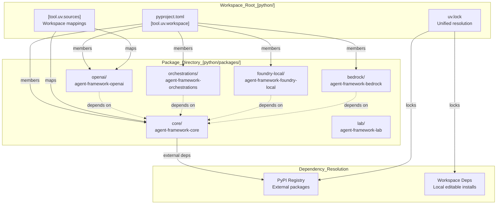
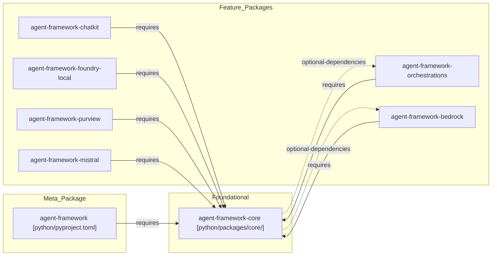

<!-- source: DeepWiki mcp.deepwiki.com · repo microsoft/agent-framework · extra page Monorepo Structure and Package Management · fetched 2026-10-26 -->

# Monorepo Structure and Package Management

<details>
<summary>Relevant source files</summary>

The following files were used as context for generating this wiki page:

- [python/CHANGELOG.md](python/CHANGELOG.md)
- [python/packages/a2a/pyproject.toml](python/packages/a2a/pyproject.toml)
- [python/packages/ag-ui/pyproject.toml](python/packages/ag-ui/pyproject.toml)
- [python/packages/anthropic/pyproject.toml](python/packages/anthropic/pyproject.toml)
- [python/packages/bedrock/pyproject.toml](python/packages/bedrock/pyproject.toml)
- [python/packages/chatkit/pyproject.toml](python/packages/chatkit/pyproject.toml)
- [python/packages/copilotstudio/pyproject.toml](python/packages/copilotstudio/pyproject.toml)
- [python/packages/core/pyproject.toml](python/packages/core/pyproject.toml)
- [python/packages/devui/pyproject.toml](python/packages/devui/pyproject.toml)
- [python/packages/foundry/pyproject.toml](python/packages/foundry/pyproject.toml)
- [python/packages/foundry_hosting/pyproject.toml](python/packages/foundry_hosting/pyproject.toml)
- [python/packages/gemini/pyproject.toml](python/packages/gemini/pyproject.toml)
- [python/packages/github_copilot/pyproject.toml](python/packages/github_copilot/pyproject.toml)
- [python/packages/hyperlight/pyproject.toml](python/packages/hyperlight/pyproject.toml)
- [python/packages/lab/pyproject.toml](python/packages/lab/pyproject.toml)
- [python/packages/lab/uv.lock](python/packages/lab/uv.lock)
- [python/packages/mem0/pyproject.toml](python/packages/mem0/pyproject.toml)
- [python/packages/openai/pyproject.toml](python/packages/openai/pyproject.toml)
- [python/packages/orchestrations/pyproject.toml](python/packages/orchestrations/pyproject.toml)
- [python/packages/postgres/README.md](python/packages/postgres/README.md)
- [python/packages/postgres/pyproject.toml](python/packages/postgres/pyproject.toml)
- [python/packages/purview/pyproject.toml](python/packages/purview/pyproject.toml)
- [python/packages/redis/pyproject.toml](python/packages/redis/pyproject.toml)
- [python/pyproject.toml](python/pyproject.toml)
- [python/uv.lock](python/uv.lock)

</details>


This document describes the Python implementation's monorepo structure, package organization, and dependency management using `uv`. It covers workspace configuration, package layout, dependency resolution, build systems, and task orchestration for all sub-packages including `agent-framework-orchestrations`, `agent-framework-chatkit`, `agent-framework-foundry-local`, and `agent-framework-bedrock`.

For .NET package structure and NuGet management, see [7.1.1](). For CI/CD build processes, see [9.2]().

Sources: [python/pyproject.toml:1-112](), [python/uv.lock:1-65]()

---

## Overview

The Python Agent Framework uses a monorepo architecture managed by `uv` (Python's fast package manager). The repository contains workspace packages organized under `python/packages/*`, with a root-level meta-package that aggregates core and optional functionality [python/uv.lock:28-65](). This structure enables:

- **Unified dependency resolution** via `uv.lock` for reproducible builds across all packages [python/uv.lock:1-20]().
- **Workspace-relative imports** allowing local packages to reference each other during development [python/pyproject.toml:73-74]().
- **Centralized tooling configuration** for linting (`ruff`), type checking (`pyright`, `mypy`), and testing (`pytest`) [python/pyproject.toml:113-203]().
- **Selective installation** where users can install only the packages they need via optional dependencies [python/packages/core/pyproject.toml:35-68]().

Sources: [python/pyproject.toml:1-112](), [python/uv.lock:1-65]()

---

## Workspace Architecture

### UV Workspace Configuration

The root `pyproject.toml` defines the workspace structure using `tool.uv.workspace`:

```toml
[tool.uv.workspace]
members = [ "packages/*" ]
exclude = [ "packages/lab" ]
```
[python/pyproject.toml:71-73]()

This configuration tells `uv` to discover all packages in the `packages/` directory while excluding experimental modules like `lab`. The workspace is further configured with:

- **Environment markers** for cross-platform support (darwin, linux, win32) [python/pyproject.toml:65-69]().
- **Override dependencies** to enforce security floors for transitive dependencies, such as `mcp[ws]>=1.27.0,<2` and `python-multipart>=0.0.31` [python/pyproject.toml:64]().
- **Workspace sources** that map package names to local paths for editable development [python/pyproject.toml:75-116]().

Sources: [python/pyproject.toml:60-116]()

### Package Discovery and Resolution

The following diagram bridges the logical workspace organization to the physical code entities (`pyproject.toml`, `uv.lock`) and dependency flows.

**Workspace Entity Map**


Sources: [python/pyproject.toml:71-116](), [python/uv.lock:28-65](), [python/packages/core/pyproject.toml:25-33]()

---

## Package Organization

### Package Categories

The workspace packages listed in the manifest [python/uv.lock:28-65]() are organized into functional categories:

| Category | Packages | Purpose |
|----------|----------|---------|
| **Core** | `agent-framework-core` | Base abstractions, workflow engine, and protocol definitions [python/packages/core/pyproject.toml:2-3](). |
| **Providers** | `agent-framework-openai`, `agent-framework-anthropic`, `agent-framework-bedrock`, `agent-framework-ollama`, `agent-framework-claude`, `agent-framework-gemini`, `agent-framework-foundry`, `agent-framework-mistral`, `agent-framework-copilotstudio`, `agent-framework-monty` | Integration with specific LLM providers and model services [python/packages/anthropic/pyproject.toml:2-3](). |
| **Orchestration** | `agent-framework-orchestrations` | High-level multi-agent patterns, handoffs, and group chat builders [python/uv.lock:63](). |
| **UI & Tools** | `agent-framework-devui`, `agent-framework-ag-ui`, `agent-framework-chatkit`, `agent-framework-tools` | Debugging interfaces, UI protocol integrations, and shared tool definitions [python/packages/devui/pyproject.toml:2-3](), [python/packages/ag-ui/pyproject.toml:2-4](). |
| **Storage/Memory**| `agent-framework-azure-cosmos`, `agent-framework-azure-cosmos-memory`, `agent-framework-redis`, `agent-framework-mem0`, `agent-framework-azure-ai-search` | State persistence and vector memory integrations [python/packages/mem0/pyproject.toml:2-3](), [python/packages/redis/pyproject.toml:2-3](). |
| **Experimental** | `agent-framework-lab` | Research modules like GAIA, TAU2, and RL training [python/packages/lab/pyproject.toml:2-3](). |
| **Hosting** | `agent-framework-hosting`, `agent-framework-hosting-responses`, `agent-framework-hosting-telegram`, `agent-framework-foundry-hosting`, `agent-framework-hosting-mcp`, `agent-framework-hosting-a2a` | Application-owned hosting patterns and protocol helpers [python/CHANGELOG.md:13-14](). |

Sources: [python/uv.lock:28-65](), [python/packages/core/pyproject.toml:35-68](), [python/packages/lab/pyproject.toml:1-38]()

### Core and Provider Dependencies

The `agent-framework-core` package serves as the foundation. Most other packages depend on it using version constraints [python/packages/core/pyproject.toml:25-33]().

**Dependency Hierarchy**


Sources: [python/pyproject.toml:25-27](), [python/packages/core/pyproject.toml:35-68]()

---

## Dependency Management

### Unified Lock File (`uv.lock`)

The `uv.lock` file provides a single source of truth for all package versions across the workspace. It includes resolution markers for cross-platform support [python/uv.lock:4-17]().

**Override and Constraint Mechanism:**
The workspace uses constraints and overrides to resolve version conflicts and enforce security floors, such as `mcp[ws]>=1.27.0,<2`, `uvicorn[standard]>=0.34.0`, and `python-multipart>=0.0.31` [python/pyproject.toml:60-64](). Experimental packages like `agent-framework-lab` also declare specific constraint dependencies like `litellm>=1.100.0` and `fastapi-sso>=0.19.0` [python/packages/lab/pyproject.toml:84]().

Sources: [python/uv.lock:1-76](), [python/pyproject.toml:60-69]()

### Optional Dependencies Pattern

The framework uses PEP 508 optional dependencies to allow users to install only what they need. The `agent-framework-core` package defines an `all` extra that pulls in nearly all workspace integrations, including `agent-framework-openai`, `agent-framework-anthropic`, and `agent-framework-redis` [python/packages/core/pyproject.toml:35-67]().

**Example - Lab Package Extras:**
The `agent-framework-lab` package separates experimental features into distinct optional dependency groups [python/packages/lab/pyproject.toml:28-56]():
- `gaia`: Benchmark module dependencies like `huggingface-hub` and `pyarrow` [python/packages/lab/pyproject.toml:30-38]().
- `lightning`: RL training via `agentlightning` [python/packages/lab/pyproject.toml:40-43]().
- `tau2`: Benchmark module dependencies including `tiktoken` and `loguru` [python/packages/lab/pyproject.toml:45-51]().
- `math`: Symbolic math support via `sympy` [python/packages/lab/pyproject.toml:53-56]().

Sources: [python/packages/lab/pyproject.toml:28-57]()

---

## Build Configuration

### PyProject.toml Structure

Each package contains a `pyproject.toml` that extends the root configuration for linting and type checking.

| Section | Role | Key Entities |
|---------|------|--------------|
| `[project]` | Metadata | `name`, `version`, `dependencies` [python/packages/core/pyproject.toml:1-33]() |
| `[tool.uv]` | Workspace | `prerelease`, `environments` [python/packages/core/pyproject.toml:79-85]() |
| `[tool.poe]` | Tasks | Includes `../../shared_tasks.toml` [python/packages/core/pyproject.toml:132-134]() |
| `[tool.ruff]` | Linting | Extends root `pyproject.toml` [python/packages/core/pyproject.toml:106-107]() |
| `[tool.pyright]` | Typing | Extends root `pyproject.toml` [python/packages/core/pyproject.toml:109-110]() |

Sources: [python/packages/core/pyproject.toml:1-134]()

### Build Backends

The monorepo uses multiple build backends depending on package requirements:
- **`flit-core`**: Used by `agent-framework-core`, `agent-framework-a2a`, `agent-framework-devui`, `agent-framework-mem0`, `agent-framework-redis`, and provider packages [python/packages/core/pyproject.toml:151-153](), [python/packages/a2a/pyproject.toml:97-98]().
- **`hatchling`**: Used by `agent-framework-ag-ui` [python/packages/ag-ui/pyproject.toml:50-52]().
- **`setuptools`**: Used by `agent-framework-lab` to manage complex namespace packaging across directories like `gaia/`, `lightning/`, and `tau2/` [python/packages/lab/pyproject.toml:100-103]().

Sources: [python/packages/core/pyproject.toml:151-153](), [python/packages/ag-ui/pyproject.toml:50-52](), [python/packages/lab/pyproject.toml:100-103]()

---

## Task Orchestration

The repository uses `poethepoet` for task automation. Tasks are defined in a root `shared_tasks.toml` and included in individual packages via `[tool.poe]` configuration [python/packages/core/pyproject.toml:132-134]().

### Common Tasks

| Task | Command | Purpose |
|------|---------|---------|
| `mypy` | `mypy --config-file ...` | Runs static type checking for the specific package [python/packages/core/pyproject.toml:140-142](). |
| `test` | `pytest -m "not integration" ...` | Runs unit tests with coverage reporting [python/packages/core/pyproject.toml:144-146](). |
| `test-gaia` | `pytest gaia/tests ...` | Lab-specific testing for GAIA benchmark [python/packages/lab/pyproject.toml:169-172](). |
| `test-lightning`| `pytest lightning/tests ...`| Lab-specific testing for RL modules [python/packages/lab/pyproject.toml:173-176](). |

Sources: [python/packages/core/pyproject.toml:131-147](), [python/packages/lab/pyproject.toml:162-180]()

---

## Summary of Key Sub-packages

- **`agent-framework-orchestrations`**: Contains high-level multi-agent builders and selector strategies [python/uv.lock:63]().
- **`agent-framework-chatkit`**: Provides integration for OpenAI's ChatKit frontend [python/uv.lock:39]().
- **`agent-framework-foundry-local`**: Enables local development and testing of Foundry-compatible agents [python/uv.lock:48]().
- **`agent-framework-bedrock`**: AWS Bedrock provider integration [python/uv.lock:38]().
- **`agent-framework-purview`**: Integration for Microsoft Purview data security and governance [python/uv.lock:65]().
- **`agent-framework-lab`**: Hosts experimental modules and CLI scripts like `gaia_viewer` and `lightning` [python/packages/lab/pyproject.toml:1-99]().
- **`agent-framework-hosting`**: Adds a hosting protocol helper surface including reusable session stores [python/uv.lock:51]().
- **`agent-framework-azure-contentunderstanding`**: Integration for Azure Content Understanding services [python/uv.lock:34]().
- **`agent-framework-azure-cosmos-memory`**: Specialized memory provider using Azure Cosmos DB [python/uv.lock:36]().
- **`agent-framework-mistral`**: Mistral AI provider integration [python/uv.lock:58]().
- **`agent-framework-monty`**: Python interpreter backend for CodeAct execution [python/uv.lock:60]().
- **`agent-framework-gemini`**: Google Gemini provider integration [python/uv.lock:49]().

Sources: [python/uv.lock:28-71](), [python/packages/lab/pyproject.toml:1-109]()

---

