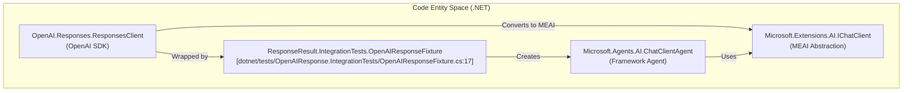
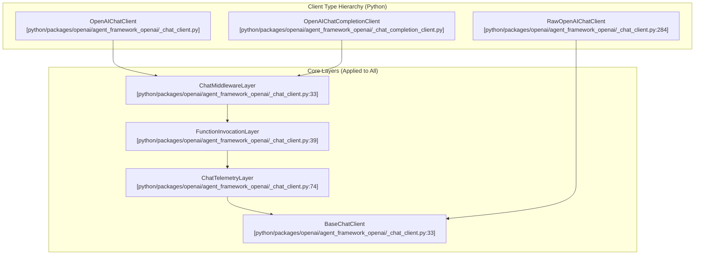
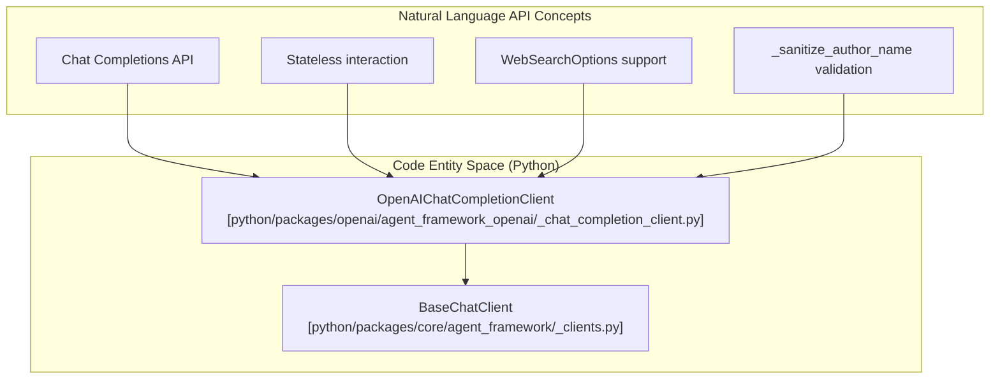

<!-- source: DeepWiki mcp.deepwiki.com · repo microsoft/agent-framework · extra page OpenAI Integration · fetched 2026-10-26 -->

# OpenAI Integration

<details>
<summary>Relevant source files</summary>

The following files were used as context for generating this wiki page:

- [docs/decisions/0032-dotnet-hosting-protocol-helpers.md](docs/decisions/0032-dotnet-hosting-protocol-helpers.md)
- [dotnet/samples/04-hosting/af-hosting/local_responses/README.md](dotnet/samples/04-hosting/af-hosting/local_responses/README.md)
- [dotnet/samples/04-hosting/af-hosting/local_responses/Server/README.md](dotnet/samples/04-hosting/af-hosting/local_responses/Server/README.md)
- [dotnet/src/Microsoft.Agents.AI.Hosting/NoopAgentSessionStore.cs](dotnet/src/Microsoft.Agents.AI.Hosting/NoopAgentSessionStore.cs)
- [dotnet/src/Shared/IntegrationTests/TestSkipReasons.cs](dotnet/src/Shared/IntegrationTests/TestSkipReasons.cs)
- [dotnet/tests/AzureAIAgentsPersistent.IntegrationTests/AzureAIAgentsPersistentFixture.cs](dotnet/tests/AzureAIAgentsPersistent.IntegrationTests/AzureAIAgentsPersistentFixture.cs)
- [dotnet/tests/Microsoft.Agents.AI.Hosting.OpenAI.IntegrationTests/OpenAIResponsesClientFunctionToolsLiveTests.cs](dotnet/tests/Microsoft.Agents.AI.Hosting.OpenAI.IntegrationTests/OpenAIResponsesClientFunctionToolsLiveTests.cs)
- [dotnet/tests/Microsoft.Agents.AI.Hosting.OpenAI.IntegrationTests/OpenAIResponsesHostingLiveTests.cs](dotnet/tests/Microsoft.Agents.AI.Hosting.OpenAI.IntegrationTests/OpenAIResponsesHostingLiveTests.cs)
- [dotnet/tests/Microsoft.Agents.AI.Hosting.OpenAI.UnitTests/OpenAIResponsesHostingTests.cs](dotnet/tests/Microsoft.Agents.AI.Hosting.OpenAI.UnitTests/OpenAIResponsesHostingTests.cs)
- [dotnet/tests/OpenAIChatCompletion.IntegrationTests/OpenAIChatCompletionFixture.cs](dotnet/tests/OpenAIChatCompletion.IntegrationTests/OpenAIChatCompletionFixture.cs)
- [dotnet/tests/OpenAIResponse.IntegrationTests/OpenAIResponse.IntegrationTests.csproj](dotnet/tests/OpenAIResponse.IntegrationTests/OpenAIResponse.IntegrationTests.csproj)
- [dotnet/tests/OpenAIResponse.IntegrationTests/OpenAIResponseFixture.cs](dotnet/tests/OpenAIResponse.IntegrationTests/OpenAIResponseFixture.cs)
- [python/packages/core/agent_framework/_feature_stage.py](python/packages/core/agent_framework/_feature_stage.py)
- [python/packages/core/tests/core/test_feature_stage.py](python/packages/core/tests/core/test_feature_stage.py)
- [python/packages/foundry/README.md](python/packages/foundry/README.md)
- [python/packages/foundry/agent_framework_foundry/_agent.py](python/packages/foundry/agent_framework_foundry/_agent.py)
- [python/packages/foundry/agent_framework_foundry/_chat_client.py](python/packages/foundry/agent_framework_foundry/_chat_client.py)
- [python/packages/foundry/tests/foundry/test_foundry_agent.py](python/packages/foundry/tests/foundry/test_foundry_agent.py)
- [python/packages/foundry/tests/foundry/test_foundry_chat_client.py](python/packages/foundry/tests/foundry/test_foundry_chat_client.py)
- [python/packages/openai/agent_framework_openai/_chat_client.py](python/packages/openai/agent_framework_openai/_chat_client.py)
- [python/packages/openai/agent_framework_openai/_chat_completion_client.py](python/packages/openai/agent_framework_openai/_chat_completion_client.py)
- [python/packages/openai/agent_framework_openai/_shared.py](python/packages/openai/agent_framework_openai/_shared.py)
- [python/packages/openai/tests/openai/conftest.py](python/packages/openai/tests/openai/conftest.py)
- [python/packages/openai/tests/openai/test_openai_chat_client.py](python/packages/openai/tests/openai/test_openai_chat_client.py)
- [python/packages/openai/tests/openai/test_openai_chat_completion_client.py](python/packages/openai/tests/openai/test_openai_chat_completion_client.py)
- [python/packages/openai/tests/openai/test_openai_chat_completion_client_azure.py](python/packages/openai/tests/openai/test_openai_chat_completion_client_azure.py)
- [python/packages/openai/tests/openai/test_openai_embedding_client_azure.py](python/packages/openai/tests/openai/test_openai_embedding_client_azure.py)
- [python/packages/openai/tests/openai/test_openai_shared.py](python/packages/openai/tests/openai/test_openai_shared.py)

</details>


## Purpose and Scope

This page documents the OpenAI provider integration in the Microsoft Agent Framework, covering support for:

- **Chat Completions API**: Stateless chat interaction for standard LLM conversations.
- **Responses API**: Stateful, reasoning-capable API with background execution and enhanced tooling.
- **Assistants API**: Persistent, managed agents with service-side memory and threading.
  
Support spans both .NET and Python implementations, maintaining parity with idiomatic designs per language.

**Related pages:**
- [Azure OpenAI Integration (3.2.2)](3.2.2)
- [Provider Integrations (3.2)](3.2)
- [Azure AI Foundry Integration (3.2.3)](3.2.3)

Sources: [python/packages/openai/agent_framework_openai/_chat_client.py:33-101](), [dotnet/tests/OpenAIResponse.IntegrationTests/OpenAIResponseFixture.cs:17-88]()

---

## OpenAI Client Architecture Overview

The integration in both languages is designed around layering client abstractions, adapting OpenAI SDK clients into the Agent Framework `IChatClient` / `BaseChatClient` abstractions, and enabling middleware for functionality such as tool invocation, telemetry, and session management.

### .NET Integration Architecture

The .NET package `Microsoft.Agents.AI.OpenAI` provides extension methods to convert native OpenAI `ResponsesClient` instances into Framework agents or chat clients via `OpenAIResponseFixture`.

- `ResponsesClient` (OpenAI SDK) → wrapped via factory methods:
  - `.AsIChatClient()` → binds model deployment.
  - ChatClientAgent configuration wrapping `IChatClient`.



Sources: [dotnet/tests/OpenAIResponse.IntegrationTests/OpenAIResponseFixture.cs:17-88]()

### Python Integration Architecture

Python implements OpenAI clients using a protocol-based, layered approach atop `BaseChatClient`:

- **RawOpenAIChatClient**: Minimal API wrapper around OpenAI SDK clients exposing core functionality without middleware.
- **OpenAIChatClient**: Adds framework middleware for function invocation, chat middleware, and telemetry.
- **OpenAIChatCompletionClient**: Specializes for the stateless Chat Completions API.



Sources: [python/packages/openai/agent_framework_openai/_chat_client.py:33-101](), [python/packages/openai/agent_framework_openai/_chat_completion_client.py:10-120]()

---

## Chat Completions API

The Chat Completions API is stateless, suitable for simple request-response chat interactions without inherent conversation tracking or management.

### Python Implementation: `OpenAIChatCompletionClient`

- Converts framework `Message` objects into OpenAI's native message structures.
- Supports web search tool integration via `WebSearchOptions` but **does not** support code interpreter, MCP, or file search tools.
- Uses sanitized author names (`_sanitize_author_name`) to remove spaces and unsafe characters, truncated at 64 characters to comply with OpenAI validation.
- Allows configuring base URL via parameter or environment variable `OPENAI_BASE_URL`.

```python
def _sanitize_author_name(name: str | None) -> str | None:
    """Sanitize an author name for use as the Chat Completions message ``name`` field."""
    if not name:
        return None
    sanitized = _INVALID_AUTHOR_NAME_RE.sub("", name)
    return sanitized[:_MAX_AUTHOR_NAME_LENGTH] if sanitized else None
```

Sources: [python/packages/openai/agent_framework_openai/_chat_completion_client.py:120-137](), [python/packages/openai/tests/openai/test_openai_chat_completion_client.py:93-108]()

---

## Responses API

The Responses API adds statefulness, conversation tracking, and advanced features like reasoning models, background operations, and extended tooling.

### .NET Implementation

- Converts a `ResponsesClient` into a Framework `ChatClientAgent` via `OpenAIResponseFixture`.
- Supports configuring reasoning content inclusion and stored output via `CreateResponseOptions`.

Sources: [dotnet/tests/OpenAIResponse.IntegrationTests/OpenAIResponseFixture.cs:73-89]()

### Python Implementation: `OpenAIChatClient`

- Wraps OpenAI's Responses API using the SDK's `AsyncOpenAI` client.
- Supports background execution returning an `OpenAIContinuationToken`.
- Supports reasoning model options (`ReasoningOptions`) with configurable `effort` and `summary` levels.
- Manages advanced tools (`CodeInterpreter`, `FileSearchToolParam`, `WebSearchToolParam`, `ImageGeneration`, `Mcp`).

```python
class OpenAIContinuationToken(ContinuationToken):
    """Continuation token for OpenAI Responses API background operations."""
    response_id: str
```

Sources: [python/packages/openai/agent_framework_openai/_chat_client.py:184-210](), [python/packages/openai/tests/openai/test_openai_chat_client.py:100-192]()

---

## Assistants API (Persistent Agents)

The Assistants API enables managed, persistent agents backed by service-side memory and agent threads.

- Managed through `PersistentAgentsClient` and corresponding integration tests.
- Agents maintain metadata, instructions, and associated vector stores.

Sources: [dotnet/tests/AzureAIAgentsPersistent.IntegrationTests/AzureAIAgentsPersistentCreateTests.cs:37-51]()

---

## Tool Integration

The OpenAI integration supports built-in OpenAI-hosted tools exposed through typed parameters:

| Tool | Description | Python Parameter Type |
|-------|-------------|----------------------|
| Code Interpreter | Python code execution sandbox | `CodeInterpreter` |
| File Search | Search uploaded files using vector embeddings | `FileSearchToolParam` |
| Web Search | Real-time web search capability | `WebSearchToolParam` |
| Image Generation | Generate images from prompts using DALL-E | `ImageGeneration` |
| MCP (Model Context Protocol) | Tool support using MCP extensions in Responses API | `Mcp` |

Sources: [python/packages/openai/agent_framework_openai/_chat_client.py:80-112]()

---

## Session and History Management

- `InMemoryHistoryProvider`: Ephemeral chat history provider.
- Managed session stores and file-based function approval storage.

Sources: [python/packages/openai/tests/openai/test_openai_chat_client.py:32-41]()

---

# Summary Mermaid Diagrams Bridging Natural Language System Names and Code Entities

### Diagram 1: OpenAI Chat Completions API Mapping (Python)



Sources: [python/packages/openai/agent_framework_openai/_chat_completion_client.py:10-140]()

### Diagram 2: OpenAI Responses API Mapping (Python and .NET)

```mermaid
graph LR
    subgraph NaturalLanguage["Natural Language System Names"]
        ResponsesAPI["OpenAI Responses API"]
        ReasoningModels["ReasoningOptions (effort, summary)"]
        BackgroundMode["OpenAIContinuationToken"]
        HostedTools["Hosted Tools (CodeInterpreter, Mcp)"]
    end

    subgraph PythonEntities["Code Entity Space (Python)"]
        OAIChatClient["OpenAIChatClient<br/>[python/packages/openai/agent_framework_openai/_chat_client.py]"]
        RawOpenAI ["RawOpenAIChatClient<br/>[python/packages/openai/agent_framework_openai/_chat_client.py]"]
    end

    subgraph DotNetEntities["Code Entity Space (.NET)"]
        ResponsesClient["ResponsesClient<br/>(OpenAI SDK)"]
        Fixture["OpenAIResponseFixture<br/>[dotnet/tests/OpenAIResponse.IntegrationTests/OpenAIResponseFixture.cs]"]
        ChatClientAgent["ChatClientAgent<br/>(Microsoft.Agents.AI)"]
    end

    ResponsesAPI --> OAIChatClient
    ReasoningModels --> OAIChatClient
    BackgroundMode --> OAIChatClient
    HostedTools --> OAIChatClient

    ResponsesClient --> Fixture
    Fixture --> ChatClientAgent
    OAIChatClient --> RawOpenAI
```

Sources: [python/packages/openai/agent_framework_openai/_chat_client.py:33-210](), [dotnet/tests/OpenAIResponse.IntegrationTests/OpenAIResponseFixture.cs:17-88]()

---

