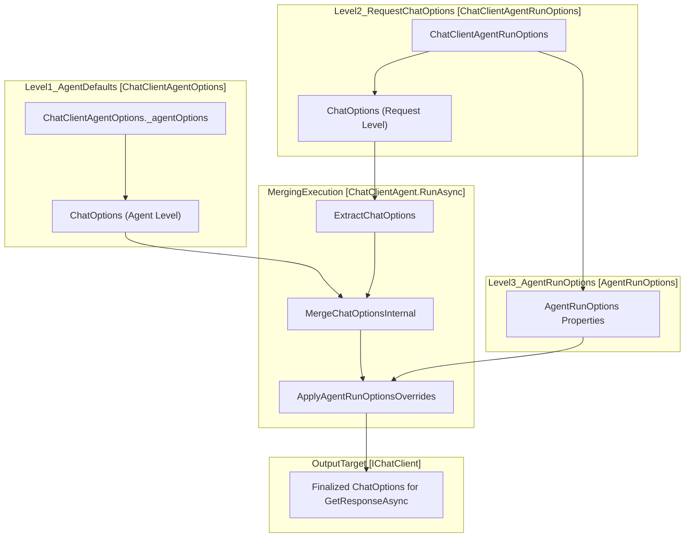
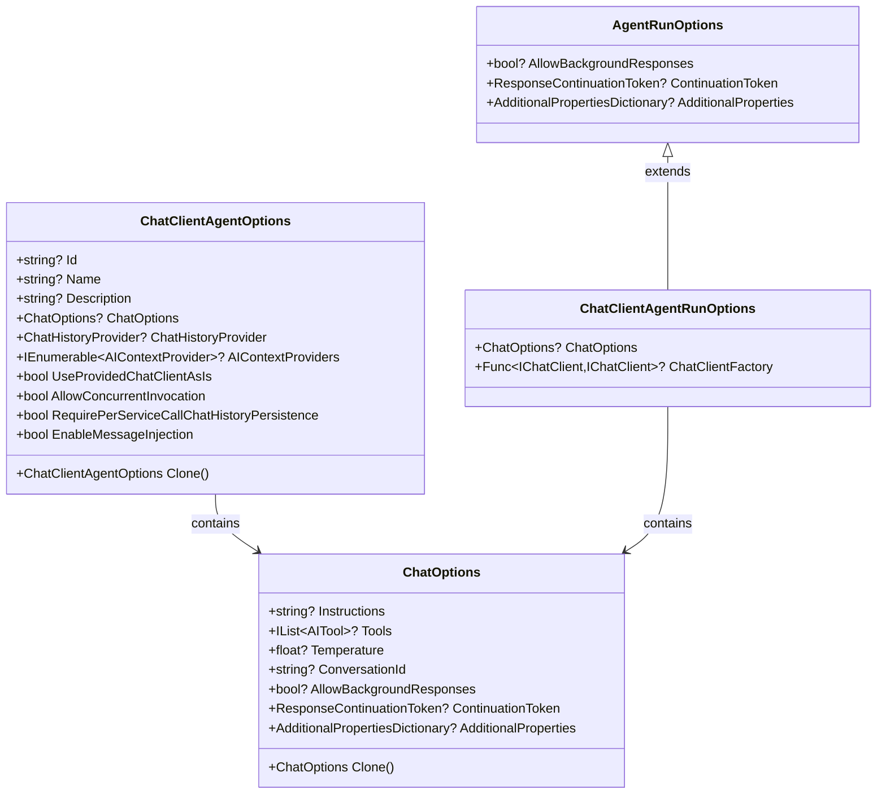
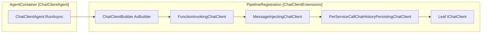

<!-- source: DeepWiki mcp.deepwiki.com · repo microsoft/agent-framework · extra page Options Merging and Configuration · fetched 2026-10-26 -->

# Options Merging and Configuration

Relevant source files

The following files were used as context for generating this wiki page:

- [docs/decisions/0022-chat-history-persistence-consistency.md](docs/decisions/0022-chat-history-persistence-consistency.md)
- [dotnet/samples/02-agents/Agents/Agent_Step19_InFunctionLoopCheckpointing/Program.cs](dotnet/samples/02-agents/Agents/Agent_Step19_InFunctionLoopCheckpointing/Program.cs)
- [dotnet/samples/02-agents/Agents/Agent_Step19_InFunctionLoopCheckpointing/README.md](dotnet/samples/02-agents/Agents/Agent_Step19_InFunctionLoopCheckpointing/README.md)
- [dotnet/src/Microsoft.Agents.AI.Abstractions/AdditionalPropertiesExtensions.cs](dotnet/src/Microsoft.Agents.AI.Abstractions/AdditionalPropertiesExtensions.cs)
- [dotnet/src/Microsoft.Agents.AI/ChatClient/ChatClientAgent.cs](dotnet/src/Microsoft.Agents.AI/ChatClient/ChatClientAgent.cs)
- [dotnet/src/Microsoft.Agents.AI/ChatClient/ChatClientAgentContinuationToken.cs](dotnet/src/Microsoft.Agents.AI/ChatClient/ChatClientAgentContinuationToken.cs)
- [dotnet/src/Microsoft.Agents.AI/ChatClient/ChatClientAgentLogMessages.cs](dotnet/src/Microsoft.Agents.AI/ChatClient/ChatClientAgentLogMessages.cs)
- [dotnet/src/Microsoft.Agents.AI/ChatClient/ChatClientAgentOptions.cs](dotnet/src/Microsoft.Agents.AI/ChatClient/ChatClientAgentOptions.cs)
- [dotnet/src/Microsoft.Agents.AI/ChatClient/ChatClientBuilderExtensions.cs](dotnet/src/Microsoft.Agents.AI/ChatClient/ChatClientBuilderExtensions.cs)
- [dotnet/src/Microsoft.Agents.AI/ChatClient/ChatClientExtensions.cs](dotnet/src/Microsoft.Agents.AI/ChatClient/ChatClientExtensions.cs)
- [dotnet/tests/Microsoft.Agents.AI.Abstractions.UnitTests/AdditionalPropertiesExtensionsTests.cs](dotnet/tests/Microsoft.Agents.AI.Abstractions.UnitTests/AdditionalPropertiesExtensionsTests.cs)
- [dotnet/tests/Microsoft.Agents.AI.UnitTests/ChatClient/ChatClientAgentContinuationTokenTests.cs](dotnet/tests/Microsoft.Agents.AI.UnitTests/ChatClient/ChatClientAgentContinuationTokenTests.cs)
- [dotnet/tests/Microsoft.Agents.AI.UnitTests/ChatClient/ChatClientAgentOptionsTests.cs](dotnet/tests/Microsoft.Agents.AI.UnitTests/ChatClient/ChatClientAgentOptionsTests.cs)
- [dotnet/tests/Microsoft.Agents.AI.UnitTests/ChatClient/ChatClientAgentTestHelper.cs](dotnet/tests/Microsoft.Agents.AI.UnitTests/ChatClient/ChatClientAgentTestHelper.cs)
- [dotnet/tests/Microsoft.Agents.AI.UnitTests/ChatClient/ChatClientAgentTests.cs](dotnet/tests/Microsoft.Agents.AI.UnitTests/ChatClient/ChatClientAgentTests.cs)
- [dotnet/tests/Microsoft.Agents.AI.UnitTests/ChatClient/ChatClientAgent_ApprovalsTests.cs](dotnet/tests/Microsoft.Agents.AI.UnitTests/ChatClient/ChatClientAgent_ApprovalsTests.cs)
- [dotnet/tests/Microsoft.Agents.AI.UnitTests/ChatClient/ChatClientAgent_BackgroundResponsesTests.cs](dotnet/tests/Microsoft.Agents.AI.UnitTests/ChatClient/ChatClientAgent_BackgroundResponsesTests.cs)
- [dotnet/tests/Microsoft.Agents.AI.UnitTests/ChatClient/ChatClientAgent_ChatHistoryManagementTests.cs](dotnet/tests/Microsoft.Agents.AI.UnitTests/ChatClient/ChatClientAgent_ChatHistoryManagementTests.cs)
- [dotnet/tests/Microsoft.Agents.AI.UnitTests/ChatClient/ChatClientAgent_ChatOptionsMergingTests.cs](dotnet/tests/Microsoft.Agents.AI.UnitTests/ChatClient/ChatClientAgent_ChatOptionsMergingTests.cs)
- [dotnet/tests/Microsoft.Agents.AI.UnitTests/ChatClient/ChatClientBuilderExtensionsTests.cs](dotnet/tests/Microsoft.Agents.AI.UnitTests/ChatClient/ChatClientBuilderExtensionsTests.cs)
- [dotnet/tests/Microsoft.Agents.AI.UnitTests/ChatClient/ChatClientExtensionsTests.cs](dotnet/tests/Microsoft.Agents.AI.UnitTests/ChatClient/ChatClientExtensionsTests.cs)

## Purpose and Scope

This document details the configuration merging strategy in the .NET `ChatClientAgent` implementation. It explains how `ChatClientAgentOptions`, `AgentRunOptions` (and its derivative `ChatClientAgentRunOptions`), and request-level `ChatOptions` are merged to produce the final configuration passed to the `IChatClient`.

The framework employs a multi-tiered precedence system to resolve configuration conflicts, ensuring that specific run-time requirements can override general agent defaults while maintaining architectural consistency.

Sources: [dotnet/src/Microsoft.Agents.AI/ChatClient/ChatClientAgent.cs:39-41](), [dotnet/src/Microsoft.Agents.AI/ChatClient/ChatClientAgentOptions.cs:18-20]()

## Three-Level Precedence Architecture

The `ChatClientAgent` [dotnet/src/Microsoft.Agents.AI/ChatClient/ChatClientAgent.cs:39-39]() implements a three-level precedence system. Merging occurs in configuration methods called during both `RunAsync` and `RunStreamingAsync` [dotnet/src/Microsoft.Agents.AI/ChatClient/ChatClientAgent.cs:220-220]() [dotnet/src/Microsoft.Agents.AI/ChatClient/ChatClientAgent.cs:446-446]().

### Precedence Flow

Title: Code-Level Options Merging Flow (`ChatClientAgent`)

Sources: [dotnet/src/Microsoft.Agents.AI/ChatClient/ChatClientAgent.cs:528-669](), [dotnet/src/Microsoft.Agents.AI/ChatClient/ChatClientAgent.cs:39-41]()

## Options Classes Hierarchy

The framework defines a hierarchy of classes to control agent behavior. `ChatClientAgentOptions` [dotnet/src/Microsoft.Agents.AI/ChatClient/ChatClientAgentOptions.cs:18-18]() configures the agent instance, while `ChatClientAgentRunOptions` provides per-run overrides.

Title: Configuration Entity Relationships (`ChatClientAgentOptions`)

| Options Class | Purpose | Key Properties | Scope |
|---------------|---------|----------------|-------|
| `ChatClientAgentOptions` | Agent-level configuration | `Id`, `Name`, `ChatOptions`, `ChatHistoryProvider` | Agent construction |
| `ChatOptions` | AI Service parameters | `Instructions`, `Tools`, `Temperature`, `ConversationId` | Standardized AI interface |
| `AgentRunOptions` | Base per-run config | `AllowBackgroundResponses`, `ContinuationToken` | Execution lifecycle |
| `ChatClientAgentRunOptions` | Extended per-run config | `ChatOptions`, `ChatClientFactory` | Request-specific AI overrides |

Sources: [dotnet/src/Microsoft.Agents.AI/ChatClient/ChatClientAgentOptions.cs:18-140](), [dotnet/src/Microsoft.Agents.AI/ChatClient/ChatClientAgent.cs:83-96](), [dotnet/tests/Microsoft.Agents.AI.UnitTests/ChatClient/ChatClientAgent_ChatOptionsMergingTests.cs:116-143]()

## Property-Specific Merging Rules

The configuration resolution applies different rules based on property type. Request-level options (Level 2) are merged into agent-level options (Level 1).

| Property | Merging Rule | Conflict Winner | Logic Reference |
|----------|--------------|-----------------|-------|
| `Temperature`, `MaxOutputTokens`, `ModelId` | `??=` (null-coalescing) | Request | [dotnet/src/Microsoft.Agents.AI/ChatClient/ChatClientAgent.cs:547-558]() |
| `Instructions` | String concatenation with `\n` | Both (Agent first) | [dotnet/src/Microsoft.Agents.AI/ChatClient/ChatClientAgent.cs:561-565]() |
| `AdditionalProperties` | `TryAdd` merge | Request | [dotnet/src/Microsoft.Agents.AI/ChatClient/ChatClientAgent.cs:568-578]() |
| `StopSequences` | List concatenation | Both (Request first) | [dotnet/src/Microsoft.Agents.AI/ChatClient/ChatClientAgent.cs:589-609]() |
| `Tools` | List concatenation | Both (Request first) | [dotnet/src/Microsoft.Agents.AI/ChatClient/ChatClientAgent.cs:612-635]() |

### ApplyAgentRunOptionsOverrides

Highest-precedence overrides (Level 3) from `AgentRunOptions` are applied subsequently. This includes specific handling for `AllowBackgroundResponses` and `ContinuationToken` [dotnet/src/Microsoft.Agents.AI/ChatClient/ChatClientAgent.cs:641-655](). Unlike the standard `ChatOptions` merge, `AdditionalProperties` here use direct assignment or specific replacement logic, ensuring they always overwrite values from lower levels [dotnet/src/Microsoft.Agents.AI/ChatClient/ChatClientAgent.cs:657-667]().

Sources: [dotnet/src/Microsoft.Agents.AI/ChatClient/ChatClientAgent.cs:639-668]()

## Middleware Configuration and Persistence

A critical configuration aspect is the `RequirePerServiceCallChatHistoryPersistence` and `EnableMessageInjection` settings in `ChatClientAgentOptions`.

### Per-Service-Call Persistence Consistency

As defined in ADR 0022 [docs/decisions/0022-chat-history-persistence-consistency.md:10-10](), the framework provides two persistence timings:

*   **End-of-Run (Default)**: History is persisted once the entire agent run (including all tool loops) completes [docs/decisions/0022-chat-history-persistence-consistency.md:16-17]().
*   **Per-Service-Call**: Enabled via `RequirePerServiceCallChatHistoryPersistence = true` [dotnet/src/Microsoft.Agents.AI/ChatClient/ChatClientAgentOptions.cs:108-110](). A `PerServiceCallChatHistoryPersistingChatClient` decorator is inserted into the pipeline [dotnet/src/Microsoft.Agents.AI/ChatClient/ChatClientExtensions.cs:126-129](). It saves messages after *each* LLM interaction within the tool-calling loop, matching service-side behavior like OpenAI Responses [docs/decisions/0022-chat-history-persistence-consistency.md:62-63]().

### Message Injection

When `EnableMessageInjection` is set to `true`, a `MessageInjectingChatClient` is added to the pipeline [dotnet/src/Microsoft.Agents.AI/ChatClient/ChatClientExtensions.cs:115-118](). This allows tool code to use `AIAgent.CurrentRunContext` to resolve the client and call `EnqueueMessagesAsync` to inject new user prompts during the function execution loop [dotnet/samples/02-agents/Agents/Agent_Step19_InFunctionLoopCheckpointing/Program.cs:87-94]().

Title: Middleware Pipeline Construction (`ChatClientExtensions.WithDefaultAgentMiddleware`)

Sources: [dotnet/src/Microsoft.Agents.AI/ChatClient/ChatClientExtensions.cs:52-132](), [dotnet/src/Microsoft.Agents.AI/ChatClient/ChatClientAgentOptions.cs:108-141](), [dotnet/samples/02-agents/Agents/Agent_Step19_InFunctionLoopCheckpointing/Program.cs:106-117](), [docs/decisions/0022-chat-history-persistence-consistency.md:10-63]()

## Options Cloning and Immutability

To ensure thread safety and prevent unintended side effects, `ChatClientAgent` performs defensive cloning:
1.  **Construction**: The `ChatClientAgentOptions` object is cloned immediately using `options?.Clone()` [dotnet/src/Microsoft.Agents.AI/ChatClient/ChatClientAgent.cs:121-121]().
2.  **Runtime**: The `ChatOptions` provided in `ChatClientAgentRunOptions` are cloned before merging [dotnet/src/Microsoft.Agents.AI/ChatClient/ChatClientAgent.cs:530-530]().

This prevents external mutations of options objects from affecting active agent instances or concurrent runs [dotnet/tests/Microsoft.Agents.AI.UnitTests/ChatClient/ChatClientAgentOptionsTests.cs:116-165]().

Sources: [dotnet/src/Microsoft.Agents.AI/ChatClient/ChatClientAgent.cs:121-530](), [dotnet/tests/Microsoft.Agents.AI.UnitTests/ChatClient/ChatClientAgentOptionsTests.cs:116-165]()

## Provider Conflict Handling

The framework monitors for conflicts between framework-managed history and service-managed history (e.g., OpenAI's `ConversationId`). Configuration flags in `ChatClientAgentOptions` determine behavior when a service returns a `ConversationId` while a `ChatHistoryProvider` is also active:

*   `ClearOnChatHistoryProviderConflict`: Defaults to `true` [dotnet/src/Microsoft.Agents.AI/ChatClient/ChatClientAgentOptions.cs:87-87]().
*   `WarnOnChatHistoryProviderConflict`: Defaults to `true` [dotnet/src/Microsoft.Agents.AI/ChatClient/ChatClientAgentOptions.cs:96-96]().
*   `ThrowOnChatHistoryProviderConflict`: Defaults to `true` [dotnet/src/Microsoft.Agents.AI/ChatClient/ChatClientAgentOptions.cs:105-105]().

If `ThrowOnChatHistoryProviderConflict` is enabled and a conflict occurs (e.g., different IDs provided in session and request), an `InvalidOperationException` is thrown [dotnet/tests/Microsoft.Agents.AI.UnitTests/ChatClient/ChatClientAgent_ChatHistoryManagementTests.cs:54-66]().

Sources: [dotnet/src/Microsoft.Agents.AI/ChatClient/ChatClientAgentOptions.cs:78-105](), [dotnet/tests/Microsoft.Agents.AI.UnitTests/ChatClient/ChatClientAgent_ChatHistoryManagementTests.cs:29-66]()

---

