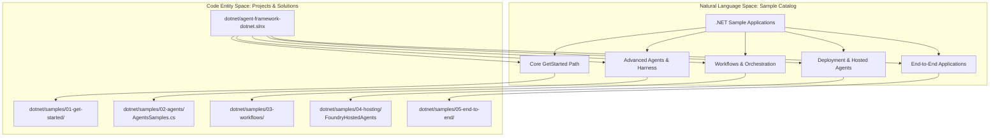
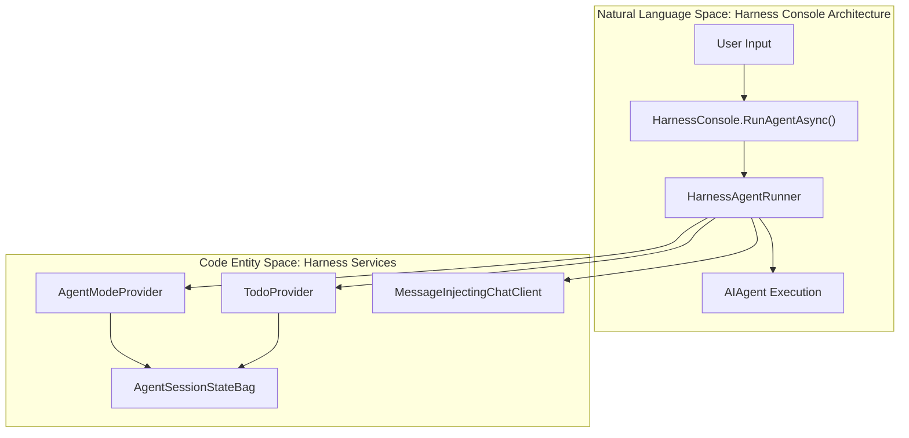

<!-- source: DeepWiki mcp.deepwiki.com · repo microsoft/agent-framework · extra page .NET Sample Catalog · fetched 2026-10-26 -->

# .NET Sample Catalog

Relevant source files

The following files were used as context for generating this wiki page:

- [dotnet/eng/verify-samples/AgentsSamples.cs](dotnet/eng/verify-samples/AgentsSamples.cs)
- [dotnet/samples/02-agents/AgentWithMemory/AgentWithMemory_Step06_MemoryUsingAgentMemory/ProductCatalog.cs](dotnet/samples/02-agents/AgentWithMemory/AgentWithMemory_Step06_MemoryUsingAgentMemory/ProductCatalog.cs)
- [dotnet/samples/02-agents/AgentWithMemory/AgentWithMemory_Step06_MemoryUsingAgentMemory/Program.cs](dotnet/samples/02-agents/AgentWithMemory/AgentWithMemory_Step06_MemoryUsingAgentMemory/Program.cs)
- [dotnet/samples/02-agents/AgentWithMemory/AgentWithMemory_Step06_MemoryUsingAgentMemory/README.md](dotnet/samples/02-agents/AgentWithMemory/AgentWithMemory_Step06_MemoryUsingAgentMemory/README.md)
- [dotnet/samples/02-agents/AgentWithMemory/AgentWithMemory_Step07_FileMemoryProvider/AgentWithMemory_Step07_FileMemoryProvider.csproj](dotnet/samples/02-agents/AgentWithMemory/AgentWithMemory_Step07_FileMemoryProvider/AgentWithMemory_Step07_FileMemoryProvider.csproj)
- [dotnet/samples/02-agents/AgentWithMemory/AgentWithMemory_Step07_FileMemoryProvider/Program.cs](dotnet/samples/02-agents/AgentWithMemory/AgentWithMemory_Step07_FileMemoryProvider/Program.cs)
- [dotnet/samples/02-agents/AgentWithMemory/AgentWithMemory_Step07_FileMemoryProvider/README.md](dotnet/samples/02-agents/AgentWithMemory/AgentWithMemory_Step07_FileMemoryProvider/README.md)
- [dotnet/samples/02-agents/AgentWithMemory/AgentWithMemory_Step08_MemoryUsingCosmosNoSql/AgentWithMemory_Step08_MemoryUsingCosmosNoSql.csproj](dotnet/samples/02-agents/AgentWithMemory/AgentWithMemory_Step08_MemoryUsingCosmosNoSql/AgentWithMemory_Step08_MemoryUsingCosmosNoSql.csproj)
- [dotnet/samples/02-agents/AgentWithMemory/AgentWithMemory_Step08_MemoryUsingCosmosNoSql/Program.cs](dotnet/samples/02-agents/AgentWithMemory/AgentWithMemory_Step08_MemoryUsingCosmosNoSql/Program.cs)
- [dotnet/samples/02-agents/AgentWithMemory/AgentWithMemory_Step08_MemoryUsingCosmosNoSql/README.md](dotnet/samples/02-agents/AgentWithMemory/AgentWithMemory_Step08_MemoryUsingCosmosNoSql/README.md)
- [dotnet/samples/02-agents/AgentWithMemory/AgentWithMemory_Step09_MemoryUsingMem0Sharp/README.md](dotnet/samples/02-agents/AgentWithMemory/AgentWithMemory_Step09_MemoryUsingMem0Sharp/README.md)
- [dotnet/samples/02-agents/AgentWithMemory/README.md](dotnet/samples/02-agents/AgentWithMemory/README.md)
- [dotnet/samples/02-agents/Harness/Harness_Shared_Console/Commands/ModeCommandHandler.cs](dotnet/samples/02-agents/Harness/Harness_Shared_Console/Commands/ModeCommandHandler.cs)
- [dotnet/samples/02-agents/Harness/Harness_Shared_Console/Commands/SessionCommandHandler.cs](dotnet/samples/02-agents/Harness/Harness_Shared_Console/Commands/SessionCommandHandler.cs)
- [dotnet/samples/02-agents/Harness/Harness_Shared_Console/Commands/TodoCommandHandler.cs](dotnet/samples/02-agents/Harness/Harness_Shared_Console/Commands/TodoCommandHandler.cs)
- [dotnet/samples/02-agents/Harness/Harness_Shared_Console/HarnessAgentRunner.cs](dotnet/samples/02-agents/Harness/Harness_Shared_Console/HarnessAgentRunner.cs)
- [dotnet/samples/02-agents/Harness/Harness_Shared_Console/HarnessConsole.cs](dotnet/samples/02-agents/Harness/Harness_Shared_Console/HarnessConsole.cs)
- [dotnet/samples/02-agents/Harness/Harness_Shared_Console/HarnessConsoleOptions.cs](dotnet/samples/02-agents/Harness/Harness_Shared_Console/HarnessConsoleOptions.cs)
- [dotnet/samples/02-agents/Harness/Harness_Shared_Console/HarnessConsoleUXStateDriver.cs](dotnet/samples/02-agents/Harness/Harness_Shared_Console/HarnessConsoleUXStateDriver.cs)
- [dotnet/samples/02-agents/Harness/Harness_Shared_Console/IUXStateDriver.cs](dotnet/samples/02-agents/Harness/Harness_Shared_Console/IUXStateDriver.cs)
- [dotnet/samples/02-agents/Harness/Harness_Shared_Console/Observers/ConsoleObserver.cs](dotnet/samples/02-agents/Harness/Harness_Shared_Console/Observers/ConsoleObserver.cs)
- [dotnet/samples/02-agents/Harness/Harness_Shared_Console/ToolFormatters/TodoToolFormatter.cs](dotnet/samples/02-agents/Harness/Harness_Shared_Console/ToolFormatters/TodoToolFormatter.cs)
- [dotnet/samples/02-agents/Harness/Harness_Shared_Console/ToolFormatters/ToolCallFormatter.cs](dotnet/samples/02-agents/Harness/Harness_Shared_Console/ToolFormatters/ToolCallFormatter.cs)
- [dotnet/samples/AGENTS.md](dotnet/samples/AGENTS.md)
- [dotnet/src/Microsoft.Agents.AI/Harness/AgentMode/AgentModeProvider.cs](dotnet/src/Microsoft.Agents.AI/Harness/AgentMode/AgentModeProvider.cs)
- [dotnet/src/Microsoft.Agents.AI/Harness/AgentMode/AgentModeProviderOptions.cs](dotnet/src/Microsoft.Agents.AI/Harness/AgentMode/AgentModeProviderOptions.cs)
- [dotnet/src/Microsoft.Agents.AI/Harness/AgentMode/AgentModeState.cs](dotnet/src/Microsoft.Agents.AI/Harness/AgentMode/AgentModeState.cs)
- [dotnet/src/Microsoft.Agents.AI/Harness/BackgroundAgents/BackgroundAgentState.cs](dotnet/src/Microsoft.Agents.AI/Harness/BackgroundAgents/BackgroundAgentState.cs)
- [dotnet/src/Microsoft.Agents.AI/Harness/Loop/TodoCompletionLoopEvaluator.cs](dotnet/src/Microsoft.Agents.AI/Harness/Loop/TodoCompletionLoopEvaluator.cs)
- [dotnet/src/Microsoft.Agents.AI/Harness/Todo/TodoItem.cs](dotnet/src/Microsoft.Agents.AI/Harness/Todo/TodoItem.cs)
- [dotnet/src/Microsoft.Agents.AI/Harness/Todo/TodoItemInput.cs](dotnet/src/Microsoft.Agents.AI/Harness/Todo/TodoItemInput.cs)
- [dotnet/src/Microsoft.Agents.AI/Harness/Todo/TodoProvider.cs](dotnet/src/Microsoft.Agents.AI/Harness/Todo/TodoProvider.cs)
- [dotnet/src/Microsoft.Agents.AI/Harness/Todo/TodoProviderOptions.cs](dotnet/src/Microsoft.Agents.AI/Harness/Todo/TodoProviderOptions.cs)
- [dotnet/tests/Microsoft.Agents.AI.UnitTests/Harness/AgentMode/AgentModeProviderTests.cs](dotnet/tests/Microsoft.Agents.AI.UnitTests/Harness/AgentMode/AgentModeProviderTests.cs)
- [dotnet/tests/Microsoft.Agents.AI.UnitTests/Harness/Loop/TodoCompletionLoopEvaluatorTests.cs](dotnet/tests/Microsoft.Agents.AI.UnitTests/Harness/Loop/TodoCompletionLoopEvaluatorTests.cs)
- [dotnet/tests/Microsoft.Agents.AI.UnitTests/Harness/Todo/TodoProviderTests.cs](dotnet/tests/Microsoft.Agents.AI.UnitTests/Harness/Todo/TodoProviderTests.cs)

This document provides a comprehensive catalog of all .NET sample applications included in the Microsoft Agent Framework. The samples are organized by functionality and learning progression, ranging from basic introductory agents to hosted agents, complex workflows, Harness patterns, and end-to-end solutions.

For information about Python samples, see [Python Sample Catalog](). For general getting started guidance, see [Getting Started](). For deployment patterns, see [.NET Deployment Options]().

## Sample Organization

The .NET samples reside under `dotnet/samples/` and are organized into functional subdirectories, all integrated into the solution file `dotnet/agent-framework-dotnet.slnx` [dotnet/eng/verify-samples/AgentsSamples.cs:8-17]().

### Sample Categories Hierarchy

**Sources:** [dotnet/eng/verify-samples/AgentsSamples.cs:8-17]()

---

## Core Learning Path: 01-get-started

The primary entry point for developers consists of progressive samples in `dotnet/samples/01-get-started/` that build fundamental agent skills sequentially.

| Sample | Project Path | Key Concepts & Framework Classes |
|--------|-------------|----------------------------------|
| **01_hello_agent** | `01-get-started/01_hello_agent` | `AIAgent`, `RunAsync`, instructions configuration |
| **02_add_tools** | `01-get-started/02_add_tools` | `AIFunctionFactory`, function tool binding and invocation |
| **03_multi_turn** | `01-get-started/03_multi_turn` | `AgentSession`, multi-turn conversation state persistence |
| **04_memory** | `01-get-started/04_memory` | `AIContextProvider`, memory and context injection |
| **05_first_workflow** | `01-get-started/05_first_workflow` | `WorkflowBuilder`, foundational executors and edges |

**Sources:** [dotnet/eng/verify-samples/AgentsSamples.cs:14-25]()

---

## Advanced Features & Harness Samples: 02-agents

The `dotnet/samples/02-agents/` directory covers advanced capabilities, provider integrations, RAG memory providers, and the batteries-independent `HarnessAgent` pattern.

### Agent Step-by-Step Progression

The framework provides a granular progression covering structured outputs, tool approvals, middleware, and custom implementations [dotnet/eng/verify-samples/AgentsSamples.cs:14-146]().

```mermaid
graph LR
    subgraph "Core Agent Capabilities"
        S1["Agent_Step01_UsingFunctionToolsWithApprovals"]
        S2["Agent_Step02_StructuredOutput"]
        S3["Agent_Step03_PersistedConversations"]
        S4["Agent_Step04_3rdPartyChatHistoryStorage"]
    end

    subgraph "Advanced Execution"
        S7["Agent_With_AzureAIProject"]
        S10["Agent_With_AzureFoundryModel"]
        S19["Agent_With_AzureOpenAIResponses"]
        S25["Agent_With_CustomImplementation"]
    end

    S1 --> S2 --> S3 --> S4
    S4 --> S7 --> S10 --> S19 --> S25
```

**Sources:** [dotnet/eng/verify-samples/AgentsSamples.cs:14-146]()

### Memory, RAG, and File-Based Providers

Memory-focused samples under `AgentWithMemory/` demonstrate integration with vector stores and managed services:
* **Cosmos DB Integration**: `AgentWithMemory_Step08_MemoryUsingCosmosNoSql` uses `ChatHistoryMemoryProvider` with `CosmosVectorStore` to persist chat history across user sessions [dotnet/samples/02-agents/AgentWithMemory/AgentWithMemory_Step08_MemoryUsingCosmosNoSql/Program.cs:56-77]().
* **File-Based Memory**: `AgentWithMemory_Step07_FileMemoryProvider` provides agents with file-based recall and storage tools [dotnet/samples/02-agents/AgentWithMemory/README.md:13-13]().
* **Mem0 Integration**: `AgentWithMemory_Step02_MemoryUsingMem0` extracts and retrieves individual memories via the Mem0 service [dotnet/samples/02-agents/AgentWithMemory/README.md:8-8]().

**Sources:** [dotnet/samples/02-agents/AgentWithMemory/README.md:1-17](), [dotnet/samples/02-agents/AgentWithMemory/AgentWithMemory_Step08_MemoryUsingCosmosNoSql/Program.cs:56-77]()

### Harness and Console Utilities

The `Harness` samples showcase robust console agents equipped with planning, task tracking, and interactive commands.
* **`TodoProvider`**: Manages todo items (`todos_add`, `todos_complete`, `todos_remove`, `todos_get_remaining`) stored in `AgentSessionStateBag` [dotnet/src/Microsoft.Agents.AI/Harness/Todo/TodoProvider.cs:20-38]().
* **`AgentModeProvider`**: Tracks operating modes (e.g., `"plan"` vs `"execute"`) to govern agent behavior [dotnet/src/Microsoft.Agents.AI/Harness/AgentMode/AgentModeProviderOptions.cs:1-1](), [dotnet/src/Microsoft.Agents.AI/Harness/AgentMode/AgentModeProvider.cs:15-38]().
* **`HarnessConsole`**: Provides an interactive console loop supporting streaming output, command handling, and reactive components [dotnet/samples/02-agents/Harness/Harness_Shared_Console/HarnessConsole.cs:10-24]().

**Sources:** [dotnet/src/Microsoft.Agents.AI/Harness/Todo/TodoProvider.cs:20-38](), [dotnet/src/Microsoft.Agents.AI/Harness/AgentMode/AgentModeProvider.cs:15-38](), [dotnet/samples/02-agents/Harness/Harness_Shared_Console/HarnessConsole.cs:24-42](), [dotnet/samples/02-agents/Harness/Harness_Shared_Console/HarnessAgentRunner.cs:19-57]()

---

## Workflow Samples: 03-workflows

The `dotnet/samples/03-workflows/` directory contains samples demonstrating graph-based execution, state sharing, checkpointing, and declarative YAML definitions.
* **Declarative Workflows**: Executes YAML-defined workflows utilizing `DefaultMcpToolHandler` and `WorkflowFactory`.
* **Checkpointing & Resume**: Demonstrates persistent workflow execution states via `WorkflowRunner` with JSON checkpoints.
* **Human-in-the-Loop**: Illustrates approval gates and request-info patterns.

**Sources:** [dotnet/eng/verify-samples/AgentsSamples.cs:8-17]()

---

## Hosting and Hosted Agent Samples: 04-hosting

The `dotnet/samples/04-hosting/` directory contains deployment patterns, A2A communication, and Microsoft Foundry Hosted Agents.

### Foundry Hosted Agents and Client REPLs

Hosted agent samples demonstrate deploying agents as managed services using the OpenAI Responses protocol. For example, `Hosted-AgentSkills` loads guidelines from Foundry Skills authored as `SKILL.md` files using `AgentSkillsProvider`.

**Client REPL Utilities**: The `Using-Samples` directory provides lightweight console clients (e.g., `SimpleAgent`, `FoundryHostedSession`) that connect to hosted servers using `AIProjectClient(...).AsAIAgent(agentEndpoint)`.

**Sources:** [dotnet/samples/02-agents/AgentWithMemory/README.md:1-17]()

---

## End-to-End Applications: 05-end-to-end

The `dotnet/samples/05-end-to-end/` directory houses complete, production-like reference architectures:
* **`AgentWebChat`**: Aspire-hosted web chat interface integrating agents with distributed telemetry and UI routing.
* **`A2AClientServer`**: Demonstrates Agent-to-Agent protocol communication over HTTP endpoints.
* **`AGUIClientServer` & `AGUIWebChat`**: Connects agents to frontend components using protocol packages.
* **`AgentWithPurview`**: Integrates Microsoft Purview for policy evaluation, data governance, and auditing.

**Sources:** [dotnet/eng/verify-samples/AgentsSamples.cs:8-17]()

---

## Sample Verification Infrastructure

To ensure ongoing correctness, the repository maintains an automated validation engine under `dotnet/eng/verify-samples/` [dotnet/eng/verify-samples/AgentsSamples.cs:8-10]().

* **`SampleDefinition`**: Declares required environment variables, optional inputs, delay parameters, and expected output descriptions [dotnet/eng/verify-samples/AgentsSamples.cs:14-25]().
* **CI Execution**: Validated continuously through GitHub Actions workflows to prevent regression across all agent providers and samples.

**Sources:** [dotnet/eng/verify-samples/AgentsSamples.cs:8-25]()

---

