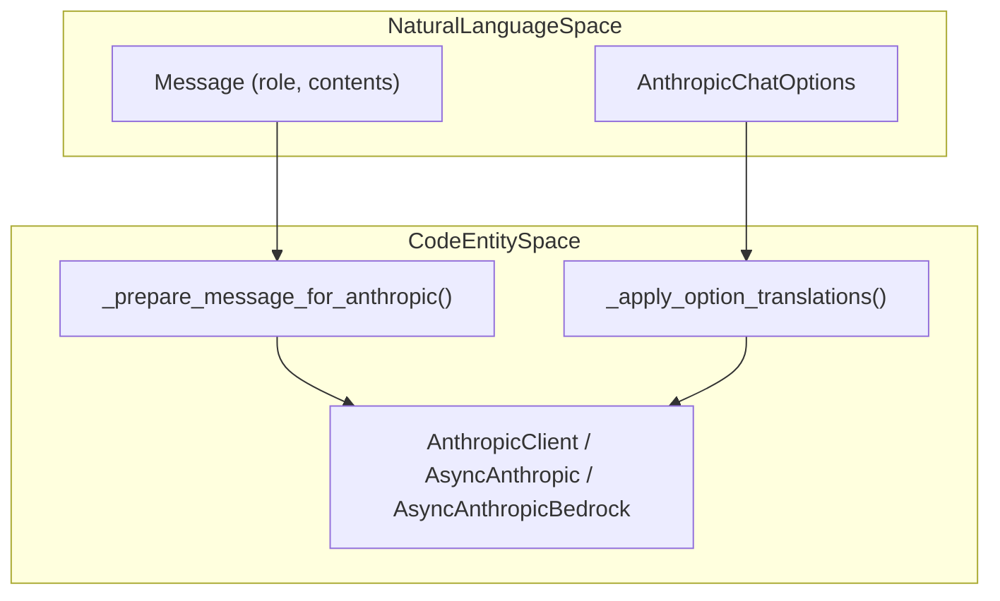
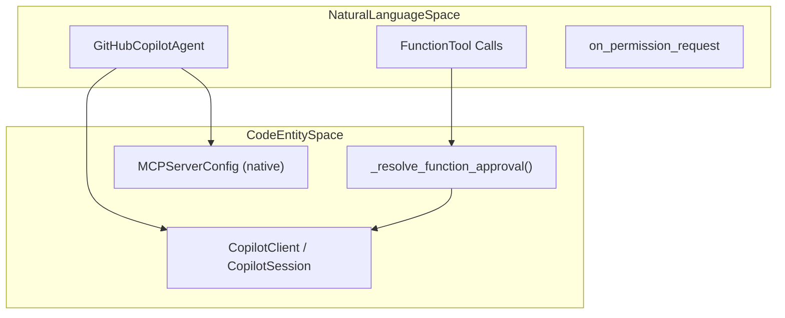
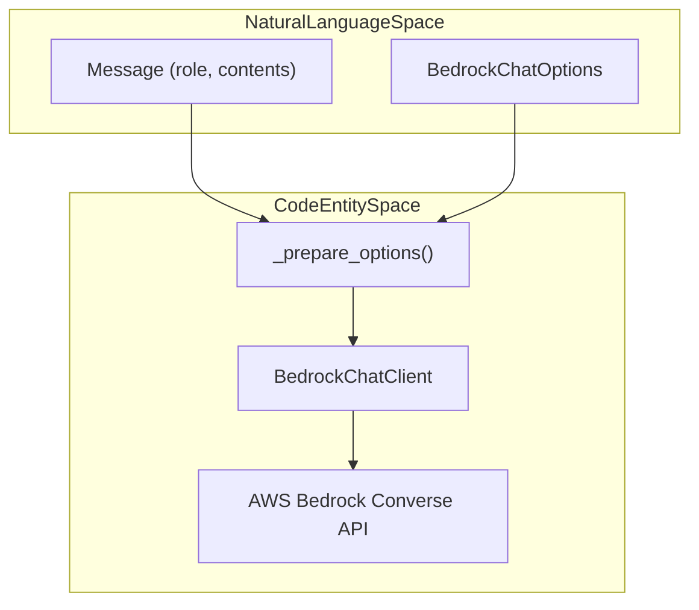
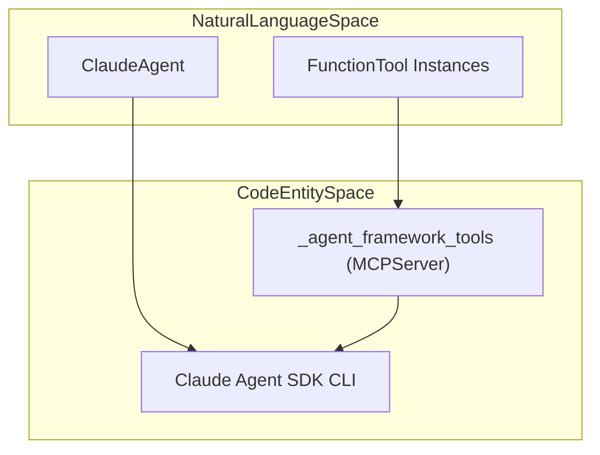
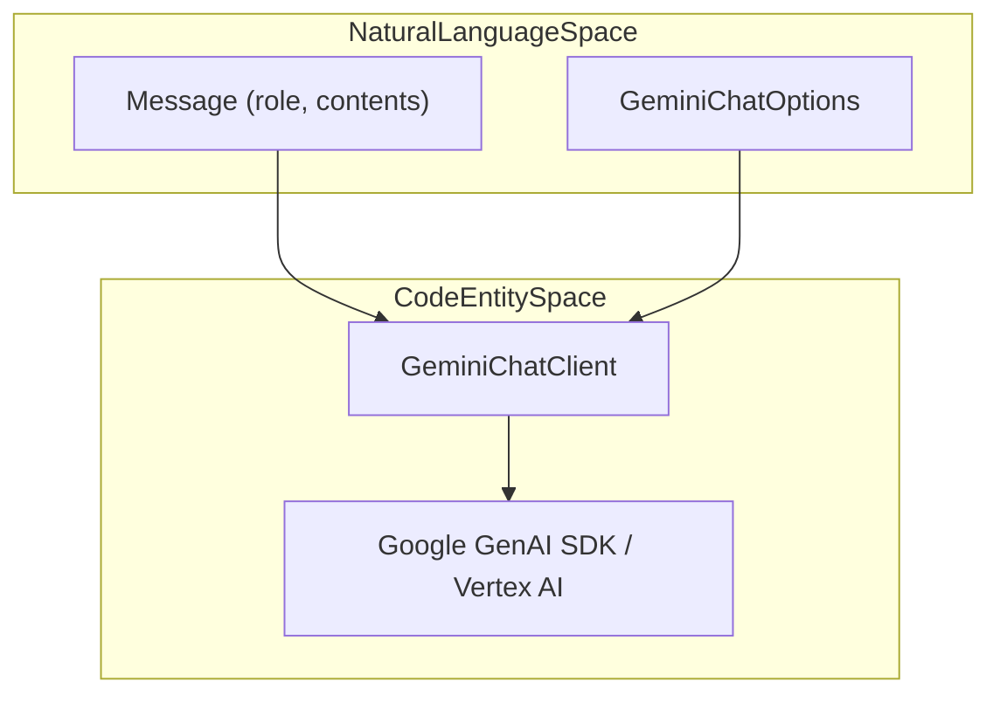
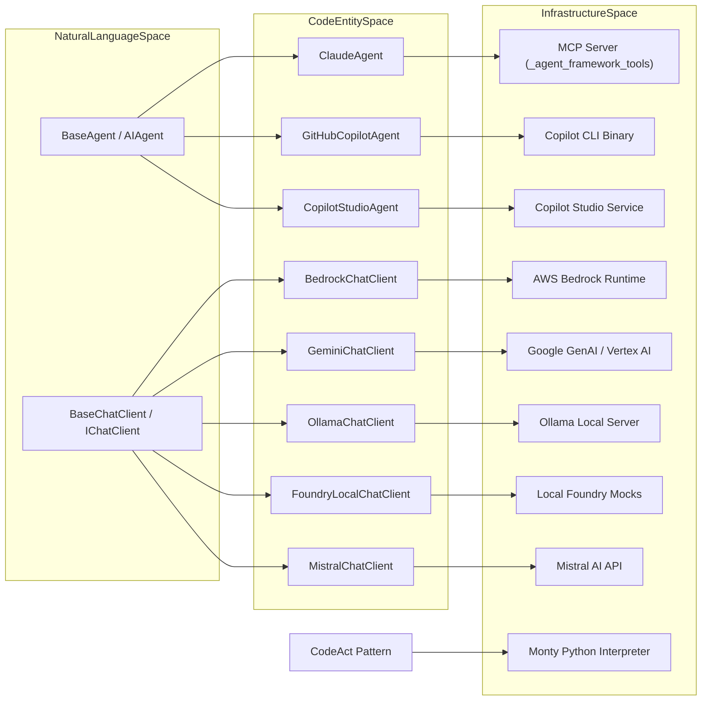

<!-- source: DeepWiki mcp.deepwiki.com · repo microsoft/agent-framework · extra page Other Provider Integrations · fetched 2026-10-26 -->

# Other Provider Integrations

Relevant source files

The following files were used as context for generating this wiki page:

- [docs/decisions/0033-feature-usage-bitmask-user-agent.md](docs/decisions/0033-feature-usage-bitmask-user-agent.md)
- [docs/specs/004-feature-usage-telemetry.md](docs/specs/004-feature-usage-telemetry.md)
- [docs/specs/feature-usage-bit-registry.md](docs/specs/feature-usage-bit-registry.md)
- [dotnet/samples/02-agents/AgentProviders/github-copilot/Agent_With_GitHubCopilot/README.md](dotnet/samples/02-agents/AgentProviders/github-copilot/Agent_With_GitHubCopilot/README.md)
- [dotnet/src/Microsoft.Agents.AI.GitHub.Copilot/CopilotClientExtensions.cs](dotnet/src/Microsoft.Agents.AI.GitHub.Copilot/CopilotClientExtensions.cs)
- [dotnet/src/Microsoft.Agents.AI.GitHub.Copilot/GitHubCopilotAgent.cs](dotnet/src/Microsoft.Agents.AI.GitHub.Copilot/GitHubCopilotAgent.cs)
- [dotnet/src/Microsoft.Agents.AI.GitHub.Copilot/GitHubCopilotAgentLogMessages.cs](dotnet/src/Microsoft.Agents.AI.GitHub.Copilot/GitHubCopilotAgentLogMessages.cs)
- [dotnet/src/Microsoft.Agents.AI.GitHub.Copilot/GitHubCopilotJsonUtilities.cs](dotnet/src/Microsoft.Agents.AI.GitHub.Copilot/GitHubCopilotJsonUtilities.cs)
- [dotnet/src/Microsoft.Agents.AI.GitHub.Copilot/Microsoft.Agents.AI.GitHub.Copilot.csproj](dotnet/src/Microsoft.Agents.AI.GitHub.Copilot/Microsoft.Agents.AI.GitHub.Copilot.csproj)
- [dotnet/src/Microsoft.Agents.AI.GitHub.Copilot/buildTransitive/.gitignore](dotnet/src/Microsoft.Agents.AI.GitHub.Copilot/buildTransitive/.gitignore)
- [dotnet/src/Microsoft.Agents.AI.GitHub.Copilot/buildTransitive/Microsoft.Agents.AI.GitHub.Copilot.targets](dotnet/src/Microsoft.Agents.AI.GitHub.Copilot/buildTransitive/Microsoft.Agents.AI.GitHub.Copilot.targets)
- [dotnet/tests/Microsoft.Agents.AI.GitHub.Copilot.IntegrationTests/GitHubCopilotAgentTests.cs](dotnet/tests/Microsoft.Agents.AI.GitHub.Copilot.IntegrationTests/GitHubCopilotAgentTests.cs)
- [dotnet/tests/Microsoft.Agents.AI.GitHub.Copilot.IntegrationTests/Microsoft.Agents.AI.GitHub.Copilot.IntegrationTests.csproj](dotnet/tests/Microsoft.Agents.AI.GitHub.Copilot.IntegrationTests/Microsoft.Agents.AI.GitHub.Copilot.IntegrationTests.csproj)
- [dotnet/tests/Microsoft.Agents.AI.GitHub.Copilot.UnitTests/CopilotClientExtensionsTests.cs](dotnet/tests/Microsoft.Agents.AI.GitHub.Copilot.UnitTests/CopilotClientExtensionsTests.cs)
- [dotnet/tests/Microsoft.Agents.AI.GitHub.Copilot.UnitTests/GitHubCopilotAgentTests.cs](dotnet/tests/Microsoft.Agents.AI.GitHub.Copilot.UnitTests/GitHubCopilotAgentTests.cs)
- [dotnet/tests/Microsoft.Agents.AI.GitHub.Copilot.UnitTests/Microsoft.Agents.AI.GitHub.Copilot.UnitTests.csproj](dotnet/tests/Microsoft.Agents.AI.GitHub.Copilot.UnitTests/Microsoft.Agents.AI.GitHub.Copilot.UnitTests.csproj)
- [dotnet/tests/Microsoft.Agents.AI.GitHub.Copilot.UnitTests/ToolExecutionEventProjectionTests.cs](dotnet/tests/Microsoft.Agents.AI.GitHub.Copilot.UnitTests/ToolExecutionEventProjectionTests.cs)
- [python/.env.example](python/.env.example)
- [python/packages/anthropic/agent_framework_anthropic/_chat_client.py](python/packages/anthropic/agent_framework_anthropic/_chat_client.py)
- [python/packages/anthropic/tests/test_anthropic_client.py](python/packages/anthropic/tests/test_anthropic_client.py)
- [python/packages/bedrock/agent_framework_bedrock/_chat_client.py](python/packages/bedrock/agent_framework_bedrock/_chat_client.py)
- [python/packages/bedrock/tests/test_bedrock_client.py](python/packages/bedrock/tests/test_bedrock_client.py)
- [python/packages/bedrock/tests/test_bedrock_settings.py](python/packages/bedrock/tests/test_bedrock_settings.py)
- [python/packages/bedrock/tests/test_bedrock_structured_output.py](python/packages/bedrock/tests/test_bedrock_structured_output.py)
- [python/packages/chatkit/AGENTS.md](python/packages/chatkit/AGENTS.md)
- [python/packages/chatkit/README.md](python/packages/chatkit/README.md)
- [python/packages/chatkit/agent_framework_chatkit/_converter.py](python/packages/chatkit/agent_framework_chatkit/_converter.py)
- [python/packages/chatkit/tests/test_converter.py](python/packages/chatkit/tests/test_converter.py)
- [python/packages/claude/agent_framework_claude/__init__.py](python/packages/claude/agent_framework_claude/__init__.py)
- [python/packages/claude/agent_framework_claude/_agent.py](python/packages/claude/agent_framework_claude/_agent.py)
- [python/packages/claude/tests/test_claude_agent.py](python/packages/claude/tests/test_claude_agent.py)
- [python/packages/core/agent_framework/_telemetry.py](python/packages/core/agent_framework/_telemetry.py)
- [python/packages/core/agent_framework/anthropic/__init__.py](python/packages/core/agent_framework/anthropic/__init__.py)
- [python/packages/core/agent_framework/anthropic/__init__.pyi](python/packages/core/agent_framework/anthropic/__init__.pyi)
- [python/packages/core/agent_framework/chatkit/__init__.py](python/packages/core/agent_framework/chatkit/__init__.py)
- [python/packages/core/agent_framework/chatkit/__init__.pyi](python/packages/core/agent_framework/chatkit/__init__.pyi)
- [python/packages/core/agent_framework/mistral/__init__.py](python/packages/core/agent_framework/mistral/__init__.py)
- [python/packages/core/agent_framework/mistral/__init__.pyi](python/packages/core/agent_framework/mistral/__init__.pyi)
- [python/packages/core/tests/core/test_mistral_namespace.py](python/packages/core/tests/core/test_mistral_namespace.py)
- [python/packages/core/tests/core/test_telemetry.py](python/packages/core/tests/core/test_telemetry.py)
- [python/packages/gemini/AGENTS.md](python/packages/gemini/AGENTS.md)
- [python/packages/gemini/README.md](python/packages/gemini/README.md)
- [python/packages/gemini/agent_framework_gemini/__init__.py](python/packages/gemini/agent_framework_gemini/__init__.py)
- [python/packages/gemini/agent_framework_gemini/_chat_client.py](python/packages/gemini/agent_framework_gemini/_chat_client.py)
- [python/packages/gemini/tests/test_gemini_client.py](python/packages/gemini/tests/test_gemini_client.py)
- [python/packages/github_copilot/AGENTS.md](python/packages/github_copilot/AGENTS.md)
- [python/packages/github_copilot/README.md](python/packages/github_copilot/README.md)
- [python/packages/github_copilot/agent_framework_github_copilot/_agent.py](python/packages/github_copilot/agent_framework_github_copilot/_agent.py)
- [python/packages/github_copilot/tests/test_github_copilot_agent.py](python/packages/github_copilot/tests/test_github_copilot_agent.py)
- [python/packages/mistral/AGENTS.md](python/packages/mistral/AGENTS.md)
- [python/packages/mistral/README.md](python/packages/mistral/README.md)
- [python/packages/mistral/agent_framework_mistral/__init__.py](python/packages/mistral/agent_framework_mistral/__init__.py)
- [python/packages/mistral/agent_framework_mistral/_chat_client.py](python/packages/mistral/agent_framework_mistral/_chat_client.py)
- [python/packages/mistral/agent_framework_mistral/_embedding_client.py](python/packages/mistral/agent_framework_mistral/_embedding_client.py)
- [python/packages/mistral/agent_framework_mistral/_http_client.py](python/packages/mistral/agent_framework_mistral/_http_client.py)
- [python/packages/mistral/pyproject.toml](python/packages/mistral/pyproject.toml)
- [python/packages/mistral/tests/mistral/test_mistral_chat_client.py](python/packages/mistral/tests/mistral/test_mistral_chat_client.py)
- [python/packages/mistral/tests/mistral/test_mistral_embedding_client.py](python/packages/mistral/tests/mistral/test_mistral_embedding_client.py)
- [python/packages/ollama/agent_framework_ollama/_chat_client.py](python/packages/ollama/agent_framework_ollama/_chat_client.py)
- [python/packages/ollama/tests/test_ollama_chat_client.py](python/packages/ollama/tests/test_ollama_chat_client.py)
- [python/packages/orchestrations/agent_framework_orchestrations/_participant_output_config.py](python/packages/orchestrations/agent_framework_orchestrations/_participant_output_config.py)
- [python/samples/02-agents/providers/anthropic/README.md](python/samples/02-agents/providers/anthropic/README.md)
- [python/samples/02-agents/providers/anthropic/anthropic_claude_sequential_agents.py](python/samples/02-agents/providers/anthropic/anthropic_claude_sequential_agents.py)
- [python/samples/02-agents/providers/github_copilot/README.md](python/samples/02-agents/providers/github_copilot/README.md)
- [python/samples/02-agents/providers/github_copilot/github_copilot_with_byok.py](python/samples/02-agents/providers/github_copilot/github_copilot_with_byok.py)
- [python/samples/02-agents/providers/github_copilot/github_copilot_with_file_hooks.py](python/samples/02-agents/providers/github_copilot/github_copilot_with_file_hooks.py)
- [python/samples/02-agents/providers/github_copilot/github_copilot_with_instruction_directories.py](python/samples/02-agents/providers/github_copilot/github_copilot_with_instruction_directories.py)

This page documents LLM provider integrations beyond the core OpenAI, Azure OpenAI, and Azure AI Foundry integrations. It covers Anthropic (Claude models), Ollama (local models), GitHub Copilot, Google Gemini, Amazon Bedrock, Mistral, Monty CodeAct, Copilot Studio, and the ChatKit integration for front-end compatibility.

## Overview

The Agent Framework provides an extensible architecture for integrating diverse AI providers. In Python, these integrations typically implement `BaseChatClient` [python/packages/bedrock/agent_framework_bedrock/_chat_client.py:19-19]() or `BaseAgent` [python/packages/github_copilot/agent_framework_github_copilot/_agent.py:33-33](). In .NET, they adhere to the `IChatClient` interface or wrap provider-specific SDKs as specialized agent implementations like `GitHubCopilotAgent` [dotnet/src/Microsoft.Agents.AI.GitHub.Copilot/GitHubCopilotAgent.cs:24-28]().

**Supported Provider Integrations:**

| Provider          | Python Package                     | .NET Package                            | Primary Implementation         | Key Features                                |
|-------------------|----------------------------------|---------------------------------------|-------------------------------|---------------------------------------------|
| **Anthropic**     | `agent-framework-anthropic`       | `Anthropic`                          | `AnthropicClient`              | Claude 3.5, Extended Thinking, Computer Use |
| **GitHub Copilot**| `agent-framework-github_copilot`  | `Microsoft.Agents.AI.GitHub.Copilot` | `GitHubCopilotAgent`           | MCP support, Shell/File permissions, CLI-based |
| **Claude (SDK)**  | `agent-framework-claude`          | N/A                                   | `ClaudeAgent`                  | Claude Code CLI integration, MCP tool hosting |
| **Amazon Bedrock**| `agent-framework-bedrock`         | N/A                                   | `BedrockChatClient`            | Converse API, Guardrails, Cross-model support |
| **Google Gemini** | `agent-framework-gemini`          | `Google.GenAI` (wrapper)               | `GeminiChatClient`             | Code execution, Google Search grounding    |
| **Ollama**        | `agent-framework-ollama`          | `CommunityToolkit.Aspire.OllamaSharp` | `OllamaChatClient`             | Local model execution via OllamaSharp       |
| **Foundry Local** | `agent-framework-foundry_local`   | N/A                                   | `FoundryLocalChatClient`       | Local development for Foundry agents        |
| **ChatKit**       | `agent-framework-chatkit`         | N/A                                   | `ChatKitChatClient`            | OpenAI ChatKit frontend compatibility      |
| **Mistral**       | `agent-framework-mistral`         | N/A                                   | `MistralChatClient`            | Native Mistral API support                   |
| **Copilot Studio**| `agent-framework-copilotstudio`   | N/A                                   | `CopilotStudioAgent`           | Direct integration with Copilot Studio bots |

Sources:  
[python/packages/github_copilot/agent_framework_github_copilot/_agent.py:33-44](),  
[python/packages/claude/agent_framework_claude/_agent.py:37-43](),  
[python/packages/bedrock/agent_framework_bedrock/_chat_client.py:18-32](),  
[python/packages/gemini/agent_framework_gemini/_chat_client.py:14-30](),  
[dotnet/src/Microsoft.Agents.AI.GitHub.Copilot/GitHubCopilotAgent.cs:24-28]().

---

## Anthropic Integration

The Anthropic integration supports Claude models via multiple backends, including direct Anthropic API, Amazon Bedrock, and Google Vertex AI. Advanced features include "Extended Thinking" and "Computer Use" capabilities.

### Implementation Detail

- The integration provides asynchronous clients to handle different Anthropic backends which respect the common interface pattern (`BaseChatClient`) [python/packages/anthropic/agent_framework_anthropic/_chat_client.py:14-14]().
- It features support for `ThinkingConfig` to enable extended reasoning budgets [python/packages/anthropic/agent_framework_anthropic/_chat_client.py:125-141]().
- Beta flags enable advanced features such as multiprocess client (MCP) support and computer interaction [python/packages/anthropic/agent_framework_anthropic/_chat_client.py:98-98]().

### Data Flow: Framework to Anthropic

Sources:  
[python/packages/anthropic/agent_framework_anthropic/_chat_client.py:14-14](),  
[python/packages/anthropic/agent_framework_anthropic/_chat_client.py:98-98](),  
[python/packages/anthropic/agent_framework_anthropic/_chat_client.py:125-141]().

---

## GitHub Copilot Integration

The `GitHubCopilotAgent` wraps the GitHub Copilot SDK, interfacing with GitHub Copilot CLI to provide agent capabilities in both Python and .NET.

### Architecture and Key Components

- **Agent Class:** The `GitHubCopilotAgent` class in .NET implements the `AIAgent` base and manages a `CopilotClient` instance internally [dotnet/src/Microsoft.Agents.AI.GitHub.Copilot/GitHubCopilotAgent.cs:24-41]().
- **Session Management:** Supports creating sessions with optional session IDs, allowing persistent conversations [dotnet/src/Microsoft.Agents.AI.GitHub.Copilot/GitHubCopilotAgent.cs:132-134]().
- **Permission Handling:** Interactive permission requests like shell access or file operations are implemented using callbacks and hooks (`on_permission_request`) [python/packages/github_copilot/agent_framework_github_copilot/_agent.py:130-143]().
- **Tool Approval:** Tool approval callback `_resolve_function_approval` supports synchronous/async function call approvals [python/packages/github_copilot/agent_framework_github_copilot/_agent.py:162-191]().
- **MCP Servers:** Supports native management of MCP servers but advises that MCP servers used by the Copilot SDK itself should be configured via the SDK, not wrapped as framework `MCPTool` instances.

### Data Flow

Sources:  
[python/packages/github_copilot/agent_framework_github_copilot/_agent.py:130-191](),  
[dotnet/src/Microsoft.Agents.AI.GitHub.Copilot/GitHubCopilotAgent.cs:24-41](),  
[dotnet/src/Microsoft.Agents.AI.GitHub.Copilot/GitHubCopilotAgent.cs:132-134](),  
[dotnet/tests/Microsoft.Agents.AI.GitHub.Copilot.UnitTests/GitHubCopilotAgentTests.cs:71-100]().

---

## Amazon Bedrock Integration

`BedrockChatClient` provides integration with the Amazon Bedrock Converse API, enabling unified access to multiple foundation models such as Claude, Titan, and Llama.

### Key Features

- **Guardrails:** Support for Bedrock Guardrails configuration for content filtering and safety [python/packages/bedrock/agent_framework_bedrock/_chat_client.py:93-110]().
- **Performance Config:** Tuning options for inference performance and latency [python/packages/bedrock/agent_framework_bedrock/_chat_client.py:169-174]().
- **Option Translation:** Maps generic `ChatOptions` from the framework to Bedrock API keys such as `modelId`, `inferenceConfig.*`, and `toolConfig` [python/packages/bedrock/agent_framework_bedrock/_chat_client.py:112-162]().

### Data Flow

Sources:  
[python/packages/bedrock/agent_framework_bedrock/_chat_client.py:93-174]().

---

## Claude Code Integration

The `ClaudeAgent` integration uses the Claude Agent SDK and local CLI for agent capabilities.

### Architecture Highlights

- **In-Process MCP Server:** Uses an MCP server named `TOOLS_MCP_SERVER_NAME` (`_agent_framework_tools`) to host framework `FunctionTool` instances as SDK MCP tools, enabling seamless CLI interaction [python/packages/claude/agent_framework_claude/_agent.py:95-99]().
- **Permission Modes:** Configurable modes for permissions including default, acceptEdits, bypassPermissions [python/packages/claude/agent_framework_claude/_agent.py:168-170]().
- **Sandboxing:** Bash sandbox settings supported for secure code execution.
- **Thinking Configuration:** Supports reasoning configurations and "thinking" modes [python/packages/claude/agent_framework_claude/_agent.py:72-72]().

### Data Flow

Sources:  
[python/packages/claude/agent_framework_claude/_agent.py:72-99](),  
[python/packages/claude/agent_framework_claude/_agent.py:168-170]().

---

## Google Gemini Integration

`GeminiChatClient` wraps the Google Gemini Developer API or Vertex AI and supports structured outputs with code execution and reasoning parts [python/packages/gemini/agent_framework_gemini/_chat_client.py:44-48]().

### Features

- **Reasoning Support:** Extended thinking configurations with token budgets and thinking levels [python/packages/gemini/agent_framework_gemini/_chat_client.py:105-123]().
- **Structured Responses:** Can parse response parts for executable code and code execution results [python/packages/gemini/tests/test_gemini_client.py:95-155]().
- **Dynamic Endpoint Selection:** Automatically switches base URL between `generativelanguage.googleapis.com` and `aiplatform.googleapis.com` based on Vertex AI flags.

### Data Flow Diagram

Sources:  
[python/packages/gemini/agent_framework_gemini/_chat_client.py:44-48](),  
[python/packages/gemini/agent_framework_gemini/_chat_client.py:105-123](),  
[python/packages/gemini/tests/test_gemini_client.py:95-155]().

---

## Ollama Integration

Ollama supports local LLM execution, integrated into the framework via Python and .NET.

### .NET Support

- Utilizes the `CommunityToolkit.Aspire.OllamaSharp` client for communicating with Ollama servers.

### Python Integration

- The `OllamaChatClient` converts framework `Message` instances to Ollama's expected formats and supports tool call and reasoning features [python/packages/ollama/agent_framework_ollama/_chat_client.py:19-42]().
- Includes tests for streaming responses, tool calls, and reasoning content [python/packages/ollama/tests/test_ollama_chat_client.py:86-155]().

Sources:  
[python/packages/ollama/agent_framework_ollama/_chat_client.py:19-42](),  
[python/packages/ollama/tests/test_ollama_chat_client.py:86-155]().

---

## Mistral Integration

The `MistralChatClient` and `MistralEmbeddingClient` provide chat and embedding integrations with Mistral AI models.

- Implements `BaseChatClient` and exposes Mistral-specific options.
- Supports API key management, model selection, and endpoint configuration via `MistralSettings`.
- Environment variables like `MISTRAL_API_KEY` control credentials.

Sources:  
[python/packages/mistral/agent_framework_mistral/_chat_client.py:61-67](),  
[python/packages/mistral/agent_framework_mistral/_embedding_client.py:1-20]().

---

## Copilot Studio Integration

`CopilotStudioAgent` wraps interactions with bots hosted in the Microsoft Copilot Studio.

- Requires environment variables like `COPILOTSTUDIOAGENT__ENVIRONMENTID`, `COPILOTSTUDIOAGENT__SCHEMANAME`, `COPILOTSTUDIOAGENT__TENANTID`, and `COPILOTSTUDIOAGENT__AGENTAPPID` for authentication and identification.
- The agent extends `BaseAgent` and manages calls directly to the Copilot Studio service [python/packages/copilotstudio/agent_framework_copilotstudio/_agent.py:1-20]().

Sources:  
[python/packages/copilotstudio/agent_framework_copilotstudio/_agent.py:1-20]().

---

## Foundry Local Integration

Provides a local client for Azure AI Foundry agents to facilitate local development and debugging without requiring full Foundry service deployment.

- `FoundryLocalChatClient` simulates the behavior of the Azure AI Foundry chat client [python/packages/foundry_local/agent_framework_foundry_local/_foundry_local_client.py:1-20]().

Sources:  
[python/packages/foundry_local/agent_framework_foundry_local/_foundry_local_client.py:1-20]().

---

## Monty CodeAct Integration

Monty is a Rust-based Python interpreter used as a secure backend for the CodeAct pattern to run Python code under strict isolation.

- Although not a direct LLM provider, Monty enables LLM-driven code execution with agents using `LocalCodeAct`.
- Ensures sandboxed execution of code generated or triggered by LLMs.

Sources:  
[python/packages/core/agent_framework/codeact/monty/__init__.py:1-20]().

---

## Implementation Architecture Summary

This diagram maps natural language space elements (agents, chat clients) to code entity implementations and underlying infrastructures.

Sources:  
[python/packages/claude/agent_framework_claude/_agent.py:37-43](),  
[python/packages/github_copilot/agent_framework_github_copilot/_agent.py:33-44](),  
[python/packages/bedrock/agent_framework_bedrock/_chat_client.py:18-32](),  
[python/packages/gemini/agent_framework_gemini/_chat_client.py:44-48](),  
[python/packages/ollama/agent_framework_ollama/_chat_client.py:19-42](),  
[python/packages/mistral/agent_framework_mistral/_chat_client.py:61-67](),  
[python/packages/copilotstudio/agent_framework_copilotstudio/_agent.py:1-20]().

---

## ChatKit Integration

The `agent-framework-chatkit` package enables integration with OpenAI's ChatKit frontend, allowing agents to interact with ChatKit-compliant UIs.

- Requires `openai-chatkit>=1.6.4` [python/packages/chatkit/pyproject.toml:26-26]().
- Provides a standard bridge between the Agent Framework's core and ChatKit frontend tooling.
- Supports Python 3.10+ and uses `agent-framework-core` as a dependency.

Sources:  
[python/packages/chatkit/pyproject.toml:1-27]().

---

