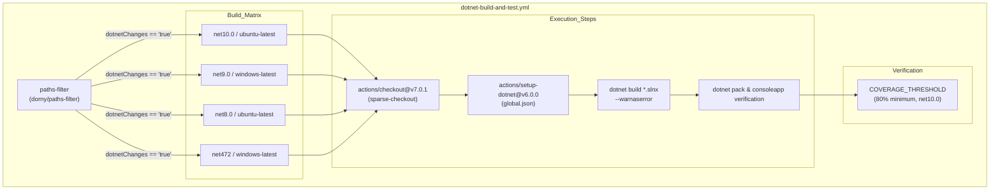
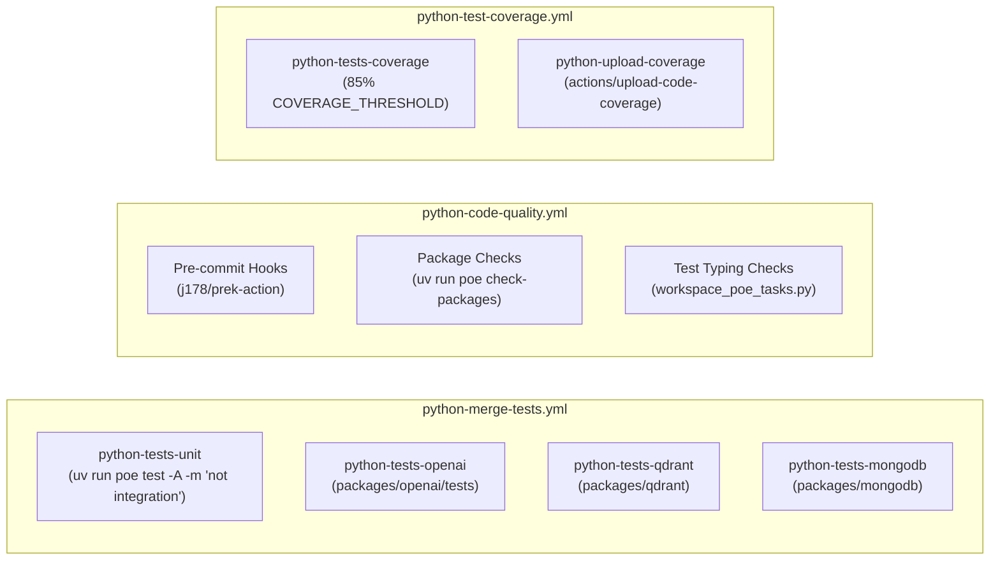

<!-- source: DeepWiki mcp.deepwiki.com · repo microsoft/agent-framework · extra page Pipeline Architecture · fetched 2026-10-26 -->

# Pipeline Architecture

Relevant source files

The following files were used as context for generating this wiki page:

- [.github/actions/github-app-token/action.yml](.github/actions/github-app-token/action.yml)
- [.github/actions/github-app-token/create-token.js](.github/actions/github-app-token/create-token.js)
- [.github/dependabot.yml](.github/dependabot.yml)
- [.github/labeler.yml](.github/labeler.yml)
- [.github/pull_request_template.md](.github/pull_request_template.md)
- [.github/scripts/set_missing_issue_type.js](.github/scripts/set_missing_issue_type.js)
- [.github/scripts/stale_issue_pr_ping.py](.github/scripts/stale_issue_pr_ping.py)
- [.github/scripts/title_prefix.js](.github/scripts/title_prefix.js)
- [.github/tests/test_create_github_app_token.js](.github/tests/test_create_github_app_token.js)
- [.github/tests/test_devflow_fix_ci_workflow.js](.github/tests/test_devflow_fix_ci_workflow.js)
- [.github/tests/test_set_missing_issue_type.js](.github/tests/test_set_missing_issue_type.js)
- [.github/tests/test_stale_issue_pr_ping.py](.github/tests/test_stale_issue_pr_ping.py)
- [.github/workflows/codeql-analysis.yml](.github/workflows/codeql-analysis.yml)
- [.github/workflows/devflow-fix-ci.yml](.github/workflows/devflow-fix-ci.yml)
- [.github/workflows/devflow-pr-review.yml](.github/workflows/devflow-pr-review.yml)
- [.github/workflows/dotnet-build-and-test.yml](.github/workflows/dotnet-build-and-test.yml)
- [.github/workflows/dotnet-format.yml](.github/workflows/dotnet-format.yml)
- [.github/workflows/dotnet-integration-tests.yml](.github/workflows/dotnet-integration-tests.yml)
- [.github/workflows/github-automation-tests.yml](.github/workflows/github-automation-tests.yml)
- [.github/workflows/integration-tests-manual.yml](.github/workflows/integration-tests-manual.yml)
- [.github/workflows/issue-triage.yml](.github/workflows/issue-triage.yml)
- [.github/workflows/label-issues.yml](.github/workflows/label-issues.yml)
- [.github/workflows/label-pr.yml](.github/workflows/label-pr.yml)
- [.github/workflows/label-title-prefix.yml](.github/workflows/label-title-prefix.yml)
- [.github/workflows/merge-gatekeeper.yml](.github/workflows/merge-gatekeeper.yml)
- [.github/workflows/python-api-compatibility.yml](.github/workflows/python-api-compatibility.yml)
- [.github/workflows/python-code-quality.yml](.github/workflows/python-code-quality.yml)
- [.github/workflows/python-docs.yml](.github/workflows/python-docs.yml)
- [.github/workflows/python-integration-tests.yml](.github/workflows/python-integration-tests.yml)
- [.github/workflows/python-lab-tests.yml](.github/workflows/python-lab-tests.yml)
- [.github/workflows/python-merge-tests.yml](.github/workflows/python-merge-tests.yml)
- [.github/workflows/python-release.yml](.github/workflows/python-release.yml)
- [.github/workflows/python-test-coverage.yml](.github/workflows/python-test-coverage.yml)
- [.github/workflows/python-tests.yml](.github/workflows/python-tests.yml)
- [.github/workflows/stale-issue-pr-ping.yml](.github/workflows/stale-issue-pr-ping.yml)
- [dotnet/samples/02-agents/AgentWithMemory/AgentWithMemory_Step06_MemoryUsingAgentMemory/AgentWithMemory_Step06_MemoryUsingAgentMemory.csproj](dotnet/samples/02-agents/AgentWithMemory/AgentWithMemory_Step06_MemoryUsingAgentMemory/AgentWithMemory_Step06_MemoryUsingAgentMemory.csproj)
- [dotnet/samples/02-agents/AgentWithRAG/AgentWithRAG_Step05_Neo4jGraphRAG/AgentWithRAG_Step05_Neo4jGraphRAG.csproj](dotnet/samples/02-agents/AgentWithRAG/AgentWithRAG_Step05_Neo4jGraphRAG/AgentWithRAG_Step05_Neo4jGraphRAG.csproj)
- [dotnet/samples/04-hosting/FoundryHostedAgents/invocations/Hosted-Invocations-EchoAgent/Hosted-Invocations-EchoAgent.csproj](dotnet/samples/04-hosting/FoundryHostedAgents/invocations/Hosted-Invocations-EchoAgent/Hosted-Invocations-EchoAgent.csproj)
- [dotnet/samples/04-hosting/FoundryHostedAgents/responses/Hosted-ChatClientAgent-Dockerfile/HostedChatClientAgentDocker.csproj](dotnet/samples/04-hosting/FoundryHostedAgents/responses/Hosted-ChatClientAgent-Dockerfile/HostedChatClientAgentDocker.csproj)
- [dotnet/samples/04-hosting/FoundryHostedAgents/responses/Hosted-LocalCodeAct/HostedLocalCodeAct.csproj](dotnet/samples/04-hosting/FoundryHostedAgents/responses/Hosted-LocalCodeAct/HostedLocalCodeAct.csproj)
- [dotnet/src/Microsoft.Agents.AI/ChatClient/MessageInjectingChatClient.cs](dotnet/src/Microsoft.Agents.AI/ChatClient/MessageInjectingChatClient.cs)
- [dotnet/tests/Microsoft.Agents.AI.UnitTests/ChatClient/MessageInjectingChatClientTests.cs](dotnet/tests/Microsoft.Agents.AI.UnitTests/ChatClient/MessageInjectingChatClientTests.cs)
- [python/PACKAGE_STATUS.md](python/PACKAGE_STATUS.md)

## Purpose and Scope

This document details the multi-tiered CI/CD pipeline architecture implemented in GitHub Actions for the Microsoft Agent Framework repository (`https://github.com/microsoft/agent-framework`). It covers the organizational structure of workflows, trigger conditions, path-based filtering, matrix strategies, test execution infrastructure, and issue/PR automation workflows.

The pipeline architecture is designed to provide robust validation across three distinct tiers:
1. **PR Validation** - Fast feedback for pull requests (Unit tests and linting via [.github/workflows/python-tests.yml]() and [.github/workflows/python-code-quality.yml]()).
2. **Merge Tests** - Comprehensive validation before merging to main (Integration tests and .NET solution builds via [.github/workflows/dotnet-build-and-test.yml]() and [.github/workflows/python-merge-tests.yml]()).
3. **Issue/PR Automation & Specialized Validation** - Automated triage, labeling, review workflows, lab tests, and security scans via [.github/workflows/issue-triage.yml](), [.github/workflows/label-issues.yml](), [.github/workflows/devflow-pr-review.yml](), and [.github/workflows/codeql-analysis.yml]()).

---

## Pipeline Tier Overview

The framework employs a tiered architecture to balance developer velocity with rigorous system validation.

### Pipeline Tiers and Trigger Conditions

**Title: Tiered Execution Flow and Workflow Mapping**

```mermaid
graph TB
    subgraph "Trigger_Events"
        PR["pull_request<br/>(to main, feature*)"]
        Push["push<br/>(main, feature*)"]
        MergeGroup["merge_group<br/>(main)"]
        Schedule["schedule<br/>(nightly)"]
        Manual["workflow_dispatch<br/>(manual)"]
        Issues["issues<br/>(opened, reopened)"]
    end
    
    subgraph "Tier_1_Fast_PR_Validation"
        DotNetFormat["dotnet-format.yml<br/>(dotnet format)"]
        PythonTests["python-tests.yml<br/>(uv run poe test)"]
        PythonQuality["python-code-quality.yml<br/>(pre-commit & pyright)"]
    end
    
    subgraph "Tier_2_Comprehensive_Merge_Tests"
        DotNetBuildTest["dotnet-build-and-test.yml<br/>(.slnx matrix)"]
        PythonMergeTests["python-merge-tests.yml<br/>(Provider integration tests)"]
        CodeQL["codeql-analysis.yml<br/>(C# & Python security scan)"]
    end
    
    subgraph "Tier_3_Specialized_Validation_and_Automation"
        PythonLab["python-lab-tests.yml<br/>(Lab package tests)"]
        PythonIntegration["python-integration-tests.yml<br/>(Reusable IT orchestrator)"]
        IssueTriage["issue-triage.yml<br/>(DevFlow issue analysis)"]
        LabelIssues["label-issues.yml<br/>(Auto-labeling script)"]
    end
    
    PR --> DotNetFormat
    PR --> PythonTests
    PR --> PythonQuality
    PR --> PythonLab
    
    Push --> DotNetBuildTest
    Push --> PythonMergeTests
    MergeGroup --> DotNetBuildTest
    MergeGroup --> PythonMergeTests
    Schedule --> DotNetBuildTest
    Schedule --> PythonMergeTests
    
    Manual --> PythonIntegration
    Issues --> IssueTriage
    Issues --> LabelIssues
```

**Sources:** [.github/workflows/dotnet-build-and-test.yml:8-17](), [.github/workflows/python-merge-tests.yml:8-15](), [.github/workflows/python-tests.yml:3-7](), [.github/workflows/python-lab-tests.yml:3-12](), [.github/workflows/python-integration-tests.yml:12-19](), [.github/workflows/issue-triage.yml:3-6](), [.github/workflows/label-issues.yml:2-7](), [.github/workflows/codeql-analysis.yml:7-13]()

### Tier Characteristics

| Tier | Purpose | Trigger Events | Core Files / Actions | Secrets / Auth |
|------|---------|----------------|----------------------|----------------|
| **Tier 1: PR Validation** | Fast developer feedback | `pull_request` | [.github/workflows/python-tests.yml](), [.github/workflows/python-code-quality.yml]() | None |
| **Tier 2: Merge Tests** | Pre-merge verification | `merge_group`, `push`, `schedule` | [.github/workflows/dotnet-build-and-test.yml](), [.github/workflows/python-merge-tests.yml](), [.github/workflows/codeql-analysis.yml]() | Integration env secrets |
| **Tier 3: Specialized & Automation** | Triage, labeling, lab execution | `issues`, `workflow_dispatch`, `schedule` | [.github/workflows/issue-triage.yml](), [.github/workflows/label-issues.yml](), [.github/workflows/python-lab-tests.yml]() | GitHub App tokens, Azure secrets |

---

## .NET Pipeline Architecture

The .NET pipeline validates the framework across multiple Target Framework Monikers (TFMs) and Operating Systems.

### .NET Build and Test Workflow

The core workflow `dotnet-build-and-test.yml` uses a matrix strategy to ensure compatibility across `net8.0`, `net9.0`, `net10.0`, and `net472` [.github/workflows/dotnet-build-and-test.yml:102-109]().

**Title: .NET Validation Pipeline Execution Flow**

**Sources:** [.github/workflows/dotnet-build-and-test.yml:32-49](), [.github/workflows/dotnet-build-and-test.yml:102-109](), [.github/workflows/dotnet-build-and-test.yml:125-148](), [.github/workflows/dotnet-build-and-test.yml:19-21]()

### .NET Code Quality
Code formatting is enforced via `dotnet-format.yml`. This workflow identifies modified files and runs `dotnet format` against the relevant projects. It uses the .NET SDK container with the `--verify-no-changes` flag.

---

## Python Pipeline Architecture

The Python pipeline is modular, utilizing `uv` for dependency management and `poethepoet` (`poe`) for task execution [.github/workflows/python-tests.yml:46-48]().

### Python Workflow Mapping

**Title: Python CI Infrastructure and Task Execution Mapping**

**Sources:** [.github/workflows/python-merge-tests.yml:117-172](), [.github/workflows/python-code-quality.yml](), [.github/workflows/python-test-coverage.yml:30-62]()

### Path-Based Filtering
To optimize CI execution time, the Python merge pipeline uses granular path filtering via `dorny/paths-filter`:
- **OpenAI tests**: Triggered by changes in `python/packages/core/agent_framework/openai/**` or `python/packages/openai/**` [.github/workflows/python-merge-tests.yml:63-66]().
- **Qdrant tests**: Triggered by changes in `python/packages/qdrant/**` [.github/workflows/python-merge-tests.yml:96-98]().
- **MongoDB tests**: Triggered by changes in `python/packages/mongodb/**` [.github/workflows/python-merge-tests.yml:100-103]().

### Coverage Reporting
Python coverage is managed by [.github/workflows/python-test-coverage.yml](), which runs `uv run poe test -A -C --cov-report=xml:python-coverage.xml` and validates against an 85% `COVERAGE_THRESHOLD` using [.github/scripts/python_check_coverage.py]() [.github/workflows/python-test-coverage.yml:20-52]().

---

## Issue and PR Automation Workflows

The repository includes automated workflows for managing issues, labeling pull requests, and executing team reviews via DevFlow integrations.

### Issue Triage and Labeling
- **Issue Triage**: [.github/workflows/issue-triage.yml]() triggers on newly opened or typed issues. It checks team membership using `check_team_membership.js` and invokes DevFlow automation models if the author is external [.github/workflows/issue-triage.yml:3-43]().
- **Issue Labeling**: [.github/workflows/label-issues.yml]() inspects issue forms for fields like `Language` (`Python`, `.NET`) or `Type of Issue` (`Feature Request`, `Question`) and applies corresponding labels (`python`, `.NET`, `enhancement`, `question`, `triage`) [.github/workflows/label-issues.yml:71-119]().

### DevFlow PR Reviews
[.github/workflows/devflow-pr-review.yml]() manages pull request reviews and comment commands (`/review`) from team members, utilizing GitHub App token authentication and automated sparse checkouts [.github/workflows/devflow-pr-review.yml:4-95]().

---

## Data Flow and Matrix Strategies

### Matrix Configurations
- **.NET TFM Matrix**: Enforces builds across `net10.0` (primary coverage target), `net9.0`, `net8.0`, and legacy `net472` on Windows and Ubuntu runners [.github/workflows/dotnet-build-and-test.yml:21,101-109]().
- **Python Matrix**: Tests across Python versions `3.10` through `3.15` on `ubuntu-latest` and `windows-latest` [.github/workflows/python-tests.yml:23-26]().

### Integration Environments
Integration tests rely on GitHub environment secrets and services:
- `OPENAI__APIKEY` [.github/workflows/python-integration-tests.yml:30-31]()
- `ANTHROPIC_API_KEY` [.github/workflows/python-integration-tests.yml:20-21]()
- Containerized service dependencies like `qdrant/qdrant:v1.16.2` and `mongodb/mongodb-atlas-local` [.github/workflows/python-integration-tests.yml:47,96]().

---

## Specialized Test Suites and Security

### Python Lab Tests
[.github/workflows/python-lab-tests.yml]() targets experimental capabilities in `python/packages/lab/**`. It executes package tests, resource-intensive pytest benchmarks, linting (`poe lint`), formatting checks (`poe fmt --check`), and static analysis (`poe pyright`) across Python `3.10`–`3.14` [.github/workflows/python-lab-tests.yml:33-88]().

### Security Scanning with CodeQL
[.github/workflows/codeql-analysis.yml]() runs scheduled and push-based security code scans for both `csharp` and `python` languages using `github/codeql-action/init` and `github/codeql-action/analyze` [.github/workflows/codeql-analysis.yml:24-69]().

---
**Sources:** [.github/workflows/dotnet-build-and-test.yml](), [.github/workflows/python-merge-tests.yml](), [.github/workflows/issue-triage.yml](), [.github/workflows/label-issues.yml](), [.github/workflows/devflow-pr-review.yml](), [.github/workflows/python-lab-tests.yml](), [.github/workflows/codeql-analysis.yml](), [.github/workflows/python-test-coverage.yml]()

---

