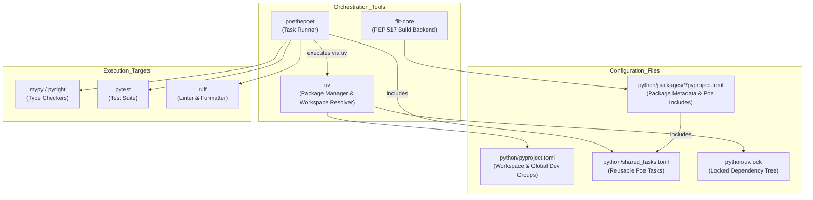
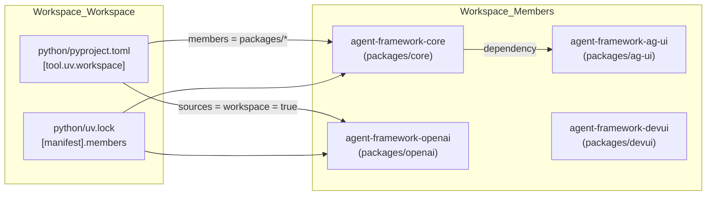
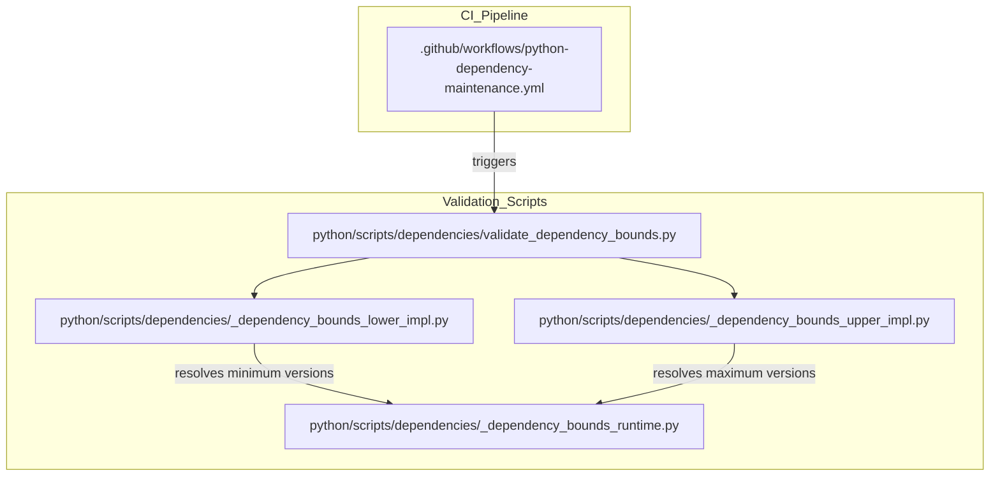

<!-- source: DeepWiki mcp.deepwiki.com · repo microsoft/agent-framework · extra page Python Build System · fetched 2026-10-26 -->

# Python Build System

<details>
<summary>Relevant source files</summary>

The following files were used as context for generating this wiki page:

- [.github/actions/sample-validation-setup/action.yml](.github/actions/sample-validation-setup/action.yml)
- [.github/workflows/python-dependency-maintenance.yml](.github/workflows/python-dependency-maintenance.yml)
- [.github/workflows/python-sample-validation.yml](.github/workflows/python-sample-validation.yml)
- [python/.github/instructions/python.instructions.md](python/.github/instructions/python.instructions.md)
- [python/.github/skills/agent-framework-py-release/SKILL.md](python/.github/skills/agent-framework-py-release/SKILL.md)
- [python/.github/skills/python-development/SKILL.md](python/.github/skills/python-development/SKILL.md)
- [python/.github/skills/python-package-management/SKILL.md](python/.github/skills/python-package-management/SKILL.md)
- [python/AGENTS.md](python/AGENTS.md)
- [python/CODING_STANDARD.md](python/CODING_STANDARD.md)
- [python/DEV_SETUP.md](python/DEV_SETUP.md)
- [python/packages/ollama/LICENSE](python/packages/ollama/LICENSE)
- [python/packages/ollama/README.md](python/packages/ollama/README.md)
- [python/packages/ollama/agent_framework_ollama/__init__.py](python/packages/ollama/agent_framework_ollama/__init__.py)
- [python/packages/ollama/agent_framework_ollama/py.typed](python/packages/ollama/agent_framework_ollama/py.typed)
- [python/scripts/dependencies/README.md](python/scripts/dependencies/README.md)
- [python/scripts/dependencies/_dependency_bounds_lower_impl.py](python/scripts/dependencies/_dependency_bounds_lower_impl.py)
- [python/scripts/dependencies/_dependency_bounds_release_impl.py](python/scripts/dependencies/_dependency_bounds_release_impl.py)
- [python/scripts/dependencies/_dependency_bounds_runtime.py](python/scripts/dependencies/_dependency_bounds_runtime.py)
- [python/scripts/dependencies/_dependency_bounds_upper_impl.py](python/scripts/dependencies/_dependency_bounds_upper_impl.py)
- [python/scripts/dependencies/tests/test_dependency_bounds_release.py](python/scripts/dependencies/tests/test_dependency_bounds_release.py)
- [python/scripts/dependencies/validate_dependency_bounds.py](python/scripts/dependencies/validate_dependency_bounds.py)
- [python/scripts/sample_validation/README.md](python/scripts/sample_validation/README.md)
- [python/scripts/sample_validation/__init__.py](python/scripts/sample_validation/__init__.py)
- [python/scripts/sample_validation/__main__.py](python/scripts/sample_validation/__main__.py)
- [python/scripts/sample_validation/const.py](python/scripts/sample_validation/const.py)
- [python/scripts/sample_validation/create_dynamic_workflow_executor.py](python/scripts/sample_validation/create_dynamic_workflow_executor.py)
- [python/scripts/sample_validation/discovery.py](python/scripts/sample_validation/discovery.py)
- [python/scripts/sample_validation/models.py](python/scripts/sample_validation/models.py)
- [python/scripts/sample_validation/report.py](python/scripts/sample_validation/report.py)
- [python/scripts/sample_validation/run_dynamic_validation_workflow_executor.py](python/scripts/sample_validation/run_dynamic_validation_workflow_executor.py)
- [python/scripts/sample_validation/workflow.py](python/scripts/sample_validation/workflow.py)

</details>


This document describes the build system, package management, task orchestration, dependency bounds validation, testing infrastructure, and release automation for the Python implementation of the Microsoft Agent Framework. It covers the toolchain (`uv`, `flit`, `poethepoet`), workspace structure, dependency management, build processes, and validation pipelines.

For information about the .NET build system, see [7.1.5](). For information about testing infrastructure, see [9.2]().

---

## 1. Build Tool Stack & Task Orchestration (`poethepoet` and `shared_tasks.toml`)

The Python implementation uses a modern build toolchain centered on **uv** for fast, reproducible builds across Python versions 3.10 through 3.13 [python/uv.lock:1-20](). Task automation is managed via **poethepoet** (poe), which centralizes common commands like testing, type checking, and linting into shared configuration files.

### Task Orchestration Architecture
The following diagram maps the natural language concepts of task automation and package building to their concrete code entities and configuration files (`pyproject.toml`, `shared_tasks.toml`, `uv.lock`).


**Sources:** [python/pyproject.toml:31-50](), [python/packages/core/pyproject.toml:131-134](), [python/packages/lab/pyproject.toml:162-163]()

### `shared_tasks.toml` and Task Sharing
To avoid duplication across the numerous workspace packages (such as `agent-framework-core`, `agent-framework-devui`, `agent-framework-a2a`), common `poe` tasks are defined in a shared configuration file and included via `include = "../../shared_tasks.toml"` in individual package manifest files [python/packages/lab/pyproject.toml:162-163](), [python/packages/core/pyproject.toml:133-134]().

Packages configure `poe` to use `uv` as its execution engine for environment isolation:
```toml
[tool.poe]
executor.type = "uv"
include = "../../shared_tasks.toml"
```
**Sources:** [python/packages/core/pyproject.toml:131-134](), [python/packages/devui/pyproject.toml:99-102]()

### Key Poe Tasks

| Task Name | Target Command | Purpose |
|-----------|----------------|---------|
| `mypy` | `mypy --config-file $POE_ROOT/pyproject.toml <package>` | Runs static type checking using MyPy configuration [python/packages/core/pyproject.toml:139-141]() |
| `test` | `pytest -m "not integration" --cov=<pkg> ...` | Executes unit test suites with coverage reports, excluding integration tests [python/packages/core/pyproject.toml:143-146]() |
| `dependency-pyright` | `pyright --project pyrightconfig.dependency.json` | Validates isolated dependency boundaries [python/packages/core/pyproject.toml:135-138]() |

**Sources:** [python/packages/core/pyproject.toml:135-146](), [python/packages/lab/pyproject.toml:165-180]()

---

## 2. Workspace Structure & Package Management (`uv`)

The Python implementation is structured as a **uv workspace** monorepo [python/pyproject.toml:72-74](). All packages under `packages/*` (excluding experimental modules like `packages/lab` which manage isolation separately) share a single lockfile (`uv.lock`) [python/pyproject.toml:73-74]().

### Workspace Dependency and Source Resolution

**Sources:** [python/pyproject.toml:72-114](), [python/uv.lock:31-71]()

Workspace packages declare themselves using workspace sources in the root `pyproject.toml`:
```toml
[tool.uv.sources]
agent-framework = { workspace = true }
agent-framework-core = { workspace = true }
agent-framework-openai = { workspace = true }
```
**Sources:** [python/pyproject.toml:76-111]()

---

## 3. Dependency Bounds Validation

To ensure runtime compatibility across minimum and maximum supported versions of third-party libraries (such as `pydantic`, `fastapi`, `mcp`, and provider SDKs), the repository uses automated dependency bounds validation scripts located in `python/scripts/dependencies/`.

### Dependency Validation Flow

**Sources:** [python/scripts/dependencies/validate_dependency_bounds.py](), [python/scripts/dependencies/_dependency_bounds_lower_impl.py](), [python/scripts/dependencies/_dependency_bounds_upper_impl.py](), [.github/workflows/python-dependency-maintenance.yml]()

- **`validate_dependency_bounds.py`**: Orchestrates bounds checking across all workspace packages [python/scripts/dependencies/README.md:13-19]().
- **`_dependency_bounds_lower_impl.py`**: Pins all package dependencies to their lower declared bounds to verify backward compatibility [python/scripts/dependencies/README.md:36-39]().
- **`_dependency_bounds_upper_impl.py`**: Resolves against upper bounds or prerelease versions to verify forward compatibility [python/scripts/dependencies/README.md:41-45]().
- **`.github/workflows/python-dependency-maintenance.yml`**: Automatically schedules regular checks to catch breaking changes in transitive or direct dependencies early [.github/workflows/python-dependency-maintenance.yml:1-6]().

**Sources:** [python/scripts/dependencies/validate_dependency_bounds.py](), [.github/workflows/python-dependency-maintenance.yml]()

---

## 4. Testing Infrastructure

Testing across all Python packages is powered by `pytest` with specialized concurrency and retry plugins configured in each package's `pyproject.toml` and the root configuration [python/pyproject.toml:34-40](), [python/packages/core/pyproject.toml:89-98]().

### Test Framework Stack
- **`pytest`**: Core test runner [python/pyproject.toml:34]().
- **`pytest-asyncio`**: Handles asynchronous test cases natively [python/pyproject.toml:35]().
- **`pytest-xdist`**: Distributes test execution across multi-core CPUs (`-n auto --dist worksteal`) [python/pyproject.toml:37](), [python/packages/core/pyproject.toml:145]().
- **`pytest-timeout`**: Terminates hanging tests (default 60–120 seconds) [python/pyproject.toml:38](), [python/packages/core/pyproject.toml:95]().
- **`pytest-retry`**: Automatically retries intermittent network or service failures in integration runs [python/pyproject.toml:39]().

### Test Markers
Tests are annotated with custom markers to separate fast unit tests from expensive integration suites:
```toml
[tool.pytest.ini_options]
markers = [
    "azure: marks tests as Azure provider specific",
    "azure-ai: marks tests as Azure AI provider specific",
    "openai: marks tests as OpenAI provider specific",
    "integration: marks tests as integration tests that require external services",
]
```
**Sources:** [python/pyproject.toml:191-196](), [python/packages/core/pyproject.toml:96-98]()

---

## 5. Release Automation

Releases for Python packages follow Semantic Versioning and are managed through GitHub Actions [python/AGENTS.md:19]().

### Release Pipeline & Changelog Maintenance
- **Changelog**: All changes are tracked centrally during the Python release-preparation workflow [python/AGENTS.md:42-47]().
- **Versioning**: Managed dynamically via toolchains and lifecycle version rules [python/AGENTS.md:19]().
- **Publishing Workflows**: Verified via GitHub Actions pipelines that run unit tests, dependency bounds checks, and type validation before publishing wheels and source distributions to PyPI.

**Sources:** [python/AGENTS.md:19](), [python/AGENTS.md:42-47]()

---

