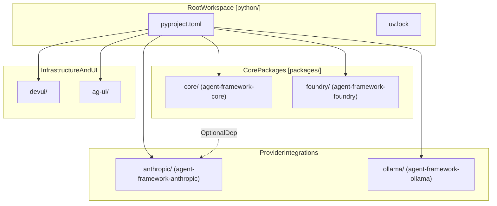
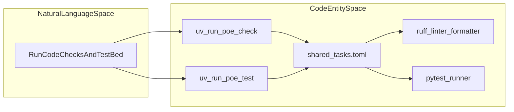
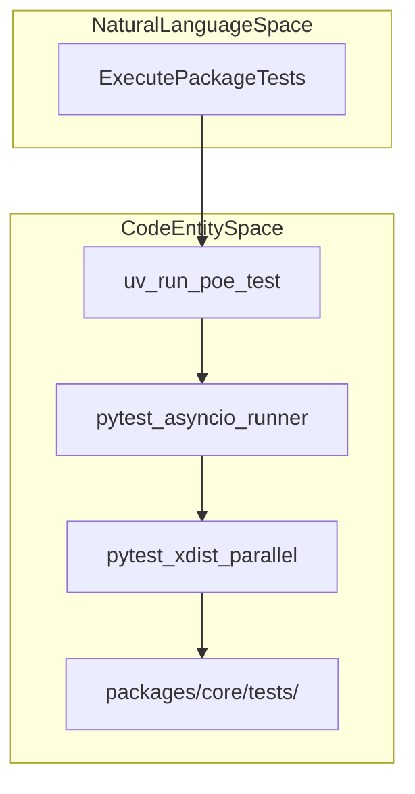

<!-- source: DeepWiki mcp.deepwiki.com · repo microsoft/agent-framework · extra page Python Development Setup · fetched 2026-10-26 -->

# Python Development Setup

<details>
<summary>Relevant source files</summary>

The following files were used as context for generating this wiki page:

- [.github/workflows/python-dependency-maintenance.yml](.github/workflows/python-dependency-maintenance.yml)
- [python/.github/instructions/python.instructions.md](python/.github/instructions/python.instructions.md)
- [python/.github/skills/agent-framework-py-release/SKILL.md](python/.github/skills/agent-framework-py-release/SKILL.md)
- [python/.github/skills/python-development/SKILL.md](python/.github/skills/python-development/SKILL.md)
- [python/.github/skills/python-package-management/SKILL.md](python/.github/skills/python-package-management/SKILL.md)
- [python/AGENTS.md](python/AGENTS.md)
- [python/CHANGELOG.md](python/CHANGELOG.md)
- [python/CODING_STANDARD.md](python/CODING_STANDARD.md)
- [python/DEV_SETUP.md](python/DEV_SETUP.md)
- [python/packages/a2a/pyproject.toml](python/packages/a2a/pyproject.toml)
- [python/packages/ag-ui/pyproject.toml](python/packages/ag-ui/pyproject.toml)
- [python/packages/anthropic/pyproject.toml](python/packages/anthropic/pyproject.toml)
- [python/packages/copilotstudio/pyproject.toml](python/packages/copilotstudio/pyproject.toml)
- [python/packages/core/pyproject.toml](python/packages/core/pyproject.toml)
- [python/packages/devui/pyproject.toml](python/packages/devui/pyproject.toml)
- [python/packages/lab/pyproject.toml](python/packages/lab/pyproject.toml)
- [python/packages/lab/uv.lock](python/packages/lab/uv.lock)
- [python/packages/mem0/pyproject.toml](python/packages/mem0/pyproject.toml)
- [python/packages/ollama/LICENSE](python/packages/ollama/LICENSE)
- [python/packages/ollama/README.md](python/packages/ollama/README.md)
- [python/packages/ollama/agent_framework_ollama/__init__.py](python/packages/ollama/agent_framework_ollama/__init__.py)
- [python/packages/ollama/agent_framework_ollama/py.typed](python/packages/ollama/agent_framework_ollama/py.typed)
- [python/packages/postgres/README.md](python/packages/postgres/README.md)
- [python/packages/postgres/pyproject.toml](python/packages/postgres/pyproject.toml)
- [python/packages/purview/pyproject.toml](python/packages/purview/pyproject.toml)
- [python/packages/redis/pyproject.toml](python/packages/redis/pyproject.toml)
- [python/pyproject.toml](python/pyproject.toml)
- [python/scripts/dependencies/README.md](python/scripts/dependencies/README.md)
- [python/scripts/dependencies/_dependency_bounds_lower_impl.py](python/scripts/dependencies/_dependency_bounds_lower_impl.py)
- [python/scripts/dependencies/_dependency_bounds_release_impl.py](python/scripts/dependencies/_dependency_bounds_release_impl.py)
- [python/scripts/dependencies/_dependency_bounds_runtime.py](python/scripts/dependencies/_dependency_bounds_runtime.py)
- [python/scripts/dependencies/_dependency_bounds_upper_impl.py](python/scripts/dependencies/_dependency_bounds_upper_impl.py)
- [python/scripts/dependencies/tests/test_dependency_bounds_release.py](python/scripts/dependencies/tests/test_dependency_bounds_release.py)
- [python/scripts/dependencies/validate_dependency_bounds.py](python/scripts/dependencies/validate_dependency_bounds.py)
- [python/uv.lock](python/uv.lock)

</details>


This page provides technical instructions for setting up a local Python development environment for the Microsoft Agent Framework (`agent-framework`). It details the `uv`-based monorepo workspace structure, dependency management, task orchestration via `poethepoet`, testing infrastructure, and code quality validation standards.

Sources: [python/pyproject.toml:1-12]()

---

## Prerequisites and System Setup

### Python Version Requirements
The framework supports multiple Python versions to guarantee runtime compatibility across platforms.
* **Minimum Version:** Python 3.10 [python/pyproject.toml:6]()
* **Supported Range:** Python 3.10, 3.11, 3.12, 3.13, and 3.14 [python/pyproject.toml:17-22]()
* **Lockfile Target:** Cross-platform resolution via `uv.lock` covering Linux, Darwin, and Win32 platforms for Python versions [python/uv.lock:3-22]().

### Package Manager: uv
The framework uses `uv` for workspace dependency management and resolution, superseding traditional `pip`, `venv`, and `pip-tools` workflows.

**Installation Commands:**
* **macOS/Linux/WSL:** `curl -LsSf https://astral.sh/uv/install.sh | sh`
* **Windows (PowerShell):** `powershell -c "irm https://astral.sh/uv/install.sh | iex"`
* **macOS Homebrew:** `brew install uv`

Sources: [python/pyproject.toml:1-69](), [python/uv.lock:1-28]()

---

## Workspace Architecture and Package Management

The Python implementation is structured as a monorepo managed through `uv` workspaces, allowing sub-packages (`core`, providers, extensions) to interoperate via editable local references (`[tool.uv.sources]`) [python/pyproject.toml:71-117]().

Title: "Workspace Dependency Flow"

Sources: [python/pyproject.toml:70-117](), [python/packages/core/pyproject.toml:35-68]()

---

## Initial Environment Setup & Commands

To set up the development environment locally:

```bash
# Install Python versions
uv python install 3.10 3.11 3.12 3.13

# Create a virtual environment and sync workspace dependencies
PYTHON_VERSION="3.10"
uv venv --python $PYTHON_VERSION
uv sync --all-groups

# Install task runners and dev tools via poe
uv run poe install
```

Alternatively, you can run a single unified setup command where configured via `poe` tasks [python/pyproject.toml:47]().
*Note:* The root workspace excludes experimental packages like `packages/lab`, which maintains its own independent lockfile and environment configuration [python/pyproject.toml:73](), [python/packages/lab/pyproject.toml:80-94]().

Sources: [python/pyproject.toml:29-52](), [python/packages/lab/pyproject.toml:80-94]()

---

## Task Orchestration (Poethepoet)

Task execution across workspace packages is managed by `poethepoet` using task definitions defined in shared tasks and individual `pyproject.toml` files [python/pyproject.toml:47](), [python/packages/core/pyproject.toml:132-135]().

Title: "Developer Workflow to Tool Mapping"


### Common Poe Tasks
| Task Command | Description | Code Entity / Script |
| :--- | :--- | :--- |
| `uv run poe check` | Lints and formats source code | `ruff` linter/formatter config [python/pyproject.toml:118-175]() |
| `uv run poe test` | Runs unit tests (excluding integration) | `pytest` runner [python/packages/core/pyproject.toml:144-147]() |
| `uv run poe mypy` | Runs strict type checking | `mypy` type checker [python/packages/core/pyproject.toml:140-142]() |

Sources: [python/pyproject.toml:118-195](), [python/packages/core/pyproject.toml:132-147]()

---

## Testing Infrastructure

All packages contain unit and integration tests located within their respective `tests/` directories [python/packages/core/pyproject.toml:91]().

Title: "Test Execution Architecture"


* **Execution Modes:** Use `uv run poe test` for package-local tests, or run `pytest` with specific markers [python/packages/core/pyproject.toml:97-99]().
* **Markers & Skipping:** Integration tests are guarded by decorators such as `@pytest.mark.integration` to separate external services [python/packages/core/pyproject.toml:97-99]().

Sources: [python/packages/core/pyproject.toml:90-100](), [python/pyproject.toml:185-195]()

---

## Code Quality Standards

Code quality and formatting are strictly enforced through automated tooling and CI pipelines [python/pyproject.toml:118-128]().

* **Linting & Formatting (`ruff`):** Codebase targets Python 3.10 syntax rules with a 120-character line length limit and Google-style docstrings [python/pyproject.toml:118-180]().
* **Type Checking (`mypy` & `pyright`):** Strict type annotations (`disallow_untyped_defs = true`) are mandated across core packages [python/packages/core/pyproject.toml:113-127]().

Sources: [python/pyproject.toml:118-180](), [python/packages/core/pyproject.toml:113-127]()

---

