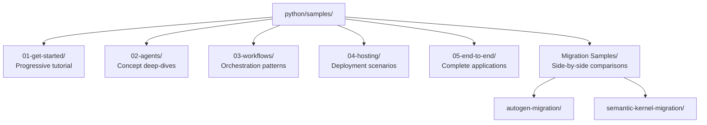
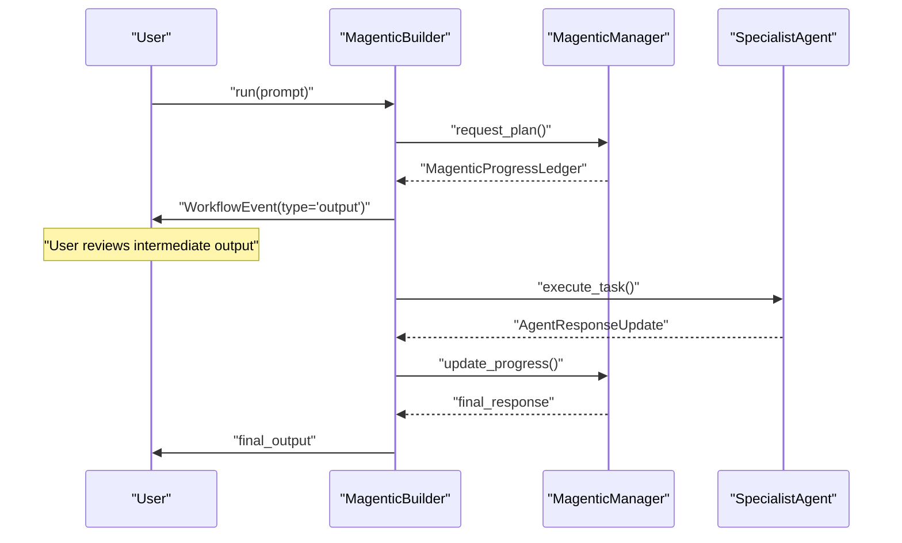
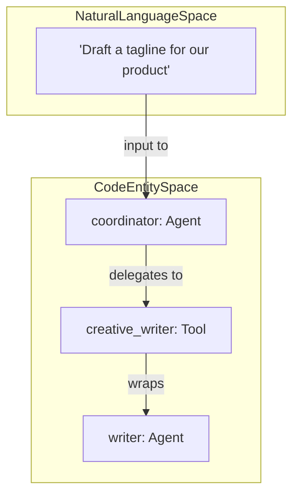
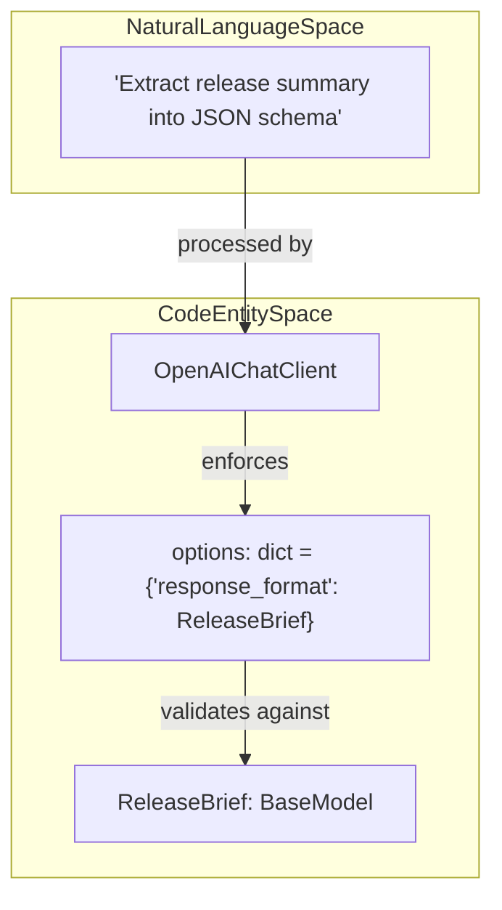

<!-- source: DeepWiki mcp.deepwiki.com · repo microsoft/agent-framework · extra page Python Sample Catalog · fetched 2026-10-26 -->

# Python Sample Catalog

Relevant source files

The following files were used as context for generating this wiki page:

- [python/packages/azure-cosmos-memory/AGENTS.md](python/packages/azure-cosmos-memory/AGENTS.md)
- [python/packages/core/tests/core/test_as_tool_kwargs_propagation.py](python/packages/core/tests/core/test_as_tool_kwargs_propagation.py)
- [python/packages/core/tests/core/test_middleware.py](python/packages/core/tests/core/test_middleware.py)
- [python/packages/core/tests/core/test_middleware_context_result.py](python/packages/core/tests/core/test_middleware_context_result.py)
- [python/samples/01-get-started/01_hello_agent.py](python/samples/01-get-started/01_hello_agent.py)
- [python/samples/01-get-started/02_add_tools.py](python/samples/01-get-started/02_add_tools.py)
- [python/samples/01-get-started/03_multi_turn.py](python/samples/01-get-started/03_multi_turn.py)
- [python/samples/01-get-started/04_memory.py](python/samples/01-get-started/04_memory.py)
- [python/samples/01-get-started/05a_functional_workflow_basics.py](python/samples/01-get-started/05a_functional_workflow_basics.py)
- [python/samples/01-get-started/05b_functional_workflow_with_agents.py](python/samples/01-get-started/05b_functional_workflow_with_agents.py)
- [python/samples/01-get-started/05c_first_graph_workflow.py](python/samples/01-get-started/05c_first_graph_workflow.py)
- [python/samples/01-get-started/06_agent_harness.py](python/samples/01-get-started/06_agent_harness.py)
- [python/samples/01-get-started/README.md](python/samples/01-get-started/README.md)
- [python/samples/02-agents/middleware/README.md](python/samples/02-agents/middleware/README.md)
- [python/samples/02-agents/middleware/override_result_with_middleware.py](python/samples/02-agents/middleware/override_result_with_middleware.py)
- [python/samples/02-agents/middleware/usage_tracking_middleware.py](python/samples/02-agents/middleware/usage_tracking_middleware.py)
- [python/samples/02-agents/response_stream.py](python/samples/02-agents/response_stream.py)
- [python/samples/03-workflows/README.md](python/samples/03-workflows/README.md)
- [python/samples/03-workflows/agents/handoff_workflow_as_agent.py](python/samples/03-workflows/agents/handoff_workflow_as_agent.py)
- [python/samples/03-workflows/declarative/agent_to_function_tool/main.py](python/samples/03-workflows/declarative/agent_to_function_tool/main.py)
- [python/samples/03-workflows/declarative/customer_support/main.py](python/samples/03-workflows/declarative/customer_support/main.py)
- [python/samples/03-workflows/orchestrations/README.md](python/samples/03-workflows/orchestrations/README.md)
- [python/samples/03-workflows/orchestrations/concurrent_agents.py](python/samples/03-workflows/orchestrations/concurrent_agents.py)
- [python/samples/03-workflows/orchestrations/concurrent_custom_agent_executors.py](python/samples/03-workflows/orchestrations/concurrent_custom_agent_executors.py)
- [python/samples/03-workflows/orchestrations/concurrent_custom_aggregator.py](python/samples/03-workflows/orchestrations/concurrent_custom_aggregator.py)
- [python/samples/03-workflows/orchestrations/group_chat_agent_manager.py](python/samples/03-workflows/orchestrations/group_chat_agent_manager.py)
- [python/samples/03-workflows/orchestrations/group_chat_message_filtering.py](python/samples/03-workflows/orchestrations/group_chat_message_filtering.py)
- [python/samples/03-workflows/orchestrations/group_chat_philosophical_debate.py](python/samples/03-workflows/orchestrations/group_chat_philosophical_debate.py)
- [python/samples/03-workflows/orchestrations/group_chat_simple_selector.py](python/samples/03-workflows/orchestrations/group_chat_simple_selector.py)
- [python/samples/03-workflows/orchestrations/handoff_autonomous.py](python/samples/03-workflows/orchestrations/handoff_autonomous.py)
- [python/samples/03-workflows/orchestrations/handoff_simple.py](python/samples/03-workflows/orchestrations/handoff_simple.py)
- [python/samples/03-workflows/orchestrations/handoff_with_code_interpreter_file.py](python/samples/03-workflows/orchestrations/handoff_with_code_interpreter_file.py)
- [python/samples/03-workflows/orchestrations/handoff_with_tool_approval_checkpoint_resume.py](python/samples/03-workflows/orchestrations/handoff_with_tool_approval_checkpoint_resume.py)
- [python/samples/03-workflows/orchestrations/magentic.py](python/samples/03-workflows/orchestrations/magentic.py)
- [python/samples/03-workflows/orchestrations/magentic_custom_prompts.py](python/samples/03-workflows/orchestrations/magentic_custom_prompts.py)
- [python/samples/03-workflows/orchestrations/magentic_human_plan_review.py](python/samples/03-workflows/orchestrations/magentic_human_plan_review.py)
- [python/samples/03-workflows/tool-approval/agent_as_tool_vs_workflow_approval.py](python/samples/03-workflows/tool-approval/agent_as_tool_vs_workflow_approval.py)
- [python/samples/README.md](python/samples/README.md)

## Purpose and Scope
This document catalogs the Python sample applications included in the Microsoft Agent Framework repository. These samples demonstrate framework features through working code examples, organized by complexity, architectural domain, workflow patterns, security best practices, and migration pathways.

Sources: [python/samples/README.md:1-14]()

## Sample Organization Structure

The Python samples are organized into progressive categories, each building on core abstractions and execution models:

**Sample Directory Structure**

| Folder | Purpose | Complexity |
|--------|---------|------------|
| `01-get-started/` | Progressive tutorial from hello agent to hosting | Beginner |
| `02-agents/` | Deep-dive into agent concepts: tools, middleware, providers, orchestrations, security | Intermediate |
| `03-workflows/` | Workflow patterns: functional, agents, checkpoint, orchestrations | Intermediate |
| `04-hosting/` | Deployment: A2A, self-hosted protocol helpers, and Foundry hosted agents | Advanced |
| `05-end-to-end/` | Full applications, evaluation, and AG-UI demos | Advanced |
| `autogen-migration/` | Comparison of AutoGen patterns vs. Agent Framework | Intermediate/Advanced |
| `semantic-kernel-migration/` | Comparison of SK Agent patterns vs. Agent Framework | Intermediate/Advanced |

Sources: [python/samples/README.md:7-14](), [python/samples/autogen-migration/README.md:1-10]()

## Environment Configuration

All samples use configuration management patterns such as `load_dotenv()` to load configuration from environment variables [python/samples/README.md:56-56]().

**Configuration Methods**

| Method | Use Case | Implementation |
|--------|----------|---------|
| `.env` file | Local development | `load_dotenv()` in `python/` directory [python/samples/README.md:56-56]() |
| Direct export | CI/CD pipelines | `export FOUNDRY_MODEL="gpt-4o"` [python/samples/README.md:69-71]() |
| `env_file_path` | Per-client config | `OpenAIChatClient(env_file_path="path/to/custom.env")` [python/samples/README.md:75-82]() |

**Precedence for Generic Clients**
For generic clients like `OpenAIChatClient`, the routing precedence is:
1. Explicit Azure inputs (`credential`, `azure_endpoint`, `api_version`) [python/samples/README.md:89-89]()
2. `OPENAI_API_KEY` environment variable or explicit parameters [python/samples/README.md:90-90]()
3. Azure environment fallback (`AZURE_OPENAI_ENDPOINT`, `AZURE_OPENAI_API_KEY`) [python/samples/README.md:91-91]()

Sources: [python/samples/README.md:54-95]()

## 01-get-started: Progressive Tutorial

The getting-started folder contains sequential samples that introduce core framework concepts step by step [python/samples/README.md:9-30]().

```mermaid
graph LR
    S1["01_hello_agent.py<br/>Agent basics"]
    S2["02_add_tools.py<br/>@tool decorator"]
    S3["03_multi_turn.py<br/>AgentSession"]
    S4["04_memory.py<br/>ContextProvider"]
    S5["05a_functional_workflow_basics.py<br/>Plain async workflows"]
    S6["05b_functional_workflow_with_agents.py<br/>Agents in functions"]
    S7["05c_first_graph_workflow.py<br/>Executors & edges"]
    S8["06_agent_harness.py<br/>Planning & compaction"]
    S9["07_hosting.py<br/>ResponsesHostServer"]
    
    S1 --> S2 --> S3 --> S4 --> S5 --> S6 --> S7 --> S8 --> S9
```

| Step | Sample File | What it Demonstrates |
|------|-------------|----------------------|
| 1 | [01_hello_agent.py](./python/samples/01-get-started/01_hello_agent.py) | Create and run your first agent [python/samples/README.md:21-21]() |
| 2 | [02_add_tools.py](./python/samples/01-get-started/02_add_tools.py) | Add function tools with `@tool` [python/samples/README.md:22-22]() |
| 3 | [03_multi_turn.py](./python/samples/01-get-started/03_multi_turn.py) | Multi-turn conversations with `AgentSession` [python/samples/README.md:23-23]() |
| 4 | [04_memory.py](./python/samples/01-get-started/04_memory.py) | Agent memory with `ContextProvider` [python/samples/README.md:24-24]() |
| 5a | [05a_functional_workflow_basics.py](./python/samples/01-get-started/05a_functional_workflow_basics.py) | Write a workflow as a plain async function [python/samples/README.md:25-25]() |
| 5b | [05b_functional_workflow_with_agents.py](./python/samples/01-get-started/05b_functional_workflow_with_agents.py) | Call agents inside a functional workflow [python/samples/README.md:26-26]() |
| 5c | [05c_first_graph_workflow.py](./python/samples/01-get-started/05c_first_graph_workflow.py) | Build a workflow with function executors and edges [python/samples/README.md:27-27]() |
| 6 | [06_agent_harness.py](./python/samples/01-get-started/06_agent_harness.py) | Add planning, todo tracking, and compaction [python/samples/README.md:28-28]() |
| 7 | [07_hosting.py](./python/samples/01-get-started/07_hosting.py) | Serve an agent with `ResponsesHostServer` [python/samples/README.md:29-29]() |

Sources: [python/samples/README.md:17-30]()

## 02-agents: Concept Deep-Dives and Security

The `02-agents/` directory provides specialized samples exploring advanced features like tools, middleware, providers, orchestrations, and security controls [python/samples/README.md:10-43]().

### Production Security Patterns
Real-world agents processing external or untrusted data require security controls against indirect prompt injection and data exfiltration [python/samples/README.md:33-36](). The security patterns in `02-agents/security/` implement these practices:
1. **Prompt Injection Defense**: [`email_security_example.py`](./python/samples/02-agents/security/email_security_example.py) shows `SecureAgentConfig`, quarantined processing with `quarantined_llm`, and approval gating for privileged tools [python/samples/README.md:39-39]().
2. **Data Confidentiality**: [`repo_confidentiality_example.py`](./python/samples/02-agents/security/repo_confidentiality_example.py) demonstrates information flow tracking and preventing sensitive data exfiltration [python/samples/README.md:40-40]().
3. **MCP Tool Protection**: [`github_mcp_example.py`](./python/samples/02-agents/security/github_mcp_example.py) demonstrates `SecureMCPToolProxy` wrapping remote MCP endpoints [python/samples/README.md:41-41]().
4. **Principal-Bound Identity**: [`user_identity_security_example.py`](./python/samples/02-agents/security/user_identity_security_example.py) shows principal binding and tenant isolation [python/samples/README.md:42-42]().

### Middleware & Result Overrides
Middleware samples showcase interceptor patterns across agents, chat clients, and tool boundaries. For example, `override_result_with_middleware.py` demonstrates intercepting function results after execution for regular and streaming agent responses, overriding weather results or handling validation notes [python/samples/02-agents/middleware/override_result_with_middleware.py:28-91]().

Sources: [python/samples/README.md:33-44](), [python/samples/02-agents/middleware/override_result_with_middleware.py:28-91]()

## 03-workflows: Workflow and Orchestration Patterns

The `03-workflows/` directory contains comprehensive workflow samples spanning functional styles, graph executors, checkpointing, and orchestrations [python/samples/03-workflows/README.md:1-68]().

### Workflow Sub-Directories
- **`functional/`**: Plain Python async functions for basic pipelines, streaming pipelines, parallel execution (`asyncio.gather`), checkpointing, and human-in-the-loop review [python/samples/03-workflows/README.md:33-46]().
- **`agents/`**: Integrates Azure Chat / Azure AI agents as workflow nodes, custom agent executors, and wrapping workflows as agents (`workflow.as_agent()`) [python/samples/03-workflows/README.md:47-59]().
- **`checkpoint/`**: Checkpoint and resume patterns, sub-workflow checkpointing, and tool-approval checkpoint resumes [python/samples/03-workflows/README.md:60-68]().
- **`orchestrations/`**: Multi-agent builders including `SequentialBuilder`, `ConcurrentBuilder`, `HandoffBuilder`, `GroupChatBuilder`, and `MagenticBuilder` [python/samples/03-workflows/orchestrations/README.md:11-21]().

Sources: [python/samples/03-workflows/README.md:1-68](), [python/samples/03-workflows/orchestrations/README.md:1-21]()

## Migration Samples: Side-by-side Comparisons

These samples provide direct code comparisons between the Agent Framework and other popular libraries (AutoGen and Semantic Kernel).

### AutoGen Migration Patterns
The `autogen-migration` samples demonstrate how to translate AutoGen's team-based orchestration into Agent Framework's builder-based workflows.

| AutoGen Concept | Agent Framework Equivalent | Sample File |
|-----------------|----------------------------|-------------|
| `RoundRobinGroupChat` | `SequentialBuilder` | [python/samples/autogen-migration/orchestrations/01_round_robin_group_chat.py:64-90]() |
| `SelectorGroupChat` | `GroupChatBuilder` | [python/samples/autogen-migration/orchestrations/02_selector_group_chat.py:95-102]() |
| `Swarm` | `HandoffBuilder` | [python/samples/autogen-migration/orchestrations/03_swarm.py:145-154]() |
| `MagenticOneGroupChat` | `MagenticBuilder` | [python/samples/autogen-migration/orchestrations/04_magentic_one.py:104-115]() |
| `AgentTool` | `agent.as_tool()` | [python/samples/autogen-migration/single_agent/04_agent_as_tool.py:70-75]() |

Sources: [python/samples/autogen-migration/orchestrations/01_round_robin_group_chat.py:9-13](), [python/samples/autogen-migration/orchestrations/02_selector_group_chat.py:9-13](), [python/samples/autogen-migration/orchestrations/03_swarm.py:9-13](), [python/samples/autogen-migration/orchestrations/04_magentic_one.py:16-20]()

### Semantic Kernel Migration Patterns
The `semantic-kernel-migration` samples show how to achieve similar results using `OpenAIChatClient` and the `Agent` class compared to SK's specialized agents.

| Semantic Kernel Entity | Agent Framework Entity | Sample File |
|------------------------|------------------------|-------------|
| `OpenAIResponsesAgent` | `Agent` + `OpenAIChatClient` | [python/samples/semantic-kernel-migration/openai_responses/03_responses_agent_structured_output.py:52-60]() |
| `kernel_function` | `@tool` | [python/samples/semantic-kernel-migration/orchestrations/handoff.py:190-210]() |
| `response_format` in Agent | `options={"response_format": ...}` | [python/samples/semantic-kernel-migration/openai_responses/03_responses_agent_structured_output.py:61-65]() |
| `MagenticOrchestration` | `MagenticBuilder` | [python/samples/semantic-kernel-migration/orchestrations/magentic.py:167-171]() |
| `HandoffOrchestration` | `HandoffBuilder` | [python/samples/semantic-kernel-migration/orchestrations/handoff.py:187-214]() |

Sources: [python/samples/semantic-kernel-migration/orchestrations/handoff.py:11-12](), [python/samples/semantic-kernel-migration/openai_responses/03_responses_agent_structured_output.py:1-75](), [python/samples/semantic-kernel-migration/orchestrations/magentic.py:15-23]()

Sources for section: [python/samples/autogen-migration/README.md:1-10](), [python/samples/semantic-kernel-migration/orchestrations/handoff.py:11-12]()

## Advanced Orchestration: Magentic Pattern

The `MagenticBuilder` demonstrates a sophisticated pattern where a manager agent coordinates specialized participants [python/samples/semantic-kernel-migration/orchestrations/magentic.py:167-171]().

Diagram: Magentic Orchestration Sequence

Sources: [python/samples/semantic-kernel-migration/orchestrations/magentic.py:137-180](), [python/samples/autogen-migration/orchestrations/04_magentic_one.py:103-146]()

**Key Code Entities in Magentic Pattern**
- `MagenticBuilder`: Orchestrates the team using a manager-led strategy [python/samples/semantic-kernel-migration/orchestrations/magentic.py:167-171]().
- `AgentResponseUpdate`: Streams intermediate progress from specialists [python/samples/semantic-kernel-migration/orchestrations/magentic.py:177-180]().
- `intermediate_output_from`: Configuration to specify which agents' outputs are surfaced during the run [python/samples/semantic-kernel-migration/orchestrations/magentic.py:170-170]().
- `MagenticProgressLedger`: A specialized data structure used by the manager to track state [python/samples/autogen-migration/orchestrations/04_magentic_one.py:138-139]().

Sources: [python/samples/semantic-kernel-migration/orchestrations/magentic.py:137-180](), [python/samples/autogen-migration/orchestrations/04_magentic_one.py:103-146]()

## Sample Code Patterns

### Agent-as-Tool
Agents can be converted into tools using `as_tool()`, allowing for hierarchical "manager-worker" architectures [python/samples/autogen-migration/single_agent/04_agent_as_tool.py:70-75]().

Diagram: Natural Language to Code Mapping for Agent-as-Tool

Sources: [python/samples/autogen-migration/single_agent/04_agent_as_tool.py:56-84]()

**Implementation Details**
- `writer.as_tool(...)`: Converts an agent instance into a tool that can be used by other agents [python/samples/autogen-migration/single_agent/04_agent_as_tool.py:71-76]().
- `coordinator = Agent(tools=[writer_tool])`: The manager agent consumes the worker agent via its tool interface [python/samples/autogen-migration/single_agent/04_agent_as_tool.py:79-84]().

Sources: [python/samples/autogen-migration/single_agent/04_agent_as_tool.py:56-84]()

### Structured Output (Responses API)
The framework supports requesting schema-constrained output from models using Pydantic models.

Diagram: Natural Language to Code Mapping for Structured Output

Sources: [python/samples/semantic-kernel-migration/openai_responses/03_responses_agent_structured_output.py:24-65]()

| Code Entity | Role |
|-------------|------|
| `ReleaseBrief(BaseModel)` | Pydantic model defining the expected JSON schema [python/samples/semantic-kernel-migration/openai_responses/03_responses_agent_structured_output.py:24-27]() |
| `OpenAIChatClient` | The client handling the communication with the model [python/samples/semantic-kernel-migration/openai_responses/03_responses_agent_structured_output.py:57-57]() |
| `options={"response_format": ReleaseBrief}` | The invocation option that enforces the schema [python/samples/semantic-kernel-migration/openai_responses/03_responses_agent_structured_output.py:64-64]() |

Sources: [python/samples/semantic-kernel-migration/openai_responses/03_responses_agent_structured_output.py:24-65]()

---

