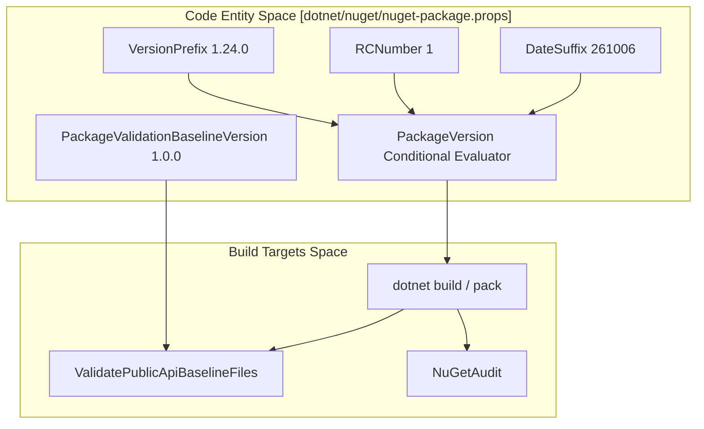
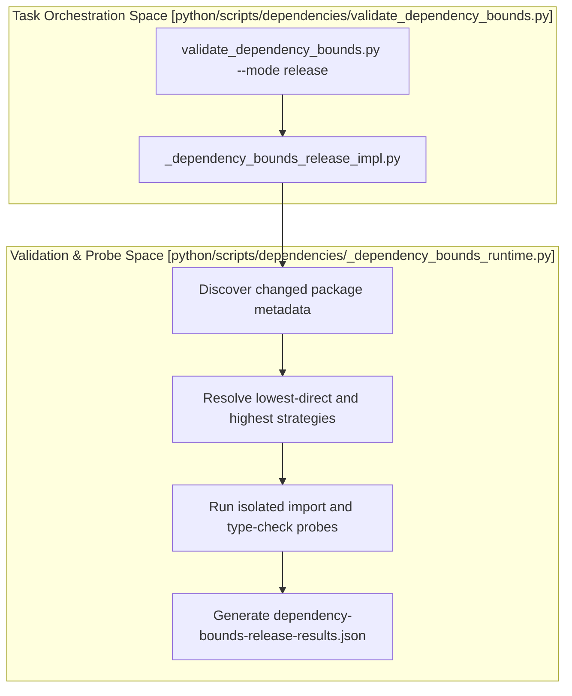
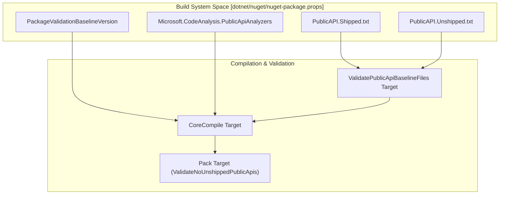

<!-- source: DeepWiki mcp.deepwiki.com · repo microsoft/agent-framework · extra page Release Process · fetched 2026-10-26 -->

# Release Process

Relevant source files

The following files were used as context for generating this wiki page:

- [.github/workflows/python-dependency-maintenance.yml](.github/workflows/python-dependency-maintenance.yml)
- [dotnet/nuget/nuget-package.props](dotnet/nuget/nuget-package.props)
- [dotnet/src/Microsoft.Agents.AI.Abstractions/Microsoft.Agents.AI.Abstractions.csproj](dotnet/src/Microsoft.Agents.AI.Abstractions/Microsoft.Agents.AI.Abstractions.csproj)
- [dotnet/src/Microsoft.Agents.AI.OpenAI/Microsoft.Agents.AI.OpenAI.csproj](dotnet/src/Microsoft.Agents.AI.OpenAI/Microsoft.Agents.AI.OpenAI.csproj)
- [dotnet/src/Microsoft.Agents.AI.Workflows.Declarative/Microsoft.Agents.AI.Workflows.Declarative.csproj](dotnet/src/Microsoft.Agents.AI.Workflows.Declarative/Microsoft.Agents.AI.Workflows.Declarative.csproj)
- [dotnet/src/Microsoft.Agents.AI.Workflows.Generators/Microsoft.Agents.AI.Workflows.Generators.csproj](dotnet/src/Microsoft.Agents.AI.Workflows.Generators/Microsoft.Agents.AI.Workflows.Generators.csproj)
- [dotnet/src/Microsoft.Agents.AI.Workflows/Microsoft.Agents.AI.Workflows.csproj](dotnet/src/Microsoft.Agents.AI.Workflows/Microsoft.Agents.AI.Workflows.csproj)
- [dotnet/src/Microsoft.Agents.AI/Microsoft.Agents.AI.csproj](dotnet/src/Microsoft.Agents.AI/Microsoft.Agents.AI.csproj)
- [dotnet/tests/Microsoft.Agents.AI.UnitTests/Microsoft.Agents.AI.UnitTests.csproj](dotnet/tests/Microsoft.Agents.AI.UnitTests/Microsoft.Agents.AI.UnitTests.csproj)
- [python/.github/instructions/python.instructions.md](python/.github/instructions/python.instructions.md)
- [python/.github/skills/agent-framework-py-release/SKILL.md](python/.github/skills/agent-framework-py-release/SKILL.md)
- [python/.github/skills/python-development/SKILL.md](python/.github/skills/python-development/SKILL.md)
- [python/.github/skills/python-package-management/SKILL.md](python/.github/skills/python-package-management/SKILL.md)
- [python/AGENTS.md](python/AGENTS.md)
- [python/CODING_STANDARD.md](python/CODING_STANDARD.md)
- [python/DEV_SETUP.md](python/DEV_SETUP.md)
- [python/packages/ollama/LICENSE](python/packages/ollama/LICENSE)
- [python/packages/ollama/README.md](python/packages/ollama/README.md)
- [python/packages/ollama/agent_framework_ollama/__init__.py](python/packages/ollama/agent_framework_ollama/__init__.py)
- [python/packages/ollama/agent_framework_ollama/py.typed](python/packages/ollama/agent_framework_ollama/py.typed)
- [python/scripts/dependencies/README.md](python/scripts/dependencies/README.md)
- [python/scripts/dependencies/_dependency_bounds_lower_impl.py](python/scripts/dependencies/_dependency_bounds_lower_impl.py)
- [python/scripts/dependencies/_dependency_bounds_release_impl.py](python/scripts/dependencies/_dependency_bounds_release_impl.py)
- [python/scripts/dependencies/_dependency_bounds_runtime.py](python/scripts/dependencies/_dependency_bounds_runtime.py)
- [python/scripts/dependencies/_dependency_bounds_upper_impl.py](python/scripts/dependencies/_dependency_bounds_upper_impl.py)
- [python/scripts/dependencies/tests/test_dependency_bounds_release.py](python/scripts/dependencies/tests/test_dependency_bounds_release.py)
- [python/scripts/dependencies/validate_dependency_bounds.py](python/scripts/dependencies/validate_dependency_bounds.py)

This document details the release process for the Microsoft Agent Framework across both .NET and Python implementations. It covers versioning schemes, package building, automated API compatibility validation checks, dependency range enforcement, and release workflows.

---

## 1. Release Overview and Architecture

The framework maintains parallel release pipelines for Python and .NET, sharing common goals of strict API compatibility, automated regression testing, dependency bound enforcement, and consistent packaging targets (PyPI for Python, NuGet.org for .NET).

- **.NET Packages**: Centrally versioned via `dotnet/nuget/nuget-package.props` [dotnet/nuget/nuget-package.props:1-11](), utilizing MSBuild package validation, SourceLink integration, and Roslyn public API analyzers [dotnet/nuget/nuget-package.props:16-24, 53-69]().
- **Python Packages**: Managed in a monorepo structure with uv-based dependency management and automated release-gate validation via `python/scripts/dependencies/validate_dependency_bounds.py` [python/scripts/dependencies/README.md:1-29]().

Sources: `[dotnet/nuget/nuget-package.props:1-24]()`, `[python/scripts/dependencies/README.md:1-29]()`

---

## 2. Version Numbering and Configuration

### .NET Centralized Versioning
All .NET projects derive their package properties, version prefixes, and validation baselines from `dotnet/nuget/nuget-package.props` [dotnet/nuget/nuget-package.props:1-12](). 

- **Version Properties**: Defines `<VersionPrefix>`, `<RCNumber>`, and conditional `<PackageVersion>` generation based on release candidate flags (`IsReleaseCandidate`) or release states (`IsReleased`) [dotnet/nuget/nuget-package.props:4-10]().
- **Baseline Configuration**: Sets `<PackageValidationBaselineVersion>` to track backwards compatibility against published NuGet versions [dotnet/nuget/nuget-package.props:15-17]().

Sources: `[dotnet/nuget/nuget-package.props:1-32]()`, `[dotnet/src/Microsoft.Agents.AI/Microsoft.Agents.AI.csproj:1-6]()`

### Python Package Status Tracking and Versioning
Python packages use workspace-wide dependency declarations in `pyproject.toml` files and are validated during releases using `validate_python_release` tasks [.github/workflows/python-dependency-maintenance.yml:46-78](), `[python/.github/skills/python-package-management/SKILL.md:57-96]()`.

Sources: `[python/.github/skills/python-package-management/SKILL.md:57-96]()`, `[.github/workflows/python-dependency-maintenance.yml:46-78]`

---

## 3. API Compatibility and Quality Gates

### Python Release Validation and Dependency Probes
Python release validation is orchestrated through `python/scripts/dependencies/validate_dependency_bounds.py` and `_dependency_bounds_release_impl.py` [python/scripts/dependencies/README.md:13-31]().

Sources: `[python/scripts/dependencies/README.md:13-31]`, `[python/scripts/dependencies/_dependency_bounds_runtime.py:1-56]()`

- **Release Mode Probes**: The `release` mode refreshes `uv.lock`, finds changed package metadata relative to the base reference, and verifies lower and upper bounds via `lowest-direct` and `highest` import strategies [python/scripts/dependencies/README.md:20-31]().
- **Concurrency**: Probes execute concurrently under a 300-second deadline [python/.github/skills/python-package-management/SKILL.md:87-91]().

Sources: `[python/scripts/dependencies/README.md:20-31]`, `[python/.github/skills/python-package-management/SKILL.md:87-91]`

### .NET Public API Validation
.NET projects enforce compatibility during `dotnet build` and `dotnet pack` using Roslyn-based analyzers configured in `dotnet/nuget/nuget-package.props` [dotnet/nuget/nuget-package.props:65-82]().

Sources: `[dotnet/nuget/nuget-package.props:16-24]`, `[dotnet/nuget/nuget-package.props:65-82]`, `[dotnet/src/Microsoft.Agents.AI/Microsoft.Agents.AI.csproj:1-6]`

- **PublicAPI Shipped/Unshipped Files**: Released projects reference `PublicAPI.Shipped.txt` and `PublicAPI.Unshipped.txt` to track public APIs [dotnet/nuget/nuget-package.props:67-70]().
- **API Baseline Validation**: The `ValidatePublicApiBaselineFiles` target ensures required baseline files exist before compilation [dotnet/nuget/nuget-package.props:72-78]().

Sources: `[dotnet/nuget/nuget-package.props:67-82]()`, `[dotnet/src/Microsoft.Agents.AI/Microsoft.Agents.AI.csproj:1-6]()`

---

## 4. Release Automation and Dependency Maintenance

Releases and dependency upgrades are coordinated through automated GitHub Actions workflows and local Poe tasks.

- **Dependency Maintenance**: `.github/workflows/python-dependency-maintenance.yml` runs automated checks to repin dev dependencies, refresh `uv.lock`, run dependency bounds test scenarios, and validate upper bounds [`.github/workflows/python-dependency-maintenance.yml:46-78`]().
- **Report Generation**: Results are uploaded as workflow artifacts (`dependency-bounds-test-results.json` and `dependency-range-results.json`), creating issues or PRs when failures or updates occur [`.github/workflows/python-dependency-maintenance.yml:79-157`]().

Sources: `[.github/workflows/python-dependency-maintenance.yml:46-157]()`, `[python/scripts/dependencies/README.md:81-95]()`

---

