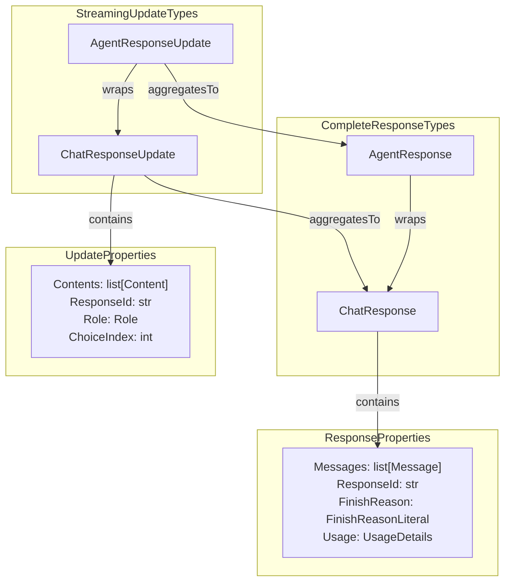
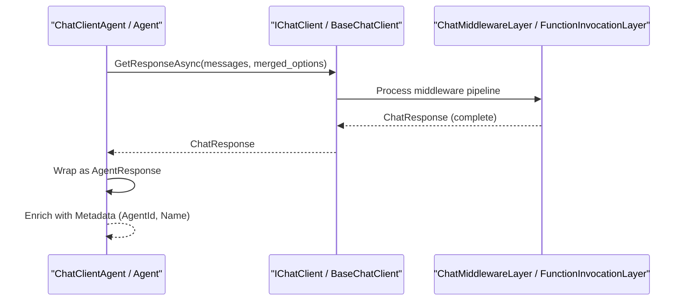
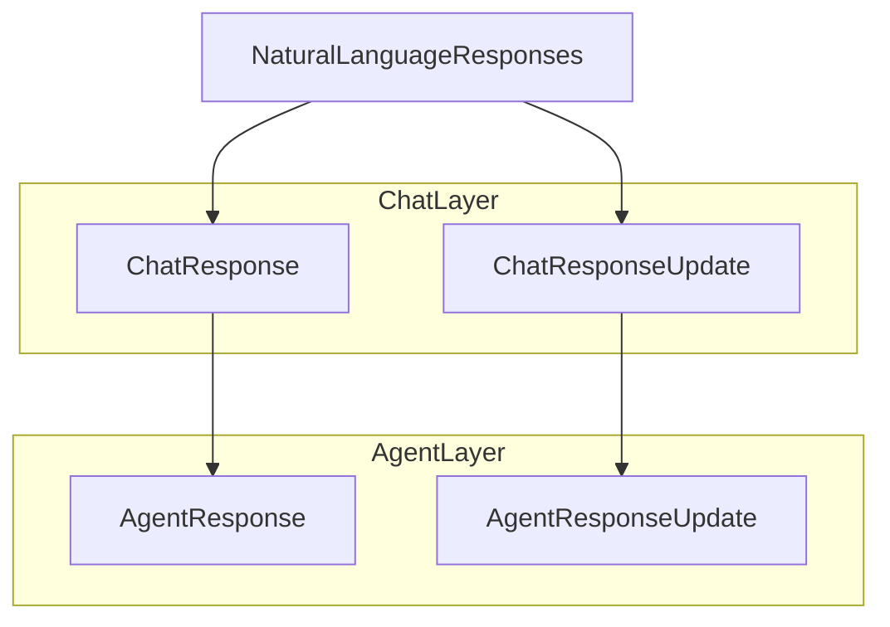
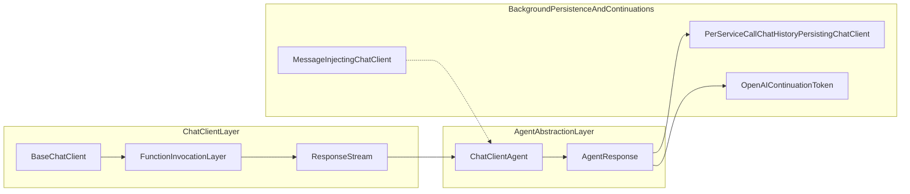

<!-- source: DeepWiki mcp.deepwiki.com · repo microsoft/agent-framework · extra page Response Processing and Streaming · fetched 2026-10-26 -->

# Response Processing and Streaming

Relevant source files

The following files were used as context for generating this wiki page:

- [python/packages/core/agent_framework/_feature_stage.py](python/packages/core/agent_framework/_feature_stage.py)
- [python/packages/core/tests/core/test_as_tool_kwargs_propagation.py](python/packages/core/tests/core/test_as_tool_kwargs_propagation.py)
- [python/packages/core/tests/core/test_feature_stage.py](python/packages/core/tests/core/test_feature_stage.py)
- [python/packages/core/tests/core/test_middleware.py](python/packages/core/tests/core/test_middleware.py)
- [python/packages/core/tests/core/test_middleware_context_result.py](python/packages/core/tests/core/test_middleware_context_result.py)
- [python/packages/foundry/README.md](python/packages/foundry/README.md)
- [python/packages/foundry/agent_framework_foundry/_agent.py](python/packages/foundry/agent_framework_foundry/_agent.py)
- [python/packages/foundry/agent_framework_foundry/_chat_client.py](python/packages/foundry/agent_framework_foundry/_chat_client.py)
- [python/packages/foundry/tests/foundry/test_foundry_agent.py](python/packages/foundry/tests/foundry/test_foundry_agent.py)
- [python/packages/foundry/tests/foundry/test_foundry_chat_client.py](python/packages/foundry/tests/foundry/test_foundry_chat_client.py)
- [python/packages/openai/agent_framework_openai/_chat_client.py](python/packages/openai/agent_framework_openai/_chat_client.py)
- [python/packages/openai/agent_framework_openai/_chat_completion_client.py](python/packages/openai/agent_framework_openai/_chat_completion_client.py)
- [python/packages/openai/tests/openai/test_openai_chat_client.py](python/packages/openai/tests/openai/test_openai_chat_client.py)
- [python/packages/openai/tests/openai/test_openai_chat_completion_client.py](python/packages/openai/tests/openai/test_openai_chat_completion_client.py)
- [python/samples/02-agents/middleware/README.md](python/samples/02-agents/middleware/README.md)
- [python/samples/02-agents/middleware/override_result_with_middleware.py](python/samples/02-agents/middleware/override_result_with_middleware.py)
- [python/samples/02-agents/middleware/usage_tracking_middleware.py](python/samples/02-agents/middleware/usage_tracking_middleware.py)
- [python/samples/02-agents/response_stream.py](python/samples/02-agents/response_stream.py)

This page explains how responses from chat clients are processed and streamed within the Microsoft Agent Framework. It details the handling of full responses and streaming partial updates, the way updates are aggregated into coherent final results, the use of continuation tokens to manage background or long-running responses, and how background response flows are orchestrated and persisted.

For foundational concepts regarding the chat client architecture and message structures, refer to [Chat Client Architecture](3.1.2) and [Message Types and Content](3.1.3).

---

## Response Type Hierarchy

The framework distinguishes between two parallel hierarchies of response types that operate at different layers:

- **Chat-level responses** originate from `IChatClient` (C#) or `BaseChatClient` (Python) implementations and represent raw completions or streams of partial updates from the AI provider.
- **Agent-level responses** wrap those chat-level responses to provide richer metadata and agent-specific state.

### Core Response Classes

| Response Type             | Description                                                                                                   |
|--------------------------|---------------------------------------------------------------------------------------------------------------|
| `ChatResponse`           | Represents a full response from a chat client, including a list of `Message` objects, usage info, and metadata. [python/packages/core/agent_framework/_types.py:1000-1001]() |
| `ChatResponseUpdate`     | Represents a partial, incremental update chunk in a streaming response, typically containing `Content` items. [python/packages/core/agent_framework/_types.py:1020-1021]() |
| `AgentResponse`          | Wraps `ChatResponse` at the agent level, adding agent-related state and identification. [dotnet/src/Microsoft.Agents.AI/ChatClient/ChatClientAgent.cs:39-40]() |
| `AgentResponseUpdate`    | Wraps `ChatResponseUpdate` similarly to provide partial updates at the agent abstraction level. |

Sources:
- [python/packages/core/agent_framework/_types.py:1000-1021]()
- [dotnet/src/Microsoft.Agents.AI/ChatClient/ChatClientAgent.cs:39-40]()

---

## Non-Streaming Response Flow

The non-streaming response mode processes a complete chat interaction in one invocation. This flow involves the agent merging base chat options with runtime overrides and then invoking the configured chat client to obtain a final `ChatResponse`. The agent wraps this into an `AgentResponse` enriched with agent-specific metadata like agent name and ID.

Sources:
- [dotnet/src/Microsoft.Agents.AI/ChatClient/ChatClientAgent.cs:118-130]()
- [python/packages/core/agent_framework/_clients.py:100-100]()
- [python/packages/core/agent_framework/_agents.py:309-310]()

---

## Streaming Response Flow

Streaming enables partial content updates to be sent as chunks as soon as they are available from the AI service, allowing applications to display output progressively. The framework supports streaming via asynchronous iterable sequences:

- In .NET, streaming responses are represented by `IAsyncEnumerable<ChatResponseUpdate>`.
- In Python, streaming responses are expressed as `AsyncIterable[ChatResponseUpdate]` [python/packages/core/agent_framework/_types.py:85-86]().

### OpenAI Streaming

The OpenAI client integration handles streaming responses through the `ResponseStream` abstraction [python/packages/openai/tests/openai/test_openai_chat_client.py:26-26]() which wraps the OpenAI SDK's streaming event types such as `ResponseStreamEvent` [python/packages/openai/agent_framework_openai/_chat_client.py:102-104](). These include events for reasoning tokens and partial summaries:
- `ResponseReasoningTextDeltaEvent` [python/packages/openai/tests/openai/test_openai_chat_client.py:65-67]()
- `ResponseReasoningSummaryTextDeltaEvent` [python/packages/openai/tests/openai/test_openai_chat_client.py:59-61]()

The client accumulates and translates these streaming events into `ChatResponseUpdate` objects in real time.

### Anthropic Streaming

For Anthropic streaming support, the raw client processes streams of message stream events containing blocks like text blocks, tool use blocks, and code execution results. These blocks are transformed asynchronously into `ChatResponseUpdate` instances yielding incremental content suitable for streaming presentation.

### Update Aggregation and Coalescing

The framework provides facilities to take a stream of partial updates and aggregate them into a final coherent response:
- **Concatenating text fragments:** Stitches partial text spans into complete text strings.
- **Accumulating usage metrics:** Sums token counts (input, output, reasoning) via `add_usage_details`.
- **Reassembling function call parameters:** Reconstructs tool invocation calls received in segments from partial JSON fragments.

Sources:
- [python/packages/core/agent_framework/_types.py:85-86]()
- [python/packages/openai/tests/openai/test_openai_chat_client.py:26-67]()
- [python/packages/openai/agent_framework_openai/_chat_client.py:102-104]()

---

## Background Response Handling and Persistence

The Agent Framework supports advanced scenarios with background or long-running response streams, particularly with the OpenAI Responses API.

### Per-Service-Call Persistence

In .NET, the `PerServiceCallChatHistoryPersistingChatClient` component decorates an existing chat client to persist chat history after **each service call** in a function invocation sequence. This guards against run interruptions during multi-step workflows by saving intermediate state incrementally.

In Python, a similar pattern is implemented with `PerServiceCallHistoryPersistingMiddleware` which persists history at the end of each service call during streaming or function invocation loops.

### Message Injection for Loop Evaluation

A specialized chat client wrapper `MessageInjectingChatClient` allows tool delegates or agents themselves to inject messages back into the chat loop dynamically. This is foundational for "loop evaluation" scenarios where the agent re-injects system or assistant messages to reconsider state based on intermediate results or tool outputs.

Sources:
- [dotnet/src/Microsoft.Agents.AI/ChatClient/ChatClientAgentOptions.cs:93-130]()
- [dotnet/src/Microsoft.Agents.AI/ChatClient/MessageInjectingChatClient.cs:1-10]()
- [python/packages/core/agent_framework/_sessions.py:42-42]()

---

## Continuation Tokens

Continuation tokens enable the framework to support background or asynchronous response resumption. For example, the OpenAI Responses API issues a `response_id` to identify a running response that can be later retrieved or resumed.

### OpenAIContinuationToken

The `OpenAIContinuationToken` type [python/packages/openai/agent_framework_openai/_chat_client.py:184-189]() extends a generic continuation token with a `response_id` string property specific to the OpenAI Responses API lifecycle:

| Property       | Type | Description                                    |
|----------------|------|------------------------------------------------|
| `response_id`  | str  | The unique identifier assigned by OpenAI Responses API to track the response session and enable resuming or retrieving the streamed result. [python/packages/openai/agent_framework_openai/_chat_client.py:187-188]() |

Sources:
- [python/packages/openai/agent_framework_openai/_chat_client.py:184-189]()
- [python/packages/core/agent_framework/_types.py:1050-1055]()

---

## Natural Language to Code Entity Mapping

Sources:
- [python/packages/core/agent_framework/_types.py:1000-1021]()
- [dotnet/src/Microsoft.Agents.AI/ChatClient/ChatClientAgent.cs:39-40]()

---

## Response Processing Components and Data Flow

Sources:
- [python/packages/core/agent_framework/_clients.py:100-100]()
- [python/packages/openai/agent_framework_openai/_chat_client.py:184-189]()
- [dotnet/src/Microsoft.Agents.AI/ChatClient/ChatClientAgent.cs:118-130]()

---

