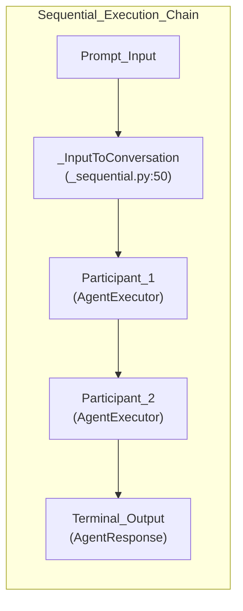
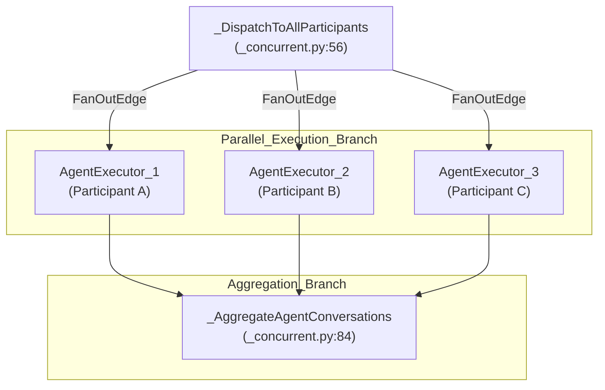

<!-- source: DeepWiki mcp.deepwiki.com · repo microsoft/agent-framework · extra page Sequential and Concurrent Patterns · fetched 2026-10-26 -->

# Sequential and Concurrent Patterns

Relevant source files

The following files were used as context for generating this wiki page:

- [dotnet/samples/03-workflows/_StartHere/03_AgentWorkflowPatterns/Program.cs](dotnet/samples/03-workflows/_StartHere/03_AgentWorkflowPatterns/Program.cs)
- [dotnet/src/Microsoft.Agents.AI.Workflows/Checkpointing/CheckpointInfoConverter.cs](dotnet/src/Microsoft.Agents.AI.Workflows/Checkpointing/CheckpointInfoConverter.cs)
- [dotnet/src/Microsoft.Agents.AI.Workflows/Checkpointing/FileSystemJsonCheckpointStore.cs](dotnet/src/Microsoft.Agents.AI.Workflows/Checkpointing/FileSystemJsonCheckpointStore.cs)
- [dotnet/src/Microsoft.Agents.AI.Workflows/Checkpointing/InMemoryCheckpointManager.cs](dotnet/src/Microsoft.Agents.AI.Workflows/Checkpointing/InMemoryCheckpointManager.cs)
- [dotnet/src/Microsoft.Agents.AI.Workflows/Checkpointing/JsonConverterDictionarySupportBase.cs](dotnet/src/Microsoft.Agents.AI.Workflows/Checkpointing/JsonConverterDictionarySupportBase.cs)
- [dotnet/src/Microsoft.Agents.AI.Workflows/Checkpointing/JsonMarshaller.cs](dotnet/src/Microsoft.Agents.AI.Workflows/Checkpointing/JsonMarshaller.cs)
- [dotnet/src/Microsoft.Agents.AI.Workflows/Checkpointing/ScopeKeyConverter.cs](dotnet/src/Microsoft.Agents.AI.Workflows/Checkpointing/ScopeKeyConverter.cs)
- [dotnet/src/Microsoft.Agents.AI.Workflows/GroupChatManager.cs](dotnet/src/Microsoft.Agents.AI.Workflows/GroupChatManager.cs)
- [dotnet/src/Microsoft.Agents.AI.Workflows/GroupChatWorkflowBuilder.cs](dotnet/src/Microsoft.Agents.AI.Workflows/GroupChatWorkflowBuilder.cs)
- [dotnet/src/Microsoft.Agents.AI.Workflows/PortableValue.cs](dotnet/src/Microsoft.Agents.AI.Workflows/PortableValue.cs)
- [dotnet/src/Microsoft.Agents.AI.Workflows/RoundRobinGroupChatManager.cs](dotnet/src/Microsoft.Agents.AI.Workflows/RoundRobinGroupChatManager.cs)
- [dotnet/src/Microsoft.Agents.AI.Workflows/SequentialWorkflowBuilder.cs](dotnet/src/Microsoft.Agents.AI.Workflows/SequentialWorkflowBuilder.cs)
- [dotnet/src/Microsoft.Agents.AI.Workflows/Specialized/GroupChatHost.cs](dotnet/src/Microsoft.Agents.AI.Workflows/Specialized/GroupChatHost.cs)
- [dotnet/src/Microsoft.Agents.AI.Workflows/WorkflowsJsonUtilities.cs](dotnet/src/Microsoft.Agents.AI.Workflows/WorkflowsJsonUtilities.cs)
- [dotnet/tests/Microsoft.Agents.AI.Workflows.UnitTests/AggregatingExecutorTests.cs](dotnet/tests/Microsoft.Agents.AI.Workflows.UnitTests/AggregatingExecutorTests.cs)
- [dotnet/tests/Microsoft.Agents.AI.Workflows.UnitTests/CheckpointManagerLatestTests.cs](dotnet/tests/Microsoft.Agents.AI.Workflows.UnitTests/CheckpointManagerLatestTests.cs)
- [dotnet/tests/Microsoft.Agents.AI.Workflows.UnitTests/FileSystemJsonCheckpointStoreTests.cs](dotnet/tests/Microsoft.Agents.AI.Workflows.UnitTests/FileSystemJsonCheckpointStoreTests.cs)
- [dotnet/tests/Microsoft.Agents.AI.Workflows.UnitTests/GroupChatOrchestrationTests.cs](dotnet/tests/Microsoft.Agents.AI.Workflows.UnitTests/GroupChatOrchestrationTests.cs)
- [dotnet/tests/Microsoft.Agents.AI.Workflows.UnitTests/JsonSerializationTests.cs](dotnet/tests/Microsoft.Agents.AI.Workflows.UnitTests/JsonSerializationTests.cs)
- [dotnet/tests/Microsoft.Agents.AI.Workflows.UnitTests/RoundRobinGroupChatManagerTests.cs](dotnet/tests/Microsoft.Agents.AI.Workflows.UnitTests/RoundRobinGroupChatManagerTests.cs)
- [dotnet/tests/Microsoft.Agents.AI.Workflows.UnitTests/SequentialWorkflowBuilderTests.cs](dotnet/tests/Microsoft.Agents.AI.Workflows.UnitTests/SequentialWorkflowBuilderTests.cs)
- [python/packages/core/agent_framework/_workflows/_agent_utils.py](python/packages/core/agent_framework/_workflows/_agent_utils.py)
- [python/packages/orchestrations/README.md](python/packages/orchestrations/README.md)
- [python/packages/orchestrations/agent_framework_orchestrations/_concurrent.py](python/packages/orchestrations/agent_framework_orchestrations/_concurrent.py)
- [python/packages/orchestrations/agent_framework_orchestrations/_group_chat.py](python/packages/orchestrations/agent_framework_orchestrations/_group_chat.py)
- [python/packages/orchestrations/agent_framework_orchestrations/_handoff.py](python/packages/orchestrations/agent_framework_orchestrations/_handoff.py)
- [python/packages/orchestrations/agent_framework_orchestrations/_magentic.py](python/packages/orchestrations/agent_framework_orchestrations/_magentic.py)
- [python/packages/orchestrations/agent_framework_orchestrations/_orchestration_request_info.py](python/packages/orchestrations/agent_framework_orchestrations/_orchestration_request_info.py)
- [python/packages/orchestrations/agent_framework_orchestrations/_orchestrator_helpers.py](python/packages/orchestrations/agent_framework_orchestrations/_orchestrator_helpers.py)
- [python/packages/orchestrations/agent_framework_orchestrations/_sequential.py](python/packages/orchestrations/agent_framework_orchestrations/_sequential.py)
- [python/packages/orchestrations/tests/test_concurrent.py](python/packages/orchestrations/tests/test_concurrent.py)
- [python/packages/orchestrations/tests/test_group_chat.py](python/packages/orchestrations/tests/test_group_chat.py)
- [python/packages/orchestrations/tests/test_handoff.py](python/packages/orchestrations/tests/test_handoff.py)
- [python/packages/orchestrations/tests/test_magentic.py](python/packages/orchestrations/tests/test_magentic.py)
- [python/packages/orchestrations/tests/test_orchestration_request_info.py](python/packages/orchestrations/tests/test_orchestration_request_info.py)
- [python/packages/orchestrations/tests/test_sequential.py](python/packages/orchestrations/tests/test_sequential.py)
- [python/samples/03-workflows/orchestrations/sequential_chain_only_agent_responses.py](python/samples/03-workflows/orchestrations/sequential_chain_only_agent_responses.py)

## Purpose and Scope

This page documents sequential agent chaining and parallel concurrent execution patterns in the Agent Framework's workflow system. These patterns enable orchestration of multiple agents or executors in linear sequences, parallel branches, fan-out/fan-in aggregations, and MapReduce-style workflows across .NET and Python implementations.

The framework provides both a low-level graph builder for custom topologies and specialized helper classes like `SequentialBuilder` and `ConcurrentBuilder` in Python [python/packages/orchestrations/agent_framework_orchestrations/_sequential.py:66-108](), [python/packages/orchestrations/agent_framework_orchestrations/_concurrent.py:35-53](), and `SequentialWorkflowBuilder` / `GroupChatWorkflowBuilder` in .NET to simplify multi-agent orchestration tasks.

Sources: [python/packages/orchestrations/agent_framework_orchestrations/_sequential.py:66-108](), [python/packages/orchestrations/agent_framework_orchestrations/_concurrent.py:35-53]()

---

## Sequential Pattern

### Overview

Sequential patterns chain executors in a linear sequence where each executor processes the output of the previous one. Execution proceeds step-by-step through the chain until reaching a terminal executor or convergence condition. In Python's `SequentialBuilder`, participants can be `SupportsAgentRun` or `Executor` instances sharing a common conversation context (`list[Message]`) [python/packages/orchestrations/agent_framework_orchestrations/_sequential.py:3-15]().

### Execution Model

Sequential workflows execute in supersteps coordinated by the workflow runner. The input is first normalized into a conversation history, and then passed sequentially down the participant chain via `AgentExecutor` nodes [python/packages/orchestrations/agent_framework_orchestrations/_sequential.py:9-15](), [python/packages/orchestrations/agent_framework_orchestrations/_sequential.py:50-64]().

Title: Sequential Execution Flow (Code Entity Space)

Sources: [python/packages/orchestrations/agent_framework_orchestrations/_sequential.py:3-64]()

### Implementation with SequentialBuilder

In Python, `SequentialBuilder` handles the wiring of participants, checkpoint storage, and intermediate output interception [python/packages/orchestrations/agent_framework_orchestrations/_sequential.py:66-134](). In .NET, `SequentialWorkflowBuilder` provides equivalent graph construction semantics.

Sources: [python/packages/orchestrations/agent_framework_orchestrations/_sequential.py:66-134]()

---

## Concurrent and Fan-Out Patterns

### Overview

Concurrent patterns enable multiple executors to process the same input in parallel. This is implemented via fan-out edges, which broadcast a single message or request to multiple target execution nodes.

### Fan-Out Execution

In the Python `_concurrent` module, `_DispatchToAllParticipants` broadcasts incoming requests, prompts, or messages to all connected downstream agent participants simultaneously [python/packages/orchestrations/agent_framework_orchestrations/_concurrent.py:35-82]().

Title: Fan-Out Pattern (Natural Language to Code Entity Space)

Sources: [python/packages/orchestrations/agent_framework_orchestrations/_concurrent.py:35-138]()

---

## Fan-In and MapReduce Patterns

### Overview

Fan-in patterns aggregate outputs from multiple concurrent executors into a single target. The framework uses barrier logic to ensure the aggregator only runs once all parallel branches have completed their respective supersteps.

### MapReduce via Concurrent Builders

The concurrent architecture implements a MapReduce pattern:
1. **Map**: `_DispatchToAllParticipants` fans out input messages to multiple agent executors [python/packages/orchestrations/agent_framework_orchestrations/_concurrent.py:56-82]().
2. **Process**: Each agent processes its task concurrently.
3. **Reduce**: `_AggregateAgentConversations` or `_CallbackAggregator` collects `AgentExecutorResponse` items, extracts assistant replies, and aggregates them into a final `AgentResponse` or custom output [python/packages/orchestrations/agent_framework_orchestrations/_concurrent.py:84-151]().

| Component | Responsibility |
|-----------|----------------|
| `_DispatchToAllParticipants` | Broadcasts text, message, or request payloads to all parallel execution targets [python/packages/orchestrations/agent_framework_orchestrations/_concurrent.py:56-82](). |
| `_AggregateAgentConversations` | Collects responses and extracts final assistant messages in deterministic order [python/packages/orchestrations/agent_framework_orchestrations/_concurrent.py:84-138](). |
| `_CallbackAggregator` | Wraps custom sync/async callback functions to process aggregate results [python/packages/orchestrations/agent_framework_orchestrations/_concurrent.py:140-151](). |

Sources: [python/packages/orchestrations/agent_framework_orchestrations/_concurrent.py:56-151]()

---

## State Persistence and Checkpointing

Workflows supporting sequential and concurrent execution can integrate persistent checkpoint stores (such as `FileSystemJsonCheckpointStore` in .NET or in-memory equivalents in Python) to ensure state durability across pauses and process restarts [dotnet/src/Microsoft.Agents.AI.Workflows/Checkpointing/FileSystemJsonCheckpointStore.cs:21-30](), [python/packages/orchestrations/agent_framework_orchestrations/_sequential.py:104-114]().

Checkpoint stores serialize workflow execution snapshots and maintain append-only index logs (`index.jsonl`) to track valid commit histories [dotnet/src/Microsoft.Agents.AI.Workflows/Checkpointing/FileSystemJsonCheckpointStore.cs:25-78]().

Sources: [dotnet/src/Microsoft.Agents.AI.Workflows/Checkpointing/FileSystemJsonCheckpointStore.cs:21-112](), [python/packages/orchestrations/agent_framework_orchestrations/_sequential.py:104-114]()

---

