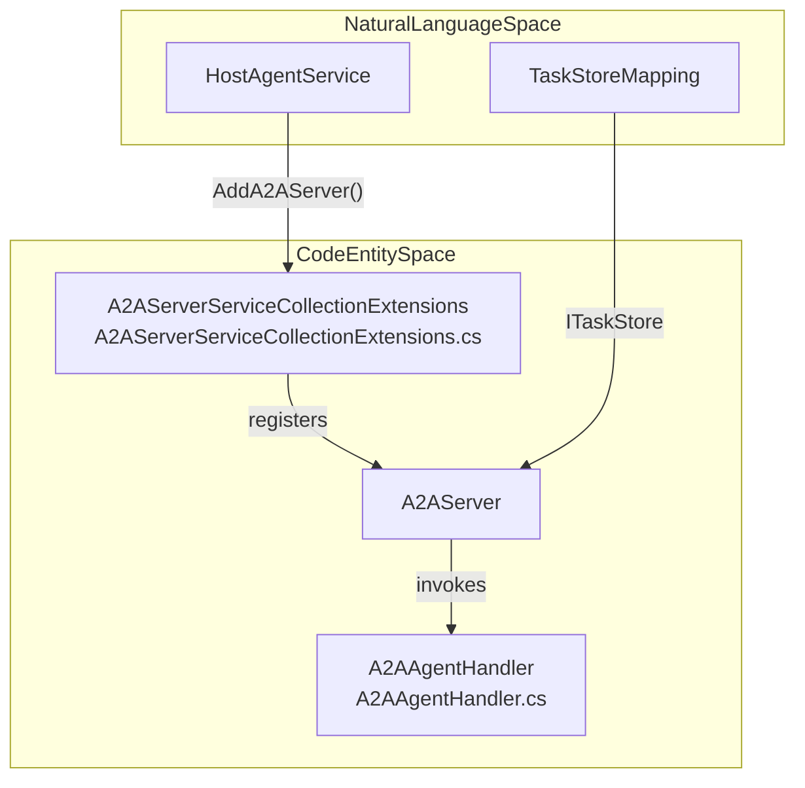
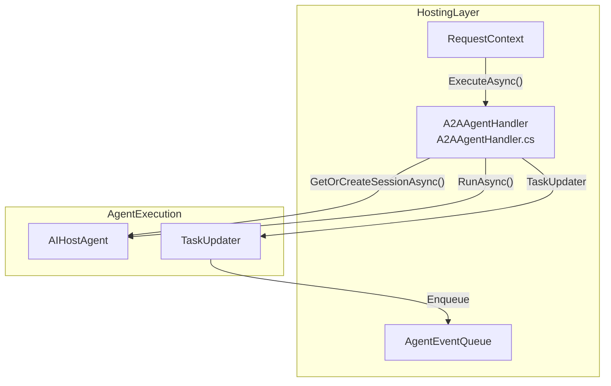
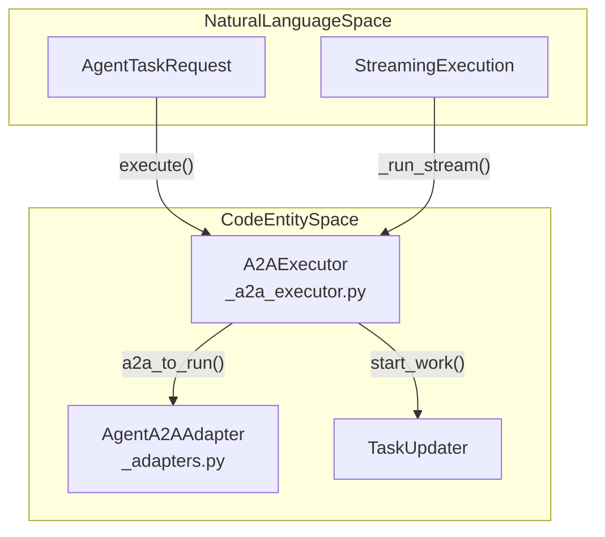

<!-- source: DeepWiki mcp.deepwiki.com · repo microsoft/agent-framework · extra page A2A Implementation · fetched 2026-10-26 -->

# A2A Implementation

<details>
<summary>Relevant source files</summary>

The following files were used as context for generating this wiki page:

- [dotnet/samples/05-end-to-end/A2AClientServer/A2AServer/Program.cs](dotnet/samples/05-end-to-end/A2AClientServer/A2AServer/Program.cs)
- [dotnet/samples/05-end-to-end/AgentWebChat/AgentWebChat.AgentHost/Program.cs](dotnet/samples/05-end-to-end/AgentWebChat/AgentWebChat.AgentHost/Program.cs)
- [dotnet/samples/05-end-to-end/AgentWebChat/AgentWebChat.Web/OpenAIChatCompletionsAgentClient.cs](dotnet/samples/05-end-to-end/AgentWebChat/AgentWebChat.Web/OpenAIChatCompletionsAgentClient.cs)
- [dotnet/samples/05-end-to-end/AgentWebChat/AgentWebChat.Web/OpenAIResponsesAgentClient.cs](dotnet/samples/05-end-to-end/AgentWebChat/AgentWebChat.Web/OpenAIResponsesAgentClient.cs)
- [dotnet/src/Microsoft.Agents.AI.A2A/Extensions/A2AAIContentExtensions.cs](dotnet/src/Microsoft.Agents.AI.A2A/Extensions/A2AAIContentExtensions.cs)
- [dotnet/src/Microsoft.Agents.AI.A2A/Extensions/ChatMessageExtensions.cs](dotnet/src/Microsoft.Agents.AI.A2A/Extensions/ChatMessageExtensions.cs)
- [dotnet/src/Microsoft.Agents.AI.Hosting.A2A/A2AAgentHandler.cs](dotnet/src/Microsoft.Agents.AI.Hosting.A2A/A2AAgentHandler.cs)
- [dotnet/src/Microsoft.Agents.AI.Hosting.A2A/A2AHostingJsonUtilities.cs](dotnet/src/Microsoft.Agents.AI.Hosting.A2A/A2AHostingJsonUtilities.cs)
- [dotnet/src/Microsoft.Agents.AI.Hosting.A2A/A2ARunDecisionContext.cs](dotnet/src/Microsoft.Agents.AI.Hosting.A2A/A2ARunDecisionContext.cs)
- [dotnet/src/Microsoft.Agents.AI.Hosting.A2A/A2AServerRegistrationOptions.cs](dotnet/src/Microsoft.Agents.AI.Hosting.A2A/A2AServerRegistrationOptions.cs)
- [dotnet/src/Microsoft.Agents.AI.Hosting.A2A/A2AServerServiceCollectionExtensions.cs](dotnet/src/Microsoft.Agents.AI.Hosting.A2A/A2AServerServiceCollectionExtensions.cs)
- [dotnet/src/Microsoft.Agents.AI.Hosting.A2A/AgentEventQueueExtensions.cs](dotnet/src/Microsoft.Agents.AI.Hosting.A2A/AgentEventQueueExtensions.cs)
- [dotnet/src/Microsoft.Agents.AI.Hosting.A2A/AgentRunMode.cs](dotnet/src/Microsoft.Agents.AI.Hosting.A2A/AgentRunMode.cs)
- [dotnet/src/Microsoft.Agents.AI.Hosting.A2A/ArtifactStreamWriter.cs](dotnet/src/Microsoft.Agents.AI.Hosting.A2A/ArtifactStreamWriter.cs)
- [dotnet/src/Microsoft.Agents.AI.Hosting.A2A/Converters/MessageConverter.cs](dotnet/src/Microsoft.Agents.AI.Hosting.A2A/Converters/MessageConverter.cs)
- [dotnet/src/Microsoft.Agents.AI.Hosting.A2A/IsolationKeyScopedTaskStore.cs](dotnet/src/Microsoft.Agents.AI.Hosting.A2A/IsolationKeyScopedTaskStore.cs)
- [dotnet/src/Microsoft.Agents.AI.Hosting.OpenAI/Responses/IResponsesService.cs](dotnet/src/Microsoft.Agents.AI.Hosting.OpenAI/Responses/IResponsesService.cs)
- [dotnet/tests/Microsoft.Agents.AI.A2A.UnitTests/Extensions/A2AAIContentExtensionsTests.cs](dotnet/tests/Microsoft.Agents.AI.A2A.UnitTests/Extensions/A2AAIContentExtensionsTests.cs)
- [dotnet/tests/Microsoft.Agents.AI.A2A.UnitTests/Extensions/ChatMessageExtensionsTests.cs](dotnet/tests/Microsoft.Agents.AI.A2A.UnitTests/Extensions/ChatMessageExtensionsTests.cs)
- [dotnet/tests/Microsoft.Agents.AI.Hosting.A2A.UnitTests/A2AAgentHandlerTests.cs](dotnet/tests/Microsoft.Agents.AI.Hosting.A2A.UnitTests/A2AAgentHandlerTests.cs)
- [dotnet/tests/Microsoft.Agents.AI.Hosting.A2A.UnitTests/A2AEndpointRouteBuilderExtensionsTests.cs](dotnet/tests/Microsoft.Agents.AI.Hosting.A2A.UnitTests/A2AEndpointRouteBuilderExtensionsTests.cs)
- [dotnet/tests/Microsoft.Agents.AI.Hosting.A2A.UnitTests/A2AServerServiceCollectionExtensionsTests.cs](dotnet/tests/Microsoft.Agents.AI.Hosting.A2A.UnitTests/A2AServerServiceCollectionExtensionsTests.cs)
- [dotnet/tests/Microsoft.Agents.AI.Hosting.A2A.UnitTests/AgentRunModeTests.cs](dotnet/tests/Microsoft.Agents.AI.Hosting.A2A.UnitTests/AgentRunModeTests.cs)
- [dotnet/tests/Microsoft.Agents.AI.Hosting.A2A.UnitTests/Converters/MessageConverterTests.cs](dotnet/tests/Microsoft.Agents.AI.Hosting.A2A.UnitTests/Converters/MessageConverterTests.cs)
- [dotnet/tests/Microsoft.Agents.AI.Hosting.A2A.UnitTests/IsolationKeyScopedTaskStoreTests.cs](dotnet/tests/Microsoft.Agents.AI.Hosting.A2A.UnitTests/IsolationKeyScopedTaskStoreTests.cs)
- [dotnet/tests/Microsoft.Agents.AI.Hosting.OpenAI.UnitTests/EndpointRouteBuilderExtensionsTests.cs](dotnet/tests/Microsoft.Agents.AI.Hosting.OpenAI.UnitTests/EndpointRouteBuilderExtensionsTests.cs)
- [dotnet/tests/Microsoft.Agents.AI.Hosting.OpenAI.UnitTests/OpenAIHttpApiIntegrationTests.cs](dotnet/tests/Microsoft.Agents.AI.Hosting.OpenAI.UnitTests/OpenAIHttpApiIntegrationTests.cs)
- [dotnet/tests/Microsoft.Agents.AI.Hosting.OpenAI.UnitTests/OpenAIResponsesAgentResolutionIntegrationTests.cs](dotnet/tests/Microsoft.Agents.AI.Hosting.OpenAI.UnitTests/OpenAIResponsesAgentResolutionIntegrationTests.cs)
- [python/packages/a2a/AGENTS.md](python/packages/a2a/AGENTS.md)
- [python/packages/a2a/agent_framework_a2a/_a2a_executor.py](python/packages/a2a/agent_framework_a2a/_a2a_executor.py)
- [python/packages/a2a/tests/test_a2a_executor.py](python/packages/a2a/tests/test_a2a_executor.py)
- [python/packages/hosting-a2a/AGENTS.md](python/packages/hosting-a2a/AGENTS.md)
- [python/packages/hosting-a2a/README.md](python/packages/hosting-a2a/README.md)
- [python/packages/hosting-a2a/agent_framework_hosting_a2a/__init__.py](python/packages/hosting-a2a/agent_framework_hosting_a2a/__init__.py)
- [python/packages/hosting-a2a/agent_framework_hosting_a2a/_adapters.py](python/packages/hosting-a2a/agent_framework_hosting_a2a/_adapters.py)
- [python/packages/hosting-a2a/agent_framework_hosting_a2a/_conversion.py](python/packages/hosting-a2a/agent_framework_hosting_a2a/_conversion.py)
- [python/packages/hosting-a2a/tests/hosting_a2a/test_adapters.py](python/packages/hosting-a2a/tests/hosting_a2a/test_adapters.py)
- [python/packages/hosting-a2a/tests/hosting_a2a/test_conversion.py](python/packages/hosting-a2a/tests/hosting_a2a/test_conversion.py)
- [python/samples/04-hosting/a2a/README.md](python/samples/04-hosting/a2a/README.md)
- [python/samples/04-hosting/a2a/a2a_server.http](python/samples/04-hosting/a2a/a2a_server.http)
- [python/samples/04-hosting/a2a/a2a_server.py](python/samples/04-hosting/a2a/a2a_server.py)
- [python/samples/04-hosting/a2a/agent_definitions.py](python/samples/04-hosting/a2a/agent_definitions.py)
- [python/samples/04-hosting/a2a/agent_framework_to_a2a.py](python/samples/04-hosting/a2a/agent_framework_to_a2a.py)
- [python/samples/04-hosting/a2a/invoice_data.py](python/samples/04-hosting/a2a/invoice_data.py)
- [python/samples/04-hosting/a2a/requirements.txt](python/samples/04-hosting/a2a/requirements.txt)

</details>


## Purpose and Scope

This document details the implementation of Agent-to-Agent (A2A) communication within both the .NET and Python environments of the Microsoft Agent Framework. It explains how to host framework agents as A2A-compliant servers using ASP.NET Core and Starlette/FastAPI, manage the task execution lifecycle, handle session persistence, and translate between native framework run objects and protocol-level A2A messages.

Sources: [python/packages/a2a/agent_framework_a2a/_a2a_executor.py:31-37](), [dotnet/src/Microsoft.Agents.AI.Hosting.A2A/Microsoft.Agents.AI.Hosting.A2A.csproj:1-10](), [python/samples/04-hosting/a2a/README.md:3-9]()

## Package Architecture

### .NET Packages

The .NET A2A ecosystem is modularized across core protocol support, hosting integrations, and ASP.NET Core extension wrappers:

| Package | Purpose |
|---------|---------|
| `Microsoft.Agents.AI.A2A` | Core client and session protocol primitives for communicating with remote A2A agents. |
| `Microsoft.Agents.AI.Hosting.A2A` | Hosting integration providing `A2AAgentHandler`, `A2AServer`, and task storage mapping for `AIAgent`. |
| `Microsoft.Agents.AI.Hosting.A2A.AspNetCore` | ASP.NET Core routing extensions (`MapA2AHttpJson`, `MapA2AJsonRpc`) to expose agents over HTTP. |

Sources: [dotnet/src/Microsoft.Agents.AI.Hosting.A2A/Microsoft.Agents.AI.Hosting.A2A.csproj:1-25](), [dotnet/src/Microsoft.Agents.AI.Hosting.A2A.AspNetCore/Microsoft.Agents.AI.Hosting.A2A.AspNetCore.csproj:1-30]()

### Python Packages

The Python implementation separates raw execution logic, protocol definitions, and hosting conversion helpers:

| Package | Purpose |
|---------|---------|
| `a2a-sdk` | Underlying protocol implementation (JSON-RPC transport, base types, and request contexts). |
| `agent-framework-a2a` | Integration layer providing `A2AExecutor` and wrapping A2A clients as framework agent instances. |
| `agent-framework-hosting-a2a` | Conversion adapters (`AgentA2AAdapter`) bridging native agent execution streams and A2A parts. |

Sources: [python/packages/a2a/agent_framework_a2a/_a2a_executor.py:31-42](), [python/samples/04-hosting/a2a/README.md:5-9]()

## .NET Implementation

### Server Registration and Dependency Injection

In .NET applications, agents are exposed as A2A servers by registering them in the dependency injection container via `A2AServerServiceCollectionExtensions` [dotnet/src/Microsoft.Agents.AI.Hosting.A2A/A2AServerServiceCollectionExtensions.cs:16-21](). The registration binds an agent instance or builder name to an `A2AServer` instance [dotnet/src/Microsoft.Agents.AI.Hosting.A2A/A2AServerServiceCollectionExtensions.cs:79-112]().

Title: .NET A2A Server Registration Architecture


Sources: [dotnet/src/Microsoft.Agents.AI.Hosting.A2A/A2AServerServiceCollectionExtensions.cs:79-112](), [dotnet/src/Microsoft.Agents.AI.Hosting.A2A/A2AAgentHandler.cs:21-30]()

### ASP.NET Core Integration

Once registered in the container, A2A endpoints are mapped in ASP.NET Core via endpoint routing extensions such as `MapA2AHttpJson` and `MapA2AJsonRpc` [dotnet/samples/05-end-to-end/A2AClientServer/A2AServer/Program.cs:67-73]().

```csharp
// Register the policy agent with A2A hosting services
builder.AddA2AServer(policyAgent);

var app = builder.Build();

// Expose the agent through A2A protocol bindings
app.MapA2AHttpJson(policyAgent, "/");
app.MapA2AJsonRpc(policyAgent, "/");
app.MapWellKnownAgentCard(policyAgentCard);
```

Sources: [dotnet/samples/05-end-to-end/A2AClientServer/A2AServer/Program.cs:67-76]()

### Execution Logic and Handler

The `A2AAgentHandler` class bridges incoming `RequestContext` events to the underlying `AIHostAgent` [dotnet/src/Microsoft.Agents.AI.Hosting.A2A/A2AAgentHandler.cs:21-30](). It handles message execution, task continuations, cancellation via `CancelAsync`, and streaming updates [dotnet/src/Microsoft.Agents.AI.Hosting.A2A/A2AAgentHandler.cs:49-74]().

Title: .NET Execution Logic Data Flow


Sources: [dotnet/src/Microsoft.Agents.AI.Hosting.A2A/A2AAgentHandler.cs:21-74](), [dotnet/src/Microsoft.Agents.AI.Hosting.A2A/A2AAgentHandler.cs:124-128]()

Sources for section: [dotnet/src/Microsoft.Agents.AI.Hosting.A2A/A2AServerServiceCollectionExtensions.cs:79-112](), [dotnet/src/Microsoft.Agents.AI.Hosting.A2A/A2AAgentHandler.cs:21-74](), [dotnet/samples/05-end-to-end/A2AClientServer/A2AServer/Program.cs:67-76]()

## Python Implementation

### A2A Executor

The Python implementation provides `A2AExecutor`, which inherits from the A2A SDK's `AgentExecutor` class [python/packages/a2a/agent_framework_a2a/_a2a_executor.py:31-37](). It orchestrates session retrieval, streaming execution, and status updates via `TaskUpdater` [python/packages/a2a/agent_framework_a2a/_a2a_executor.py:141-170]().

Title: Python A2A Executor Execution Flow


Sources: [python/packages/a2a/agent_framework_a2a/_a2a_executor.py:31-37](), [python/packages/a2a/agent_framework_a2a/_a2a_executor.py:141-170](), [python/packages/hosting-a2a/agent_framework_hosting_a2a/_adapters.py:1-20]()

### FastAPI and Starlette Hosting

Python agents are typically hosted using Starlette or FastAPI applications [python/samples/04-hosting/a2a/a2a_server.py:26-39](). Custom executors like `AppAgentExecutor` or library adapters coordinate request decoding, task state management, and JSON-RPC dispatching [python/samples/04-hosting/a2a/a2a_server.py:57-116]().

```python
# Example from Python A2A Server Sample
request_handler = DefaultRequestHandler(
    agent_executor=A2AExecutor(agent, stream=True),
    task_store=InMemoryTaskStore(),
    agent_card=public_agent_card,
)

app = Starlette(
    routes=[
        *create_agent_card_routes(public_agent_card),
        *create_jsonrpc_routes(request_handler, "/"),
    ],
)
```

Sources: [python/packages/a2a/agent_framework_a2a/_a2a_executor.py:45-87](), [python/samples/04-hosting/a2a/a2a_server.py:57-116]()

### Session Management

Session persistence across A2A interactions is maintained by mapping protocol identifiers (`context_id` and `tenant`) into framework session keys [python/samples/04-hosting/a2a/a2a_server.py:85-86](). The session object manages chat history and continuation state across multiple turn requests [python/samples/04-hosting/a2a/a2a_server.py:85-115]().

Sources: [python/samples/04-hosting/a2a/a2a_server.py:85-115]()

Sources for section: [python/packages/a2a/agent_framework_a2a/_a2a_executor.py:31-170](), [python/samples/04-hosting/a2a/a2a_server.py:26-116]()

## Implementation Parity Summary

| Feature | .NET Implementation | Python Implementation |
|---------|---------------------|-----------------------|
| **Core Handler** | `A2AAgentHandler` [dotnet/src/Microsoft.Agents.AI.Hosting.A2A/A2AAgentHandler.cs:21-25]() | `A2AExecutor` [python/packages/a2a/agent_framework_a2a/_a2a_executor.py:31-35]() |
| **Server Registration** | `AddA2AServer` [dotnet/src/Microsoft.Agents.AI.Hosting.A2A/A2AServerServiceCollectionExtensions.cs:54-61]() | `DefaultRequestHandler` with Starlette [python/samples/04-hosting/a2a/a2a_server.py:75-80]() |
| **Routing / Endpoints** | `MapA2AHttpJson` / `MapA2AJsonRpc` [dotnet/samples/05-end-to-end/A2AClientServer/A2AServer/Program.cs:72-73]() | `create_jsonrpc_routes` [python/packages/a2a/agent_framework_a2a/_a2a_executor.py:84-85]() |
| **Task / Session State** | `AgentSessionStore` / `ITaskStore` | `InMemoryTaskStore` / `AgentState` |

Sources: [dotnet/src/Microsoft.Agents.AI.Hosting.A2A/A2AAgentHandler.cs:21-26](), [dotnet/src/Microsoft.Agents.AI.Hosting.A2A/A2AServerServiceCollectionExtensions.cs:54-61](), [dotnet/samples/05-end-to-end/A2AClientServer/A2AServer/Program.cs:72-73](), [python/packages/a2a/agent_framework_a2a/_a2a_executor.py:31-37](), [python/samples/04-hosting/a2a/a2a_server.py:75-86]()

---

