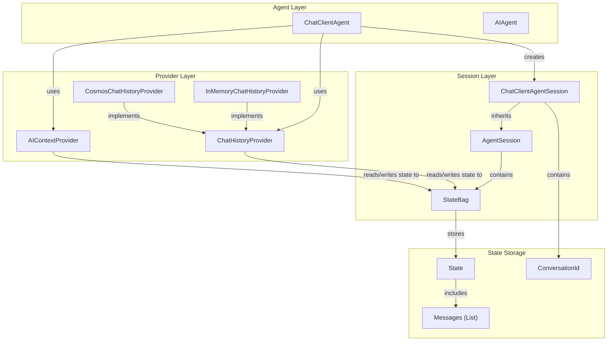
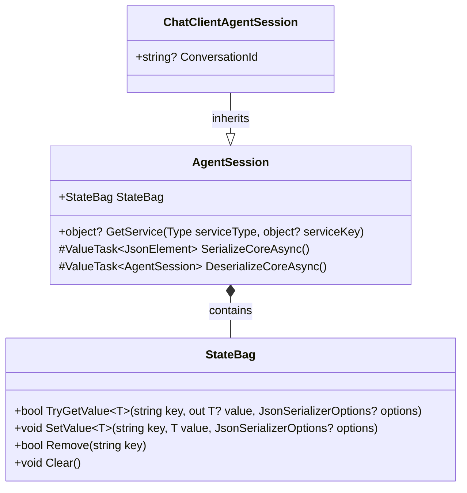
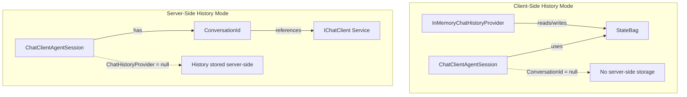
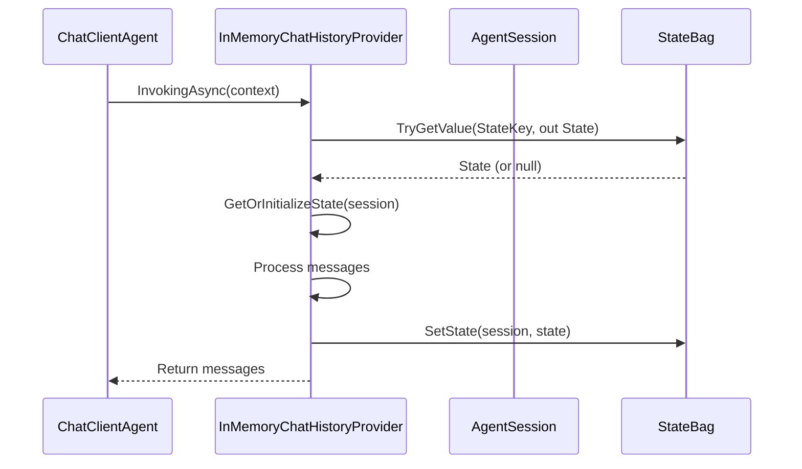
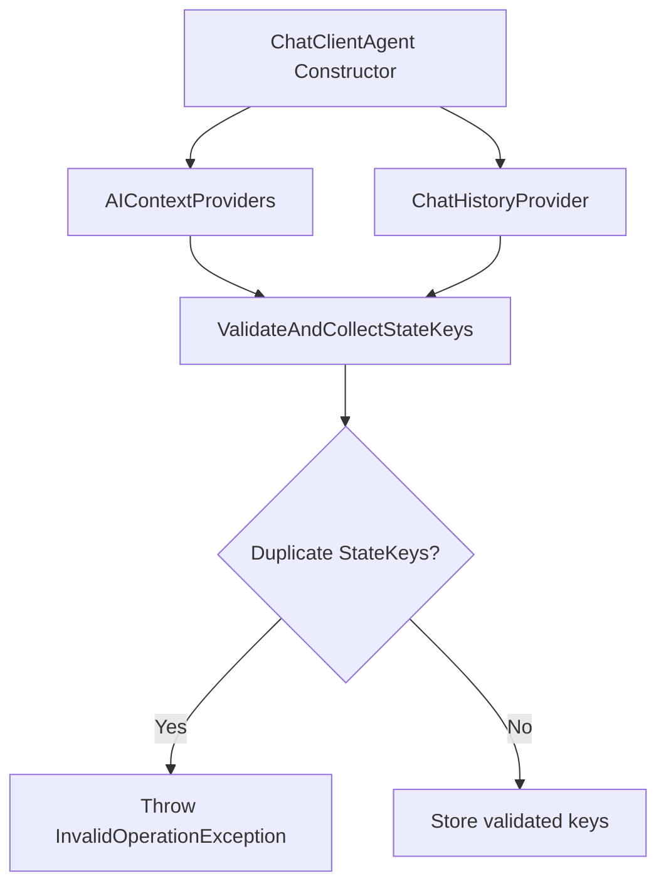

<!-- source: DeepWiki mcp.deepwiki.com · repo microsoft/agent-framework · extra page Session and State Management · fetched 2026-10-26 -->

# Session and State Management

Relevant source files

The following files were used as context for generating this wiki page:

- [dotnet/src/Microsoft.Agents.AI.Abstractions/AgentAbstractionsJsonUtilities.cs](dotnet/src/Microsoft.Agents.AI.Abstractions/AgentAbstractionsJsonUtilities.cs)
- [dotnet/src/Microsoft.Agents.AI.CosmosNoSql/CosmosChatHistoryProvider.cs](dotnet/src/Microsoft.Agents.AI.CosmosNoSql/CosmosChatHistoryProvider.cs)
- [dotnet/src/Microsoft.Agents.AI.CosmosNoSql/CosmosCheckpointStore.cs](dotnet/src/Microsoft.Agents.AI.CosmosNoSql/CosmosCheckpointStore.cs)
- [dotnet/src/Microsoft.Agents.AI.CosmosNoSql/CosmosDBChatExtensions.cs](dotnet/src/Microsoft.Agents.AI.CosmosNoSql/CosmosDBChatExtensions.cs)
- [dotnet/src/Microsoft.Agents.AI.CosmosNoSql/CosmosDBWorkflowExtensions.cs](dotnet/src/Microsoft.Agents.AI.CosmosNoSql/CosmosDBWorkflowExtensions.cs)
- [dotnet/src/Microsoft.Agents.AI.CosmosNoSql/CosmosOptionsHelper.cs](dotnet/src/Microsoft.Agents.AI.CosmosNoSql/CosmosOptionsHelper.cs)
- [dotnet/src/Microsoft.Agents.AI.CosmosNoSql/Microsoft.Agents.AI.CosmosNoSql.csproj](dotnet/src/Microsoft.Agents.AI.CosmosNoSql/Microsoft.Agents.AI.CosmosNoSql.csproj)
- [dotnet/src/Microsoft.Agents.AI.Hosting.OpenAI/ChatCompletions/ChatCompletionsJsonSerializerOptions.cs](dotnet/src/Microsoft.Agents.AI.Hosting.OpenAI/ChatCompletions/ChatCompletionsJsonSerializerOptions.cs)
- [dotnet/src/Microsoft.Agents.AI.Hosting.OpenAI/OpenAIHostingJsonUtilities.cs](dotnet/src/Microsoft.Agents.AI.Hosting.OpenAI/OpenAIHostingJsonUtilities.cs)
- [dotnet/src/Microsoft.Agents.AI.Mem0/Mem0Client.cs](dotnet/src/Microsoft.Agents.AI.Mem0/Mem0Client.cs)
- [dotnet/src/Microsoft.Agents.AI.Mem0/Mem0JsonUtilities.cs](dotnet/src/Microsoft.Agents.AI.Mem0/Mem0JsonUtilities.cs)
- [dotnet/src/Microsoft.Agents.AI/AgentJsonUtilities.cs](dotnet/src/Microsoft.Agents.AI/AgentJsonUtilities.cs)
- [dotnet/tests/Microsoft.Agents.AI.Abstractions.UnitTests/AIContextProviderTests.cs](dotnet/tests/Microsoft.Agents.AI.Abstractions.UnitTests/AIContextProviderTests.cs)
- [dotnet/tests/Microsoft.Agents.AI.Abstractions.UnitTests/AgentAbstractionsJsonUtilitiesTests.cs](dotnet/tests/Microsoft.Agents.AI.Abstractions.UnitTests/AgentAbstractionsJsonUtilitiesTests.cs)
- [dotnet/tests/Microsoft.Agents.AI.Abstractions.UnitTests/ChatHistoryProviderTests.cs](dotnet/tests/Microsoft.Agents.AI.Abstractions.UnitTests/ChatHistoryProviderTests.cs)
- [dotnet/tests/Microsoft.Agents.AI.Abstractions.UnitTests/InMemoryChatHistoryProviderTests.cs](dotnet/tests/Microsoft.Agents.AI.Abstractions.UnitTests/InMemoryChatHistoryProviderTests.cs)
- [dotnet/tests/Microsoft.Agents.AI.Abstractions.UnitTests/TestJsonSerializerContext.cs](dotnet/tests/Microsoft.Agents.AI.Abstractions.UnitTests/TestJsonSerializerContext.cs)
- [dotnet/tests/Microsoft.Agents.AI.CosmosNoSql.UnitTests/.editorconfig](dotnet/tests/Microsoft.Agents.AI.CosmosNoSql.UnitTests/.editorconfig)
- [dotnet/tests/Microsoft.Agents.AI.CosmosNoSql.UnitTests/CosmosChatHistoryProviderMaxBatchSizeTests.cs](dotnet/tests/Microsoft.Agents.AI.CosmosNoSql.UnitTests/CosmosChatHistoryProviderMaxBatchSizeTests.cs)
- [dotnet/tests/Microsoft.Agents.AI.CosmosNoSql.UnitTests/CosmosChatHistoryProviderTests.cs](dotnet/tests/Microsoft.Agents.AI.CosmosNoSql.UnitTests/CosmosChatHistoryProviderTests.cs)
- [dotnet/tests/Microsoft.Agents.AI.CosmosNoSql.UnitTests/CosmosCheckpointStoreTests.cs](dotnet/tests/Microsoft.Agents.AI.CosmosNoSql.UnitTests/CosmosCheckpointStoreTests.cs)
- [dotnet/tests/Microsoft.Agents.AI.CosmosNoSql.UnitTests/CosmosOptionsHelperTests.cs](dotnet/tests/Microsoft.Agents.AI.CosmosNoSql.UnitTests/CosmosOptionsHelperTests.cs)
- [dotnet/tests/Microsoft.Agents.AI.CosmosNoSql.UnitTests/Microsoft.Agents.AI.CosmosNoSql.UnitTests.csproj](dotnet/tests/Microsoft.Agents.AI.CosmosNoSql.UnitTests/Microsoft.Agents.AI.CosmosNoSql.UnitTests.csproj)
- [dotnet/tests/Microsoft.Agents.AI.Mem0.UnitTests/Mem0ClientTests.cs](dotnet/tests/Microsoft.Agents.AI.Mem0.UnitTests/Mem0ClientTests.cs)
- [dotnet/tests/Microsoft.Agents.AI.UnitTests/AgentJsonUtilitiesTests.cs](dotnet/tests/Microsoft.Agents.AI.UnitTests/AgentJsonUtilitiesTests.cs)

This document describes the session and state management architecture in the .NET implementation of the Microsoft Agent Framework. It covers how agent sessions store conversational state, manage chat history, handle provider state, and support serialization for persistence and resumption of agent interactions under ADR 0018 and related persistence consistency guidelines.

For information about the overall agent architecture, see [Agent and Chat Client Implementation](7.1.2). For details on context providers and chat history management, see [Context Providers](3.4.2) and [Chat History Providers](3.4.3).

## Architecture Overview

The session and state management system separates **state** (data that needs to be persisted) from **behavior** (logic that operates on that state). This separation enables standard serialization, supports multiple concurrent sessions with the same providers, and provides a clean abstraction for state persistence.

### Core Components and State Flow

The following mapping connects high-level concepts to their concrete code entities in the codebase:

| Natural Language Concept | Code Entity | Role |
| :--- | :--- | :--- |
| **Session Container** | `ChatClientAgentSession` [dotnet/src/Microsoft.Agents.AI/ChatClient/ChatClientAgent.cs:39-46]() | Holds `ConversationId` and the `StateBag`. |
| **State Storage** | `StateBag` [dotnet/src/Microsoft.Agents.AI.Abstractions/AgentSession.cs:11-30]() | A dictionary-backed store for serializable provider data. |
| **Persistence Key** | `StateKey` [dotnet/src/Microsoft.Agents.AI.Abstractions/InMemoryChatHistoryProvider.cs:45-51]() | A unique string identifying a provider's data within the bag. |
| **History Manager** | `ChatHistoryProvider` [dotnet/src/Microsoft.Agents.AI.CosmosNoSql/CosmosChatHistoryProvider.cs:41-43]() | Logic for reading/writing messages to the `StateBag`. |
| **Workflow State** | `CosmosCheckpointStore` [dotnet/src/Microsoft.Agents.AI.CosmosNoSql/CosmosCheckpointStore.cs:24-25]() | Specialized persistence for workflow supersteps and checkpoints. |

Sources: [dotnet/src/Microsoft.Agents.AI/ChatClient/ChatClientAgent.cs:39-46](), [dotnet/src/Microsoft.Agents.AI.Abstractions/AgentSession.cs:11-30](), [dotnet/src/Microsoft.Agents.AI.CosmosNoSql/CosmosChatHistoryProvider.cs:41-48]()

The key architectural decision is that **providers are stateless** and store all session-specific state in the `StateBag`. This means:
- The same provider instance can be safely used across multiple concurrent sessions.
- Sessions can be serialized using standard `System.Text.Json` mechanisms.
- State is always complete and valid after deserialization.

Sources: [dotnet/src/Microsoft.Agents.AI.Abstractions/AgentSession.cs:11-30](), [dotnet/src/Microsoft.Agents.AI.Abstractions/InMemoryChatHistoryProvider.cs:27-51]()

---

## AgentSession and StateBag

`AgentSession` is the base class for all session types and provides the foundational state storage mechanism through its `StateBag` property.

### AgentSession Class Structure

Sources: [dotnet/src/Microsoft.Agents.AI.Abstractions/AgentSession.cs:11-30]()

### StateBag Design

The `StateBag` is a strongly-typed property bag that stores provider state using string keys [dotnet/src/Microsoft.Agents.AI.Abstractions/AgentSession.cs:11-30](). Each provider declares one or more state keys to identify its state in the bag.

| Feature | Description |
| :--- | :--- |
| **Type Safety** | Generic `TryGetValue<T>` and `SetValue<T>` methods ensure type-safe access. |
| **JSON Serialization** | All state is serialized using `System.Text.Json`. |
| **Key-Based Isolation** | Providers use unique state keys to avoid conflicts. |
| **Validation** | State keys are validated at `ChatClientAgent` construction time. |

Sources: [dotnet/src/Microsoft.Agents.AI.Abstractions/AgentSession.cs:11-30](), [dotnet/src/Microsoft.Agents.AI/ChatClient/ChatClientAgent.cs:122-130]()

---

## ChatClientAgentSession

`ChatClientAgentSession` extends `AgentSession` to support both **client-side chat history** (via `StateBag`) and **server-side chat history** (via `ConversationId`) [dotnet/src/Microsoft.Agents.AI/ChatClient/ChatClientAgent.cs:39-46]().

### Two Session Modes

Sources: [dotnet/src/Microsoft.Agents.AI/ChatClient/ChatClientAgent.cs:39-46](), [dotnet/src/Microsoft.Agents.AI.Abstractions/InMemoryChatHistoryProvider.cs:27-51]()

### ConversationId Behavior

The presence of a `ConversationId` in the response from the underlying `IChatClient` indicates that the service manages chat history server-side:

1. **First Invocation**: If `IChatClient.GetResponseAsync` returns a response with a `ConversationId`, the framework stores it in the session [dotnet/src/Microsoft.Agents.AI/ChatClient/PerServiceCallChatHistoryPersistingChatClient.cs:127-130]().
2. **Subsequent Invocations**: The `ConversationId` is passed in `ChatOptions.ConversationId` to continue the conversation.
3. **Conflict Detection**: If both a `ChatHistoryProvider` and a `ConversationId` are present, the framework handles it based on configuration settings.

Sources: [dotnet/src/Microsoft.Agents.AI/ChatClient/PerServiceCallChatHistoryPersistingChatClient.cs:127-130]()

---

## State Management with Providers

Providers (both `ChatHistoryProvider` and `AIContextProvider`) store their state in the session's `StateBag` using declared state keys.

### Provider State Storage Pattern

Sources: [dotnet/src/Microsoft.Agents.AI.Abstractions/InMemoryChatHistoryProvider.cs:89-104]()

---

## State Key Validation

To prevent state corruption, `ChatClientAgent` validates that all state keys are unique across all configured providers during construction [dotnet/src/Microsoft.Agents.AI/ChatClient/ChatClientAgent.cs:122-130](). If two providers use the same key, an exception is thrown.

### State Key Conflict Detection

Sources: [dotnet/src/Microsoft.Agents.AI/ChatClient/ChatClientAgent.cs:122-130]()

---

## External State Persistence (Cosmos DB)

For production scenarios, state can be persisted to external stores like Azure Cosmos DB.

### CosmosChatHistoryProvider
The `CosmosChatHistoryProvider` implements `ChatHistoryProvider` to store messages in Cosmos DB [dotnet/src/Microsoft.Agents.AI.CosmosNoSql/CosmosChatHistoryProvider.cs:41-43]. It uses a `ProviderSessionState<State>` to manage conversation routing info such as `conversationId`, `tenantId`, and `userId` [dotnet/src/Microsoft.Agents.AI.CosmosNoSql/CosmosChatHistoryProvider.cs:43-46].

### CosmosCheckpointStore
Workflows utilize the `CosmosCheckpointStore` for persisting execution state [dotnet/src/Microsoft.Agents.AI.CosmosNoSql/CosmosCheckpointStore.cs:24-25]. It stores checkpoint documents containing the `SessionId`, `CheckpointId`, and serialized state values [dotnet/src/Microsoft.Agents.AI.CosmosNoSql/CosmosCheckpointStore.cs:116-124].

Sources: [dotnet/src/Microsoft.Agents.AI.CosmosNoSql/CosmosChatHistoryProvider.cs:41-48](), [dotnet/src/Microsoft.Agents.AI.CosmosNoSql/CosmosCheckpointStore.cs:116-124]()

---

## Serialization and Persistence

Session serialization separates state from behavior. Only the `StateBag` and `ConversationId` are serialized. `AgentJsonUtilities` and `AgentAbstractionsJsonUtilities` provide default options for this process, including source-generated contracts for Native AOT support [dotnet/src/Microsoft.Agents.AI/AgentJsonUtilities.cs:31-60](), [dotnet/src/Microsoft.Agents.AI.Abstractions/AgentAbstractionsJsonUtilities.cs:38-38]().

### Serialization Configuration

| File | Role |
| :--- | :--- |
| `AgentJsonUtilities.cs` | Defines `DefaultOptions` and chains `TypeInfoResolverChain`. [dotnet/src/Microsoft.Agents.AI/AgentJsonUtilities.cs:31-60]() |
| `AgentAbstractionsJsonUtilities.cs` | Provides serialization options for core abstraction types like `AgentSessionStateBag`. [dotnet/src/Microsoft.Agents.AI.Abstractions/AgentAbstractionsJsonUtilities.cs:78-87]() |

Sources: [dotnet/src/Microsoft.Agents.AI/AgentJsonUtilities.cs:31-60](), [dotnet/src/Microsoft.Agents.AI.Abstractions/AgentAbstractionsJsonUtilities.cs:38-87]()

### Persistence Consistency (ADR 0018)

**Per-Service-Call Persistence** addresses discrepancies between framework-managed and service-managed history when using tool-calling loops.

| Feature | Per-Run Persistence (Default) | Per-Service-Call Persistence |
| :--- | :--- | :--- |
| **Timing** | Persists at the end of the full agent run. | Persists after every individual service call in the loop. |
| **Consistency** | May include trailing tool results. | Matches service behavior exactly by naturally trimming trailing results. |
| **Crash Recovery** | Work lost if process crashes mid-loop. | Progress saved after each step. |
| **Component** | Handled by `ChatClientAgent`. | Handled by `PerServiceCallChatHistoryPersistingChatClient` [dotnet/src/Microsoft.Agents.AI/ChatClient/PerServiceCallChatHistoryPersistingChatClient.cs:57-57](). |

Sources: [dotnet/src/Microsoft.Agents.AI/ChatClient/PerServiceCallChatHistoryPersistingChatClient.cs:57-84]()

### Per-Service-Call Implementation

The `PerServiceCallChatHistoryPersistingChatClient` is a delegating chat client that implements per-call persistence. It is injected into the pipeline when `RequirePerServiceCallChatHistoryPersistence` is set to `true` in `ChatClientAgentOptions` [dotnet/src/Microsoft.Agents.AI/ChatClient/PerServiceCallChatHistoryPersistingChatClient.cs:17-22]().

**Functionality:**
- **Framework-managed history:** Before each call, it loads history via the configured `ChatHistoryProvider`. After the call, it persists new messages and returns a sentinel `ConversationId` (`LocalHistoryConversationId`) to signal downstream clients to treat the conversation as service-managed [dotnet/src/Microsoft.Agents.AI/ChatClient/PerServiceCallChatHistoryPersistingChatClient.cs:60-75]().
- **Service-managed history:** It updates the `ChatClientAgentSession.ConversationId` immediately after each call, ensuring the latest ID is captured [dotnet/src/Microsoft.Agents.AI/ChatClient/PerServiceCallChatHistoryPersistingChatClient.cs:127-130]().

Sources: [dotnet/src/Microsoft.Agents.AI/ChatClient/PerServiceCallChatHistoryPersistingChatClient.cs:75-136]()

---

