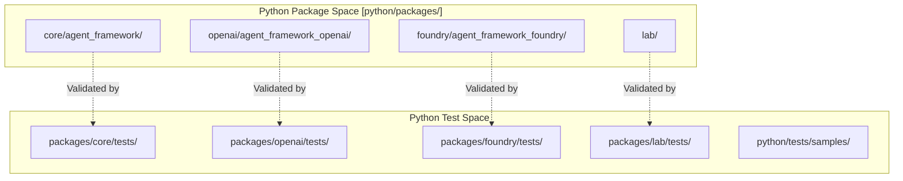
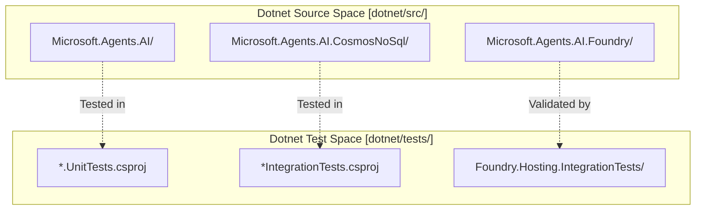
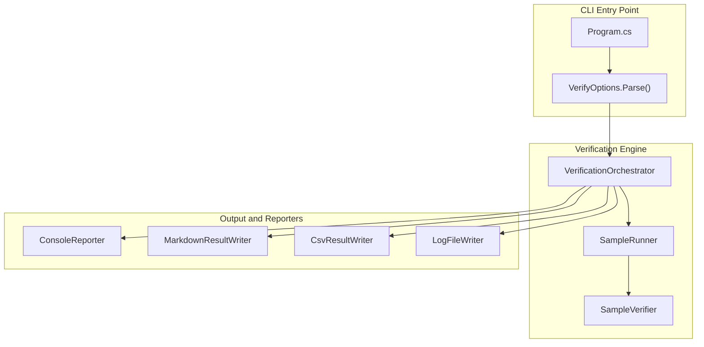
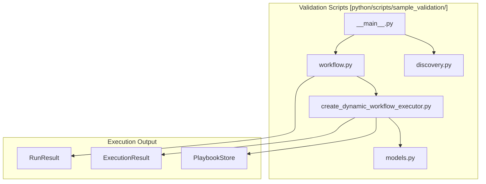

<!-- source: DeepWiki mcp.deepwiki.com · repo microsoft/agent-framework · extra page Testing Strategy · fetched 2026-10-26 -->

# Testing Strategy

Relevant source files

The following files were used as context for generating this wiki page:

- [.github/actions/sample-validation-setup/action.yml](.github/actions/sample-validation-setup/action.yml)
- [.github/workflows/dotnet-verify-samples.yml](.github/workflows/dotnet-verify-samples.yml)
- [.github/workflows/python-sample-validation.yml](.github/workflows/python-sample-validation.yml)
- [dotnet/.github/skills/verify-samples-tool/SKILL.md](dotnet/.github/skills/verify-samples-tool/SKILL.md)
- [dotnet/eng/verify-samples/AgentsSamples.cs](dotnet/eng/verify-samples/AgentsSamples.cs)
- [dotnet/eng/verify-samples/ConsoleReporter.cs](dotnet/eng/verify-samples/ConsoleReporter.cs)
- [dotnet/eng/verify-samples/CsvResultWriter.cs](dotnet/eng/verify-samples/CsvResultWriter.cs)
- [dotnet/eng/verify-samples/LogFileWriter.cs](dotnet/eng/verify-samples/LogFileWriter.cs)
- [dotnet/eng/verify-samples/MarkdownResultWriter.cs](dotnet/eng/verify-samples/MarkdownResultWriter.cs)
- [dotnet/eng/verify-samples/Program.cs](dotnet/eng/verify-samples/Program.cs)
- [dotnet/eng/verify-samples/SampleDefinition.cs](dotnet/eng/verify-samples/SampleDefinition.cs)
- [dotnet/eng/verify-samples/SampleRunner.cs](dotnet/eng/verify-samples/SampleRunner.cs)
- [dotnet/eng/verify-samples/SampleVerifier.cs](dotnet/eng/verify-samples/SampleVerifier.cs)
- [dotnet/eng/verify-samples/VerificationOrchestrator.cs](dotnet/eng/verify-samples/VerificationOrchestrator.cs)
- [dotnet/eng/verify-samples/VerifyOptions.cs](dotnet/eng/verify-samples/VerifyOptions.cs)
- [dotnet/samples/02-agents/AgentWithMemory/AgentWithMemory_Step06_MemoryUsingAgentMemory/ProductCatalog.cs](dotnet/samples/02-agents/AgentWithMemory/AgentWithMemory_Step06_MemoryUsingAgentMemory/ProductCatalog.cs)
- [dotnet/samples/02-agents/AgentWithMemory/AgentWithMemory_Step06_MemoryUsingAgentMemory/Program.cs](dotnet/samples/02-agents/AgentWithMemory/AgentWithMemory_Step06_MemoryUsingAgentMemory/Program.cs)
- [dotnet/samples/02-agents/AgentWithMemory/AgentWithMemory_Step06_MemoryUsingAgentMemory/README.md](dotnet/samples/02-agents/AgentWithMemory/AgentWithMemory_Step06_MemoryUsingAgentMemory/README.md)
- [dotnet/samples/02-agents/AgentWithMemory/AgentWithMemory_Step07_FileMemoryProvider/AgentWithMemory_Step07_FileMemoryProvider.csproj](dotnet/samples/02-agents/AgentWithMemory/AgentWithMemory_Step07_FileMemoryProvider/AgentWithMemory_Step07_FileMemoryProvider.csproj)
- [dotnet/samples/02-agents/AgentWithMemory/AgentWithMemory_Step07_FileMemoryProvider/Program.cs](dotnet/samples/02-agents/AgentWithMemory/AgentWithMemory_Step07_FileMemoryProvider/Program.cs)
- [dotnet/samples/02-agents/AgentWithMemory/AgentWithMemory_Step07_FileMemoryProvider/README.md](dotnet/samples/02-agents/AgentWithMemory/AgentWithMemory_Step07_FileMemoryProvider/README.md)
- [dotnet/samples/02-agents/AgentWithMemory/AgentWithMemory_Step08_MemoryUsingCosmosNoSql/AgentWithMemory_Step08_MemoryUsingCosmosNoSql.csproj](dotnet/samples/02-agents/AgentWithMemory/AgentWithMemory_Step08_MemoryUsingCosmosNoSql/AgentWithMemory_Step08_MemoryUsingCosmosNoSql.csproj)
- [dotnet/samples/02-agents/AgentWithMemory/AgentWithMemory_Step08_MemoryUsingCosmosNoSql/Program.cs](dotnet/samples/02-agents/AgentWithMemory/AgentWithMemory_Step08_MemoryUsingCosmosNoSql/Program.cs)
- [dotnet/samples/02-agents/AgentWithMemory/AgentWithMemory_Step08_MemoryUsingCosmosNoSql/README.md](dotnet/samples/02-agents/AgentWithMemory/AgentWithMemory_Step08_MemoryUsingCosmosNoSql/README.md)
- [dotnet/samples/02-agents/AgentWithMemory/AgentWithMemory_Step09_MemoryUsingMem0Sharp/README.md](dotnet/samples/02-agents/AgentWithMemory/AgentWithMemory_Step09_MemoryUsingMem0Sharp/README.md)
- [dotnet/samples/02-agents/AgentWithMemory/README.md](dotnet/samples/02-agents/AgentWithMemory/README.md)
- [dotnet/samples/AGENTS.md](dotnet/samples/AGENTS.md)
- [python/scripts/sample_validation/README.md](python/scripts/sample_validation/README.md)
- [python/scripts/sample_validation/__init__.py](python/scripts/sample_validation/__init__.py)
- [python/scripts/sample_validation/__main__.py](python/scripts/sample_validation/__main__.py)
- [python/scripts/sample_validation/const.py](python/scripts/sample_validation/const.py)
- [python/scripts/sample_validation/create_dynamic_workflow_executor.py](python/scripts/sample_validation/create_dynamic_workflow_executor.py)
- [python/scripts/sample_validation/discovery.py](python/scripts/sample_validation/discovery.py)
- [python/scripts/sample_validation/models.py](python/scripts/sample_validation/models.py)
- [python/scripts/sample_validation/report.py](python/scripts/sample_validation/report.py)
- [python/scripts/sample_validation/run_dynamic_validation_workflow_executor.py](python/scripts/sample_validation/run_dynamic_validation_workflow_executor.py)
- [python/scripts/sample_validation/workflow.py](python/scripts/sample_validation/workflow.py)

This document describes the comprehensive testing strategy employed in the Microsoft Agent Framework, covering test organization, execution workflows, coverage requirements, sample validation infrastructure, and matrix testing for both Python and .NET implementations.

---

## Purpose and Scope

The testing strategy ensures code quality, API stability, and end-to-end reliability through:

- **Multi-language Testing**: Parallel test execution pipelines for Python and .NET implementations.
- **Multi-level Testing**: Unit tests, integration tests, specialized lab tests, and automated sample verification.
- **Matrix Testing**: Cross-platform (Ubuntu, Windows) and cross-version (Python 3.10-3.14, .NET 8.0-10.0) compatibility validation.
- **Coverage Enforcement**: Minimum coverage thresholds (80% for .NET, 85% for Python) with automated reporting pipelines.
- **Sample Validation Infrastructure**: Dedicated automated tools (`verify-samples` for .NET and `sample_validation` for Python) that execute and verify sample code using deterministic checks and AI-powered output verification.

The strategy balances fast feedback loops during pull request validation with thorough, heavy integration and sample verification checks on merge or scheduled runs.

Sources: [.github/workflows/dotnet-verify-samples.yml:8-42](), [.github/workflows/python-sample-validation.yml:1-12]()

---

## Test Organization

### Python Test Organization

Python tests are organized in a monorepo structure with package-specific test directories and a shared test suite. The framework utilizes `uv` and `poe` (Poe the Poet) for task orchestration across the workspace.

**Python Code-to-Test Mapping**

Sources: [.github/workflows/python-merge-tests.yml:54-88](), [.github/workflows/python-lab-tests.yml:79-81](), [.github/workflows/python-tests.yml:45-48]()

Each package contains its own tests. For example, the OpenAI package integration tests are located in `packages/openai/tests` [.github/workflows/python-merge-tests.yml:166-167](), while experimental lab features have their own test runners in `packages/lab` [.github/workflows/python-lab-tests.yml:80-81](). Python sample validation is managed via script runners in `python/scripts/sample_validation/` [.github/workflows/python-sample-validation.yml:49]().

### .NET Test Organization

.NET tests follow a project-based structure separating unit and integration tests, often filtered via solution files (`.slnx`).

**Dotnet Code-to-Test Mapping**

Sources: [.github/workflows/dotnet-build-and-test.yml:48-78](), [.github/workflows/dotnet-build-and-test.yml:59-74](), [.github/workflows/dotnet-integration-tests.yml:89-90]()

The framework uses path filters to determine which test suites to execute based on modified components. For example, changes to `foundryHosting` trigger specific integration tests for hosting services and dependencies [.github/workflows/dotnet-build-and-test.yml:63-74](). Sample verification suites are organized under `dotnet/eng/verify-samples/` [.github/workflows/dotnet-verify-samples.yml:70-96]().

---

## Test Types and Levels

### Unit Tests

Unit tests execute on every pull request to test individual components in isolation without external service dependencies.

- **Python Unit Tests**: Executed via `uv run poe test -A`, which runs the workspace-wide test suite while explicitly omitting integration tests via `-m "not integration"` [.github/workflows/python-merge-tests.yml:119-120](). Matrix validation runs across Python 3.10 to 3.14 on Ubuntu and Windows [.github/workflows/python-tests.yml:22-25]().
- **.NET Unit Tests**: Discovered by searching for project files under `dotnet/` and building/testing via solution configurations [.github/workflows/dotnet-build-and-test.yml:131-137](). Code coverage is collected specifically for target framework `net10.0` [.github/workflows/dotnet-build-and-test.yml:21]().

### Integration Tests

Integration tests validate interactions with external AI providers and cloud services. These are excluded from standard fast PR runs to optimize CI runtime and cost, running instead on `merge_group`, schedules, or manual triggers [.github/workflows/python-merge-tests.yml:8-15](), [.github/workflows/python-integration-tests.yml:12-18]().

| Provider | Python Trigger Path | .NET Trigger Path |
| :--- | :--- | :--- |
| **OpenAI** | `python/packages/openai/**` | `dotnet/src/Microsoft.Agents.AI.OpenAI/**` |
| **Azure AI / Foundry** | `python/packages/foundry/**` | `dotnet/src/Microsoft.Agents.AI.Foundry/**` |
| **Cosmos DB** | `python/packages/azure-cosmos/**` | `dotnet/src/Microsoft.Agents.AI.CosmosNoSql/**` |

Sources: [.github/workflows/python-merge-tests.yml:59-88](), [.github/workflows/dotnet-build-and-test.yml:51-73]()

### Sample Validation and Verification Tooling

A core component of the framework's integration and regression testing is automated sample verification. Samples are treated as living integration tests to ensure that getting-started guides, agent code, and workflow examples remain functional across releases.

- **.NET Sample Verification (`verify-samples`)**: Located in `dotnet/eng/verify-samples/`, this automated utility builds and runs sample projects (e.g., `01-get-started`, `02-agents`, `03-workflows`) [dotnet/eng/verify-samples/Program.cs:3-17](), [dotnet/eng/verify-samples/VerifyOptions.cs:44-50](). It supports:
  - **Deterministic Checks (`MustContain`)**: Verifies exact string markers and required section outputs [dotnet/.github/skills/verify-samples-tool/SKILL.md:90-91]().
  - **AI-Powered Verification (`ExpectedOutputDescription`)**: Employs an `AIAgent` verifier instance initialized via `AIProjectClient` to semantically evaluate stdout/stderr against natural language expectations [dotnet/eng/verify-samples/Program.cs:46-74]().
  - **Interactive Inputs**: Feeds predefined console inputs (`Inputs`) with configurable delays (`InputDelayMs`) for interactive agent loops [dotnet/.github/skills/verify-samples-tool/SKILL.md:108-111]().
  - **Artifact Generation**: Outputs detailed sequential logs (`results.log`), CSV summaries (`results.csv`), and Markdown reports (`results.md`) suitable for GitHub job summaries [.github/workflows/dotnet-verify-samples.yml:81-135]().

**Dotnet Sample Verification Execution Architecture**

Sources: [dotnet/eng/verify-samples/Program.cs:31-127](), [dotnet/eng/verify-samples/VerifyOptions.cs:56-118]()

- **Python Sample Validation (`sample_validation`)**: Located in `python/scripts/sample_validation/`, this utility validates Python sample subdirectories (e.g., `01-get-started`, `02-agents`, `harness`) [.github/workflows/python-sample-validation.yml:49-163](). It uses dynamic workflow executors and playbook records to test sample execution deterministically or via AI-assisted validation [python/scripts/sample_validation/create_dynamic_workflow_executor.py:46-126]().

**Python Sample Validation Code Space Bridge**

Sources: [.github/workflows/python-sample-validation.yml:49-50](), [python/scripts/sample_validation/create_dynamic_workflow_executor.py:22-38]()

---

## Coverage Requirements

### Thresholds and Enforcement

The framework enforces strict code coverage requirements to maintain quality standards:
- **.NET Threshold**: Minimum 80% coverage requirement [.github/workflows/dotnet-build-and-test.yml:20]().
- **Python Threshold**: Minimum 85% coverage requirement [.github/workflows/python-test-coverage.yml:16]().

### Reporting Pipeline

1. **Collection**: Test runs execute with coverage flags (e.g., `uv run poe test -A -C`) yielding XML coverage reports [.github/workflows/python-test-coverage.yml:44]().
2. **Persistence**: PR numbers are stored in artifact files to preserve context across asynchronous `workflow_run` triggers [.github/workflows/python-test-coverage.yml:31-33]().
3. **Posting**: Reports are posted directly to Pull Requests via dedicated actions such as `MishaKav/pytest-coverage-comment` [.github/workflows/python-test-coverage-report.yml:58-70]().

---

## Matrix Testing

The framework utilizes GitHub Actions strategy matrices to ensure multi-environment compatibility.

### .NET Matrix
- **Operating Systems**: `ubuntu-latest`, `windows-latest` [.github/workflows/dotnet-build-and-test.yml:106-109]().
- **Frameworks**: `net10.0`, `net9.0`, `net8.0`, and `net472` [.github/workflows/dotnet-build-and-test.yml:106-109]().
- **Configurations**: `Debug` and `Release` [.github/workflows/dotnet-build-and-test.yml:106-109]().

### Python Matrix
- **Python Versions**: `3.10`, `3.11`, `3.12`, `3.13`, `3.14` [.github/workflows/python-tests.yml:23]().
- **Operating Systems**: `ubuntu-latest`, `windows-latest` [.github/workflows/python-tests.yml:25]().

Sources: [.github/workflows/dotnet-build-and-test.yml:106-109](), [.github/workflows/python-tests.yml:22-25]()

---

## Code Quality Standards

Static analysis, linting, and formatting checks complement functional testing:

- **Python Quality Tools**: Pre-commit hooks via `j178/prek-action` [.github/workflows/python-code-quality.yml:49-55](), static type checking with Pyright (`poe check-packages`) [.github/workflows/python-code-quality.yml:82-83](), type checking with `mypy` [.github/workflows/python-code-quality.yml:142-143](), and markdown code snippet linting (`poe markdown-code-lint`) [.github/workflows/python-code-quality.yml:114]().
- **.NET Quality Tools**: `dotnet format` verification in CI [.github/workflows/dotnet-format.yml:93-102](), alongside automated CodeQL security scanning for C# and Python [.github/workflows/codeql-analysis.yml:27]().

Sources: [.github/workflows/python-code-quality.yml:49-143](), [.github/workflows/dotnet-format.yml:93-102]()

---

## Release Process and Asset Validation

Automated workflows ensure published artifacts are valid and installable:
- **Package Install Check**: Temporary .NET console applications verify that `dotnet pack` outputs install and reference cleanly [.github/workflows/dotnet-build-and-test.yml:138-154]().
- **Python Release Assets**: Workflows trigger on version tags (e.g., `python-<version>` or `python-<package>-<version>`) to build distributions using `uv run poe build` [.github/workflows/python-release.yml:36-126]().

Sources: [.github/workflows/dotnet-verify-samples.yml:1-137](), [dotnet/eng/verify-samples/VerifyOptions.cs:56-118](), [dotnet/eng/verify-samples/Program.cs:31-127](), [.github/workflows/python-sample-validation.yml:1-169]()

---

