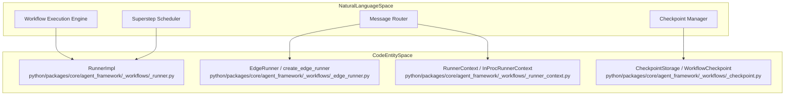
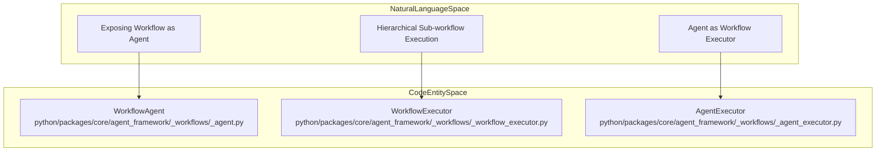

<!-- source: DeepWiki mcp.deepwiki.com · repo microsoft/agent-framework · extra page Workflow Engine Architecture · fetched 2026-10-26 -->

# Workflow Engine Architecture

<details>
<summary>Relevant source files</summary>

The following files were used as context for generating this wiki page:

- [python/packages/core/agent_framework/_workflows/__init__.py](python/packages/core/agent_framework/_workflows/__init__.py)
- [python/packages/core/agent_framework/_workflows/_agent.py](python/packages/core/agent_framework/_workflows/_agent.py)
- [python/packages/core/agent_framework/_workflows/_agent_executor.py](python/packages/core/agent_framework/_workflows/_agent_executor.py)
- [python/packages/core/agent_framework/_workflows/_checkpoint.py](python/packages/core/agent_framework/_workflows/_checkpoint.py)
- [python/packages/core/agent_framework/_workflows/_checkpoint_encoding.py](python/packages/core/agent_framework/_workflows/_checkpoint_encoding.py)
- [python/packages/core/agent_framework/_workflows/_const.py](python/packages/core/agent_framework/_workflows/_const.py)
- [python/packages/core/agent_framework/_workflows/_events.py](python/packages/core/agent_framework/_workflows/_events.py)
- [python/packages/core/agent_framework/_workflows/_executor.py](python/packages/core/agent_framework/_workflows/_executor.py)
- [python/packages/core/agent_framework/_workflows/_function_executor.py](python/packages/core/agent_framework/_workflows/_function_executor.py)
- [python/packages/core/agent_framework/_workflows/_request_info_mixin.py](python/packages/core/agent_framework/_workflows/_request_info_mixin.py)
- [python/packages/core/agent_framework/_workflows/_runner.py](python/packages/core/agent_framework/_workflows/_runner.py)
- [python/packages/core/agent_framework/_workflows/_runner_context.py](python/packages/core/agent_framework/_workflows/_runner_context.py)
- [python/packages/core/agent_framework/_workflows/_typing_utils.py](python/packages/core/agent_framework/_workflows/_typing_utils.py)
- [python/packages/core/agent_framework/_workflows/_validation.py](python/packages/core/agent_framework/_workflows/_validation.py)
- [python/packages/core/agent_framework/_workflows/_workflow.py](python/packages/core/agent_framework/_workflows/_workflow.py)
- [python/packages/core/agent_framework/_workflows/_workflow_context.py](python/packages/core/agent_framework/_workflows/_workflow_context.py)
- [python/packages/core/agent_framework/_workflows/_workflow_executor.py](python/packages/core/agent_framework/_workflows/_workflow_executor.py)
- [python/packages/core/tests/workflow/test_agent_executor.py](python/packages/core/tests/workflow/test_agent_executor.py)
- [python/packages/core/tests/workflow/test_agent_executor_tool_calls.py](python/packages/core/tests/workflow/test_agent_executor_tool_calls.py)
- [python/packages/core/tests/workflow/test_checkpoint.py](python/packages/core/tests/workflow/test_checkpoint.py)
- [python/packages/core/tests/workflow/test_checkpoint_decode.py](python/packages/core/tests/workflow/test_checkpoint_decode.py)
- [python/packages/core/tests/workflow/test_checkpoint_encode.py](python/packages/core/tests/workflow/test_checkpoint_encode.py)
- [python/packages/core/tests/workflow/test_checkpoint_orchestrations_deserialization.py](python/packages/core/tests/workflow/test_checkpoint_orchestrations_deserialization.py)
- [python/packages/core/tests/workflow/test_checkpoint_unrestricted_pickle.py](python/packages/core/tests/workflow/test_checkpoint_unrestricted_pickle.py)
- [python/packages/core/tests/workflow/test_checkpoint_validation.py](python/packages/core/tests/workflow/test_checkpoint_validation.py)
- [python/packages/core/tests/workflow/test_executor.py](python/packages/core/tests/workflow/test_executor.py)
- [python/packages/core/tests/workflow/test_executor_future.py](python/packages/core/tests/workflow/test_executor_future.py)
- [python/packages/core/tests/workflow/test_function_executor.py](python/packages/core/tests/workflow/test_function_executor.py)
- [python/packages/core/tests/workflow/test_function_executor_future.py](python/packages/core/tests/workflow/test_function_executor_future.py)
- [python/packages/core/tests/workflow/test_request_info_event_rehydrate.py](python/packages/core/tests/workflow/test_request_info_event_rehydrate.py)
- [python/packages/core/tests/workflow/test_request_info_mixin.py](python/packages/core/tests/workflow/test_request_info_mixin.py)
- [python/packages/core/tests/workflow/test_runner.py](python/packages/core/tests/workflow/test_runner.py)
- [python/packages/core/tests/workflow/test_sub_workflow.py](python/packages/core/tests/workflow/test_sub_workflow.py)
- [python/packages/core/tests/workflow/test_typing_utils.py](python/packages/core/tests/workflow/test_typing_utils.py)
- [python/packages/core/tests/workflow/test_validation.py](python/packages/core/tests/workflow/test_validation.py)
- [python/packages/core/tests/workflow/test_workflow.py](python/packages/core/tests/workflow/test_workflow.py)
- [python/packages/core/tests/workflow/test_workflow_agent.py](python/packages/core/tests/workflow/test_workflow_agent.py)
- [python/packages/core/tests/workflow/test_workflow_context.py](python/packages/core/tests/workflow/test_workflow_context.py)
- [python/packages/core/tests/workflow/test_workflow_kwargs.py](python/packages/core/tests/workflow/test_workflow_kwargs.py)

</details>


## Purpose and Scope

This document details the internal architecture of the Python workflow execution engine in the Microsoft Agent Framework (`agent_framework`), focusing on how workflows are executed, messages are routed between executors, and events are processed. It covers the `RunnerImpl` superstep scheduler, `RunnerContext`, message routing via `EdgeRunner` implementations, event streaming pipelines, checkpoint persistence via `WorkflowCheckpoint` and restricted deserialization (`_RestrictedUnpickler`), and hierarchical compositions like `WorkflowAgent`, `WorkflowExecutor`, and `AgentExecutor`.

For information about building workflows and defining executors, see [Workflow Fundamentals](4.1). For checkpoint storage implementations, see [Workflow Execution and Checkpointing](4.4). For the .NET workflow implementation, see [.NET Implementation](7.1).

**Sources:** `[python/packages/core/agent_framework/_workflows/_runner.py:44-86]()`, `[python/packages/core/agent_framework/_workflows/_workflow.py:129-184]()`

---

## Overview

The workflow engine executes directed graphs of executors using a Pregel-like superstep model. The `RunnerImpl` coordinates executor invocations, routes messages through edge groups, emits events, and manages checkpoints. All execution occurs through the `RunnerContext` protocol, which abstracts message passing, event streaming, and optional checkpoint storage.

Title: "WorkflowEngineArchitectureOverview"


**Sources:** `[python/packages/core/agent_framework/_workflows/_runner.py:44-86]()`, `[python/packages/core/agent_framework/_workflows/_edge_runner.py:18-25]()`, `[python/packages/core/agent_framework/_workflows/_runner_context.py:99-130]()`, `[python/packages/core/agent_framework/_workflows/_checkpoint.py:34-146]()`

---

## Core Components

### RunnerImpl

The `RunnerImpl` class orchestrates workflow execution by running supersteps until convergence (no more messages). It is initialized with edge groups, executors, a shared state, and a runner context.

Title: "RunnerInitializationArchitecture"
```mermaid
graph TB
    subgraph "Runner_Initialization"
        Runner[""RunnerImpl<br/>python/packages/core/agent_framework/_workflows/_runner.py""]
        EdgeGroups[""Sequence[EdgeGroup]<br/>Workflow topology""]
        Executors[""dict[str, Executor]<br/>Executor instances""]
        State[""State<br/>Shared workflow state""]
        Context[""RunnerContext<br/>Message & event handling""]
    end
    
    subgraph "Runtime_Components"
        EdgeRunners[""List[EdgeRunner]<br/>Created from edge groups""]
        EdgeRunnerMap[""dict[str, List[EdgeRunner]]<br/>Source ID → edge runners""]
        IterationCount[""_iteration: int<br/>Current superstep""]
        WorkflowName[""_workflow_name: str""]
    end
    
    EdgeGroups --> Runner
    Executors --> Runner
    State --> Runner
    Context --> Runner
    
    Runner --> EdgeRunners
    Runner --> EdgeRunnerMap
    Runner --> IterationCount
    Runner --> WorkflowName
```

**Sources:** `[python/packages/core/agent_framework/_workflows/_runner.py:44-86]()`

The `RunnerImpl.__init__()` method creates `EdgeRunner` instances from edge groups and builds a mapping from source executor IDs to their associated edge runners for efficient message routing.

**Key attributes:**
- `_executors`: Dictionary mapping executor IDs to executor instances `[python/packages/core/agent_framework/_workflows/_runner.py:69-70]()`
- `_edge_runners`: List of `EdgeRunner` instances for message routing `[python/packages/core/agent_framework/_workflows/_runner.py:70-71]()`
- `_edge_runner_map`: Maps source executor IDs to their outgoing edge runners `[python/packages/core/agent_framework/_workflows/_runner.py:71-72]()`
- `_ctx`: The `RunnerContext` for message passing and event emission `[python/packages/core/agent_framework/_workflows/_runner.py:75-75]()`
- `_iteration`: Current superstep counter `[python/packages/core/agent_framework/_workflows/_runner.py:80-80]()`
- `_max_iterations`: Maximum allowed supersteps before raising `WorkflowConvergenceException` `[python/packages/core/agent_framework/_workflows/_runner.py:81-81]()`
- `_state`: Shared `State` instance for workflow-wide data `[python/packages/core/agent_framework/_workflows/_runner.py:82-82]()`

---

### RunnerContext Protocol

The `RunnerContext` protocol defines the interface for message passing, event emission, and checkpoint operations. The primary implementation is `InProcRunnerContext` for local execution.

Title: "RunnerContextProtocol"
```mermaid
graph LR
    subgraph "RunnerContext_Protocol"
        Protocol[""RunnerContext<br/>(protocol)""]
        SendMsg[""send_message(msg)""]
        DrainMsg[""drain_messages()""]
        AddEvent[""add_event(event)""]
        DrainEvents[""drain_events()""]
        NextEvent[""next_event()""]
    end
    
    subgraph "InProcRunnerContext_Implementation"
        Impl[""InProcRunnerContext<br/>python/packages/core/agent_framework/_workflows/_runner_context.py""]
        MsgDict[""_messages: dict[str, list[WorkflowMessage]]""]
        EventQueue[""_event_queue: asyncio.Queue[WorkflowEvent]""]
        PendingReq[""_pending_request_info_events: dict[str, WorkflowEvent]""]
    end
    
    Protocol -.implements.-> Impl
    Impl --> MsgDict
    Impl --> EventQueue
    Impl --> PendingReq
```

**Sources:** `[python/packages/core/agent_framework/_workflows/_runner_context.py:99-156]()`

---

## Superstep Execution Model

### Convergence Loop

The `RunnerImpl.run_until_convergence()` method executes supersteps until the workflow becomes idle (no messages remain).

Title: "WorkflowConvergenceLoop"
```mermaid
graph TD
    Start[""run_until_convergence()""] --> PreLoop[""Emit pre-loop events""]
    PreLoop --> IterLoop{""iteration < max_iterations?""}
    
    IterLoop -->|Yes| EmitStart[""Emit superstep_started event""]
    EmitStart --> RunIter[""asyncio.create_task(_run_iteration())""]
    RunIter --> PollEvents[""Poll for events with timeout<br/>while task not done""]
    PollEvents --> YieldEvents[""Yield events to caller""]
    YieldEvents --> AwaitIter[""await iteration_task""]
    AwaitIter --> DrainStraggler[""Drain straggler events""]
    DrainStraggler --> CommitState[""_state.commit()""]
    CommitState --> CreateCP[""Create checkpoint if enabled""]
    CreateCP --> EmitComplete[""Emit superstep_completed event""]
    EmitComplete --> CheckMsgs{""has_messages?""}
    
    CheckMsgs -->|Yes| IncIter[""_iteration += 1""]
    IncIter --> IterLoop
    CheckMsgs -->|No| Converged[""Workflow converged""]
    
    IterLoop -->|No| CheckMaxIter{""has_messages?""}
    CheckMaxIter -->|Yes| MaxIterError[""Raise WorkflowConvergenceException""]
    CheckMaxIter -->|No| Converged
    
    Converged --> End[""Return""]
    MaxIterError --> End
```

**Sources:** `[python/packages/core/agent_framework/_workflows/_runner.py:108-167]()`

---

## Message Routing and Executors

### Executor Invocation Lifecycle

Executors receive messages through decorated handler methods (`@handler`), process them within a `WorkflowContext`, and emit output messages or workflow outputs.

Title: "ExecutorExecutionLifecycle"
```mermaid
graph TD
    Start[""executor.execute(message, source_ids, state, ctx)""]
    
    Start --> Span[""Create processing span (OpenTelemetry)""]
    Span --> FindHandler[""_find_handler(message)""]
    FindHandler --> UnwrapMsg{""message is WorkflowMessage?""}
    UnwrapMsg -->|Yes| Extract[""message = message.data""]
    UnwrapMsg -->|No| UseRaw[""Use message directly""]
    
    Extract --> CreateCtx[""Create WorkflowContext(executor, source_ids, state, ctx)""]
    UseRaw --> CreateCtx
    
    CreateCtx --> EmitInvoke[""Emit executor_invoked event""]
    EmitInvoke --> TryHandler[""await handler(message, context)""]
    
    TryHandler --> Success{""Success?""}
    Success -->|Yes| EmitComplete[""Emit executor_completed event""]
    Success -->|No| CatchError[""Catch exception""]
    
    CatchError --> EmitFailed[""Emit executor_failed event""]
    EmitFailed --> Reraise[""raise""]
```

**Sources:** `[python/packages/core/agent_framework/_workflows/_executor.py:218-293]()`

---

## Checkpointing and State Persistence

Checkpoints capture complete workflow state at superstep boundaries using `WorkflowCheckpoint` objects, persisted via `CheckpointStorage` backends (such as `InMemoryCheckpointStorage` or `FileCheckpointStorage`).

Deserialization uses `_RestrictedUnpickler` in `_checkpoint_encoding.py` to enforce an allowlist of permitted classes during unpickling, mitigating security risks associated with arbitrary pickle execution.

Title: "CheckpointingAndRestrictedUnpickler"
```mermaid
graph TB
    subgraph "Checkpoint_Entities"
        Checkpoint[""WorkflowCheckpoint<br/>python/packages/core/agent_framework/_workflows/_checkpoint.py""]
        Storage[""CheckpointStorage (Protocol)<br/>save() / load()""]
    end
    
    subgraph "Security_Layer"
        Decoder[""decode_checkpoint_value()""]
        Unpickler[""_RestrictedUnpickler<br/>python/packages/core/agent_framework/_workflows/_checkpoint_encoding.py""]
        Allowlist[""_BUILTIN_ALLOWED_TYPE_KEYS & allowed_types""]
    end
    
    Checkpoint --> Storage
    Storage --> Decoder
    Decoder --> Unpickler
    Unpickler --> Allowlist
```

**Sources:** `[python/packages/core/agent_framework/_workflows/_checkpoint.py:34-162]()`, `[python/packages/core/agent_framework/_workflows/_checkpoint_encoding.py:11-174]()`

---

## Agent and Workflow Composition

The framework supports wrapping workflows and agents via composite executors:
- `WorkflowAgent`: Wraps a `Workflow` as a `BaseAgent`, converting workflow output and `request_info` events into `AgentResponse` and `AgentResponseUpdate` instances (`[python/packages/core/agent_framework/_workflows/_agent.py:55-148]()`).
- `WorkflowExecutor`: Wraps a sub-workflow within an executor for parent-child workflow composition (`[python/packages/core/agent_framework/_workflows/_workflow_executor.py:152-169]()`).
- `AgentExecutor`: Wraps an agent as an executor within a workflow (`[python/packages/core/agent_framework/_workflows/_agent_executor.py:152-168]()`).

Title: "AgentAndWorkflowCompositionBridge"


**Sources:** `[python/packages/core/agent_framework/_workflows/_agent.py:55-148]()`, `[python/packages/core/agent_framework/_workflows/_workflow_executor.py:152-169]()`, `[python/packages/core/agent_framework/_workflows/_agent_executor.py:152-168]()`

---

