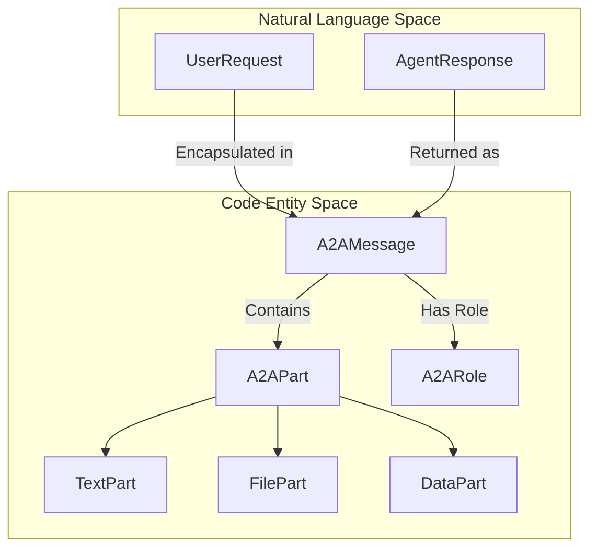
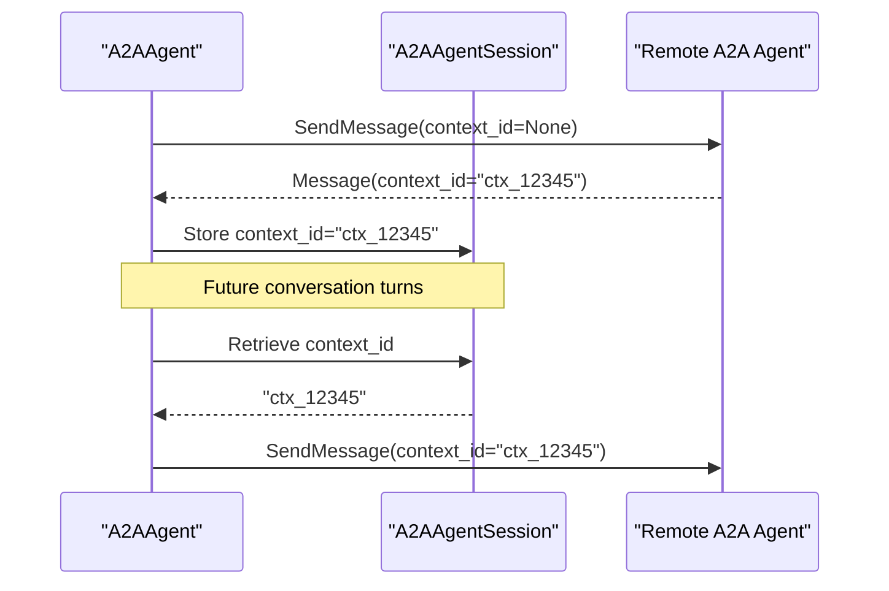
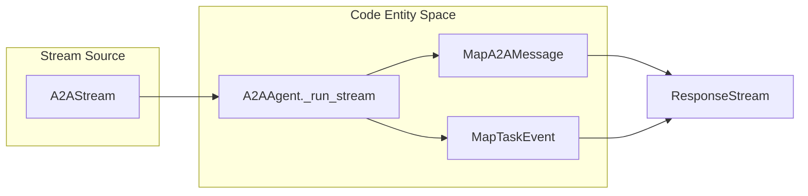
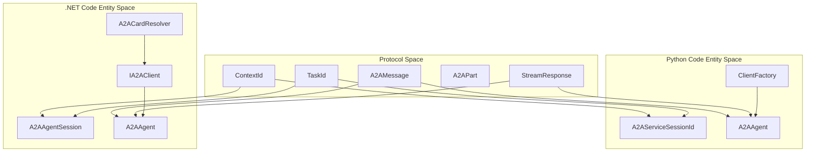

<!-- source: DeepWiki mcp.deepwiki.com · repo microsoft/agent-framework · extra page A2A Protocol Overview · fetched 2026-10-26 -->

# A2A Protocol Overview

Relevant source files

The following files were used as context for generating this wiki page:

- [dotnet/src/Microsoft.Agents.AI.A2A/A2AAgent.cs](dotnet/src/Microsoft.Agents.AI.A2A/A2AAgent.cs)
- [dotnet/src/Microsoft.Agents.AI.A2A/A2AAgentOptions.cs](dotnet/src/Microsoft.Agents.AI.A2A/A2AAgentOptions.cs)
- [dotnet/src/Microsoft.Agents.AI.A2A/Extensions/A2AAgentCardExtensions.cs](dotnet/src/Microsoft.Agents.AI.A2A/Extensions/A2AAgentCardExtensions.cs)
- [dotnet/src/Microsoft.Agents.AI.A2A/Extensions/A2ACardResolverExtensions.cs](dotnet/src/Microsoft.Agents.AI.A2A/Extensions/A2ACardResolverExtensions.cs)
- [dotnet/src/Microsoft.Agents.AI.A2A/Extensions/A2AClientExtensions.cs](dotnet/src/Microsoft.Agents.AI.A2A/Extensions/A2AClientExtensions.cs)
- [dotnet/src/Microsoft.Agents.AI.A2A/Microsoft.Agents.AI.A2A.csproj](dotnet/src/Microsoft.Agents.AI.A2A/Microsoft.Agents.AI.A2A.csproj)
- [dotnet/src/Microsoft.Agents.AI.Hosting.A2A.AspNetCore/Microsoft.Agents.AI.Hosting.A2A.AspNetCore.csproj](dotnet/src/Microsoft.Agents.AI.Hosting.A2A.AspNetCore/Microsoft.Agents.AI.Hosting.A2A.AspNetCore.csproj)
- [dotnet/src/Microsoft.Agents.AI.Hosting.A2A/Microsoft.Agents.AI.Hosting.A2A.csproj](dotnet/src/Microsoft.Agents.AI.Hosting.A2A/Microsoft.Agents.AI.Hosting.A2A.csproj)
- [dotnet/src/Microsoft.Agents.AI.Hosting.OpenAI/Microsoft.Agents.AI.Hosting.OpenAI.csproj](dotnet/src/Microsoft.Agents.AI.Hosting.OpenAI/Microsoft.Agents.AI.Hosting.OpenAI.csproj)
- [dotnet/src/Microsoft.Agents.AI.Hosting/Microsoft.Agents.AI.Hosting.csproj](dotnet/src/Microsoft.Agents.AI.Hosting/Microsoft.Agents.AI.Hosting.csproj)
- [dotnet/tests/Microsoft.Agents.AI.A2A.UnitTests/A2AAgentTests.cs](dotnet/tests/Microsoft.Agents.AI.A2A.UnitTests/A2AAgentTests.cs)
- [dotnet/tests/Microsoft.Agents.AI.A2A.UnitTests/Extensions/A2AAgentCardExtensionsTests.cs](dotnet/tests/Microsoft.Agents.AI.A2A.UnitTests/Extensions/A2AAgentCardExtensionsTests.cs)
- [dotnet/tests/Microsoft.Agents.AI.A2A.UnitTests/Extensions/A2ACardResolverExtensionsTests.cs](dotnet/tests/Microsoft.Agents.AI.A2A.UnitTests/Extensions/A2ACardResolverExtensionsTests.cs)
- [dotnet/tests/Microsoft.Agents.AI.A2A.UnitTests/Extensions/A2AClientExtensionsTests.cs](dotnet/tests/Microsoft.Agents.AI.A2A.UnitTests/Extensions/A2AClientExtensionsTests.cs)
- [dotnet/tests/Microsoft.Agents.AI.A2A.UnitTests/Microsoft.Agents.AI.A2A.UnitTests.csproj](dotnet/tests/Microsoft.Agents.AI.A2A.UnitTests/Microsoft.Agents.AI.A2A.UnitTests.csproj)
- [dotnet/tests/Microsoft.Agents.AI.Hosting.AGUI.AspNetCore.IntegrationTests/BasicStreamingTests.cs](dotnet/tests/Microsoft.Agents.AI.Hosting.AGUI.AspNetCore.IntegrationTests/BasicStreamingTests.cs)
- [dotnet/tests/Microsoft.Agents.AI.Hosting.AGUI.AspNetCore.IntegrationTests/ForwardedPropertiesTests.cs](dotnet/tests/Microsoft.Agents.AI.Hosting.AGUI.AspNetCore.IntegrationTests/ForwardedPropertiesTests.cs)
- [dotnet/tests/Microsoft.Agents.AI.Hosting.AGUI.AspNetCore.IntegrationTests/SharedStateTests.cs](dotnet/tests/Microsoft.Agents.AI.Hosting.AGUI.AspNetCore.IntegrationTests/SharedStateTests.cs)
- [dotnet/tests/Microsoft.Agents.AI.Hosting.AGUI.AspNetCore.UnitTests/AGUIEndpointRouteBuilderExtensionsTests.cs](dotnet/tests/Microsoft.Agents.AI.Hosting.AGUI.AspNetCore.UnitTests/AGUIEndpointRouteBuilderExtensionsTests.cs)
- [dotnet/tests/Microsoft.Agents.AI.Workflows.UnitTests/TestEchoAgent.cs](dotnet/tests/Microsoft.Agents.AI.Workflows.UnitTests/TestEchoAgent.cs)
- [python/packages/a2a/agent_framework_a2a/__init__.py](python/packages/a2a/agent_framework_a2a/__init__.py)
- [python/packages/a2a/agent_framework_a2a/_agent.py](python/packages/a2a/agent_framework_a2a/_agent.py)
- [python/packages/a2a/tests/test_a2a_agent.py](python/packages/a2a/tests/test_a2a_agent.py)

## Purpose and Scope

This document specifies the Agent-to-Agent (A2A) protocol used in the Microsoft Agent Framework to enable communication between AI agents. It focuses on:

- The A2A protocol specification and message formats.
- How agents maintain conversation context.
- Task management, including long-running and asynchronous tasks.
- Streaming response patterns and event handling.
- Protocol negotiation and transport selection.

This page bridges the high-level protocol concepts with the concrete implementation in the Microsoft Agent Framework .NET and Python packages.

For in-depth implementation and hosting of A2A agents, see page **3.5.2** (A2A Implementation).

Sources:  
- [python/packages/a2a/agent_framework_a2a/_agent.py:13-30]()  
- [dotnet/src/Microsoft.Agents.AI.A2A/A2AAgent.cs:18-26]()  
- [python/packages/a2a/README.md:9-35]()

---

## Protocol Overview

The A2A protocol enables AI agents to communicate using a standardized message format and task lifecycle over HTTP transports. Key features of the protocol include:

- **Synchronous messaging**: Immediate send-and-receive of chat messages [python/packages/a2a/agent_framework_a2a/_agent.py:20-21]().
- **Asynchronous tasks**: Agents can spawn background tasks that complete later [python/packages/a2a/agent_framework_a2a/_agent.py:22-26]().
- **Conversation context**: Messages share a `context_id` to group interactions [python/packages/a2a/agent_framework_a2a/_agent.py:61-66]().
- **Task referencing**: Tasks can be referenced via a `task_id` to continue or refine actions [python/packages/a2a/agent_framework_a2a/_agent.py:185-189]().
- **Streaming**: Responses can be streamed over Server-Sent Events or JSON-RPC [python/packages/a2a/agent_framework_a2a/_agent.py:21-22]().
- **Protocol negotiation**: Transport selection is negotiated via an `AgentCard` [python/packages/a2a/agent_framework_a2a/_agent.py:14]().

The framework exposes this as an abstraction where `A2AAgent` (both in .NET and Python) acts as a client to remote A2A agents by wrapping protocol details and exposing an agent interface [python/packages/a2a/agent_framework_a2a/_agent.py:69-80](), [dotnet/src/Microsoft.Agents.AI.A2A/A2AAgent.cs:26-27]().

Sources:  
- [python/packages/a2a/agent_framework_a2a/_agent.py:13-30]()  
- [dotnet/src/Microsoft.Agents.AI.A2A/A2AAgent.cs:18-27]()  

---

## A2A Message Structure

The protocol message is centered around an `A2AMessage` that includes unique identifiers and roles, with embedded content parts.

Title: A2A Message Architecture bridging Natural Language to Code Entities

Sources:  
- [python/packages/a2a/agent_framework_a2a/_agent.py:27-31]()  
- [python/packages/a2a/tests/test_a2a_agent.py:49-59]()  
- [dotnet/src/Microsoft.Agents.AI.A2A/A2AAgent.cs:131-136]()

| Field       | Type                     | Description                                  |
|-------------|--------------------------|----------------------------------------------|
| `message_id` | string                   | Unique identifier for the message             |
| `role`      | `A2ARole`                | Role of the sender (User, Agent, System)     |
| `parts`     | `List[A2APart]`          | List of content parts (text, file, data)     |
| `context_id`| optional string          | Conversation grouping identifier              |
| `task_id`   | optional string          | Associated task identifier                     |

Each `Part` can represent different content types, such as text snippets, embedded files, or encoded data.

Sources:  
- [python/packages/a2a/agent_framework_a2a/_agent.py:27-30]()  
- [dotnet/src/Microsoft.Agents.AI.A2A/A2AAgent.cs:131-180]()

---

## Context Continuity with `context_id`

`context_id` is a core feature that allows conversational continuity across multiple messages.

- When starting a conversation, the client sends a message with no `context_id` or a new ID [python/packages/a2a/agent_framework_a2a/_agent.py:86-92]().
- The remote agent returns a `context_id` to associate all follow-up messages [python/packages/a2a/agent_framework_a2a/_agent.py:76-80]().
- The client stores this `context_id` in the session state and sends it on subsequent messages [python/packages/a2a/agent_framework_a2a/_agent.py:118-128]().

### Context Persistence in the Framework

- **Python**: An `A2AServiceSessionId` dictionary keyed in `AgentSession.service_session_id` stores `context_id`, `task_id`, and `task_state` for durable tracking [python/packages/a2a/agent_framework_a2a/_agent.py:61-66,69-172]().
- **.NET**: `A2AAgentSession` encapsulates the context state with `ContextId`, `TaskId`, and `TaskState` fields with serialization/deserialization support [dotnet/src/Microsoft.Agents.AI.A2A/A2AAgent.cs:82-92,74-110]().

Title: Context Continuity Sequence Flow

Sources:  
- [python/packages/a2a/agent_framework_a2a/_agent.py:60-172]()  
- [dotnet/src/Microsoft.Agents.AI.A2A/A2AAgent.cs:74-110]()  

---

## Task Management

The protocol supports background tasks representing asynchronous or long-running operations.

### Task States and Categories

A task can have multiple states defined by the `TaskState` enum (from protobuf) [python/packages/a2a/agent_framework_a2a/_agent.py:23-27]():

| State                                 | Category         | Description                              |
|-------------------------------------|------------------|------------------------------------------|
| `TASK_STATE_SUBMITTED`              | In-Progress      | Task is accepted but not yet started.   |
| `TASK_STATE_WORKING`                | In-Progress      | Task is actively being worked on.       |
| `TASK_STATE_INPUT_REQUIRED`        | In-Progress      | Task is paused, awaiting external input.|
| `TASK_STATE_COMPLETED`              | Terminal         | Task finished successfully; results ready.|
| `TASK_STATE_FAILED` / `CANCELED` / `REJECTED` | Terminal | Task was aborted or stopped without completion.|

For ongoing tasks (in-progress states), the client receives an `A2AContinuationToken` to resume or poll the task status later [python/packages/a2a/agent_framework_a2a/_agent.py:185-189]().

### Continuation Token

The `A2AContinuationToken` stores the `task_id` and `context_id` to allow callers to resume or query the progress of a task via the `GetTask` method on the `A2AClient` [python/packages/a2a/agent_framework_a2a/_agent.py:185-189](), [dotnet/src/Microsoft.Agents.AI.A2A/A2AAgent.cs:121-124](). This token is passed in input messages to continue task execution from where it paused.

Sources:  
- [python/packages/a2a/agent_framework_a2a/_agent.py:185-189]()  
- [dotnet/src/Microsoft.Agents.AI.A2A/A2AAgent.cs:120-130]()  

---

## Streaming and Event Processing

To support interactive and real-time scenarios, the A2A protocol streams responses as they become available.

### Streaming Pipeline in Python

The A2A Python agent handles streaming responses as asynchronous iterators yielding `StreamResponse` objects [python/packages/a2a/agent_framework_a2a/_agent.py:21](). These may carry various event types:

- **A2AMessage**: Regular message content [python/packages/a2a/agent_framework_a2a/_agent.py:28]().
- **TaskStatusUpdateEvent**: Indicates task progress or state changes [python/packages/a2a/agent_framework_a2a/_agent.py:26]().
- **TaskArtifactUpdateEvent**: Delivers intermediate task results or data artifacts [python/packages/a2a/agent_framework_a2a/_agent.py:24]().

Title: A2A Streaming Event Processing Pipeline

Sources:  
- [python/packages/a2a/agent_framework_a2a/_agent.py:21-28]()  
- [python/packages/a2a/tests/test_a2a_agent.py:93-101]()  

---

## Protocol Negotiation and Transport

The A2A protocol supports multiple transport bindings (e.g., HTTP+JSON, JSON-RPC). The client negotiates the best binding using the `AgentCard` [dotnet/src/Microsoft.Agents.AI.A2A/Extensions/A2ACardResolverExtensions.cs:45-51]().

- **Python**: Uses `ClientFactory` to select transport protocol from `AgentCard`, defaulting via `minimal_agent_card()` to HTTP+JSON and falling back to JSON-RPC [python/packages/a2a/agent_framework_a2a/_agent.py:13-14]().
- **.NET**: Uses `A2ACardResolver` to obtain an `AgentCard` via well-known URI discovery, then calls `A2AClientFactory.Create()` to instantiate an `IA2AClient` [dotnet/src/Microsoft.Agents.AI.A2A/Extensions/A2ACardResolverExtensions.cs:45-51](). Protocol preference is HTTP+JSON first, then JSON-RPC.

Sources:  
- [python/packages/a2a/agent_framework_a2a/_agent.py:13-14]()  
- [dotnet/src/Microsoft.Agents.AI.A2A/Extensions/A2ACardResolverExtensions.cs:45-51]()  

---

## Summary Diagram: Mapping Protocol Concepts to Code Entities

Title: Protocol Concepts to Code Entities Mapping

Sources:  
- [python/packages/a2a/agent_framework_a2a/_agent.py:13-189]()  
- [dotnet/src/Microsoft.Agents.AI.A2A/A2AAgent.cs:26-148]()  
- [dotnet/src/Microsoft.Agents.AI.A2A/Extensions/A2ACardResolverExtensions.cs:28-87]()

---

# References

- Python A2A Agent: `agent_framework_a2a._agent.A2AAgentSession` and `A2AAgent` [python/packages/a2a/agent_framework_a2a/_agent.py:60-189]()
- .NET A2A Agent: `Microsoft.Agents.AI.A2A.A2AAgent` class and related client [dotnet/src/Microsoft.Agents.AI.A2A/A2AAgent.cs:18-148]()
- A2A transport and discovery extensions [dotnet/src/Microsoft.Agents.AI.A2A/Extensions/A2ACardResolverExtensions.cs:28-87]()
- Unit tests demonstrating message flows and client behaviors [python/packages/a2a/tests/test_a2a_agent.py:40-120](), [dotnet/tests/Microsoft.Agents.AI.A2A.UnitTests/A2AAgentTests.cs:20-210]()

---

