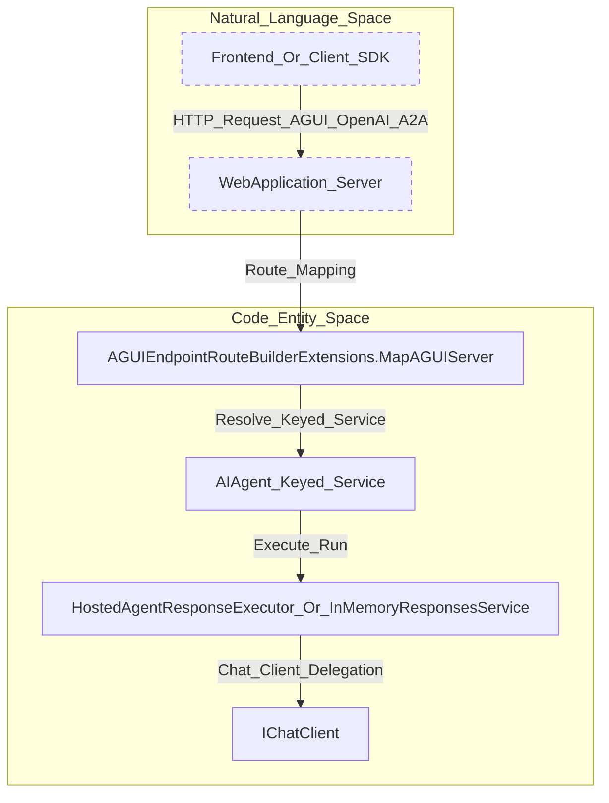
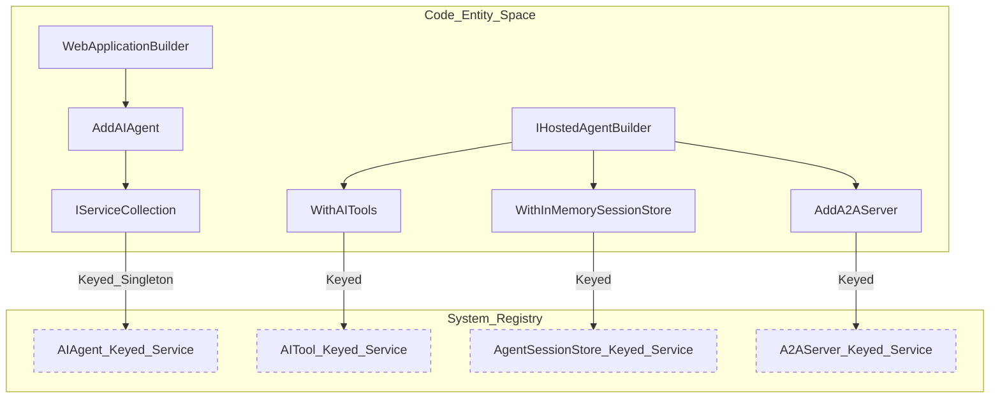
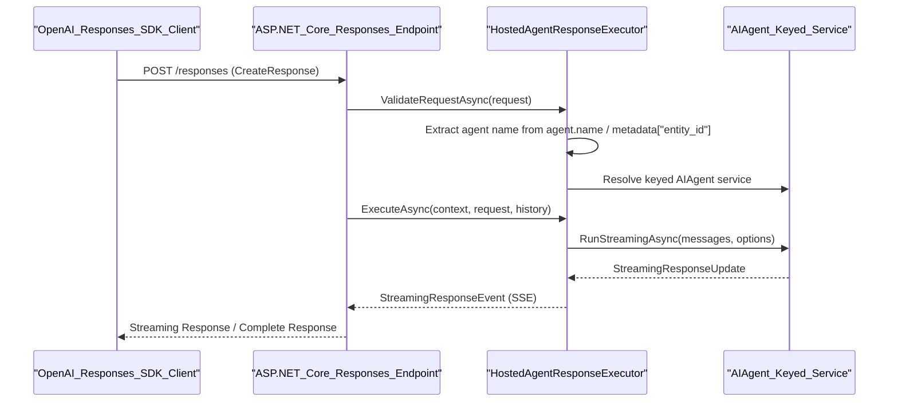
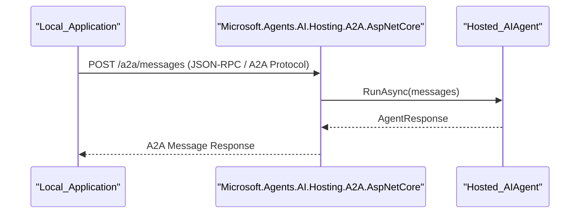

<!-- source: DeepWiki mcp.deepwiki.com · repo microsoft/agent-framework · extra page ASP.NET Core Hosting · fetched 2026-10-26 -->

# ASP.NET Core Hosting

<details>
<summary>Relevant source files</summary>

The following files were used as context for generating this wiki page:

- [dotnet/src/Microsoft.Agents.AI.A2A/Microsoft.Agents.AI.A2A.csproj](dotnet/src/Microsoft.Agents.AI.A2A/Microsoft.Agents.AI.A2A.csproj)
- [dotnet/src/Microsoft.Agents.AI.Hosting.A2A.AspNetCore/Microsoft.Agents.AI.Hosting.A2A.AspNetCore.csproj](dotnet/src/Microsoft.Agents.AI.Hosting.A2A.AspNetCore/Microsoft.Agents.AI.Hosting.A2A.AspNetCore.csproj)
- [dotnet/src/Microsoft.Agents.AI.Hosting.A2A/Microsoft.Agents.AI.Hosting.A2A.csproj](dotnet/src/Microsoft.Agents.AI.Hosting.A2A/Microsoft.Agents.AI.Hosting.A2A.csproj)
- [dotnet/src/Microsoft.Agents.AI.Hosting.OpenAI/Microsoft.Agents.AI.Hosting.OpenAI.csproj](dotnet/src/Microsoft.Agents.AI.Hosting.OpenAI/Microsoft.Agents.AI.Hosting.OpenAI.csproj)
- [dotnet/src/Microsoft.Agents.AI.Hosting.OpenAI/OpenAIResponseRequestInfo.cs](dotnet/src/Microsoft.Agents.AI.Hosting.OpenAI/OpenAIResponseRequestInfo.cs)
- [dotnet/src/Microsoft.Agents.AI.Hosting.OpenAI/OpenAIResponsesMapOptions.cs](dotnet/src/Microsoft.Agents.AI.Hosting.OpenAI/OpenAIResponsesMapOptions.cs)
- [dotnet/src/Microsoft.Agents.AI.Hosting.OpenAI/Responses/AIAgentResponseExecutor.cs](dotnet/src/Microsoft.Agents.AI.Hosting.OpenAI/Responses/AIAgentResponseExecutor.cs)
- [dotnet/src/Microsoft.Agents.AI.Hosting.OpenAI/Responses/Converters/ItemResourceConversions.cs](dotnet/src/Microsoft.Agents.AI.Hosting.OpenAI/Responses/Converters/ItemResourceConversions.cs)
- [dotnet/src/Microsoft.Agents.AI.Hosting.OpenAI/Responses/HostedAgentResponseExecutor.cs](dotnet/src/Microsoft.Agents.AI.Hosting.OpenAI/Responses/HostedAgentResponseExecutor.cs)
- [dotnet/src/Microsoft.Agents.AI.Hosting.OpenAI/Responses/IResponseExecutor.cs](dotnet/src/Microsoft.Agents.AI.Hosting.OpenAI/Responses/IResponseExecutor.cs)
- [dotnet/src/Microsoft.Agents.AI.Hosting.OpenAI/Responses/InMemoryResponsesService.cs](dotnet/src/Microsoft.Agents.AI.Hosting.OpenAI/Responses/InMemoryResponsesService.cs)
- [dotnet/src/Microsoft.Agents.AI.Hosting.OpenAI/Responses/OpenAIResponseRequestInfoBuilder.cs](dotnet/src/Microsoft.Agents.AI.Hosting.OpenAI/Responses/OpenAIResponseRequestInfoBuilder.cs)
- [dotnet/src/Microsoft.Agents.AI.Hosting.OpenAI/Responses/ResponseErrorCodes.cs](dotnet/src/Microsoft.Agents.AI.Hosting.OpenAI/Responses/ResponseErrorCodes.cs)
- [dotnet/src/Microsoft.Agents.AI.Hosting.OpenAI/Responses/ResponsesHttpHandler.cs](dotnet/src/Microsoft.Agents.AI.Hosting.OpenAI/Responses/ResponsesHttpHandler.cs)
- [dotnet/src/Microsoft.Agents.AI.Hosting/Microsoft.Agents.AI.Hosting.csproj](dotnet/src/Microsoft.Agents.AI.Hosting/Microsoft.Agents.AI.Hosting.csproj)
- [dotnet/tests/Microsoft.Agents.AI.A2A.UnitTests/Microsoft.Agents.AI.A2A.UnitTests.csproj](dotnet/tests/Microsoft.Agents.AI.A2A.UnitTests/Microsoft.Agents.AI.A2A.UnitTests.csproj)
- [dotnet/tests/Microsoft.Agents.AI.Hosting.OpenAI.UnitTests/InMemoryResponsesServiceStreamingTests.cs](dotnet/tests/Microsoft.Agents.AI.Hosting.OpenAI.UnitTests/InMemoryResponsesServiceStreamingTests.cs)
- [dotnet/tests/Microsoft.Agents.AI.Hosting.OpenAI.UnitTests/InMemoryResponsesServiceTests.cs](dotnet/tests/Microsoft.Agents.AI.Hosting.OpenAI.UnitTests/InMemoryResponsesServiceTests.cs)
- [dotnet/tests/Microsoft.Agents.AI.Hosting.OpenAI.UnitTests/OpenAIMapOptionsTests.cs](dotnet/tests/Microsoft.Agents.AI.Hosting.OpenAI.UnitTests/OpenAIMapOptionsTests.cs)
- [dotnet/tests/Microsoft.Agents.AI.Hosting.OpenAI.UnitTests/OpenAIResponseRequestInfoBuilderTests.cs](dotnet/tests/Microsoft.Agents.AI.Hosting.OpenAI.UnitTests/OpenAIResponseRequestInfoBuilderTests.cs)
- [dotnet/tests/Microsoft.Agents.AI.Hosting.OpenAI.UnitTests/OpenAIResponsesAgentCompatibilityTests.cs](dotnet/tests/Microsoft.Agents.AI.Hosting.OpenAI.UnitTests/OpenAIResponsesAgentCompatibilityTests.cs)
- [dotnet/tests/Microsoft.Agents.AI.Hosting.OpenAI.UnitTests/OpenAIResponsesIntegrationTests.cs](dotnet/tests/Microsoft.Agents.AI.Hosting.OpenAI.UnitTests/OpenAIResponsesIntegrationTests.cs)
- [dotnet/tests/Microsoft.Agents.AI.Hosting.OpenAI.UnitTests/TestHelpers.cs](dotnet/tests/Microsoft.Agents.AI.Hosting.OpenAI.UnitTests/TestHelpers.cs)
- [python/packages/devui/tests/devui/test_execution.py](python/packages/devui/tests/devui/test_execution.py)

</details>


This page documents the hosting infrastructure for AI agents in ASP.NET Core applications within the Microsoft Agent Framework. It covers core dependency injection (DI) patterns, OpenAI Responses protocol hosting (including `InMemoryResponsesService` and `HostedAgentResponseExecutor`), the **AG-UI** protocol integration, **Agent-to-Agent (A2A)** protocol integration via `Microsoft.Agents.AI.Hosting.A2A.AspNetCore`, and hosting workflows as executable endpoints.

## Overview and Architecture

The Microsoft Agent Framework provides a first-class hosting experience for .NET applications. By leveraging standard ASP.NET Core abstractions like `IServiceCollection` and `IEndpointRouteBuilder`, developers can expose agents as scalable HTTP services supporting multiple interaction protocols (AG-UI, OpenAI Responses API, and A2A).

**Key Hosting Components**:
- **`IHostedAgentBuilder`**: A fluent interface for configuring agents, tools, and session stores within the DI container. [dotnet/src/Microsoft.Agents.AI.Hosting/IHostedAgentBuilder.cs:1-25]()
- **OpenAI Responses Hosting**: Maps OpenAI Responses API endpoints to hosted agents via `HostedAgentResponseExecutor`, `AIAgentResponseExecutor`, and `InMemoryResponsesService`. [dotnet/src/Microsoft.Agents.AI.Hosting.OpenAI/Responses/HostedAgentResponseExecutor.cs:16-20](), [dotnet/src/Microsoft.Agents.AI.Hosting.OpenAI/Responses/AIAgentResponseExecutor.cs:18-21](), [dotnet/src/Microsoft.Agents.AI.Hosting.OpenAI/Responses/InMemoryResponsesService.cs:20-22]()
- **AG-UI Protocol Integration**: Adapter layer connecting agents to frontends via Server-Sent Events (SSE) using `MapAGUIServer`. [dotnet/src/Microsoft.Agents.AI.Hosting.AGUI.AspNetCore/AGUIEndpointRouteBuilderExtensions.cs:33-50]()
- **A2A Protocol Support**: Standardized cross-agent communication via `Microsoft.Agents.AI.Hosting.A2A.AspNetCore` and `Microsoft.Agents.AI.Hosting.A2A`. [dotnet/src/Microsoft.Agents.AI.Hosting.A2A.AspNetCore/Microsoft.Agents.AI.Hosting.A2A.AspNetCore.csproj:1-38](), [dotnet/src/Microsoft.Agents.AI.Hosting.A2A/Microsoft.Agents.AI.Hosting.A2A.csproj:1-33]()


**ASP.NET Core Hosting Architecture**

Sources: [dotnet/src/Microsoft.Agents.AI.Hosting.A2A/Microsoft.Agents.AI.Hosting.A2A.csproj:1-33](), [dotnet/src/Microsoft.Agents.AI.Hosting.AGUI.AspNetCore/AGUIEndpointRouteBuilderExtensions.cs:33-50](), [dotnet/src/Microsoft.Agents.AI.Hosting.OpenAI/Responses/HostedAgentResponseExecutor.cs:16-20](), [dotnet/src/Microsoft.Agents.AI.Hosting.OpenAI/Responses/InMemoryResponsesService.cs:20-22]()

## Dependency Injection and Configuration

Agents are registered using the `AddAIAgent` extension method. This creates a keyed service registration, ensuring that multiple agents can coexist in the same application without configuration collisions.

### Agent Registration Flow


**DI Registration Mapping**

### Configuring Agents and Tools
The `IHostedAgentBuilder` allows chaining configuration for tools and state:

```csharp
builder.AddAIAgent("AGUIAssistant", "You are a helpful assistant.", chatClient)
    .WithAITools(
        new HostedWebSearchTool(),
        AIFunctionFactory.Create(() => DateTimeOffset.UtcNow, name: "get_current_time"))
    .WithInMemorySessionStore();
```

- **Tool Isolation**: Tools are registered as keyed services using the agent's name, preventing an agent from accidentally using tools intended for another. [dotnet/samples/05-end-to-end/AGUIClientServer/AGUIServer/Program.cs:40-63]()
- **Session Management**: Developers can register an `AgentSessionStore` (e.g., `WithInMemorySessionStore`) to persist conversation state across requests. [dotnet/samples/05-end-to-end/AGUIClientServer/AGUIServer/Program.cs:63-63]()
- **Isolation**: Hosts serving multiple users should register an `AgentIsolationKeyProvider` to scope sessions by principal. [dotnet/samples/05-end-to-end/AGUIClientServer/AGUIServer/Program.cs:35-38]()

Sources: [dotnet/samples/05-end-to-end/AGUIClientServer/AGUIServer/Program.cs:13-70](), [dotnet/src/Microsoft.Agents.AI.Hosting/IHostedAgentBuilder.cs:1-25]()

## OpenAI Responses Protocol Hosting

The framework provides ASP.NET Core hosting support for the OpenAI Responses API protocol through `Microsoft.Agents.AI.Hosting.OpenAI`. This allows clients using standard OpenAI Responses SDK clients (`ResponsesClient`) to communicate directly with local `AIAgent` instances.

### Key Components
- **`HostedAgentResponseExecutor`**: Routes incoming requests to hosted `AIAgent` services based on `agent.name` or `metadata["entity_id"]`. Resolves agents from keyed DI services. [dotnet/src/Microsoft.Agents.AI.Hosting.OpenAI/Responses/HostedAgentResponseExecutor.cs:16-20]()
- **`AIAgentResponseExecutor`**: Executes responses locally using a specific `AIAgent` instance. [dotnet/src/Microsoft.Agents.AI.Hosting.OpenAI/Responses/AIAgentResponseExecutor.cs:14-18]()
- **`InMemoryResponsesService`**: Provides an in-memory implementation of the responses service supporting thread-safe execution, background processing, caching, and stream event publication. [dotnet/src/Microsoft.Agents.AI.Hosting.OpenAI/Responses/InMemoryResponsesService.cs:16-25]()
- **`OpenAIResponsesMapOptions`**: Controls how incoming request settings are mapped to `AgentRunOptions`. [dotnet/src/Microsoft.Agents.AI.Hosting.OpenAI/OpenAIResponsesMapOptions.cs:15-18]()

### Request Mapping and Validation
`HostedAgentResponseExecutor` and `AIAgentResponseExecutor` validate incoming requests via `ValidateRequestAsync`, checking agent presence, session requirements, and run options mapping. [dotnet/src/Microsoft.Agents.AI.Hosting.OpenAI/Responses/HostedAgentResponseExecutor.cs:46-118](), [dotnet/src/Microsoft.Agents.AI.Hosting.OpenAI/Responses/AIAgentResponseExecutor.cs:54-69]()


**OpenAI Responses Execution Flow**

Sources: [dotnet/src/Microsoft.Agents.AI.Hosting.OpenAI/Responses/HostedAgentResponseExecutor.cs:1-150](), [dotnet/src/Microsoft.Agents.AI.Hosting.OpenAI/Responses/AIAgentResponseExecutor.cs:1-129](), [dotnet/src/Microsoft.Agents.AI.Hosting.OpenAI/Responses/InMemoryResponsesService.cs:16-131]()

## AG-UI Protocol Integration

The AG-UI protocol enables seamless connectivity to web frontends via Server-Sent Events (SSE).

- **Endpoint Routing**: `app.MapAGUIServer(AgentName, "/path")` maps the agent to an HTTP endpoint. [dotnet/samples/05-end-to-end/AGUIClientServer/AGUIServer/Program.cs:68-68]()
- **Streaming**: Supports streaming updates via `RunStreamingAsync`, emitting lifecycle events such as `RUN_STARTED` and output text deltas. [dotnet/src/Microsoft.Agents.AI.Hosting.AGUI.AspNetCore/AGUIEndpointRouteBuilderExtensions.cs:102-196]()
- **Human-in-the-Loop**: Natively supports tool approval mechanisms, allowing servers to pause execution for user approval and resume upon receiving resolution messages. [dotnet/src/Microsoft.Agents.AI.Hosting.AGUI.AspNetCore/AGUIEndpointRouteBuilderExtensions.cs:1-196]()

Sources: [dotnet/src/Microsoft.Agents.AI.Hosting.AGUI.AspNetCore/AGUIEndpointRouteBuilderExtensions.cs:33-196](), [dotnet/samples/05-end-to-end/AGUIClientServer/AGUIServer/Program.cs:65-70]()

## A2A (Agent-to-Agent) Hosting

The framework supports the A2A protocol in ASP.NET Core via `Microsoft.Agents.AI.Hosting.A2A.AspNetCore` and `Microsoft.Agents.AI.Hosting.A2A`, allowing agents to communicate across service boundaries.

- **Server Registration**: Utilizes `AddA2AServer` extension methods provided by the ASP.NET Core integration package to expose hosted agents over the A2A protocol. [dotnet/src/Microsoft.Agents.AI.Hosting.A2A.AspNetCore/Microsoft.Agents.AI.Hosting.A2A.AspNetCore.csproj:1-38]()
- **Core Abstractions**: Relies on `Microsoft.Agents.AI.Hosting.A2A` for underlying server and message routing primitives. [dotnet/src/Microsoft.Agents.AI.Hosting.A2A/Microsoft.Agents.AI.Hosting.A2A.csproj:1-33]()

### A2A Interaction Flow


**A2A ASP.NET Core Hosting Flow**

Sources: [dotnet/src/Microsoft.Agents.AI.Hosting.A2A.AspNetCore/Microsoft.Agents.AI.Hosting.A2A.AspNetCore.csproj:1-38](), [dotnet/src/Microsoft.Agents.AI.Hosting.A2A/Microsoft.Agents.AI.Hosting.A2A.csproj:1-33]()

## Hosting Workflows as Agents

Workflows can be exposed as standard agents, enabling complex multi-agent logic and graph-based pipelines to appear as a single conversational entity within ASP.NET Core applications.

- **State Persistence**: Conversations and execution steps can be integrated with `AgentSessionStore` implementations to maintain state across requests. [dotnet/samples/05-end-to-end/AGUIClientServer/AGUIServer/Program.cs:42-63]()
- **Hierarchical Composition**: Wrapped workflows can be hosted behind any protocol endpoint (AG-UI, OpenAI Responses, or A2A) interchangeably with standard chat-client-backed agents. [dotnet/src/Microsoft.Agents.AI.Hosting.OpenAI/Responses/HostedAgentResponseExecutor.cs:16-20](), [dotnet/src/Microsoft.Agents.AI.Hosting.AGUI.AspNetCore/AGUIEndpointRouteBuilderExtensions.cs:33-50]()

Sources: [dotnet/samples/05-end-to-end/AGUIClientServer/AGUIServer/Program.cs:42-63](), [dotnet/src/Microsoft.Agents.AI.Hosting.OpenAI/Responses/HostedAgentResponseExecutor.cs:16-20]()

---

