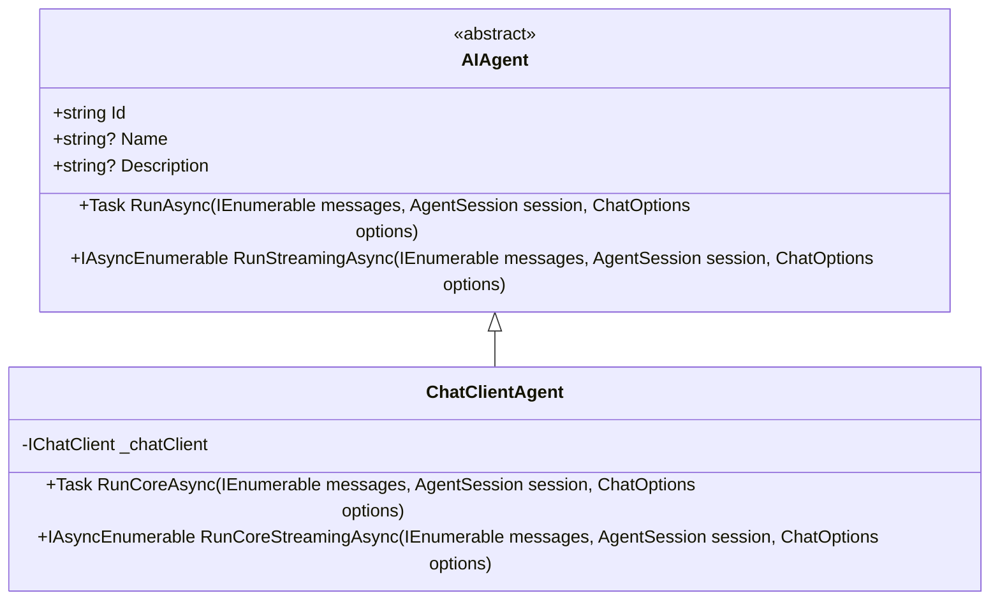
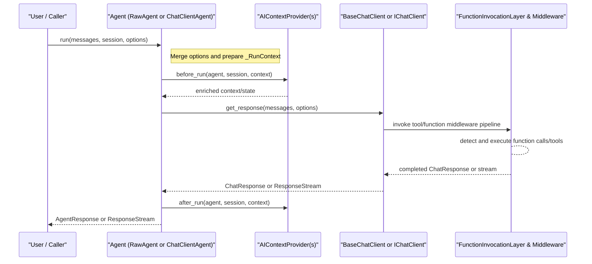
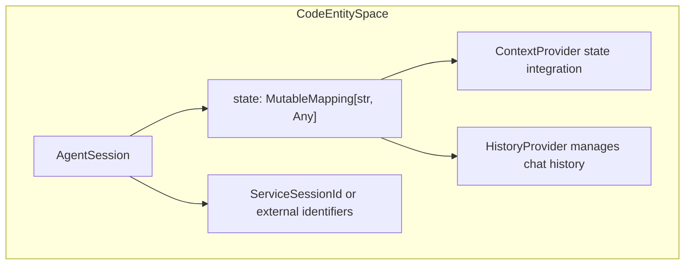
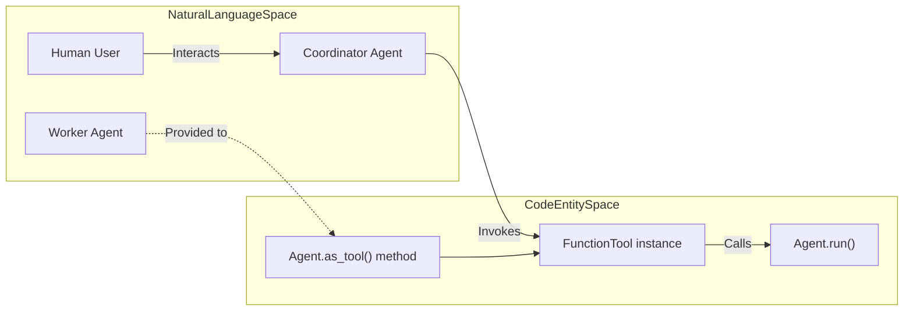

<!-- source: DeepWiki mcp.deepwiki.com · repo microsoft/agent-framework · extra page Agent Abstraction · fetched 2026-10-26 -->

# Agent Abstraction

<details>
<summary>Relevant source files</summary>

The following files were used as context for generating this wiki page:

- [docs/specs/004-python-function-calling-loop.md](docs/specs/004-python-function-calling-loop.md)
- [dotnet/src/Microsoft.Agents.AI.Abstractions/AIAgent.cs](dotnet/src/Microsoft.Agents.AI.Abstractions/AIAgent.cs)
- [dotnet/src/Microsoft.Agents.AI.Abstractions/DelegatingAIAgent.cs](dotnet/src/Microsoft.Agents.AI.Abstractions/DelegatingAIAgent.cs)
- [dotnet/src/Microsoft.Agents.AI/ChatClient/DeferredOpenTelemetryChatClient.cs](dotnet/src/Microsoft.Agents.AI/ChatClient/DeferredOpenTelemetryChatClient.cs)
- [dotnet/src/Microsoft.Agents.AI/OpenTelemetryAgent.cs](dotnet/src/Microsoft.Agents.AI/OpenTelemetryAgent.cs)
- [dotnet/src/Microsoft.Agents.AI/OpenTelemetryConsts.cs](dotnet/src/Microsoft.Agents.AI/OpenTelemetryConsts.cs)
- [dotnet/tests/Microsoft.Agents.AI.Abstractions.UnitTests/AIAgentTests.cs](dotnet/tests/Microsoft.Agents.AI.Abstractions.UnitTests/AIAgentTests.cs)
- [dotnet/tests/Microsoft.Agents.AI.Abstractions.UnitTests/DelegatingAIAgentTests.cs](dotnet/tests/Microsoft.Agents.AI.Abstractions.UnitTests/DelegatingAIAgentTests.cs)
- [dotnet/tests/Microsoft.Agents.AI.UnitTests/OpenTelemetryAgentTests.cs](dotnet/tests/Microsoft.Agents.AI.UnitTests/OpenTelemetryAgentTests.cs)
- [python/packages/core/agent_framework/_agents.py](python/packages/core/agent_framework/_agents.py)
- [python/packages/core/agent_framework/_clients.py](python/packages/core/agent_framework/_clients.py)
- [python/packages/core/agent_framework/_compaction.py](python/packages/core/agent_framework/_compaction.py)
- [python/packages/core/agent_framework/_harness/_tool_approval.py](python/packages/core/agent_framework/_harness/_tool_approval.py)
- [python/packages/core/agent_framework/_middleware.py](python/packages/core/agent_framework/_middleware.py)
- [python/packages/core/agent_framework/_tools.py](python/packages/core/agent_framework/_tools.py)
- [python/packages/core/agent_framework/_types.py](python/packages/core/agent_framework/_types.py)
- [python/packages/core/agent_framework/observability.py](python/packages/core/agent_framework/observability.py)
- [python/packages/core/tests/core/test_agent_hooks.py](python/packages/core/tests/core/test_agent_hooks.py)
- [python/packages/core/tests/core/test_agents.py](python/packages/core/tests/core/test_agents.py)
- [python/packages/core/tests/core/test_clients.py](python/packages/core/tests/core/test_clients.py)
- [python/packages/core/tests/core/test_compaction.py](python/packages/core/tests/core/test_compaction.py)
- [python/packages/core/tests/core/test_function_invocation_logic.py](python/packages/core/tests/core/test_function_invocation_logic.py)
- [python/packages/core/tests/core/test_harness_tool_approval.py](python/packages/core/tests/core/test_harness_tool_approval.py)
- [python/packages/core/tests/core/test_middleware_with_agent.py](python/packages/core/tests/core/test_middleware_with_agent.py)
- [python/packages/core/tests/core/test_middleware_with_chat.py](python/packages/core/tests/core/test_middleware_with_chat.py)
- [python/packages/core/tests/core/test_observability.py](python/packages/core/tests/core/test_observability.py)
- [python/packages/core/tests/core/test_tools.py](python/packages/core/tests/core/test_tools.py)
- [python/packages/core/tests/core/test_types.py](python/packages/core/tests/core/test_types.py)
- [python/samples/02-agents/context_providers/cross_session_observer.py](python/samples/02-agents/context_providers/cross_session_observer.py)
- [python/samples/02-agents/observability/README.md](python/samples/02-agents/observability/README.md)
- [python/samples/02-agents/observability/microsoft_opentelemetry_distro.py](python/samples/02-agents/observability/microsoft_opentelemetry_distro.py)

</details>


## Purpose and Scope

This page documents the core agent abstraction foundational to the Microsoft Agent Framework. It details the base classes and protocols representing AI agents, the run lifecycle coordinating message processing and function invocation, session and state management patterns, and the agent-as-interface pattern enabling modular agent compositions.

The information covers both the .NET and Python implementations, showing parallels in design while respecting language idioms. The goal is to provide implementers and users the deep technical understanding needed to extend, compose, and operate agents consistently.

---

## Agent Protocol and Interface Contract

### Python: `SupportsAgentRun` Protocol

In Python, the agent abstraction is defined by the structural protocol `SupportsAgentRun`. This protocol defines the minimal required interface for an agent: an ID, optional name and description, and essential methods for running the agent and creating sessions.

```python
@runtime_checkable
class SupportsAgentRun(Protocol):
    id: str
    name: str | None
    description: str | None

    async def run(
        self,
        messages: Sequence[Message] | Content | str,
        *,
        stream: bool = False,
        session: AgentSession | None = None,
        options: ChatOptions | None = None,
    ) -> AgentResponse | ResponseStream[AgentResponseUpdate, AgentResponse]:
        """Generate a response from the agent."""
        ...

    def create_session(self, **kwargs) -> AgentSession:
        """Create a new conversation session."""
        ...
```

- `run`: The core asynchronous method to generate agent output from messages or content.
- `create_session`: Factory method to create a new conversation session, which scopes state and context.

This protocol-based pattern enables flexibility: agents need not derive from a particular base, allowing duck typing and composition.

**Sources:** [python/packages/core/agent_framework/_agents.py:213-255]()

---

### .NET: `AIAgent` Abstract Class

In .NET, the core agent abstraction is the abstract class `AIAgent`. It exposes asynchronous methods `RunAsync` and `RunStreamingAsync` for obtaining agent responses non-streaming and streaming respectively. Subclasses implement the protected core methods for actual logic.



- `RunAsync` and `RunStreamingAsync`: public entry points wrapping the core run logic.
- `RunCoreAsync` and `RunCoreStreamingAsync`: protected abstract methods subclasses override.
- `ChatClientAgent`: concrete agent using an `IChatClient` for chat functionality delegation.

This base abstraction defines the essential contract for .NET agents, allowing composition with chat clients, middleware, and tooling layers.

**Sources:** [dotnet/src/Microsoft.Agents.AI.Abstractions/AIAgent.cs:15-150](), [dotnet/src/Microsoft.Agents.AI/ChatClient/ChatClientAgent.cs:39-40]()

---

## Agent Class Hierarchy and Composition (Python)

The Python agent implementation is designed as a layered class hierarchy to provide extensibility, middleware integration, telemetry, and function invocation support.

| Class        | Purpose                            | Key Features                                                                                                    | Location                                      |
|--------------|----------------------------------|----------------------------------------------------------------------------------------------------------------|-----------------------------------------------|
| `BaseAgent`  | Core agent logic                  | Implements serialization, manages context providers, and exposes `as_tool()` to wrap the agent as a function tool. | `_agents.py:328-353`                           |
| `RawAgent`   | Chat client delegating agent      | Wraps a chat client instance, manages tool normalization and options merging, orchestrates run lifecycle.         | `_agents.py:567-603`                           |
| `Agent`      | Fully-featured layered agent      | A type alias combining `RawAgent` with telemetry, function invocation, and chat middleware layers.                | `_agents.py:1143-1173`                         |

This design enables clear separation of concerns, middleware composition, and extensible agent capability augmentation.

**Sources:** [python/packages/core/agent_framework/_agents.py:117-155](), [python/packages/core/agent_framework/_agents.py:328-353](), [python/packages/core/agent_framework/_agents.py:567-603](), [python/packages/core/agent_framework/_agents.py:1143-1173]()

---

## Agent Run Lifecycle

The run lifecycle orchestrates multiple components and hooks to process input messages and produce AI-driven responses. Notable steps in the lifecycle include option merging, context enrichment via providers, running chat clients, handling function/tool invocation, and applying post-processing.

### General Agent Run Flow Sequence



- The lifecycle begins with input messages plus optional session and run options.
- Options are merged carefully including tools and metadata.
- Context providers augment the session and context before invoking the chat client.
- The chat client issues requests to models or remote services, routed through function invocation middleware.
- Middleware intercepts function calls embedded in chat messages, executes them, and injects results.
- The response or streamed updates are returned to the caller.
- Post-run hooks allow context providers to update session or trigger side-effects.

This coordinated sequence ensures extensible, observable, and composable agent execution.

**Sources:** [python/packages/core/agent_framework/_agents.py:899-1057](), [python/packages/core/agent_framework/observability.py:93-112](), [python/packages/core/agent_framework/_tools.py:206-210](), [dotnet/src/Microsoft.Agents.AI/ChatClient/ChatClientAgent.cs:181-220]()

---

## Session and State Management

Agents maintain conversation and context state via `AgentSession` objects, which orchestrate state dictionaries, chat history, and other providers to persist and isolate conversational data across interactions.

### Session State Architecture



- **AgentSession** encapsulates:
  - A stable `session_id` string for conversation continuity.
  - A mutable state dictionary used by context providers for memory, tool approvals, etc.
  - History management through `HistoryProvider` abstractions for in-memory or external persistence.
  - Optional service session IDs for linking to external systems.

- The session object is passed throughout the run lifecycle to preserve context and state isolation.

**Sources:** [python/packages/core/agent_framework/_sessions.py:226-304](), [python/packages/core/agent_framework/_agents.py:367-443]()

---

## Agent-as-Interface Pattern

A key architectural pattern in the framework is expressing agents as callable tools, enabling:

- Hierarchical agent compositions.
- Modular and reusable AI capabilities.
- Orchestration of multi-agent workflows where agents invoke other agents as tools.

### Transforming an Agent to a Tool

- The agent name is sanitized by replacing invalid characters with underscores.
- The `run()` method of the agent is wrapped into a `FunctionTool` instance.
- This tool exposes the agent logic as a structured function-callable entity.
- Supports invocation from other agents or orchestrators via the function calling system.

### Pattern Diagram Bridging Natural Language and Code Entities



This bridging shows how human user intents flow through a higher-level coordinator agent invoking other agents exposed as function tools.

**Sources:** [python/packages/core/agent_framework/_agents.py:158-192](), [python/packages/core/agent_framework/_agents.py:470-562](), [python/packages/core/agent_framework/_tools.py:206-210]()

---

## Key Functions and Classes Overview

| Entity                 | File Path                                              | Role                                                                                               |
|------------------------|-------------------------------------------------------|--------------------------------------------------------------------------------------------------|
| `Agent`                | `python/packages/core/agent_framework/_agents.py`     | Primary high-level Python agent class combining telemetry, function invocation, and middleware.  |
| `AIAgent`              | `dotnet/src/Microsoft.Agents.AI.Abstractions/AIAgent.cs` | Abstract .NET agent base defining basic run methods for agents.                                   |
| `ChatClientAgent`      | `dotnet/src/Microsoft.Agents.AI/ChatClient/ChatClientAgent.cs` | .NET agent implementation delegating to `IChatClient`.                                           |
| `_RunContext`          | `python/packages/core/agent_framework/_agents.py`     | TypedDict encapsulating state used during a single agent execution.                               |
| `_merge_options`       | `python/packages/core/agent_framework/_agents.py`     | Utility to merge nested agent run options with careful handling of tools and metadata.            |
| `AgentSession`         | `python/packages/core/agent_framework/_sessions.py`   | Container for session-scoped mutable state and conversation history management.                    |
| `Content`              | `python/packages/core/agent_framework/_types.py`      | Unified content model representing text, data, function calls, annotations, media, and errors.    |

---

# Summary

The Agent Abstraction layer defines the fundamental interface and lifecycle for AI agents in the Microsoft Agent Framework. Key characteristics include:

- Minimal agent interface contracts, realized by abstract base classes in .NET (e.g., `AIAgent`) and protocols in Python (e.g., `SupportsAgentRun`).
- A robust run lifecycle coordinating message processing, middleware invocation, tool/function execution, and context enrichment.
- Stateful session management via `AgentSession` to maintain conversation continuity and support memory/context providers.
- The agent-as-interface pattern, enabling any agent to be wrapped as a callable function tool, promoting modularity and composability.
- Parallel design patterns in both .NET and Python implementations with carefully composed middleware layers and telemetry integration.

This design facilitates extensible, modular, and observable AI agents capable of complex multi-agent workflows and real-world applications.

---

# References and Sources

- Python Agent Framework Source: `python/packages/core/agent_framework/_agents.py` [117-207](), [328-353](), [567-603](), [1143-1173]()
- Python Session Management: `python/packages/core/agent_framework/_sessions.py` [226-304]()
- Python Unified Content Model: `python/packages/core/agent_framework/_types.py` [49-73]()
- Python Tools and Function Invocation: `python/packages/core/agent_framework/_tools.py` [206-210]()
- .NET Abstract Agent Base: `dotnet/src/Microsoft.Agents.AI.Abstractions/AIAgent.cs` [15-150]()
- .NET ChatClientAgent Implementation: `dotnet/src/Microsoft.Agents.AI/ChatClient/ChatClientAgent.cs` [39-40]()
- Observability Integration: `python/packages/core/agent_framework/observability.py` [93-112]()

---

