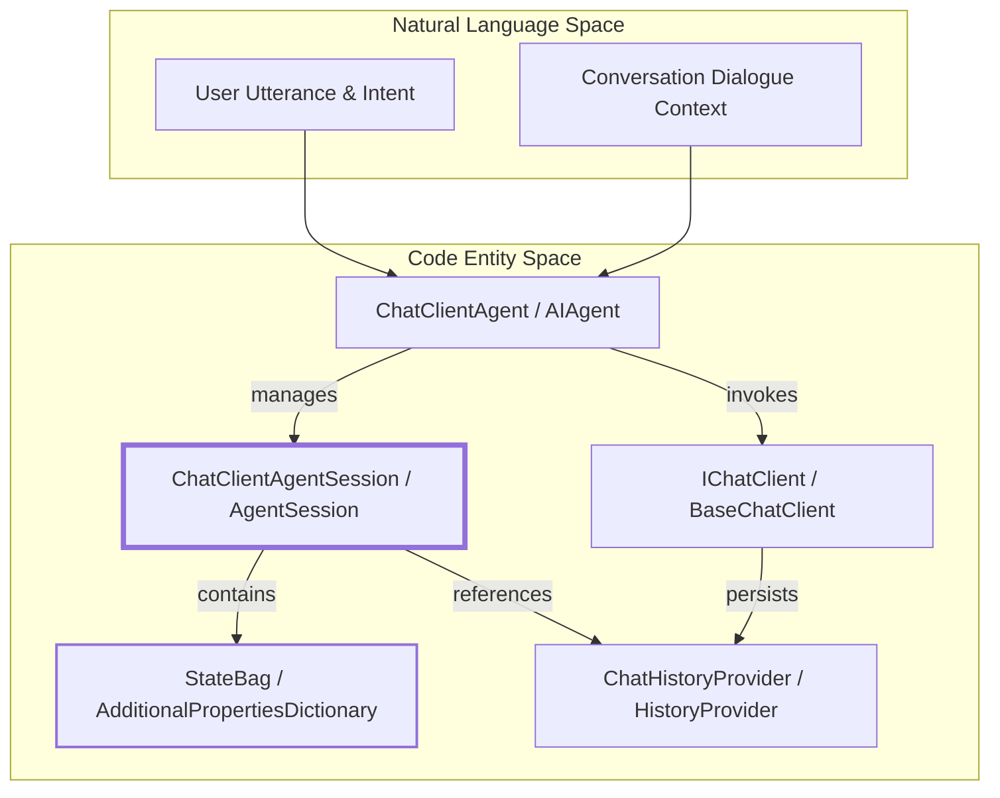
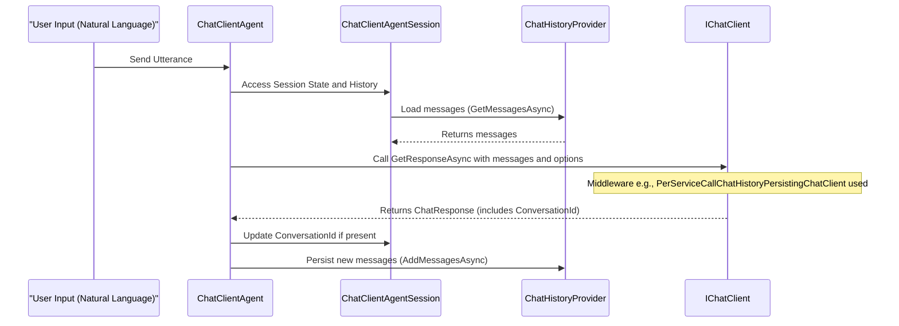
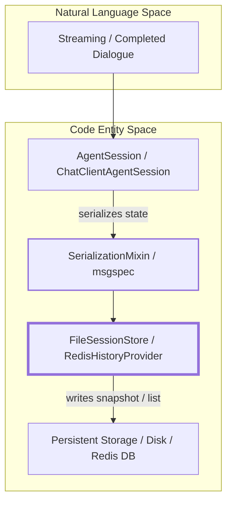

<!-- source: DeepWiki mcp.deepwiki.com · repo microsoft/agent-framework · extra page Agent Sessions and State · fetched 2026-10-26 -->

# Agent Sessions and State

Relevant source files

The following files were used as context for generating this wiki page:

- [python/packages/core/agent_framework/_serialization.py](python/packages/core/agent_framework/_serialization.py)
- [python/packages/core/agent_framework/_sessions.py](python/packages/core/agent_framework/_sessions.py)
- [python/packages/core/tests/core/test_serializable_mixin.py](python/packages/core/tests/core/test_serializable_mixin.py)
- [python/packages/core/tests/core/test_sessions.py](python/packages/core/tests/core/test_sessions.py)
- [python/packages/mem0/README.md](python/packages/mem0/README.md)
- [python/packages/mem0/agent_framework_mem0/__init__.py](python/packages/mem0/agent_framework_mem0/__init__.py)
- [python/packages/mem0/agent_framework_mem0/_context_provider.py](python/packages/mem0/agent_framework_mem0/_context_provider.py)
- [python/packages/mem0/tests/test_mem0_context_provider.py](python/packages/mem0/tests/test_mem0_context_provider.py)
- [python/packages/redis/AGENTS.md](python/packages/redis/AGENTS.md)
- [python/packages/redis/README.md](python/packages/redis/README.md)
- [python/packages/redis/agent_framework_redis/_context_provider.py](python/packages/redis/agent_framework_redis/_context_provider.py)
- [python/packages/redis/agent_framework_redis/_history_provider.py](python/packages/redis/agent_framework_redis/_history_provider.py)
- [python/packages/redis/tests/test_context_provider_edges.py](python/packages/redis/tests/test_context_provider_edges.py)
- [python/packages/redis/tests/test_providers.py](python/packages/redis/tests/test_providers.py)
- [python/samples/02-agents/conversations/redis_history_provider.py](python/samples/02-agents/conversations/redis_history_provider.py)

This leaf page explains how the Microsoft Agent Framework manages conversation state, session persistence, and metadata through `AgentSession`, `ChatClientAgentSession`, `StateBag`, and state persistence patterns across both .NET and Python implementations.

---

## Overview

In the Microsoft Agent Framework, state management is centered around the **Session** abstraction. A session encapsulates conversation history, custom application state, and configuration overrides for a specific interaction sequence between a user and an agent.

Key components include:

- **`AgentSession`**: The core Python class for managing session state, including identifiers, arbitrary user state, and cross-session origins [python/packages/core/agent_framework/_sessions.py:209-245]().
- **`ChatClientAgentSession`**: The .NET equivalent specialized for chat client agents managing state and conversation IDs [dotnet/src/Microsoft.Agents.AI/ChatClient/ChatClientAgent.cs:39-46]().
- **`StateBag` / `AdditionalPropertiesDictionary`**: Thread-safe and serializable dictionaries for storing arbitrary, extensible state variables within sessions [dotnet/src/Microsoft.Agents.AI/ChatClient/ChatClientAgentOptions.cs:156-160]().
- **Session Persistence Stores**: Pluggable stores like `SessionStore` and `FileSessionStore` handle snapshotting and restoring session state for both ephemeral and durable storage [python/packages/core/agent_framework/_sessions.py:433-462]().
- **Chat History Providers**: Interface implementations that persist chat messages either in-memory or to durable storage, optionally integrated with service-managed conversation threading [python/packages/core/agent_framework/_sessions.py:348-360]().

Sources:
* [python/packages/core/agent_framework/_sessions.py:3-14,209-245,348-360,433-462]()
* [dotnet/src/Microsoft.Agents.AI/ChatClient/ChatClientAgent.cs:39-46,118-126]()
* [dotnet/src/Microsoft.Agents.AI/ChatClient/ChatClientAgentOptions.cs:150-160]()

---

## Session Architecture

The session architecture bridges natural language interactions with internal code entities, encapsulating stateful context, message history, and agent runtime data.

### Natural Language to Code Entity Space: Session Lifecycles

- The **Agent** receives user input and controls the conversation lifecycle.
- Each **Agent** manages a **Session** instance (`ChatClientAgentSession` / `AgentSession`) that holds persistent state and identifiers.
- **Session** holds a **StateBag** / `AdditionalProperties` dictionary that serializes arbitrary state data across agent turns.
- The **Session** maintains a reference to a **HistoryProvider** / `ChatHistoryProvider` which manages persisted chat messages.
- The **Agent** uses an underlying **ChatClient** (`IChatClient` / `BaseChatClient`) to fetch responses, optionally calling middleware to persist history after service calls.

Sources:
* [dotnet/src/Microsoft.Agents.AI/ChatClient/ChatClientAgent.cs:118-126]()
* [python/packages/core/agent_framework/_sessions.py:209-245]()
* [dotnet/src/Microsoft.Agents.AI/ChatClient/ChatClientAgentOptions.cs:16-46]()

---

## AgentSession and ChatClientAgentSession

The **session object** is the core stateholder of a conversation instance, augmented with identifiers for integration with remote AI services and local context storage.

### `AgentSession` (Python)

- Holds properties:
  - `session_id`: Unique internal identifier string for the session.
  - `service_session_id`: Optional identifier to track the session as recognized by AI service providers (e.g., Azure AI Foundry, OpenAI Responses API).
  - `origin_session_ids`: A list of other session IDs to track related or merged session origins.
  - `state`: A dictionary-like container for arbitrary user-defined state keyed by strings [python/packages/core/agent_framework/_sessions.py:209-245]().
- Supports type registration and state serialization for user-defined classes to ensure persistence and rehydration fidelity [python/packages/core/agent_framework/_sessions.py:269-281]().

### `ChatClientAgentSession` (.NET)

- Similar role, specialized for chat client agents.
- Contains `ConversationId` which maps directly to the conversation identifier used by the remote AI service to continue conversations.
- Maintains an additional properties dictionary for extensible metadata.
- The session lifecycle is tightly coupled with `ChatClientAgent` run options and preservation of conversation identity [dotnet/src/Microsoft.Agents.AI/ChatClient/ChatClientAgent.cs:39-46]().

### Session Lifecycle and Data Flow

Sources:
* [dotnet/src/Microsoft.Agents.AI/ChatClient/ChatClientAgent.cs:118-126,32-46]()
* [dotnet/src/Microsoft.Agents.AI/ChatClient/ChatClientAgentOptions.cs:95-135]()
* [python/packages/core/agent_framework/_sessions.py:209-245]()

---

## State Persistence and Serialization

The framework employs robust serialization patterns allowing session state to be persisted, transmitted across process boundaries, and rehydrated accurately.

### Serialization Mechanism

- **Python**: Uses a type registry (`_STATE_TYPE_REGISTRY`) to map strings to custom state types, providing encoders and decoders registered by `register_state_type`. This enables session state to include rich objects beyond primitives [python/packages/core/agent_framework/_sessions.py:269-281]().
- **Serialization Protocol**: Types implement `to_dict()` and `from_dict()` methods (e.g., via `SerializationMixin`), allowing consistent state serialization and reconstruction [python/packages/core/agent_framework/_serialization.py:30-180]().
- **StateBag / AdditionalProperties**: Acts as a flexible dictionary, serializable and thread-safe.

### Session Stores & History Providers

- `SessionStore` serves as an abstract layer for state snapshot persistence [python/packages/core/agent_framework/_sessions.py:433-462]().
- `FileSessionStore` implements disk-based JSON or MsgPack file persistence in Python, providing atomic writes and safe filename derivation [python/packages/core/agent_framework/_sessions.py:433-462]().
- External history providers like `RedisHistoryProvider` store conversation history in structured data stores (e.g., Redis Lists) scoped by application and session identifiers [python/packages/redis/agent_framework_redis/_history_provider.py:53-92]().

### Natural Language to Code Entity Space: Persistence Pipeline

### Per-Service-Call Persistence (.NET)

- Configurable via the `RequirePerServiceCallChatHistoryPersistence` option in `ChatClientAgentOptions`.
- When enabled, the `PerServiceCallChatHistoryPersistingChatClient` middleware persists conversation history immediately after every service call during tool invocation loops [dotnet/src/Microsoft.Agents.AI/ChatClient/ChatClientAgentOptions.cs:108-111]().
- The middleware intercepts calls to the underlying `IChatClient` to insert persistence logic after receiving responses.

Sources:
* [python/packages/core/agent_framework/_sessions.py:269-281,433-462]()
* [python/packages/core/agent_framework/_serialization.py:30-180]()
* [python/packages/redis/agent_framework_redis/_history_provider.py:53-92]()
* [dotnet/src/Microsoft.Agents.AI/ChatClient/ChatClientAgentOptions.cs:105-135]()
* [dotnet/src/Microsoft.Agents.AI/ChatClient/ChatClientBuilderExtensions.cs:113-116]()

---

## Implementation Details

### .NET Implementation (`ChatClientAgentSession` and `ChatClientAgent`)

- `ChatClientAgent` manages session lifecycle and session creation (`CreateSessionAsync`).
- Enforces strict conversation ID consistency when combining local and remote history sources with options such as `ThrowOnChatHistoryProviderConflict`, `WarnOnChatHistoryProviderConflict`, or `ClearOnChatHistoryProviderConflict` for conflict handling.
- Validates that injected `AIContextProviders` and `ChatHistoryProvider` do not clash by sharing state keys [dotnet/tests/Microsoft.Agents.AI.UnitTests/ChatClient/ChatClientAgentTests.cs:59-66]().
- The `ChatClientAgentSession` wraps `ConversationId` and has an extensible `AdditionalProperties` dictionary for custom state [dotnet/src/Microsoft.Agents.AI/ChatClient/ChatClientAgent.cs:39-46]().

### Python Implementation (`AgentSession` and Related Types)

- `AgentSession` is an extensible container for session state, storing:
  - `session_id` (unique string)
  - `service_session_id` (optional service-provided ID)
  - `origin_session_ids` (tracking related sessions for memory consolidation or cross-session tracking)
  - `state`: A dictionary holding arbitrary data, supporting registration of custom types with encode/decode functions to persist them safely [python/packages/core/agent_framework/_sessions.py:209-245,269-281]().
- Provides snapshot-serialization support compatible with JSON/MessagePack.
- Works with `HistoryProvider` modules like `InMemoryHistoryProvider` or `FileHistoryProvider` for message persistence [python/packages/core/agent_framework/_sessions.py:348-360]().

Sources:
* [dotnet/src/Microsoft.Agents.AI/ChatClient/ChatClientAgentOptions.cs:78-105]()
* [python/packages/core/agent_framework/_sessions.py:209-245,269-281]()
* [dotnet/tests/Microsoft.Agents.AI.UnitTests/ChatClient/ChatClientAgent_ChatHistoryManagementTests.cs:95-114,119-137]()

---

## Summary

The Microsoft Agent Framework's session and state management design provides a flexible, extensible foundation for managing AI agent conversation state. Through clearly defined session objects (`AgentSession` in Python, `ChatClientAgentSession` in .NET), extensible state containers (`StateBag` / `AdditionalPropertiesDictionary`), and robust serialization mechanisms, the framework supports durable, resumable conversations with both local and service-managed state.

---

### Documented Symbols

| Symbol | Description | Location |
|---|---|---|
| `AgentSession` | Python session object encapsulating state and IDs | `python/packages/core/agent_framework/_sessions.py:209-245` |
| `ChatClientAgentSession` | .NET session object for chat client agents | `dotnet/src/Microsoft.Agents.AI/ChatClient/ChatClientAgent.cs:39-46` |
| `StateBag` / `AdditionalPropertiesDictionary` | Thread-safe dictionaries holding arbitrary session state | `dotnet/src/Microsoft.Agents.AI/ChatClient/ChatClientAgentOptions.cs:156-160` |
| `SessionStore` | Abstract base for session snapshot persistence (Python) | `python/packages/core/agent_framework/_sessions.py:433-462` |
| `FileSessionStore` | File-backed snapshot storage with atomic writes | `python/packages/core/agent_framework/_sessions.py:433-462` |
| `ChatHistoryProvider` | Interface for chat message persistence | `python/packages/core/agent_framework/_sessions.py:348-360` |
| `RedisHistoryProvider` | Redis-backed history provider using scoped keys | `python/packages/redis/agent_framework_redis/_history_provider.py:53-92` |
| `register_state_type` | Registers custom state type for serialization | `python/packages/core/agent_framework/_sessions.py:269-281` |

Sources:
- [python/packages/core/agent_framework/_sessions.py:3-14,209-281,348-360,433-462]()
- [python/packages/core/agent_framework/_serialization.py:30-180]()
- [dotnet/src/Microsoft.Agents.AI/ChatClient/ChatClientAgent.cs:32-46,118-126]()
- [dotnet/src/Microsoft.Agents.AI/ChatClient/ChatClientAgentOptions.cs:78-111,150-160]()
- [python/packages/redis/agent_framework_redis/_history_provider.py:53-92]()

---

