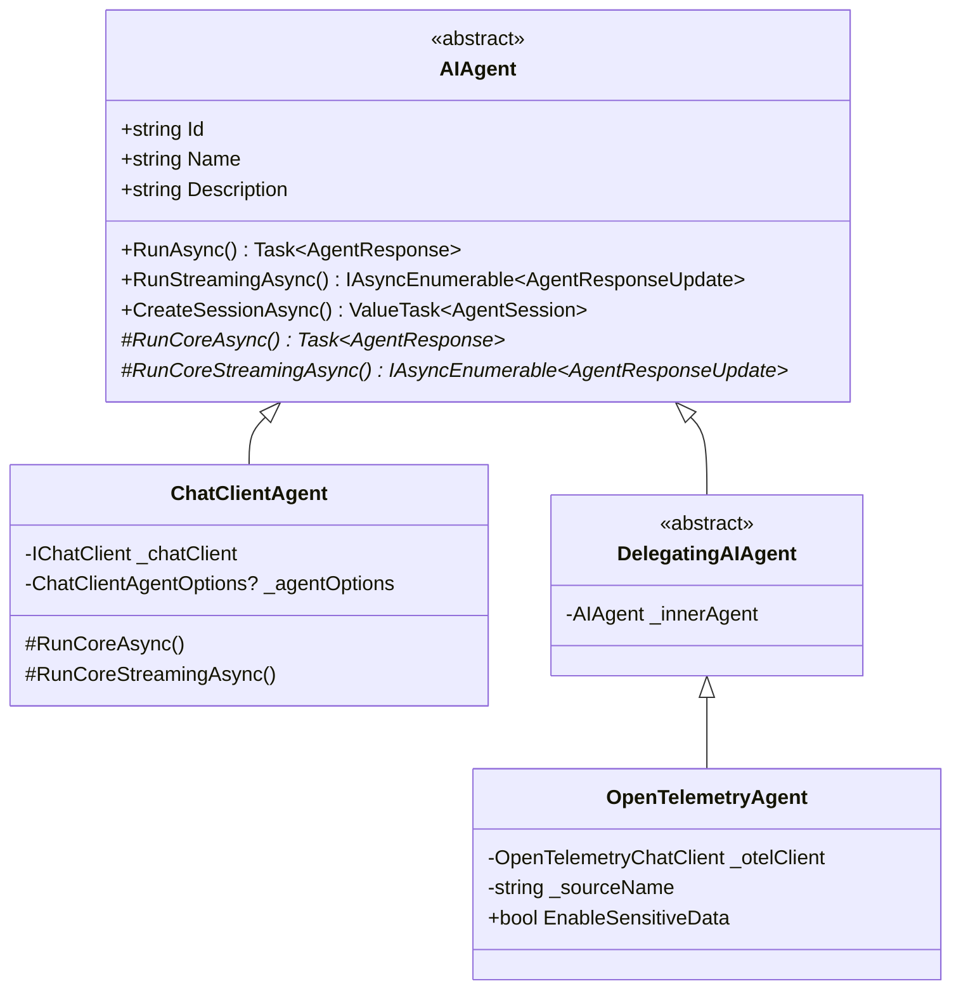
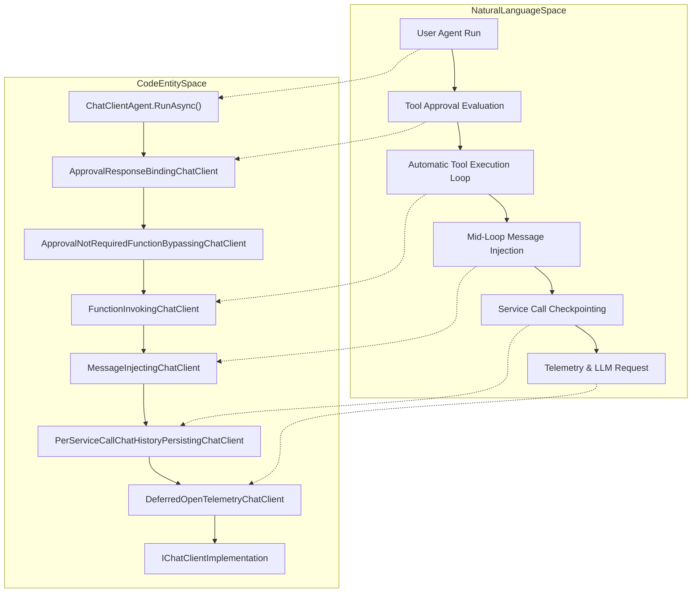
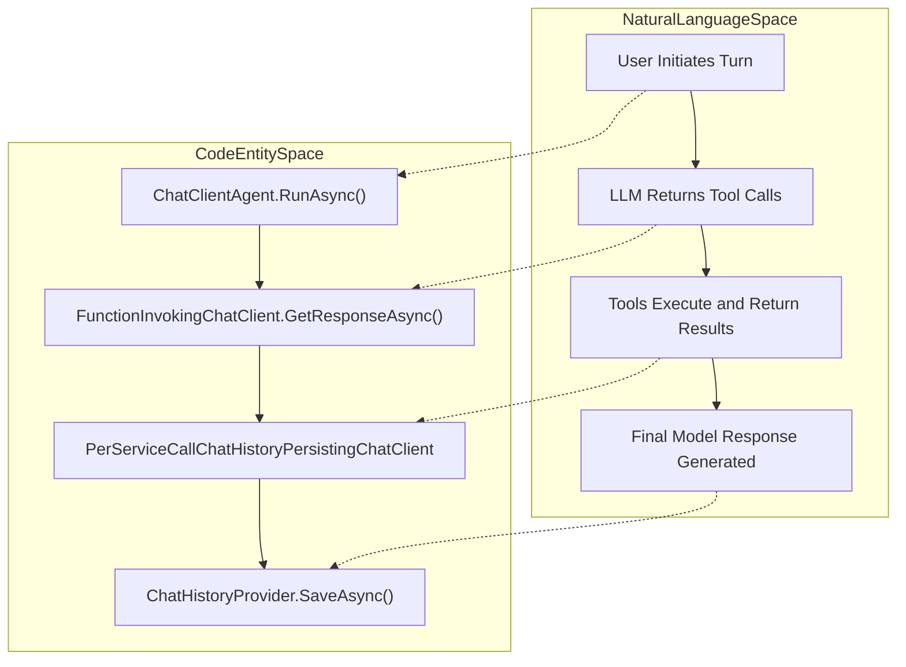

<!-- source: DeepWiki mcp.deepwiki.com · repo microsoft/agent-framework · extra page Agent and Chat Client Implementation · fetched 2026-10-26 -->

# Agent and Chat Client Implementation

Relevant source files

The following files were used as context for generating this wiki page:

- [docs/decisions/0022-chat-history-persistence-consistency.md](docs/decisions/0022-chat-history-persistence-consistency.md)
- [dotnet/samples/02-agents/Agents/Agent_Step19_InFunctionLoopCheckpointing/Program.cs](dotnet/samples/02-agents/Agents/Agent_Step19_InFunctionLoopCheckpointing/Program.cs)
- [dotnet/samples/02-agents/Agents/Agent_Step19_InFunctionLoopCheckpointing/README.md](dotnet/samples/02-agents/Agents/Agent_Step19_InFunctionLoopCheckpointing/README.md)
- [dotnet/src/Microsoft.Agents.AI.Abstractions/AdditionalPropertiesExtensions.cs](dotnet/src/Microsoft.Agents.AI.Abstractions/AdditionalPropertiesExtensions.cs)
- [dotnet/src/Microsoft.Agents.AI/ChatClient/ChatClientAgent.cs](dotnet/src/Microsoft.Agents.AI/ChatClient/ChatClientAgent.cs)
- [dotnet/src/Microsoft.Agents.AI/ChatClient/ChatClientAgentContinuationToken.cs](dotnet/src/Microsoft.Agents.AI/ChatClient/ChatClientAgentContinuationToken.cs)
- [dotnet/src/Microsoft.Agents.AI/ChatClient/ChatClientAgentLogMessages.cs](dotnet/src/Microsoft.Agents.AI/ChatClient/ChatClientAgentLogMessages.cs)
- [dotnet/src/Microsoft.Agents.AI/ChatClient/ChatClientAgentOptions.cs](dotnet/src/Microsoft.Agents.AI/ChatClient/ChatClientAgentOptions.cs)
- [dotnet/src/Microsoft.Agents.AI/ChatClient/ChatClientBuilderExtensions.cs](dotnet/src/Microsoft.Agents.AI/ChatClient/ChatClientBuilderExtensions.cs)
- [dotnet/src/Microsoft.Agents.AI/ChatClient/ChatClientExtensions.cs](dotnet/src/Microsoft.Agents.AI/ChatClient/ChatClientExtensions.cs)
- [dotnet/src/Microsoft.Agents.AI/FunctionInvocationContextExtensions.cs](dotnet/src/Microsoft.Agents.AI/FunctionInvocationContextExtensions.cs)
- [dotnet/src/Microsoft.Agents.AI/FunctionInvocationDelegatingAgent.cs](dotnet/src/Microsoft.Agents.AI/FunctionInvocationDelegatingAgent.cs)
- [dotnet/src/Microsoft.Agents.AI/FunctionInvocationDelegatingAgentBuilderExtensions.cs](dotnet/src/Microsoft.Agents.AI/FunctionInvocationDelegatingAgentBuilderExtensions.cs)
- [dotnet/src/Microsoft.Agents.AI/PublicAPI/net10.0/PublicAPI.Unshipped.txt](dotnet/src/Microsoft.Agents.AI/PublicAPI/net10.0/PublicAPI.Unshipped.txt)
- [dotnet/src/Microsoft.Agents.AI/PublicAPI/net472/PublicAPI.Unshipped.txt](dotnet/src/Microsoft.Agents.AI/PublicAPI/net472/PublicAPI.Unshipped.txt)
- [dotnet/src/Microsoft.Agents.AI/PublicAPI/net8.0/PublicAPI.Unshipped.txt](dotnet/src/Microsoft.Agents.AI/PublicAPI/net8.0/PublicAPI.Unshipped.txt)
- [dotnet/src/Microsoft.Agents.AI/PublicAPI/net9.0/PublicAPI.Unshipped.txt](dotnet/src/Microsoft.Agents.AI/PublicAPI/net9.0/PublicAPI.Unshipped.txt)
- [dotnet/src/Microsoft.Agents.AI/PublicAPI/netstandard2.0/PublicAPI.Unshipped.txt](dotnet/src/Microsoft.Agents.AI/PublicAPI/netstandard2.0/PublicAPI.Unshipped.txt)
- [dotnet/tests/Microsoft.Agents.AI.Abstractions.UnitTests/AdditionalPropertiesExtensionsTests.cs](dotnet/tests/Microsoft.Agents.AI.Abstractions.UnitTests/AdditionalPropertiesExtensionsTests.cs)
- [dotnet/tests/Microsoft.Agents.AI.UnitTests/ChatClient/ChatClientAgentContinuationTokenTests.cs](dotnet/tests/Microsoft.Agents.AI.UnitTests/ChatClient/ChatClientAgentContinuationTokenTests.cs)
- [dotnet/tests/Microsoft.Agents.AI.UnitTests/ChatClient/ChatClientAgentOptionsTests.cs](dotnet/tests/Microsoft.Agents.AI.UnitTests/ChatClient/ChatClientAgentOptionsTests.cs)
- [dotnet/tests/Microsoft.Agents.AI.UnitTests/ChatClient/ChatClientAgentTestHelper.cs](dotnet/tests/Microsoft.Agents.AI.UnitTests/ChatClient/ChatClientAgentTestHelper.cs)
- [dotnet/tests/Microsoft.Agents.AI.UnitTests/ChatClient/ChatClientAgentTests.cs](dotnet/tests/Microsoft.Agents.AI.UnitTests/ChatClient/ChatClientAgentTests.cs)
- [dotnet/tests/Microsoft.Agents.AI.UnitTests/ChatClient/ChatClientAgent_ApprovalsTests.cs](dotnet/tests/Microsoft.Agents.AI.UnitTests/ChatClient/ChatClientAgent_ApprovalsTests.cs)
- [dotnet/tests/Microsoft.Agents.AI.UnitTests/ChatClient/ChatClientAgent_BackgroundResponsesTests.cs](dotnet/tests/Microsoft.Agents.AI.UnitTests/ChatClient/ChatClientAgent_BackgroundResponsesTests.cs)
- [dotnet/tests/Microsoft.Agents.AI.UnitTests/ChatClient/ChatClientAgent_ChatHistoryManagementTests.cs](dotnet/tests/Microsoft.Agents.AI.UnitTests/ChatClient/ChatClientAgent_ChatHistoryManagementTests.cs)
- [dotnet/tests/Microsoft.Agents.AI.UnitTests/ChatClient/ChatClientAgent_ChatOptionsMergingTests.cs](dotnet/tests/Microsoft.Agents.AI.UnitTests/ChatClient/ChatClientAgent_ChatOptionsMergingTests.cs)
- [dotnet/tests/Microsoft.Agents.AI.UnitTests/ChatClient/ChatClientBuilderExtensionsTests.cs](dotnet/tests/Microsoft.Agents.AI.UnitTests/ChatClient/ChatClientBuilderExtensionsTests.cs)
- [dotnet/tests/Microsoft.Agents.AI.UnitTests/ChatClient/ChatClientExtensionsTests.cs](dotnet/tests/Microsoft.Agents.AI.UnitTests/ChatClient/ChatClientExtensionsTests.cs)
- [dotnet/tests/Microsoft.Agents.AI.UnitTests/FunctionInvocationDelegatingAgentTests.cs](dotnet/tests/Microsoft.Agents.AI.UnitTests/FunctionInvocationDelegatingAgentTests.cs)

## Purpose and Scope
This page details the implementation architecture of `ChatClientAgent` within the Microsoft Agent Framework .NET library. It covers its delegation to `IChatClient`, initialization patterns, the automatic middleware pipeline constructed via `ChatClientExtensions`, chat history persistence semantics, session management, and configuration option merging.

---

## Agent Class Hierarchy

The framework provides an abstract `AIAgent` base class [dotnet/src/Microsoft.Agents.AI.Abstractions/AIAgent.cs:38-142]() from which concrete agent implementations derive. `ChatClientAgent` inherits from `AIAgent` and delegates execution directly to an `IChatClient` instance [dotnet/src/Microsoft.Agents.AI/ChatClient/ChatClientAgent.cs:18-39]().

### Agent Type Relationships
Title: "Agent Implementation Hierarchy"

Sources: 
- [dotnet/src/Microsoft.Agents.AI.Abstractions/AIAgent.cs:38-142]()
- [dotnet/src/Microsoft.Agents.AI/ChatClient/ChatClientAgent.cs:39-46]()

---

## ChatClientAgent Implementation and IChatClient Delegation

`ChatClientAgent` wraps an `IChatClient` implementation to bridge agent semantics with the `Microsoft.Extensions.AI` chat abstractions. 

During instantiation, the agent validates inputs, clones `ChatClientAgentOptions` to maintain immutability, and executes state key validation across configured providers [dotnet/src/Microsoft.Agents.AI/ChatClient/ChatClientAgent.cs:116-150](). If duplicate or clashing `StateKey` values are detected between `AIContextProvider` and `ChatHistoryProvider` instances, an `InvalidOperationException` is thrown [dotnet/tests/Microsoft.Agents.AI.UnitTests/ChatClient/ChatClientAgentTests.cs:51-110]().

Sources:
- [dotnet/src/Microsoft.Agents.AI/ChatClient/ChatClientAgent.cs:116-150]()
- [dotnet/tests/Microsoft.Agents.AI.UnitTests/ChatClient/ChatClientAgentTests.cs:51-110]()

---

## Middleware and Pipeline Architecture

Unless `UseProvidedChatClientAsIs` is configured as `true`, `ChatClientAgent` passes the underlying `IChatClient` through `WithDefaultAgentMiddleware` to construct a stacked decorator pipeline [dotnet/src/Microsoft.Agents.AI/ChatClient/ChatClientAgentOptions.cs:51-62](), [dotnet/src/Microsoft.Agents.AI/ChatClient/ChatClientExtensions.cs:52-132](). 

### Pipeline Construction and Layer Order

The decorator pipeline applies builders in reverse order, meaning the first registered decorator becomes the outermost layer:
1. `ApprovalResponseBindingChatClient`: Binds user-provided approvals to model-originated tool approval requests [dotnet/src/Microsoft.Agents.AI/ChatClient/ChatClientExtensions.cs:62-66]().
2. `ApprovalNotRequiredFunctionBypassingChatClient`: Intercepts tool calls that do not require approval to streamline execution [dotnet/src/Microsoft.Agents.AI/ChatClient/ChatClientExtensions.cs:75-79]().
3. `InvocableFunctionBypassingChatClient`: Separates backend-invocable and frontend-only tool calls when enabled [dotnet/src/Microsoft.Agents.AI/ChatClient/ChatClientExtensions.cs:87-91]().
4. `FunctionInvokingChatClient`: Manages automatic tool invocation and the multi-turn model loop [dotnet/src/Microsoft.Agents.AI/ChatClient/ChatClientExtensions.cs:93-105]().
5. `MessageInjectingChatClient`: Enables injecting messages mid-loop from tool delegates [dotnet/src/Microsoft.Agents.AI/ChatClient/ChatClientExtensions.cs:115-118]().
6. `PerServiceCallChatHistoryPersistingChatClient`: Checkpoints chat history after each individual service call when `RequirePerServiceCallChatHistoryPersistence` is enabled [dotnet/src/Microsoft.Agents.AI/ChatClient/ChatClientExtensions.cs:126-129]().
7. `DeferredOpenTelemetryChatClient`: Innermost observability tracing wrapper [dotnet/src/Microsoft.Agents.AI/ChatClient/ChatClientExtensions.cs:131-131]().

### Pipeline Execution Mapping (Natural Language to Code Entity Space)
Title: "ChatClientAgent Pipeline Execution Architecture"

Sources:
- [dotnet/src/Microsoft.Agents.AI/ChatClient/ChatClientExtensions.cs:52-132]()
- [dotnet/src/Microsoft.Agents.AI/ChatClient/ChatClientBuilderExtensions.cs:113-145]()

---

## Chat History and Persistence Architecture

`ChatClientAgent` supports two distinct history persistence patterns based on architectural decisions regarding atomicity and recoverability (`docs/decisions/0022-chat-history-persistence-consistency.md`) [docs/decisions/0022-chat-history-persistence-consistency.md:12-41]().

### Persistence Modes

| Persistence Mode | Setting Configuration | Operational Behavior |
|------------------|----------------------|----------------------|
| **End-of-Run (Default)** | `RequirePerServiceCallChatHistoryPersistence = false` | History is saved in a single batch via `ChatHistoryProvider` when the complete agent run concludes successfully [docs/decisions/0022-chat-history-persistence-consistency.md:50-57](). |
| **Per-Service-Call** | `RequirePerServiceCallChatHistoryPersistence = true` | History is checkpointed after every individual LLM call within the `FunctionInvokingChatClient` loop via `PerServiceCallChatHistoryPersistingChatClient` [docs/decisions/0022-chat-history-persistence-consistency.md:60-72](). |

### Persistence Data Flow (Natural Language to Code Entity Space)
Title: "Chat History Persistence Data Flow"

Sources:
- [dotnet/src/Microsoft.Agents.AI/ChatClient/ChatClientAgentOptions.cs:108-141]()
- [docs/decisions/0022-chat-history-persistence-consistency.md:12-76]()

---

## Session and State Management

State persistence across turns is handled using `ChatClientAgentSession`. 

### Conflict Resolution
When an underlying AI service returns a service-managed conversation identifier (`ConversationId`), but a framework-level `ChatHistoryProvider` has also been explicitly configured, a conflict occurs. `ChatClientAgentOptions` controls handling via:
- `ClearOnChatHistoryProviderConflict`: Clears the conflicting local provider [dotnet/src/Microsoft.Agents.AI/ChatClient/ChatClientAgentOptions.cs:78-87]().
- `ThrowOnChatHistoryProviderConflict`: Throws an `InvalidOperationException` [dotnet/src/Microsoft.Agents.AI/ChatClient/ChatClientAgentOptions.cs:99-105]().
- `WarnOnChatHistoryProviderConflict`: Logs a warning via `ChatClientAgentLogMessages` [dotnet/src/Microsoft.Agents.AI/ChatClient/ChatClientAgentOptions.cs:90-96](), [dotnet/src/Microsoft.Agents.AI/ChatClient/ChatClientAgentLogMessages.cs:63-71]().

Sources:
- [dotnet/src/Microsoft.Agents.AI/ChatClient/ChatClientAgent.cs:132-150]()
- [dotnet/src/Microsoft.Agents.AI/ChatClient/ChatClientAgentOptions.cs:65-105]()
- [dotnet/src/Microsoft.Agents.AI/ChatClient/ChatClientAgentLogMessages.cs:63-71]()

---

## Options Merging and Configuration

`ChatClientAgent` merges `ChatOptions` hierarchically during execution. Precedence order (highest to lowest):
1. `AgentRunOptions`: Run-specific transient overrides.
2. Request-level `ChatOptions`: Options passed directly into `RunAsync` parameters.
3. Agent-level `ChatOptions`: Defaults established inside `ChatClientAgentOptions` at initialization [dotnet/src/Microsoft.Agents.AI/ChatClient/ChatClientAgentOptions.cs:38-38](), [dotnet/tests/Microsoft.Agents.AI.UnitTests/ChatClient/ChatClientAgent_ChatOptionsMergingTests.cs:113-143]().

Sources:
- [dotnet/src/Microsoft.Agents.AI/ChatClient/ChatClientAgentOptions.cs:34-38]()
- [dotnet/tests/Microsoft.Agents.AI.UnitTests/ChatClient/ChatClientAgent_ChatOptionsMergingTests.cs:113-143]()

---

## JSON Serialization

All serialization tasks for agent sessions, state bags, and continuation tokens are managed through `AgentJsonUtilities`, which provides pre-configured `JsonSerializerOptions` optimized for Native AOT and cross-component compatibility [dotnet/src/Microsoft.Agents.AI/AgentJsonUtilities.cs:31-112]().

Sources:
- [dotnet/src/Microsoft.Agents.AI/AgentJsonUtilities.cs:31-112]()

---

