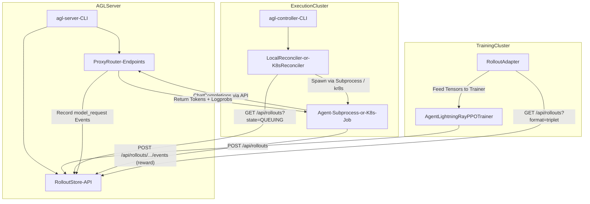
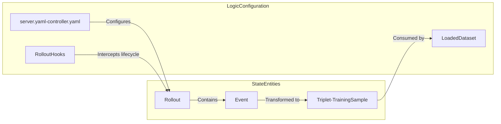

<!-- source: DeepWiki mcp.deepwiki.com · repo microsoft/agent-lightning · page 1 Overview · fetched 2026-10-26 -->

# Overview

Relevant source files

The following files were used as context for generating this wiki page:

- [README.md](README.md)
- [agentlightning/__init__.py](agentlightning/__init__.py)
- [agentlightning/verl/dataset.py](agentlightning/verl/dataset.py)
- [docs/76-example-coding-agent-moe.md](docs/76-example-coding-agent-moe.md)
- [docs/README.md](docs/README.md)
- [docs/community/contributing.md](docs/community/contributing.md)
- [docs/images/architecture.jpg](docs/images/architecture.jpg)
- [examples/swe_smith/README.md](examples/swe_smith/README.md)
- [mkdocs.yml](mkdocs.yml)

Agent Lightning v1.0 is a lightweight (~3,500 lines of code) framework designed for **Harnessed Agentic RL** [README.md:5-15](). It enables training AI agents—ranging from multi-turn reasoning agents to complex coding agents—using Reinforcement Learning with **zero changes** required to the agent's internal business logic or tools [README.md:22-23]().

By decoupling the training infrastructure from the agent execution environment, Agent Lightning allows models to interact with real toolchains, file systems, and sandboxes while recording high-fidelity training data (token IDs, logprobs, and rewards) via an OpenAI-compatible proxy [README.md:49-51]().

Sources: [README.md:5-15](), [README.md:22-23](), [README.md:49-51]()

## Three-Service Architecture

The framework operates via a Producer-Consumer loop distributed across three lightweight components. This separation isolates heavy training compute (GPUs) from agent execution compute (which may require specialized sandboxes or Kubernetes clusters) [README.md:49-51]().

- **Trainer:** Runs `verl` and vLLM, builds training samples, and updates the policy [README.md:47]().
- **AGL Server (`agentlightning.server.__main__:main`):** A FastAPI-based central hub acting as a rollout state store, event repository, and LLM proxy [README.md:49-50](), [docs/community/contributing.md:63]().
- **AGL Controller (`agentlightning.controller.__main__:main`):** A reconciliation service that polls the server for queued rollout tasks and spawns agent execution environments either as local subprocesses or native Kubernetes Jobs [docs/community/contributing.md:64]().

Sources: [README.md:47-51](), [docs/community/contributing.md:63-64]()

## System Topology & Mapping

The following diagrams illustrate how high-level architectural concepts correspond to concrete code entities across the repository.

**Diagram: Service Interaction and Code Entrypoints**

Sources: [README.md:47-51](), [docs/community/contributing.md:63-65]()

**Diagram: Data Entity Relationship**

Sources: [docs/community/contributing.md:63-65](), [agentlightning/verl/dataset.py:17-45]()

## Core Value Proposition: Harnessed RL

Unlike traditional RL frameworks that rely on simplified environment emulators, Agent Lightning focuses on **Harnessed Agentic RL**:
- **Real Harnesses & Tools:** Agents utilize actual bash shells, compilers, and browsers without abstraction layers [README.md:22-23]().
- **Native Kubernetes Support:** Rollouts scale horizontally as native `K8s Jobs` via `kr8s` without external sandbox services [README.md:24]().
- **Zero-Drift Proxy:** Captures exact token IDs and logprobs directly from the provider API to eliminate re-tokenization drift [README.md:91]().
- **Trajectory Aggregation:** Supports multi-turn credit assignment, advantage normalization, and reward-hacking prevention [README.md:89]().

Sources: [README.md:22-24](), [README.md:89](), [README.md:91]()

## Navigation

For detailed information on specific subsystems, guides, and workflows, see the child pages:
- **[Getting Started & Installation](#1.1)** — Installing Agent Lightning v1.0, dependency groups, `scripts/setup_verl.sh` CUDA setup, and first local training runs [README.md:27-35]().
- **[Architecture Overview](#1.2)** — In-depth breakdown of the three-service Producer-Consumer loop, data flows, and service responsibilities [README.md:40-51]().

Sources: [README.md:27-51](), [README.md:40-51]()

---

