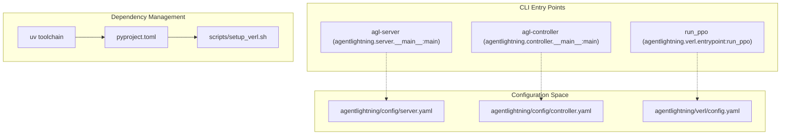
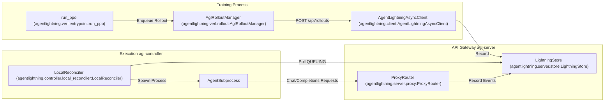

<!-- source: DeepWiki mcp.deepwiki.com · repo microsoft/agent-lightning · page 1.1 Getting Started & Installation · fetched 2026-10-26 -->

# Getting Started & Installation

<details>
<summary>Relevant source files</summary>

The following files were used as context for generating this wiki page:

- [agentlightning/config/__init__.py](agentlightning/config/__init__.py)
- [agentlightning/config/controller.yaml](agentlightning/config/controller.yaml)
- [agentlightning/config/server.yaml](agentlightning/config/server.yaml)
- [agentlightning/controller/__init__.py](agentlightning/controller/__init__.py)
- [agentlightning/controller/__main__.py](agentlightning/controller/__main__.py)
- [agentlightning/hooks.py](agentlightning/hooks.py)
- [docs/01-quick-start.md](docs/01-quick-start.md)
- [docs/30-controller-configuration.md](docs/30-controller-configuration.md)
- [pyproject.toml](pyproject.toml)
- [scripts/setup_verl.sh](scripts/setup_verl.sh)
- [tests/controller/test_local_reconciler_platform.py](tests/controller/test_local_reconciler_platform.py)
- [uv.lock](uv.lock)

</details>


## Purpose & Scope
This page provides a comprehensive guide for installing Agent Lightning v1.0, managing its multi-tiered dependency system, configuring core services via Hydra, and executing your first local agent training loop. Agent Lightning bridges the gap between agentic frameworks and large-scale reinforcement learning (RL) optimization loops by decoupling agent execution from training compute.

Sources: [pyproject.toml:1-128](), [scripts/setup_verl.sh:1-98](), [docs/01-quick-start.md:1-57]()

## System Overview & Toolchain

Agent Lightning utilizes the `uv` toolchain for high-performance dependency resolution and environment isolation [pyproject.toml:58-70](). The framework is built around a three-service producer-consumer architecture:
1.  **agl-server**: A FastAPI-based central hub for rollout state, LLM proxying, and event ingestion [pyproject.toml:49]().
2.  **agl-controller**: A reconciliation service managing agent lifecycles via local subprocesses (`LocalReconciler`) or Kubernetes Jobs (`K8sReconciler`) [pyproject.toml:50](), [agentlightning/controller/__main__.py:22-35]().
3.  **VERL Trainer**: The training backend (`AgentLightningRayPPOTrainer`) that orchestrates PPO/GRPO updates and dispatches rollouts to the server [docs/01-quick-start.md:7]().

### Core Components Mapping

The following diagram bridges natural language concepts to specific code entities used during installation, CLI entrypoints, and initial setup.

**Natural Language to Code Entity Space: CLI & Environment**

Sources: [pyproject.toml:48-50](), [agentlightning/config/server.yaml:1-11](), [agentlightning/config/controller.yaml:1-19](), [scripts/setup_verl.sh:1-11]()

## Installation Procedures

### Requirements
* **OS**: Linux (Ubuntu 22.04+ recommended) [docs/01-quick-start.md:11](). The `local` runner type (`runner_type=local`) relies on POSIX process-group signals and is explicitly not supported on native Windows [docs/30-controller-configuration.md:88-89](), [tests/controller/test_local_reconciler_platform.py:31-34]().
* **Python**: Version 3.12 or newer [pyproject.toml:21]().
* **Hardware**: NVIDIA GPU (A100 recommended). CUDA 12.9 or 13.0 is supported for stable GPU training stacks [scripts/setup_verl.sh:28-31]().

### Step 1: UV Sync
From the project root, use `uv` to install the base Python environment and core dependencies [docs/01-quick-start.md:27-31]():
```bash
uv sync
```
Sources: [pyproject.toml:22-34]()

### Step 2: Install VERL and GPU Stack
Agent Lightning uses `verl` as its training backend. The compatible versions of `verl`, `vllm`, and `torch` are tightly coupled. Use `scripts/setup_verl.sh` to install the tested stack and build `flash-attn` from source [scripts/setup_verl.sh:1-98]().

```bash
source .venv/bin/activate
# Usage: bash scripts/setup_verl.sh <verl_version> <cuda_variant> [venv_path]
bash scripts/setup_verl.sh 0.8.0 cu130
```
The script supports `verl` versions `0.7.1` or `0.8.0` and CUDA variants `cu129` or `cu130` [scripts/setup_verl.sh:23-31](). It automates the installation of `vllm`, `nvidia-cuda-nvcc` (for CUDA 13.0 builds), and forces a local compilation of `flash-attn==2.8.3` to ensure binary compatibility with PyTorch's CUDART runtime [scripts/setup_verl.sh:39-98]().

### Step 3: W&B Login
By default, tasks upload metrics and training trajectories to Weights & Biases [docs/01-quick-start.md:50]():
```bash
uv run wandb login
```
Sources: [docs/01-quick-start.md:50]()

## Dependency Group Configuration

Agent Lightning defines optional dependency groups and toolchain parameters in `pyproject.toml` to separate lightweight coordination services from the heavy GPU training stack [pyproject.toml:36-46](), [pyproject.toml:96-128]().

| Group | Purpose | Key Dependencies |
| :--- | :--- | :--- |
| `dev` | Development and testing | `pytest`, `ruff`, `pyright`, `openai`, `sympy` [pyproject.toml:37-46]() |
| `docs` | Documentation site generation | `mike`, `mkdocs-material`, `mkdocstrings`, `mkdocs-macros-plugin` [pyproject.toml:97-105]() |
| `verl-cpu` | Lint and type-check environment | `verl`, `torch` (CPU index), `ray`, `tensordict`, `datasets` [pyproject.toml:120-128]() |

**Toolchain Conflict Resolution**
The `verl-cpu` group uses a dedicated `uv` source (`pytorch-cpu`) pointing to `https://download.pytorch.org/whl/cpu` [pyproject.toml:58-70](). This allows static type-checkers (like `pyright`) and test suites to run on non-GPU worker nodes without downloading ~2.3GB of CUDA runtime binaries [pyproject.toml:110-128]().

Sources: [pyproject.toml:36-70](), [pyproject.toml:96-128]()

## Configuration Files

The framework uses Hydra for configuration management across services.

### Server Configuration (`server.yaml`)
Located at `agentlightning/config/server.yaml`, primary fields include:
* `host` and `port`: Uvicorn web server binding parameters [agentlightning/config/server.yaml:1-2]().
* `key`: Shared bearer token for API authentication [agentlightning/config/server.yaml:3]().
* `default_proxy`: Sets the default model name (e.g., `Qwen/Qwen2.5-7B-Instruct`) and sampling temperatures for `train` and `val` modes [agentlightning/config/server.yaml:4-11]().

### Controller Configuration (`controller.yaml`)
Located at `agentlightning/config/controller.yaml`, primary fields include:
* `runner_type`: Execution backend selector (`k8s` or `local`) [agentlightning/config/controller.yaml:1](), [docs/30-controller-configuration.md:41-47]().
* `agl_server.url`: API Gateway base URL used by the controller [agentlightning/config/controller.yaml:4](), [docs/30-controller-configuration.md:55-57]().
* `agl_server.agent_url`: Optional external URL for agent pods when networking requires traversal [agentlightning/config/controller.yaml:8](), [docs/30-controller-configuration.md:58]().
* `agl_server.key`: Shared authentication secret [agentlightning/config/controller.yaml:9](), [docs/30-controller-configuration.md:59]().
* `k8s_runner` and `local_runner`: Polling frequencies, process pool limits (`maximum_size: 50`), and job rate limits [agentlightning/config/controller.yaml:11-19](), [docs/30-controller-configuration.md:67-87]().

Sources: [agentlightning/config/server.yaml:1-11](), [agentlightning/config/controller.yaml:1-19](), [docs/30-controller-configuration.md:1-87]()

## Running the First Training Loop

A local test run uses the `local` runner mode to spawn agents as managed subprocesses on the same machine as the training process [docs/30-controller-configuration.md:49]().

### 1. Manual Service Entrypoints
Services can be started manually via the CLI entrypoints defined in `pyproject.toml`:
```bash
# Start the API Server Gateway
agl-server host=0.0.0.0 port=8080 key="my-secret-key"

# Start the Controller in local mode
agl-controller runner_type=local agl_server.url="http://localhost:8080" agl_server.key="my-secret-key"
```
Sources: [pyproject.toml:48-50](), [agentlightning/config/server.yaml:1-3](), [agentlightning/config/controller.yaml:1-9]()

### 2. Data Flow Diagram
The following diagram maps the execution components during training initialization and rollout reconciliation to code symbols in the codebase.

**Code Entity Data Flow: Training Initialization**

Sources: [pyproject.toml:48-50](), [agentlightning/controller/__main__.py:17-43](), [agentlightning/controller/local_reconciler.py:12]()

Sources: [pyproject.toml:1-128](), [scripts/setup_verl.sh:1-98](), [agentlightning/config/server.yaml:1-11](), [agentlightning/config/controller.yaml:1-19](), [docs/01-quick-start.md:1-57](), [docs/30-controller-configuration.md:1-95](), [tests/controller/test_local_reconciler_platform.py:1-61]()

---

