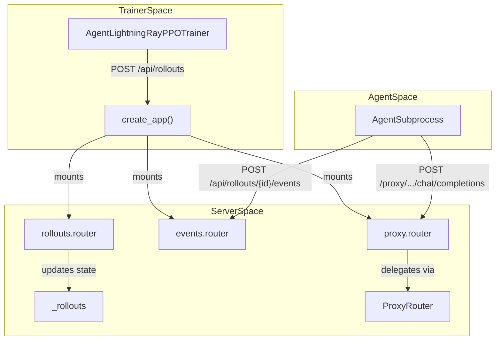

<!-- source: DeepWiki mcp.deepwiki.com · repo microsoft/agent-lightning · page 2 AGL Server · fetched 2026-10-26 -->

# AGL Server

<details>
<summary>Relevant source files</summary>

The following files were used as context for generating this wiki page:

- [agentlightning/controller/k8s_reconciler.py](agentlightning/controller/k8s_reconciler.py)
- [agentlightning/server/__init__.py](agentlightning/server/__init__.py)
- [agentlightning/server/__main__.py](agentlightning/server/__main__.py)
- [agentlightning/server/app.py](agentlightning/server/app.py)
- [agentlightning/server/routes/rollouts.py](agentlightning/server/routes/rollouts.py)

</details>


The `agl-server` is the central coordination hub and state management plane of the Agent Lightning framework [agentlightning/server/app.py:3-19](). Implemented as a FastAPI application, it manages rollout lifecycle states, provides an OpenAI-compatible reverse proxy for LLM generation, and ingests telemetry and reward events from running agents [agentlightning/server/app.py:3-19](). 

By centralizing state transitions and model interaction through `agl-server`, the training infrastructure (such as VERL) remains decoupled from environment execution details.

Sources: [agentlightning/server/app.py:3-19]()

## Role and Responsibilities

The server executes several core coordination duties:

*   **Rollout Coordination:** Manages rollout states through `enqueue_rollouts()` and `patch_rollout()` [agentlightning/server/routes/rollouts.py:95-183]().
*   **LLM Proxying:** Intercepts agent generation calls via `ProxyRouter` and manages drain/pause workflows with `ProxyPauseState` [agentlightning/server/app.py:17]().
*   **Event Ingestion:** Receives telemetry and reward payloads via event routers mounted in `create_app()` [agentlightning/server/app.py:84]().
*   **Authentication:** Validates API keys via `_build_auth_dependency()` using bearer tokens or `x-api-key` headers [agentlightning/server/app.py:34-50]().
*   **Application Lifecycle:** Manages background state variables and HTTP client sessions inside the `lifespan()` async context manager [agentlightning/server/app.py:67-73]().

Sources: [agentlightning/server/app.py:17-84](), [agentlightning/server/routes/rollouts.py:95-183]()

## System Topology & Code Mapping

The following diagram bridges natural language runtime components to their implementation symbols within the `agentlightning/server` package.

### System Topology Map

Sources: [agentlightning/server/app.py:53-93](), [agentlightning/server/routes/rollouts.py:95-209]()

## Core Subsystems

The server functionality is partitioned across three core domains, each detailed in its respective child page:

### REST API & Data Model
Exposes HTTP endpoints for rollout creation, lifecycle patching, lightweight terminal pagination, and health checks [agentlightning/server/routes/rollouts.py:95-209](), [agentlightning/server/app.py:78-80](). Data structures are validated via Pydantic schemas.

For details, see [REST API & Data Model](#2.1).

Sources: [agentlightning/server/app.py:78-80](), [agentlightning/server/routes/rollouts.py:95-209]()

### LLM Proxy & Gateway Management
Implements an OpenAI-compatible proxy interface that routes agent requests according to URL parameters, supporting model weight updates via pause and drain states managed by `ProxyPauseState` [agentlightning/server/app.py:17,68-88]().

For details, see [LLM Proxy & Gateway Management](#2.2).

Sources: [agentlightning/server/app.py:17,68-88]()

### Event System & Triplet Format
Ingeats agent telemetry (`model_request` and `reward` events) to reconstruct training sequences and calculate policy advantages [agentlightning/server/app.py:84]().

For details, see [Event System & Triplet Format](#2.3).

Sources: [agentlightning/server/app.py:84]()

## Code Entity Mapping

This diagram maps internal class implementations and route handlers to their architectural roles.

### Code Entity Map
```mermaid
classDiagram
    class create_app {
        +create_app(config) FastAPI
        +_build_auth_dependency(key)
    }
    class ProxyRouter {
        +__init__(default_proxy)
    }
    class ProxyPauseState {
        +pause()
        +resume()
    }
    class rollouts {
        +enqueue_rollouts()
        +list_rollouts()
        +patch_rollout()
    }
    class events {
        +post_event()
    }

    create_app --> ProxyRouter : "app.state.proxy_router"
    create_app --> ProxyPauseState : "app.state.proxy_pause_state"
    create_app --> rollouts : "rollouts.router"
    create_app --> events : "events.router"

    style create_app font-weight:bold
```
Sources: [agentlightning/server/app.py:34-93](), [agentlightning/server/routes/rollouts.py:95-209]()

## Execution

The server is launched via the Hydra entrypoint `main()` defined in `agentlightning/server/__main__.py` [agentlightning/server/__main__.py:14-23](). It constructs the application instance using `create_app(config)` and binds a `uvicorn` server instance [agentlightning/server/__main__.py:16-23]().

Sources: [agentlightning/server/__main__.py:14-23]()

---

