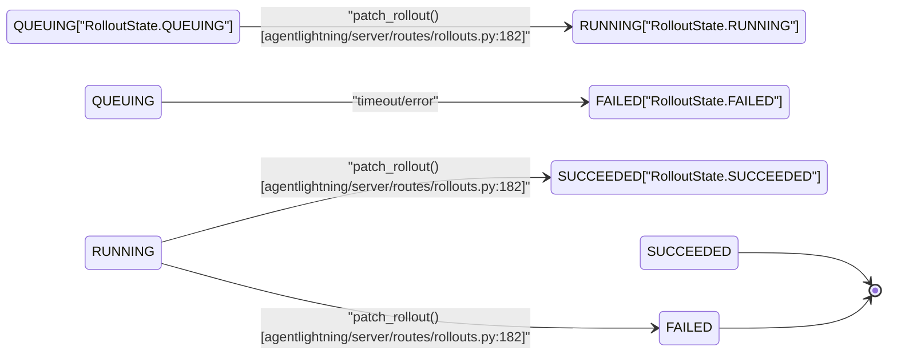
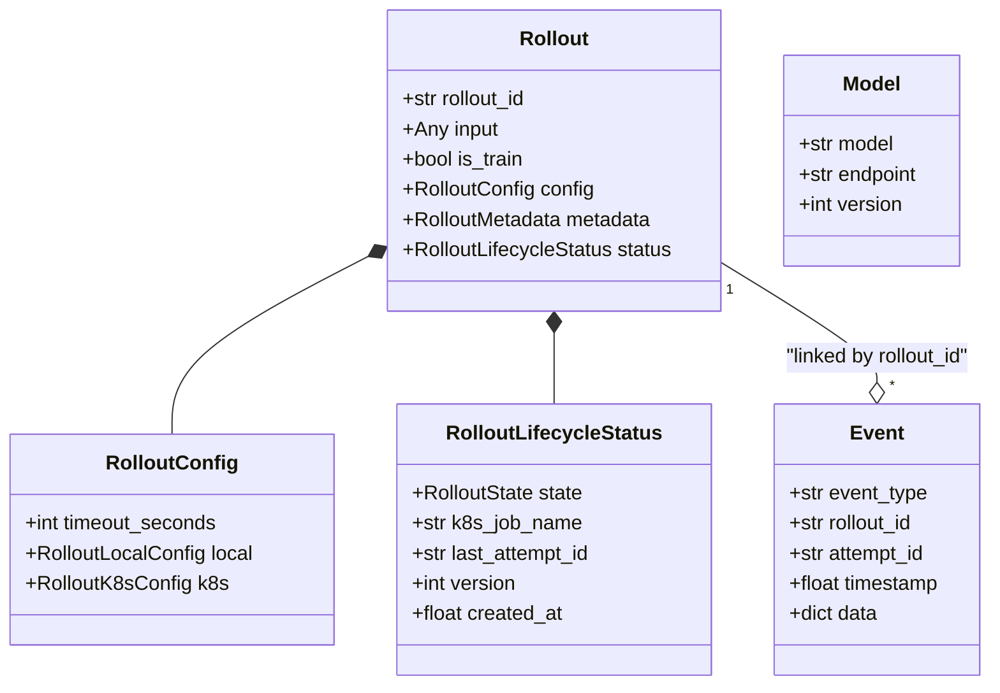
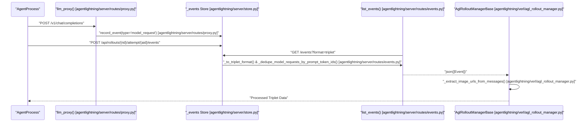

<!-- source: DeepWiki mcp.deepwiki.com · repo microsoft/agent-lightning · page 2.1 REST API & Data Model · fetched 2026-10-26 -->

# REST API & Data Model

Relevant source files

The following files were used as context for generating this wiki page:

- [agentlightning/schemas.py](agentlightning/schemas.py)
- [agentlightning/server/routes/__init__.py](agentlightning/server/routes/__init__.py)
- [agentlightning/server/routes/models.py](agentlightning/server/routes/models.py)
- [agentlightning/server/store.py](agentlightning/server/store.py)
- [tests/server/test_endpoints.py](tests/server/test_endpoints.py)
- [tests/verl/test_agl_rollout_manager.py](tests/verl/test_agl_rollout_manager.py)

The `agl-server` module acts as the central state coordinator and telemetry hub for Agent Lightning. It provides a RESTful interface implemented in FastAPI [agentlightning/server/app.py:53-93]() for enqueuing rollouts, tracking their lifecycle states, registering models [agentlightning/server/routes/models.py:15-24](), and ingesting events such as LLM requests and reward signals [tests/server/test_endpoints.py:126-148](). The server uses an in-memory store (`_rollouts`, `_events`, `_models`, and `_terminal_order`) [agentlightning/server/store.py:13-18]() to maintain low-latency coordination between the training loop (producer) and the controller/runners (consumers).

Sources: [agentlightning/server/app.py:53-93](), [agentlightning/server/routes/models.py:15-24](), [agentlightning/server/store.py:13-18](), [tests/server/test_endpoints.py:126-148]()

---

## Rollout Lifecycle & State Machine

The core unit of work managed by `agl-server` is a `Rollout` [agentlightning/schemas.py:177-185](). Its execution lifecycle is governed by a strict state machine defined by `RolloutState` [agentlightning/schemas.py:77-84]() and enforced via `VALID_TRANSITIONS` [agentlightning/schemas.py:87-93]() during `patch_rollout` requests [agentlightning/server/routes/rollouts.py:182-209]().

### Rollout States
*   **`QUEUING`**: Initial state upon creation via `enqueue_rollouts` [agentlightning/schemas.py:80](), [agentlightning/server/routes/rollouts.py:95-122](). The rollout is waiting for a controller runner (local or Kubernetes) to pick it up.
*   **`RUNNING`**: The controller runner has claimed and spawned an agent process or Kubernetes Job for the rollout [agentlightning/schemas.py:81](), [agentlightning/controller/k8s_reconciler.py:38-101]().
*   **`SUCCEEDED`**: Terminal state indicating the agent completed execution successfully [agentlightning/schemas.py:82]().
*   **`FAILED`**: Terminal state indicating the agent crashed, timed out, or encountered a fatal error [agentlightning/schemas.py:83]().

### State Transitions & Terminal Ordering
Transitions are strictly validated against `VALID_TRANSITIONS` [agentlightning/schemas.py:87-93](). Attempting an invalid transition raises an HTTP 409 conflict via `_invalid_transition` [agentlightning/server/routes/rollouts.py:59-63]() and [tests/server/test_endpoints.py:51-56](). When a rollout enters a terminal state (`SUCCEEDED` or `FAILED`), its identifier is appended to `_terminal_order` [agentlightning/server/store.py:18](), enabling efficient cursor-based pagination for the VERL training loop via `list_terminal_rollouts` [agentlightning/server/routes/rollouts.py:143-171]().

**Title: Rollout State Machine (`RolloutState`, `VALID_TRANSITIONS`, and `patch_rollout`)**

Sources: [agentlightning/schemas.py:77-100](), [agentlightning/server/routes/rollouts.py:59-209](), [agentlightning/server/store.py:18](), [tests/server/test_endpoints.py:32-71]()

---

## REST API Endpoints

The server exposes endpoints under the `/api` prefix alongside root proxy and health routes, protected by an optional bearer token or API key verified by `_build_auth_dependency` [agentlightning/server/app.py:34-50]().

### Rollout CRUD Endpoints (`/api/rollouts`)
| Method | Endpoint | Description | Code Entity / Reference |
| :--- | :--- | :--- | :--- |
| `POST` | `/api/rollouts` | Enqueue a batch of rollouts. Supports idempotency via client-supplied `rollout_id`. | `enqueue_rollouts` [agentlightning/server/routes/rollouts.py:95-122]() |
| `GET` | `/api/rollouts` | List rollouts filtered by lifecycle states. | `list_rollouts` [agentlightning/server/routes/rollouts.py:125-133]() |
| `GET` | `/api/rollouts/terminal` | Cursor-paginated lightweight list of completed rollouts for training consumption. | `list_terminal_rollouts` [agentlightning/server/routes/rollouts.py:143-171]() |
| `GET` | `/api/rollouts/{rollout_id}` | Retrieve full rollout details and attempt lists. | `get_rollout` [agentlightning/server/routes/rollouts.py:174-179]() |
| `PATCH` | `/api/rollouts/{rollout_id}` | Update rollout status and increment version. | `patch_rollout` [agentlightning/server/routes/rollouts.py:182-209]() |
| `DELETE` | `/api/rollouts/{rollout_id}` | Delete a rollout and its associated events idempotently. | `test_delete_rollout` [tests/server/test_endpoints.py:150-167]() |

### Event Ingestion & Model Registration Endpoints
| Method | Endpoint | Description | Code Entity / Reference |
| :--- | :--- | :--- | :--- |
| `POST` | `/api/rollouts/{rid}/attempt/{aid}/events` | Post user-defined or environment events (such as `reward`). | `test_event_endpoints` [tests/server/test_endpoints.py:126-148]() |
| `GET` | `/api/rollouts/{rid}/events` | Retrieve events for a rollout, supporting `?format=triplet`. | `_to_triplet_format` [agentlightning/server/routes/events.py:156-169]() |
| `POST` | `/api/models` | Register model inference endpoints (`model`, `endpoint`). | `register_models` [agentlightning/server/routes/models.py:15-24]() |
| `DELETE` | `/api/models` | Clear all registered model inference endpoints. | `delete_all_models` [agentlightning/server/routes/models.py:27-31]() |
| `GET` | `/healthz` | Health check endpoint returning status `ok`. | `healthz` [agentlightning/server/app.py:78-80]() |

Sources: [agentlightning/server/app.py:34-80](), [agentlightning/server/routes/rollouts.py:95-209](), [agentlightning/server/routes/models.py:15-31](), [agentlightning/server/routes/events.py:156-169](), [tests/server/test_endpoints.py:32-167]()

---

## Data Models & Pydantic Schemas

Agent Lightning relies on shared Pydantic models defined in `agentlightning/schemas.py` to guarantee schema compliance across the `agl-server`, controller runners, and VERL trainer.

### Key Schema Classes
*   **`Rollout`**: Represents a unit of work containing `rollout_id`, `input`, `is_train`, `config` (`RolloutConfig`), `metadata` (`RolloutMetadata`), and `status` (`RolloutLifecycleStatus`) [agentlightning/schemas.py:118-185]().
*   **`Event`**: Captures telemetry items (`event_type`, `rollout_id`, `attempt_id`, `timestamp`, and `data`) stored in insertion order [agentlightning/schemas.py:13-27]().
*   **`ModelRequestData`**: Well-known structure for `event_type='model_request'`, created automatically by the LLM proxy [agentlightning/schemas.py:36-54]().
*   **`RewardData`**: Well-known structure for `event_type='reward'`, reporting scalar `value`, messages, and sources [agentlightning/schemas.py:56-67]().
*   **`Model`**: Defines registered inference endpoints keyed by `(model, endpoint)` [agentlightning/schemas.py:69-75]().

**Title: Code Entity Relationship - API Data Models (`Rollout`, `RolloutConfig`, `Event`, `Model`)**

Sources: [agentlightning/schemas.py:13-185]()

---

## Triplet Format & Data Flow Pipeline

When the VERL training loop requests rollout events via `GET /api/rollouts/{id}/events?format=triplet`, `agl-server` transforms raw telemetry into training triplets through dedicated server route helpers and VERL manager adapters.

1.  **Event Transformation**: `_to_triplet_format` trims `model_request` payloads down to `prompt_token_ids`, `response_token_ids`, and `response_log_probs`, while scalarizing `reward` events into `value` [agentlightning/server/routes/events.py:100-169]().
2.  **Deduplication**: `_dedupe_model_requests_by_prompt_token_ids` ensures that if an agent retries an identical prompt, only the final successful interaction is retained for training [agentlightning/server/routes/events.py:172-183]().
3.  **Image Alignment**: The `AglRolloutManagerBase` in the VERL trainer parses raw message structures via `_extract_image_urls_from_messages` to align multimodal image inputs with corresponding triplet tokens [agentlightning/verl/agl_rollout_manager.py:10-11](), [tests/verl/test_agl_rollout_manager.py:163-197]().

**Title: Event Pipeline & Triplet Transformation (`_to_triplet_format`, `_dedupe_model_requests_by_prompt_token_ids`, `_extract_image_urls_from_messages`)**

Sources: [agentlightning/server/routes/proxy.py:30-80](), [agentlightning/server/routes/events.py:100-183](), [agentlightning/server/store.py:13-18](), [agentlightning/verl/agl_rollout_manager.py:10-11](), [tests/verl/test_agl_rollout_manager.py:163-197]()

---

