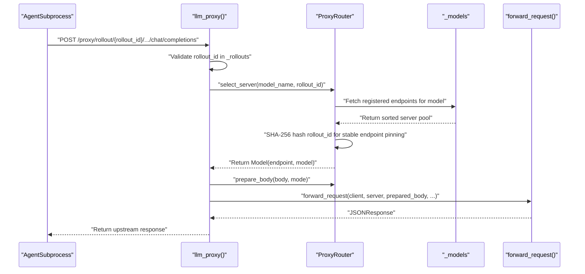
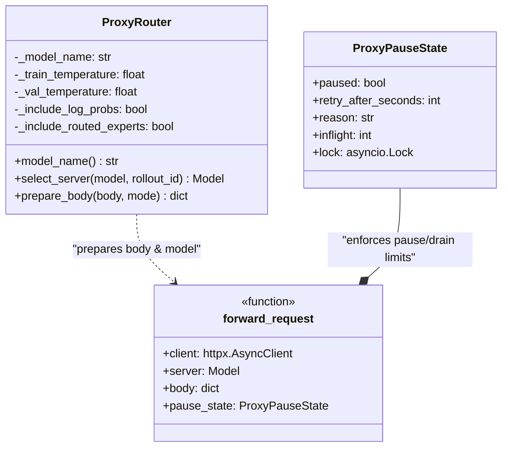

<!-- source: DeepWiki mcp.deepwiki.com · repo microsoft/agent-lightning · page 2.2 LLM Proxy & Gateway Management · fetched 2026-10-26 -->

# LLM Proxy & Gateway Management

<details>
<summary>Relevant source files</summary>

The following files were used as context for generating this wiki page:

- [agentlightning/server/proxy.py](agentlightning/server/proxy.py)
- [agentlightning/server/routes/proxy.py](agentlightning/server/routes/proxy.py)
- [docs/25-api-gateway-configuration.md](docs/25-api-gateway-configuration.md)
- [docs/35-asynchronous-training.md](docs/35-asynchronous-training.md)
- [tests/server/test_proxy_disconnect.py](tests/server/test_proxy_disconnect.py)

</details>


## Purpose and Scope
This page details the implementation of the OpenAI-compatible reverse proxy within `agl-server` (`agentlightning/server/proxy.py` and `agentlightning/server/routes/proxy.py`). It covers the proxy routing pattern, model selection and parameter injection via `ProxyRouter`, concurrency control and draining via `ProxyPauseState`, upstream retry mechanisms, client disconnect handling, and the gateway management endpoints.

Sources: [agentlightning/server/proxy.py:1-182](), [agentlightning/server/routes/proxy.py:1-139]()

---

## Proxy Routing Pattern & Architecture

The API Gateway exposes an OpenAI-compatible reverse proxy route defined in `agentlightning/server/routes/proxy.py`:

```text
POST /proxy/rollout/{rollout_id}/attempt/{attempt_id}/mode/{mode}/openai/v1/{upstream_path:path}
```

* `rollout_id`: Path parameter identifying the active rollout [agentlightning/server/routes/proxy.py:38]().
* `attempt_id`: Path parameter tracking the specific attempt index [agentlightning/server/routes/proxy.py:38]().
* `mode`: Execution mode (`train` or `val`), determining temperature and logprob injection rules [agentlightning/server/routes/proxy.py:42-43]().
* `upstream_path`: Forwarded target, supporting `chat/completions` and `completions` [agentlightning/server/routes/proxy.py:44-45]().

### Request Flow and Code Mapping

The following diagram bridges the natural language concept of proxy request handling to the exact FastAPI route handler (`llm_proxy`), router logic (`ProxyRouter`), and upstream forwarding functions (`forward_request`).

**Title: LLM Proxy Request Handling Flow**

Sources: [agentlightning/server/routes/proxy.py:38-103](), [agentlightning/server/proxy.py:39-85](), [agentlightning/server/proxy.py:96-150]()

---

## Core Implementation Entities

### ProxyRouter
The `ProxyRouter` class (`agentlightning/server/proxy.py`) manages model selection and request parameter transformation:
* `select_server(model: str, rollout_id: str)`: Looks up registered model endpoints in `_models` [agentlightning/server/proxy.py:53-56](). To maximize upstream KV prefix cache hits, it sorts the endpoint pool and hashes `rollout_id` using SHA-256 to stably pin each rollout to a specific model server replica [agentlightning/server/proxy.py:57-61]().
* `prepare_body(body: dict[str, Any], mode: str)`: Injects `model`, `temperature`, and `return_token_ids=True` [agentlightning/server/proxy.py:63-83](). When `mode == "train"`, it enforces `logprobs=True` if configured (`_include_log_probs`) and injects routed experts if enabled [agentlightning/server/proxy.py:64-75]().

### ProxyPauseState
The `ProxyPauseState` dataclass (`agentlightning/server/proxy.py`) handles gateway pause and drain states [agentlightning/server/proxy.py:87-94]().
* `paused`: Boolean flag indicating whether new requests should be rejected [agentlightning/server/proxy.py:89]().
* `inflight`: Counter tracking active requests currently executing upstream [agentlightning/server/proxy.py:92]().
* `lock`: An `asyncio.Lock` guarding state transitions and concurrent increment/decrement operations [agentlightning/server/proxy.py:93]().

**Title: Proxy Entity Architecture**

Sources: [agentlightning/server/proxy.py:39-94](), [agentlightning/server/proxy.py:96-150]()

---

## Reliability, Error Handling & Upstream Retries

To handle transient upstream model server failures (such as vLLM or TGI overloads), `_send_upstream_with_retries()` implements robust retry semantics (`agentlightning/server/proxy.py`) [agentlightning/server/proxy.py:162-182]().

*   **Max Attempts**: Bounded by `_UPSTREAM_MAX_ATTEMPTS = 6` [agentlightning/server/proxy.py:27]().
*   **Retryable Status Codes**: Triggers on `408`, `409`, `429`, and `_is_retryable_status()` checks [agentlightning/server/proxy.py:28](), [agentlightning/server/proxy.py:182]().
*   **Backoff Strategy**: Exponential backoff starting at `_RETRY_BACKOFF_BASE_SECONDS = 0.5` and capped at `_RETRY_BACKOFF_CAP_SECONDS = 8.0` [agentlightning/server/proxy.py:29-30]().
*   **Event Capture**: Every completed request invokes `_capture_event()` to record token sequences, latency, HTTP status, and retry counts into the event store [agentlightning/server/proxy.py:134-145]().

Sources: [agentlightning/server/proxy.py:27-30](), [agentlightning/server/proxy.py:134-145](), [agentlightning/server/proxy.py:162-182]()

---

## Client Disconnect Handling

When an agent subprocess disconnects during an active model request, `llm_proxy()` runs `_wait_for_disconnect(request)` concurrently with `forward_request()` [agentlightning/server/routes/proxy.py:31-35](), [agentlightning/server/routes/proxy.py:90](). If the client disconnects before the upstream response is returned, the gateway cancels the upstream HTTP task and pending retries, releases the in-flight slot, and returns a `499` status code [agentlightning/server/routes/proxy.py:91-102](). Completed requests before a disconnect are recorded normally [docs/25-api-gateway-configuration.md:62-65]().

Sources: [agentlightning/server/routes/proxy.py:31-102](), [docs/25-api-gateway-configuration.md:62-65]()

---

## Gateway Management Endpoints

Managed via `management_router` (`agentlightning/server/routes/proxy.py`), these endpoints control proxy lifecycle states during training weight updates [agentlightning/server/routes/proxy.py:21]().

| Endpoint | Method | Description |
| :--- | :--- | :--- |
| `/proxy/pause` | `POST` | Sets `paused=True`, returning `429 Too Many Requests` with a `Retry-After` header for incoming requests while active in-flight requests drain [agentlightning/server/routes/proxy.py:120-133](). |
| `/proxy/resume` | `POST` | Resumes proxy forwarding by setting `paused=False` [agentlightning/server/routes/proxy.py:136-149](). |
| `/proxy/state` | `GET` | Returns current pause configuration, reason, and active `inflight` request count [agentlightning/server/routes/proxy.py:152-161](). |

Sources: [agentlightning/server/routes/proxy.py:21](), [agentlightning/server/routes/proxy.py:120-161]()

---

