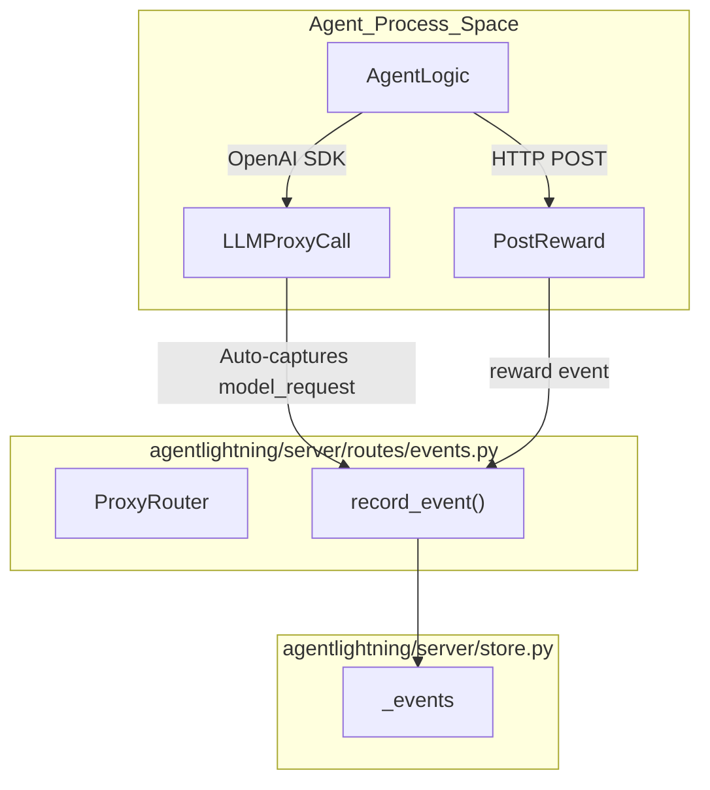
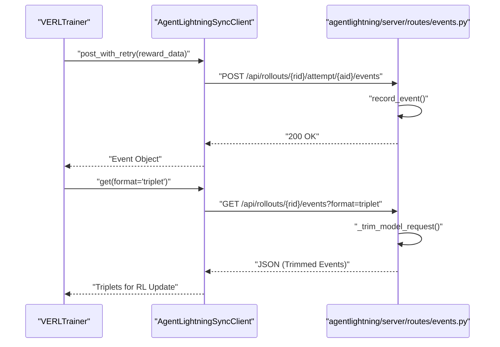

<!-- source: DeepWiki mcp.deepwiki.com · repo microsoft/agent-lightning · page 2.3 Event System & Triplet Format · fetched 2026-10-26 -->

# Event System & Triplet Format

Relevant source files

The following files were used as context for generating this wiki page:

- [agentlightning/client.py](agentlightning/client.py)
- [agentlightning/schemas.py](agentlightning/schemas.py)
- [agentlightning/server/routes/events.py](agentlightning/server/routes/events.py)
- [tests/server/test_endpoints.py](tests/server/test_endpoints.py)
- [tests/test_client.py](tests/test_client.py)
- [tests/verl/test_agl_rollout_manager.py](tests/verl/test_agl_rollout_manager.py)

The Event System is the primary telemetry and data ingestion pipeline for Agent Lightning. It records every interaction between the agent and the environment, specifically tracking model inferences and rewards. This system serves two purposes: providing observability into agent behavior and transforming raw interaction logs into the "Triplet" format required for Reinforcement Learning (RL) training.

## Purpose & Scope

This page documents the event ingestion pipeline in `agentlightning/server/routes/events.py`, the structure of well-known events (`model_request` and `reward`) defined in `agentlightning/schemas.py`, the transformation pipeline that converts raw trajectory events into RL-ready triplets, deduplication logic, and the sync/async HTTP clients (`AgentLightningSyncClient` and `AgentLightningAsyncClient`) implemented in `agentlightning/client.py`.

Sources: [agentlightning/server/routes/events.py:1-187](), [agentlightning/client.py:1-82](), [agentlightning/schemas.py:1-68]()

---

## Event Ingestion Pipeline

Events are recorded per rollout attempt. A rollout represents a single task instance (e.g., a math problem or a coding task), and an attempt (`attempt_id`) is a specific execution of that task [agentlightning/schemas.py:13-27]().

### Event Types
1. **`model_request`**: Captured automatically by the LLM Proxy. It contains the prompt, the model's response, token IDs, log probabilities, and server metadata [agentlightning/server/routes/events.py:125-172](), structured via `ModelRequestData` [agentlightning/schemas.py:36-54]().
2. **`reward`**: Posted by the agent or an external evaluator. It contains a scalar `value` representing the success or score of the rollout [agentlightning/server/routes/events.py:175-182](), structured via `RewardData` [agentlightning/schemas.py:56-67]().

### Data Flow: Agent to Server
Agents interact with the event system via environment variables pointing to the server endpoints. Events are appended in-memory to `_events` via `record_event()` [agentlightning/server/routes/events.py:46-66]().

Title: Event Ingestion Pipeline Architecture

Sources: [agentlightning/server/routes/events.py:46-66](), [agentlightning/schemas.py:13-67]()

---

## Triplet Format & RL Extraction

During training, the VERL trainer requests events using query parameters like `?format=triplet` [tests/server/test_endpoints.py:138-142](). This triggers a transformation pipeline that trims raw events into a compact format suitable for PPO/GRPO updates.

### The Transformation Process
When triplet formatting is requested, the server applies specific transformations:
1. **Trimming**: The `_trim_model_request()` function extracts `prompt_token_ids`, `response_token_ids`, and `response_log_probs` [agentlightning/server/routes/events.py:125-172](). The `_trim_reward()` function extracts scalar values [agentlightning/server/routes/events.py:175-182]().
2. **Logprob Extraction**: The `_extract_choice_log_probs()` function parses OpenAI-style chat or completions logprobs into a flat list of floats, handling malformed entries robustly without raising exceptions [agentlightning/server/routes/events.py:87-122]().
3. **Expert Routing Cleanup**: The `_drop_superseded_routed_experts()` function manages routed expert tensors, keeping only the final route tensor in each mergeable trajectory [agentlightning/server/routes/events.py:24-43]().

### Triplet Structure
| Field | Source Event | Description |
| :--- | :--- | :--- |
| `prompt_token_ids` | `model_request` | The input tokens sent to the LLM [agentlightning/server/routes/events.py:140](). |
| `response_token_ids` | `model_request` | The tokens generated by the LLM [agentlightning/server/routes/events.py:145](). |
| `response_log_probs` | `model_request` | The log probabilities of the generated tokens [agentlightning/server/routes/events.py:146](). |
| `value` | `reward` | The scalar reward value for the rollout [agentlightning/server/routes/events.py:177](). |

Sources: [agentlightning/server/routes/events.py:24-182](), [tests/server/test_endpoints.py:138-142]()

---

## HTTP Clients & Authentication

Agent Lightning provides specialized HTTP clients in `agentlightning/client.py` to interact with the server, handling authentication and reliability [agentlightning/client.py:1-82]().

### `AgentLightningAsyncClient` & `AgentLightningSyncClient`
These clients extend `httpx` and utilize `_headers_with_key()` to automatically inject and normalize the `Authorization: Bearer {key}` header case-insensitively [agentlightning/client.py:13-17](), [tests/test_client.py:29-58]().

*   **`AgentLightningAsyncClient`**: Used within the `agl-controller` and async agent loops [agentlightning/client.py:20-33]().
*   **`AgentLightningSyncClient`**: Used by the VERL trainer. It includes a `post_with_retry()` method that implements exponential backoff (up to 30 seconds) for idempotent endpoints [agentlightning/client.py:64-82](). It also includes a `get()` method with retries [agentlightning/client.py:53-63]().

Title: Client Interaction Sequence

Sources: [agentlightning/client.py:13-82](), [tests/test_client.py:29-58]()

---

## Deduplication & Routing Cleanup

Deduplication and stream cleanup ensure that redundant or superseded model requests do not distort training metrics. The event recording pipeline invokes `_drop_superseded_routed_experts()` to clean up intermediate routed expert tensors for identical or extending prompt contexts [agentlightning/server/routes/events.py:24-43]().

Sources: [agentlightning/server/routes/events.py:24-43]()

---

