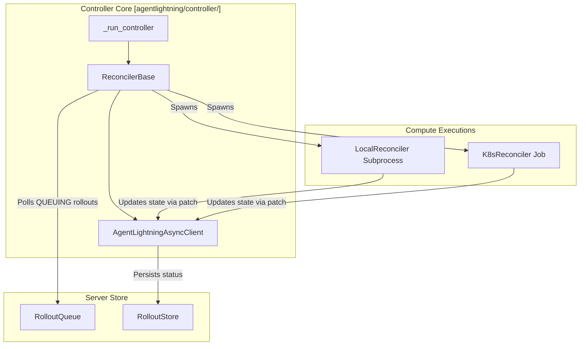
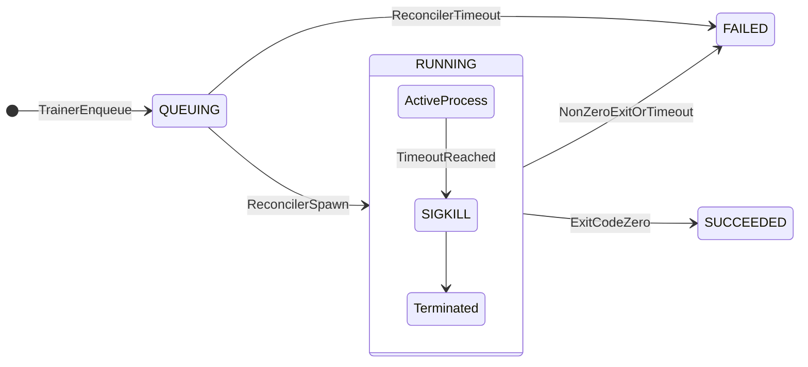

<!-- source: DeepWiki mcp.deepwiki.com · repo microsoft/agent-lightning · page 3 AGL Controller · fetched 2026-10-26 -->

# AGL Controller

Relevant source files

The following files were used as context for generating this wiki page:

- [agentlightning/config/__init__.py](agentlightning/config/__init__.py)
- [agentlightning/config/controller.yaml](agentlightning/config/controller.yaml)
- [agentlightning/controller/__init__.py](agentlightning/controller/__init__.py)
- [agentlightning/controller/__main__.py](agentlightning/controller/__main__.py)
- [agentlightning/hooks.py](agentlightning/hooks.py)
- [docs/01-quick-start.md](docs/01-quick-start.md)
- [docs/30-controller-configuration.md](docs/30-controller-configuration.md)
- [tests/controller/test_local_reconciler_platform.py](tests/controller/test_local_reconciler_platform.py)

The `agl-controller` service translates declarative rollout requests from the central `agl-server` queue into real agent executions using either local subprocesses or Kubernetes Jobs [agentlightning/controller/__main__.py:17-43](). Operating on a continuous reconciliation model, the controller polls for `QUEUING` rollouts, provisions the corresponding compute environment, and monitors their lifecycle until they reach a terminal state (`SUCCEEDED` or `FAILED`) [agentlightning/controller/__main__.py:17-43]().

This page provides a high-level overview of the controller's architecture, runner backends, and lifecycle hooks. For detailed deep dives, refer to the child sections:
- Local runner mechanics: see [Local Runner](#3.1)
- Kubernetes runner mechanics: see [Kubernetes Runner](#3.2)
- Rollout lifecycle extensions: see [Rollout Hooks](#3.3)

---

## Architecture & Reconciliation Loop

The controller entrypoint is managed by `agentlightning/controller/__main__.py`, which initializes either a `LocalReconciler` or a `K8sReconciler` depending on the Hydra configuration defined in `agentlightning/config/controller.yaml` [agentlightning/controller/__main__.py:17-38](), [agentlightning/config/controller.yaml:1](). Signal handlers for `SIGTERM` and `SIGINT` are registered to ensure graceful shutdown of the reconciler loop [agentlightning/controller/__main__.py:39-43]().

### Controller Reconciliation Architecture

*Figure 1: High-level reconciliation flow bridging server queue state with controller execution loops.*

Sources: [agentlightning/controller/__main__.py:17-43](), [agentlightning/config/controller.yaml:1-19]()

---

## Runner Backends

The controller supports a single active runner type configured via `runner_type` (`local` or `k8s`) in `agentlightning/config/controller.yaml` [agentlightning/config/controller.yaml:1-1](). 

### Local Runner (`local`)
The local runner executes agent tasks as local OS subprocesses managed by `LocalReconciler`. It maintains a process pool constrained by `local_runner.maximum_size`, handles polling intervals via `local_runner.poll_interval`, and injects required runtime environment variables (`AGL_OPENAI_BASE_URL`, `AGL_EVENT_URL`, `AGL_KEY`) [agentlightning/config/controller.yaml:17-19](). The local runner is not supported on native Windows due to its reliance on POSIX process-group signals [docs/30-controller-configuration.md:89-90](), [tests/controller/test_local_reconciler_platform.py:31-34]().

For details, see [Local Runner](#3.1).

### Kubernetes Runner (`k8s`)
The Kubernetes runner delegates execution to `K8sReconciler`, which renders Jinja2-based Job manifests from rollout definitions, enforces rate limits via `k8s_runner.max_jobs_per_minute`, manages cleanup TTLs via `k8s_runner.ttl_after_finished`, and interacts with the cluster via the `kr8s` library [agentlightning/config/controller.yaml:11-16]().

For details, see [Kubernetes Runner](#3.2).

Sources: [agentlightning/config/controller.yaml:1-19](), [agentlightning/controller/__main__.py:22-38](), [docs/30-controller-configuration.md:89-90](), [tests/controller/test_local_reconciler_platform.py:31-34]()

---

## Rollout Lifecycle & Hooks

Rollouts progress through a strict lifecycle managed by the controller and reported back through `AgentLightningAsyncClient` [agentlightning/controller/__main__.py:18-21](). Developers can intercept these transitions using the `RolloutHooks` extension point defined in `agentlightning/hooks.py` [agentlightning/hooks.py:19-35]().

### Rollout Lifecycle State Machine

*Figure 2: State machine transitions executed during rollout reconciliation.*

Sources: [agentlightning/hooks.py:19-35](), [agentlightning/controller/__main__.py:17-43]()

The `RolloutHooks` protocol provides synchronization and customization callbacks during startup, enqueueing, success, and failure [agentlightning/hooks.py:19-35](). Dynamic loading of hook implementations from file paths is handled by `load_hooks()` [agentlightning/hooks.py:36-63]().

| Hook Method | Purpose | Source Reference |
| :--- | :--- | :--- |
| `on_startup` | Initialize hook state once after startup | [agentlightning/hooks.py:22-23]() |
| `on_enqueue` | Transform a rollout request before persistence | [agentlightning/hooks.py:25-27]() |
| `on_succeeded` | Post-process successful rollouts with `TraceWriter` | [agentlightning/hooks.py:29-30]() |
| `on_failed` | Handle failure logging and cleanup actions | [agentlightning/hooks.py:32-33]() |

For details, see [Rollout Hooks](#3.3).

Sources: [agentlightning/hooks.py:15-63]()

---

