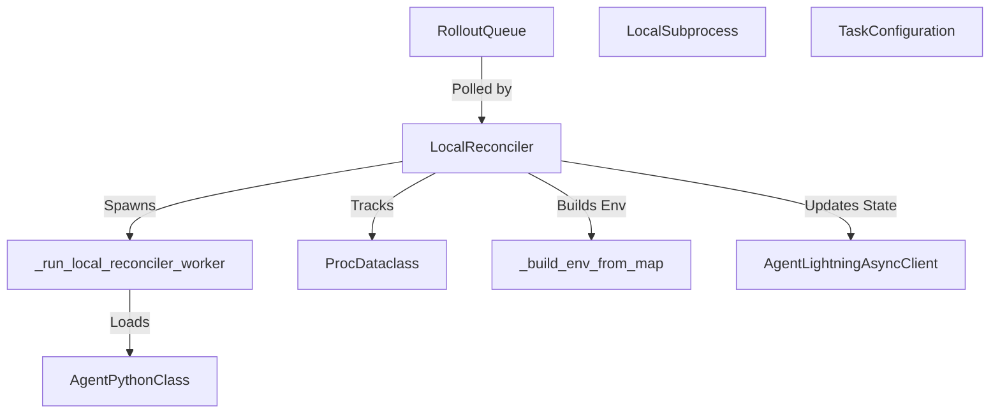
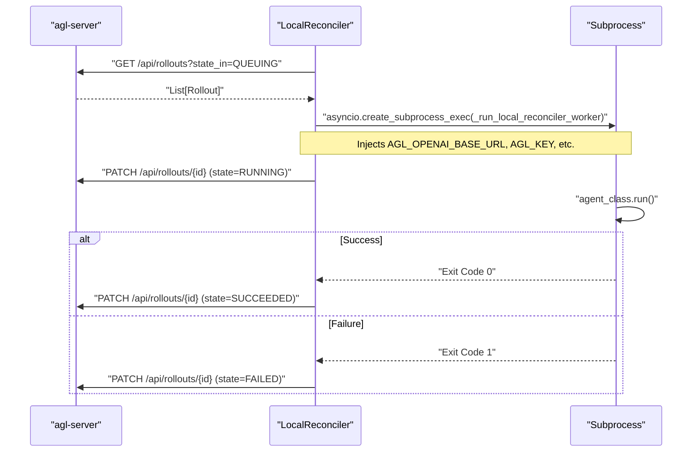

<!-- source: DeepWiki mcp.deepwiki.com · repo microsoft/agent-lightning · page 3.1 Local Runner · fetched 2026-10-26 -->

# Local Runner

Relevant source files

The following files were used as context for generating this wiki page:

- [agentlightning/controller/local_reconciler.py](agentlightning/controller/local_reconciler.py)
- [tests/controller/test_local_reconciler.py](tests/controller/test_local_reconciler.py)
- [tests/controller/test_local_reconciler_env.py](tests/controller/test_local_reconciler_env.py)

The purpose of this page is to document the implementation details of `LocalReconciler` (`agentlightning/controller/local_reconciler.py:94-110`()), the local runner component of `agl-controller`. It handles polling the server rollout queue, spawning agent rollouts as short-lived Python subprocesses, injecting `AGL_*` environment variables, managing a process pool, enforcing execution timeouts, handling state transitions, and dynamically loading agent classes.

---

## Overview & Platform Support

The `LocalReconciler` executes rollouts in a local process pool while maintaining synchronization with the central rollout queue via `AgentLightningAsyncClient` (`agentlightning/controller/local_reconciler.py:23-25`()). Because the local runner relies on POSIX process-group signal handling, native Windows is explicitly unsupported (`agentlightning/controller/local_reconciler.py:31-33`()). If `runner_type=local` is invoked on Windows, `LocalReconciler.run()` raises a `RuntimeError` before starting reconciliation or spawning any processes (`agentlightning/controller/local_reconciler.py:111-115`()).

### System Entity Mapping

**Diagram: Local Execution Data Flow**

Sources: [agentlightning/controller/local_reconciler.py:35-51](), [agentlightning/controller/local_reconciler.py:53-61](), [agentlightning/controller/local_reconciler.py:63-74](), [agentlightning/controller/local_reconciler.py:94-110]()

**Diagram: Process Lifecycle State Machine**

Sources: [agentlightning/controller/local_reconciler.py:125-183](), [agentlightning/controller/local_reconciler.py:184-189]()

Sources: [agentlightning/controller/local_reconciler.py:31-115]()

---

## Reconciliation Loop & Process Pool

The `LocalReconciler` runs a continuous asynchronous loop governed by `poll_interval` (`agentlightning/controller/local_reconciler.py:125-136`()).

### Polling and Scaling
`LocalReconciler._reconcile_once()` queries rollouts in `QUEUING` or `RUNNING` states with a limit of 50 per batch (`agentlightning/controller/local_reconciler.py:137-144`()). It records active child processes in the `_rid_to_proc` mapping dictionary (`agentlightning/controller/local_reconciler.py:108`()).
*   **Pool Size**: New subprocesses are spawned only when the live count is strictly less than `maximum_size` (`agentlightning/controller/local_reconciler.py:151-159`()).
*   **Orphan Detection**: If the server reports a rollout as `RUNNING` but no corresponding active local subprocess exists under `_rid_to_proc`, the reconciler transitions the rollout state to `FAILED` (`agentlightning/controller/local_reconciler.py:160-161`(), `tests/controller/test_local_reconciler.py:121-129`()).

Sources: [agentlightning/controller/local_reconciler.py:125-183](), [tests/controller/test_local_reconciler.py:121-129]()

---

## Environment Variable Injection & `env_map`

When spawning a subprocess, `LocalReconciler` injects a standardized set of environment variables (`tests/controller/test_local_reconciler_env.py:24-64`()).

### AGL System Variables
| Variable | Description |
| :--- | :--- |
| `AGL_OPENAI_BASE_URL` | Points to the reverse proxy endpoint: `http://{server}/proxy/rollout/{rid}/attempt/{aid}/mode/train/openai/v1` (`tests/controller/test_local_reconciler_env.py:62`()). |
| `AGL_EVENT_URL` | Points to the event ingestion endpoint: `http://{server}/api/rollouts/{rid}/attempt/{aid}/events` (`tests/controller/test_local_reconciler_env.py:63`()). |
| `AGL_KEY` | Bearer authorization key for gateway communication (`tests/controller/test_local_reconciler_env.py:61`()). |

### Task-Specific Variables (`env_map`)
The `_build_env_from_map()` and `_resolve_input_path()` functions extract specific values from the rollout's JSON `input` structure and map them to environment variables (`agentlightning/controller/local_reconciler.py:63-91`()). Nested dictionaries and list indexes are parsed dynamically (e.g., `input.question` or `input.items.0`) (`agentlightning/controller/local_reconciler.py:77-91`()).

Sources: [agentlightning/controller/local_reconciler.py:63-91](), [tests/controller/test_local_reconciler_env.py:24-64]()

---

## Agent Class Loading

`_run_local_reconciler_worker(agent_class_path: str)` serves as the entry point executed inside the spawned Python process (`agentlightning/controller/local_reconciler.py:35-51`()).
1.  **Dynamic Import**: Parses `agent_class_path` using colon (`:`) or dot (`.`) separators to separate the module name from the class name (`agentlightning/controller/local_reconciler.py:37-41`()).
2.  **Validation**: Confirms the imported attribute is a valid Python class (`agentlightning/controller/local_reconciler.py:42-43`()).
3.  **Execution**: Instantiates the class and invokes `.run()`. If the result is awaitable, `asyncio.run()` executes the coroutine (`agentlightning/controller/local_reconciler.py:44-46`()). Exceptions are caught and logged via `traceback.print_exc()`, returning a non-zero exit code (`agentlightning/controller/local_reconciler.py:48-50`()).

Sources: [agentlightning/controller/local_reconciler.py:35-51]()

---

## Timeouts and Termination

The reconciler enforces strict duration limits and handles graceful shutdown procedures.

### Timeout Enforcement
During each reconciliation tick, active subprocesses are checked against their configured `timeout_seconds` (`agentlightning/controller/local_reconciler.py:171-183`()). If `(now - spawned_at) > timeout`, the reconciler terminates the process group and marks the rollout as `FAILED` with a timeout explanation (`agentlightning/controller/local_reconciler.py:177-183`(), `tests/controller/test_local_reconciler.py:133-176`()).

### Graceful Shutdown
When stop signals are received, `LocalReconciler.stop()` sets the internal `_stop` event (`agentlightning/controller/local_reconciler.py:122-124`()). The cleanup sequence waits up to `_SHUTDOWN_WAIT_TIMEOUT` (5.0 seconds) for running subprocesses to exit before forcing termination (`agentlightning/controller/local_reconciler.py:28`()).

Sources: [agentlightning/controller/local_reconciler.py:28](), [agentlightning/controller/local_reconciler.py:122-124](), [agentlightning/controller/local_reconciler.py:171-183](), [tests/controller/test_local_reconciler.py:133-176]()

---

