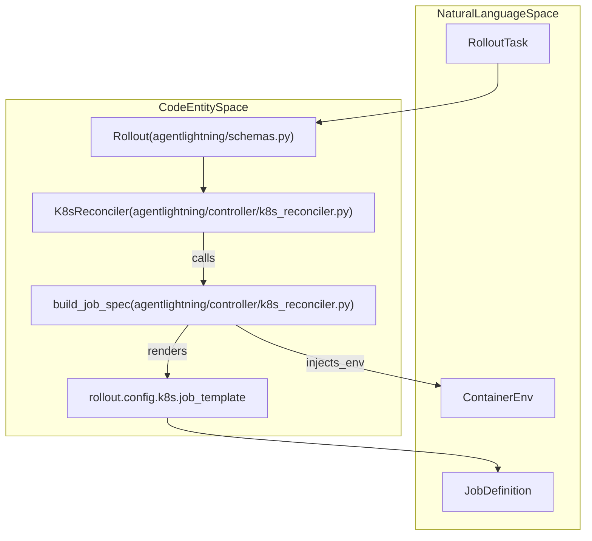
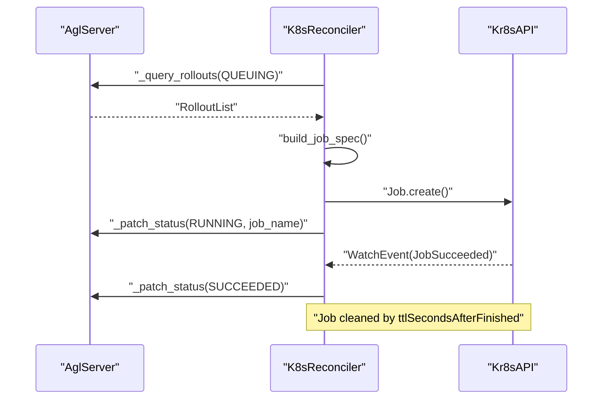

<!-- source: DeepWiki mcp.deepwiki.com · repo microsoft/agent-lightning · page 3.2 Kubernetes Runner · fetched 2026-10-26 -->

# Kubernetes Runner

Relevant source files

The following files were used as context for generating this wiki page:

- [agentlightning/controller/k8s_reconciler.py](agentlightning/controller/k8s_reconciler.py)
- [agentlightning/server/app.py](agentlightning/server/app.py)
- [agentlightning/server/routes/rollouts.py](agentlightning/server/routes/rollouts.py)
- [examples/calc_x/job-template.yaml](examples/calc_x/job-template.yaml)
- [tests/controller/test_k8s_reconciler.py](tests/controller/test_k8s_reconciler.py)

The `K8sReconciler` is the core component of the `agl-controller` responsible for managing the lifecycle of rollouts on a Kubernetes cluster. It translates `Rollout` objects from the `agl-server` into Kubernetes `Job` resources, monitors their execution using the `kr8s` async library, and synchronizes their terminal states back to the server [agentlightning/controller/k8s_reconciler.py:3-10]().

Sources: [agentlightning/controller/k8s_reconciler.py:3-10]()

---

## Implementation Architecture

The `K8sReconciler` operates using two concurrent asynchronous loops to ensure consistency between the `agl-server` state and the Kubernetes cluster state [agentlightning/controller/k8s_reconciler.py:5-10]().

### Concurrent Control Loops
1.  **`_periodic_reconcile_loop`**: Polls the `agl-server` for rollouts in `QUEUING` or `RUNNING` states at an interval defined by `poll_interval`. It triggers the creation of new Kubernetes Jobs and detects orphaned rollouts [agentlightning/controller/k8s_reconciler.py:147-160]().
2.  **`_watch_jobs_loop`**: Utilizes the `kr8s` library to watch for event-driven updates from the Kubernetes API. It reacts immediately when a Job succeeds or fails, updating the rollout status on the server without waiting for the next poll cycle [agentlightning/controller/k8s_reconciler.py:228-256]().

### Data Flow: Server to Cluster
The following diagram maps the transition from a `Rollout` entity in the code to a `Job` resource in Kubernetes, bridging natural language concepts with code entities.

**Rollout to K8s Job Mapping**

Sources: [agentlightning/controller/k8s_reconciler.py:43-101](), [agentlightning/schemas.py:18-25]()

---

## Job Manifest Rendering

The runner uses Jinja2 to render Job manifests from templates provided in the rollout configuration [agentlightning/controller/k8s_reconciler.py:25-27]().

### Template Processing
The `build_job_spec` function performs the following steps [agentlightning/controller/k8s_reconciler.py:43-43]():
1.  **Jinja2 Rendering**: It takes the template from `rollout.config.k8s.job_template` and renders it using the `job_name` and the `rollout.input` data. It includes a `yaml_escape` filter to handle special characters in input strings [agentlightning/controller/k8s_reconciler.py:45-54](), [examples/calc_x/job-template.yaml:17-19]().
2.  **Validation**: It ensures the rendered YAML contains exactly one document and that the document `kind` is `Job` [agentlightning/controller/k8s_reconciler.py:55-61]().
3.  **Metadata Injection**: It forces specific metadata to ensure the controller can track the resource:
    *   `name`: Generated via `build_job_name(rollout_id)` (format: `agl-rollout-{id}`) [agentlightning/controller/k8s_reconciler.py:38-40]().
    *   `labels`: Includes the `MANAGED_BY_SELECTOR` (`app.kubernetes.io/managed-by=agentlightning`), the specific `rollout-id`, and the `attempt-id` [agentlightning/controller/k8s_reconciler.py:34-34](), [agentlightning/controller/k8s_reconciler.py:63-70]().

### AGL Environment Variable Injection
To enable the agent running inside the container to communicate back to the server, the reconciler injects three critical environment variables into **every** container in the Pod spec [agentlightning/controller/k8s_reconciler.py:86-100]():

| Variable | Description | Value Pattern |
| :--- | :--- | :--- |
| `AGL_OPENAI_BASE_URL` | LLM Proxy endpoint | `{base}/proxy/rollout/{rid}/attempt/{aid}/mode/{mode}/openai/v1` [agentlightning/controller/k8s_reconciler.py:83-85]() |
| `AGL_EVENT_URL` | Event ingestion endpoint | `{base}/api/rollouts/{rid}/attempt/{aid}/events` [agentlightning/controller/k8s_reconciler.py:90-92]() |
| `AGL_KEY` | Authentication token | Configured via `controller_config.agl_server.key` [agentlightning/controller/k8s_reconciler.py:93-93]() |

Sources: [agentlightning/controller/k8s_reconciler.py:34-101](), [tests/controller/test_k8s_reconciler.py:11-50](), [examples/calc_x/job-template.yaml:1-23]()

---

## Resource Management & Rate Limiting

The `K8sReconciler` includes safeguards to prevent overwhelming the Kubernetes API or the cluster resources [agentlightning/controller/k8s_reconciler.py:104-120]().

### Rate Limiting
The controller implements a sliding window rate limiter using `max_jobs_per_minute`. It maintains a `deque` of `_job_creation_timestamps` and checks if the number of jobs created in the last `JOB_CREATION_WINDOW_SECONDS` (60s) exceeds the configured limit before spawning new ones [agentlightning/controller/k8s_reconciler.py:35-35](), [agentlightning/controller/k8s_reconciler.py:119-119]().

### Orphaned Job Detection
During the `_reconcile_once` cycle, the reconciler fetches all Jobs matching the `MANAGED_BY_SELECTOR` [agentlightning/controller/k8s_reconciler.py:165-172](). 
*   **Orphaned Jobs**: If a Job exists but the server has no record of the rollout (or it is in a terminal state), it is deleted from the cluster [agentlightning/controller/k8s_reconciler.py:188-192]().
*   **Orphaned Rollouts**: If a rollout is `RUNNING` on the server but no Job exists in K8s, it is considered orphaned and its state is patched to `FAILED` on the server [agentlightning/controller/k8s_reconciler.py:183-186]().

### Lifecycle & Cleanup
*   **`backoffLimit`**: Explicitly set to `0` to prevent Kubernetes from retrying failed agent pods; retries are managed by the `agl-server` state machine [agentlightning/controller/k8s_reconciler.py:72-72]().
*   **`activeDeadlineSeconds`**: Derived from `rollout.config.timeout_seconds` to ensure Jobs are killed by K8s if they hang [agentlightning/controller/k8s_reconciler.py:74-75]().
*   **`ttlSecondsAfterFinished`**: Configured via `k8s_runner.ttl_after_finished` to automatically clean up completed Job resources from the cluster [agentlightning/controller/k8s_reconciler.py:73-73]().

**Component Interaction Diagram**

Sources: [agentlightning/controller/k8s_reconciler.py:104-256](), [agentlightning/client.py:29-29]()

---

