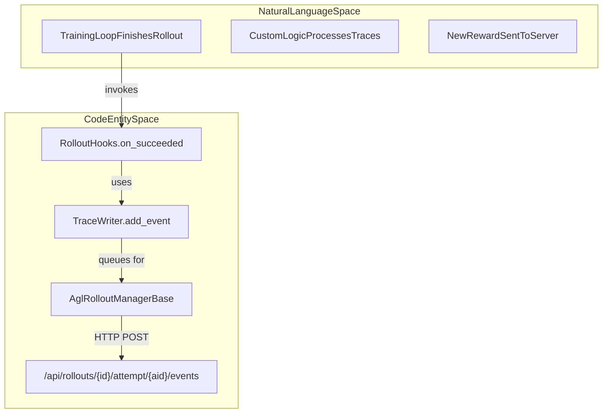

<!-- source: DeepWiki mcp.deepwiki.com · repo microsoft/agent-lightning · page 3.3 Rollout Hooks · fetched 2026-10-26 -->

# Rollout Hooks

<details>
<summary>Relevant source files</summary>

The following files were used as context for generating this wiki page:

- [agentlightning/config/__init__.py](agentlightning/config/__init__.py)
- [agentlightning/config/controller.yaml](agentlightning/config/controller.yaml)
- [agentlightning/controller/__init__.py](agentlightning/controller/__init__.py)
- [agentlightning/controller/__main__.py](agentlightning/controller/__main__.py)
- [agentlightning/hooks.py](agentlightning/hooks.py)

</details>


Rollout Hooks provide a synchronous extension point for intercepting and augmenting the rollout lifecycle during training [agentlightning/hooks.py:3-4](). They allow developers to modify rollout requests before they are enqueued, initialize state at startup, and process results (success or failure) to inject synthetic events or metrics into the server event stream.

---

### Lifecycle Callbacks

The `RolloutHooks` base class defines four primary lifecycle methods that are invoked by the rollout management infrastructure during the training loop [agentlightning/hooks.py:19-33]().

| Hook Method | Timing | Primary Purpose |
|:---|:---|:---|
| `on_startup` | Once during initialization [agentlightning/hooks.py:22-23](). | Initialize external resources or shared state. |
| `on_enqueue` | Before a rollout request is persisted [agentlightning/hooks.py:25-27](). | Transform `RolloutCreate` payloads (e.g., adding metadata or dynamic config). |
| `on_succeeded` | After a rollout transitions to `SUCCEEDED` [agentlightning/hooks.py:29-30](). | Post-process events, calculate complex rewards, or log traces. |
| `on_failed` | After a rollout transitions to `FAILED` [agentlightning/hooks.py:32-33](). | Debugging, error logging, or cleanup. |

Sources:
- `RolloutHooks` definition: [agentlightning/hooks.py:19-33]()
- `RolloutCreate` schema reference: [agentlightning/hooks.py:9]()

---

### Data Flow and Trace Injection

When a rollout completes, the manager fetches the full event history and invokes the success or failure hooks [agentlightning/hooks.py:29-33](). A key feature of these hooks is the `TraceWriter` protocol [agentlightning/hooks.py:15-16](), which allows hooks to inject new events back into the server for a specific rollout attempt.

#### Code Entity Mapping: Lifecycle Execution
The following sequence diagram shows how the rollout runner coordinates with `RolloutHooks` and the `TraceWriter` protocol.

```mermaid
sequenceDiagram
    participant RM as "AglRolloutManagerBase"
    participant H as "RolloutHooks"
    participant TH as "_TraceEventHelper"
    participant S as "agl-server"

    Note over RM, S: "Rollout Creation Phase"
    RM->>H: "on_enqueue(request: RolloutCreate)"
    H-->>RM: "RolloutCreate"
    RM->>S: "POST /api/rollouts"

    Note over RM, S: "Rollout Completion Phase"
    RM->>S: "GET /api/rollouts/{id}"
    S-->>RM: "Rollout(state=SUCCEEDED)"
    
    create participant TH
    RM->>TH: "new()"
    RM->>H: "on_succeeded(rollout, events, store)"
    
    opt "Synthetic Event Injection"
        H->>TH: "add_event(rollout_id, attempt_id, event_type, data)"
    end
    
    RM->>TH: "flush()"
    TH->>S: "POST /api/rollouts/{id}/attempt/{aid}/events"
```

Sources:
- `TraceWriter` protocol: [agentlightning/hooks.py:15-16]()
- `RolloutHooks` methods: [agentlightning/hooks.py:19-33]()

---

### Dynamic Loading and Configuration

Hooks are loaded dynamically from a Python file at runtime [agentlightning/hooks.py:36-63](). This allows training configurations to remain decoupled from the specific hook logic.

#### The `load_hooks()` Function
The `load_hooks(path: str)` function performs the following steps:
1. Resolves the absolute path to the provided Python module [agentlightning/hooks.py:42-44]().
2. Dynamically imports the module using `importlib.util` [agentlightning/hooks.py:46-49]().
3. Inspects the module using `inspect.getmembers` to identify subclasses of `RolloutHooks` [agentlightning/hooks.py:51-55]().
4. Validates that exactly one valid subclass exists to avoid ambiguity [agentlightning/hooks.py:57-61]().
5. Returns an instantiated instance of the hook class [agentlightning/hooks.py:63]().

#### Configuration Wiring
Hooks are specified in the training configuration under the `agentlightning` block.

```yaml
# Example configuration snippet
agentlightning:
  hooks: "path/to/my_hooks.py"
  agl_server:
    url: "http://localhost:8080"
```

Sources:
- `load_hooks` implementation: [agentlightning/hooks.py:36-63]()
- Controller configuration defaults: [agentlightning/config/controller.yaml:1-10]()

---

### Implementation Example: Synthetic Reward Injection

A common use case for `RolloutHooks` is to calculate a global reward based on the entire sequence of events and inject it as a synthetic reward event if the agent failed to post one explicitly.



Sources:
- `RolloutHooks.on_succeeded` definition: [agentlightning/hooks.py:29-30]()
- `TraceWriter.add_event` definition: [agentlightning/hooks.py:15-16]()
- Dynamic loading discovery: [agentlightning/hooks.py:51-55]()

---

