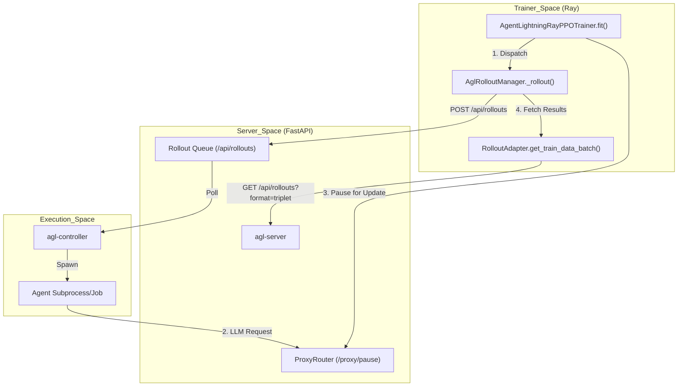
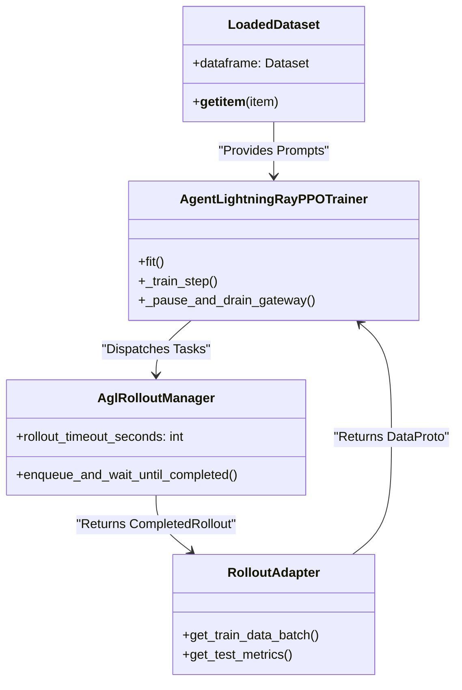

<!-- source: DeepWiki mcp.deepwiki.com · repo microsoft/agent-lightning · page 4 VERL Training Integration · fetched 2026-10-26 -->

# VERL Training Integration

Relevant source files

The following files were used as context for generating this wiki page:

- [agentlightning/verl/__init__.py](agentlightning/verl/__init__.py)
- [agentlightning/verl/vllm_compat.py](agentlightning/verl/vllm_compat.py)

## Purpose and Scope
This page provides an overview of the VERL/PPO training integration in Agent Lightning. It covers how the custom `AgentLightningRayPPOTrainer` coordinates with `agl-server` and `agl-controller` to execute agent rollouts asynchronously, manage gateway states, process rollouts through adapters, and apply per-rollout loss functions.

For deep technical details, refer to the child pages:
- [Trainer & Training Loop](#4.1)
- [Rollout Manager & Adapter](#4.2)
- [Per-Rollout Loss & Advantage](#4.3)
- [VERL Configuration](#4.4)

Sources: [agentlightning/verl/trainer.py:100-175](), [agentlightning/verl/__init__.py:1-3]()

---

## Overview

The **VERL Training Integration** enables Agent Lightning to leverage the VERL framework for large-scale Reinforcement Learning (RL). Unlike standard VERL, which executes rollouts using local Ray workers, Agent Lightning extends the PPO trainer to dispatch rollouts to `agl-server` via `AgentLightningRayPPOTrainer` [agentlightning/verl/trainer.py:100-101](). This architecture decouples agent execution—running in isolated local subprocesses or Kubernetes Jobs—from the trainer's core weight updates and advantage estimation loops. Additionally, runtime shims such as `apply_vllm_compat_patches` ensure compatibility across different vLLM versions [agentlightning/verl/vllm_compat.py:15-18]().

Sources: [agentlightning/verl/trainer.py:100-101](), [agentlightning/verl/vllm_compat.py:15-18]()

## Core Abstractions

The integration is centered around `AgentLightningRayPPOTrainer` [agentlightning/verl/trainer.py:100-101](), which overrides standard VERL rollout logic to interact with the Agent Lightning service ecosystem:

*   **Gateway Management**: Before executing a PPO weight update, the trainer invokes `_pause_and_drain_gateway` [agentlightning/verl/trainer.py:171-175]() to pause the LLM proxy gateway (`/proxy/pause`), draining in-flight agent requests to maintain parameter consistency [agentlightning/verl/trainer.py:171-175]().
*   **Rollout Dispatch**: Instead of local sampling loops, the rollout methods delegate work to instances managed by `_make_rollout_manager` [agentlightning/verl/trainer.py:139-152]() using `AglRolloutManager` or `AglAsyncRolloutManager` [agentlightning/verl/trainer.py:38-44]().
*   **Custom Loss Integration**: It registers custom policy losses like `per_rollout_mean` across Ray worker processes via setup hooks configured in `run_ppo` [agentlightning/verl/entrypoint.py:33-73]().

Sources: [agentlightning/verl/trainer.py:38-175](), [agentlightning/verl/entrypoint.py:33-73]()

### System Mapping: Trainer to Server Loop

The following diagram bridges natural language descriptions of the training loop to their corresponding code entities in `agentlightning/verl/trainer.py` and service routing layers.

Title: "System Mapping: Trainer to Server Loop"

Sources: [agentlightning/verl/trainer.py:100-175]()

---

## Component Details & Child Navigation

The VERL training subsystem is divided into four primary modules:

1.  **Trainer & Training Loop**: Implemented in `AgentLightningRayPPOTrainer` [agentlightning/verl/trainer.py:100-101](), managing `fit()`, `_train_step()`, `_rollout()`, gateway pause/drain, carry-over rollouts, and datasets.
    *   For details, see [Trainer & Training Loop](#4.1).
2.  **Rollout Manager & Adapter**: Implemented via `AglRolloutManagerBase` [agentlightning/verl/trainer.py:41-44]() and `RolloutAdapter` [agentlightning/verl/trainer.py:50-50]() handling trace merging, padding, and metrics integration.
    *   For details, see [Rollout Manager & Adapter](#4.2).
3.  **Per-Rollout Loss & Advantage**: Custom `per_rollout_mean` PPO loss, advantage normalization, dual-clip policy loss, and GRPO group metrics [agentlightning/verl/trainer.py:65-79]().
    *   For details, see [Per-Rollout Loss & Advantage](#4.3).
4.  **VERL Configuration**: Schema reference (`agentlightning/verl/config.yaml`), actor-rollout-ref overrides, and configuration merging utilities.
    *   For details, see [VERL Configuration](#4.4).

Sources: [agentlightning/verl/trainer.py:41-101](), [agentlightning/verl/trainer.py:65-79]()

---

## Entity Mapping: Data Flow

This diagram maps the core data classes and their relationships within the VERL training execution path.

Title: "Entity Mapping: Data Flow"

Sources: [agentlightning/verl/trainer.py:100-152]()

Sources:
- [agentlightning/verl/trainer.py:1-175]()
- [agentlightning/verl/entrypoint.py:1-73]()
- [agentlightning/verl/vllm_compat.py:1-41]()
- [agentlightning/verl/__init__.py:1-3]()

---

