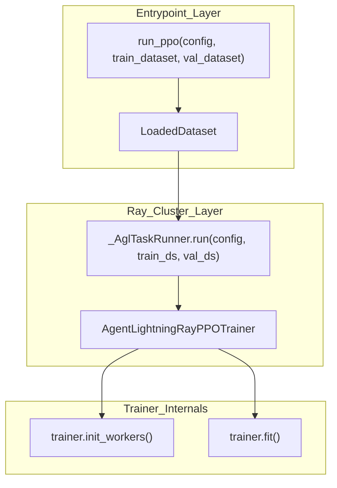
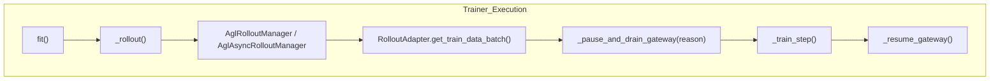

<!-- source: DeepWiki mcp.deepwiki.com · repo microsoft/agent-lightning · page 4.1 Trainer & Training Loop · fetched 2026-10-26 -->

# Trainer & Training Loop

Relevant source files

The following files were used as context for generating this wiki page:

- [agentlightning/__init__.py](agentlightning/__init__.py)
- [agentlightning/verl/dataset.py](agentlightning/verl/dataset.py)
- [agentlightning/verl/entrypoint.py](agentlightning/verl/entrypoint.py)
- [agentlightning/verl/trainer.py](agentlightning/verl/trainer.py)

The `AgentLightningRayPPOTrainer` is the core engine of the Agent Lightning reinforcement learning pipeline. It extends the standard VERL `RayPPOTrainer` to support agentic workflows where rollouts are executed as independent processes or Kubernetes jobs rather than local model-based samplers. This trainer manages the lifecycle of distributed agent execution, handles the transition from agent events to RL triplets, and coordinates weight updates with the LLM proxy.

## Overview & Entrypoint (`run_ppo` & `LoadedDataset`)

The training process is launched via the `run_ppo` function defined in `agentlightning/verl/entrypoint.py`. This entrypoint initializes the Ray cluster, configures runtime environments (including the worker process setup hook for custom rollout-level loss), and wraps training and validation data in `LoadedDataset` instances.

**Training Initialization & Entrypoint Mapping**

Sources: `[agentlightning/verl/entrypoint.py:33-73]()`, `[agentlightning/verl/dataset.py:17-42]()`.

The `LoadedDataset` class subclasses VERL's `RLHFDataset` to bypass file-based initialization, directly utilizing in-memory sequences (`Sequence[Any]`) and setting up dataframe properties `[agentlightning/verl/dataset.py:17-30]()`.

Sources: `[agentlightning/verl/entrypoint.py:33-73]()`, `[agentlightning/verl/dataset.py:17-42]()`.

---

## AgentLightningRayPPOTrainer Internals

The `AgentLightningRayPPOTrainer` class manages training execution steps, rollout orchestration, and weight synchronization.

### Key Methods & Lifecycle
- `__init__()`: Initializes configuration, checks asynchronous rollout constraints (`async_train_batch_size > data.train_batch_size`), and initializes tracking attributes like `_carry_over_rollouts` `[agentlightning/verl/trainer.py:100-118]()`.
- `fit()`: Drives the main training loop across epochs and global steps.
- `_rollout()`: Dispatches rollout requests through the `AglRolloutManager` or asynchronous rollout manager.
- `_train_step()`: Executes the VERL PPO update step using the processed `DataProto` batch.

**Trainer Control Flow & Rollout Loop**

Sources: `[agentlightning/verl/trainer.py:100-190]()`, `[agentlightning/verl/agl_rollout_manager.py:63-81]()`.

Sources: `[agentlightning/verl/trainer.py:100-190]()`.

---

## Gateway Pause, Drain & Resumption

To guarantee that active agent rollouts interact with up-to-date model weights without race conditions, the trainer coordinates directly with the `agl-server` reverse proxy gateway.

### Gateway Management Functions
- `_pause_and_drain_gateway(reason: str)`: Issues a `POST /proxy/pause` request to the gateway, allowing up to 300 seconds for in-flight requests to complete `[agentlightning/verl/trainer.py:171-175]()`.
- `_resume_gateway()`: Sends an idempotent `POST /proxy/resume` request after weight updates complete, unlocking new rollout generation `[agentlightning/verl/trainer.py:167-170]()`.
- `_abort_all_rollout_requests()` / `_resume_all_rollout_generation()`: Manages Ray rollout replica states asynchronously `[agentlightning/verl/trainer.py:159-166]()`.

Sources: `[agentlightning/verl/trainer.py:154-190]()`.

---

## Asynchronous Rollouts, Carry-Over & Sample Dropping

When asynchronous rollout collection is enabled via `agentlightning.async_rollout.enabled`, training and rollout generation run concurrently on shared GPU infrastructure. This is configured by setting `agentlightning.async_rollout.enabled: true` and `async_train_batch_size` in the configuration. The `async_train_batch_size` must be strictly greater than `data.train_batch_size` `[agentlightning/verl/trainer.py:108-111]()`.

### Carry-Over Rollouts
- The trainer maintains up to `async_train_batch_size` prompt groups active.
- Unfinished rollout groups are stored in `_carry_over_rollouts` `[agentlightning/verl/trainer.py:116]()` and passed into subsequent training iterations.
- Group integrity (such as GRPO/RLOO rollout counts `n`) is strictly preserved across steps.

### Sample Dropping & Variance Checks
- `_grpo_group_metrics()` and `_same_reward_uid_indices()` evaluate intra-group reward variance `[agentlightning/verl/trainer.py:65-97]()`.
- Samples where all rollouts share identical scores (zero variance) are identified to prevent degenerate advantage calculations in GRPO `[agentlightning/verl/trainer.py:91-97]()`.

Sources: `[agentlightning/verl/trainer.py:65-118]()`, `[agentlightning/verl/entrypoint.py:33-73]()`.

---

