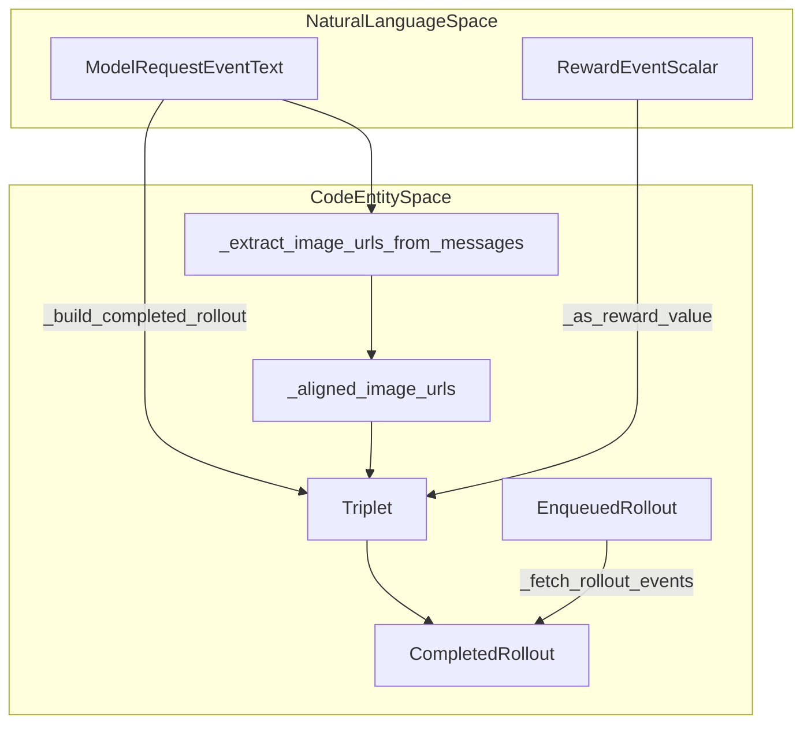
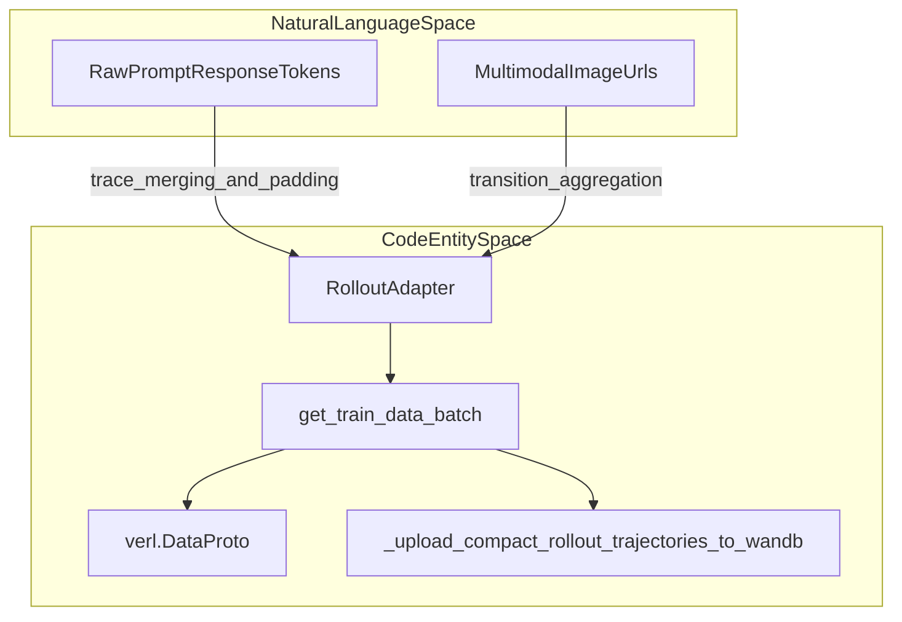

<!-- source: DeepWiki mcp.deepwiki.com · repo microsoft/agent-lightning · page 4.2 Rollout Manager & Adapter · fetched 2026-10-26 -->

# Rollout Manager & Adapter

Relevant source files

The following files were used as context for generating this wiki page:

- [agentlightning/verl/agl_rollout_manager.py](agentlightning/verl/agl_rollout_manager.py)
- [agentlightning/verl/rollout_adapter.py](agentlightning/verl/rollout_adapter.py)
- [tests/verl/test_rollout_adapter.py](tests/verl/test_rollout_adapter.py)

This page details the implementation and internal mechanisms of `AglRolloutManagerBase`, `AglRolloutManager`, `AglAsyncRolloutManager`, and the `RolloutAdapter` class (specifically `RolloutAdapter.get_train_data_batch()`). These components bridge remote agent execution environments managed by `agl-server` and `agl-controller` with the VERL PPO training loop.

Sources: `[agentlightning/verl/agl_rollout_manager.py:1-40]`, `[agentlightning/verl/rollout_adapter.py:1-20]`

## Overview & Core Data Models

The rollout management infrastructure handles remote rollout dispatch, lifecycle polling, and raw event reconstruction into structured training samples.

### Data Models
*   `Triplet`: Represents a single prompt-response-reward turn containing `prompt`, `response`, `reward`, `metadata`, and optional multimodal `image_urls` `[agentlightning/verl/agl_rollout_manager.py:41-51]`. The `image_urls` field is populated by extracting image URLs from OpenAI-style chat messages in `_extract_image_urls_from_messages` `[agentlightning/verl/agl_rollout_manager.py:144-167]` and aligning them with triplets in `_aligned_image_urls` `[agentlightning/verl/agl_rollout_manager.py:169-209]`.
*   `EnqueuedRollout`: Tracks metadata for a rollout currently in the server queue, including `data_id`, `rollout_id`, `step`, `sample_idx_in_step`, `enqueue_time`, `input`, and server timestamps (`running_at`, `finished_at`) `[agentlightning/verl/agl_rollout_manager.py:53-65]`.
*   `CompletedRollout`: Represents a finished rollout containing final rewards, aggregated triplets, raw events, rollout states, and error messages `[agentlightning/verl/agl_rollout_manager.py:67-85]`.

Sources: `[agentlightning/verl/agl_rollout_manager.py:41-85]`, `[agentlightning/verl/agl_rollout_manager.py:144-209]`

## Rollout Manager Architecture

`AglRolloutManagerBase` provides the core HTTP interaction patterns using `AgentLightningSyncClient` `[agentlightning/verl/agl_rollout_manager.py:21-21]`. It subclasses into two distinct operational managers:
1.  `AglRolloutManager`: Synchronous rollout runner that blocks and polls until batch rollouts reach terminal states (`SUCCEEDED` or `FAILED`).
2.  `AglAsyncRolloutManager`: Asynchronous rollout group manager that enables non-blocking queue submission and deferred synchronization.

### Natural Language to Code Entity Mapping (Rollout Events)
The following diagram maps event-driven natural language inputs and server responses to internal Python data structures within `agl_rollout_manager.py`.

Sources: `[agentlightning/verl/agl_rollout_manager.py:41-85]`, `[agentlightning/verl/agl_rollout_manager.py:113-118]`, `[agentlightning/verl/agl_rollout_manager.py:144-209]`, `[agentlightning/verl/agl_rollout_manager.py:18-85]`

## RolloutAdapter and get_train_data_batch()

The `RolloutAdapter` transforms a list of `CompletedRollout` objects into a VERL `DataProto` batch via its primary interface function, `get_train_data_batch()` `[agentlightning/verl/rollout_adapter.py:16-18]`.

### Aggregation Levels
The adapter supports two trace aggregation strategies controlled via configuration:
*   `transition`: Treats each interaction turn (triplet) as an individual training sample. This level is mandatory for multimodal inputs `[agentlightning/verl/rollout_adapter.py:380-390]`.
*   `trajectory`: Merges multi-turn interaction traces into a single concatenated sequence per rollout.

Sources: `[agentlightning/verl/rollout_adapter.py:16-18]`, `[agentlightning/verl/rollout_adapter.py:380-390]`

### Trace Merging & Padding
During multi-turn execution, prompts must incorporate prior interaction history. The adapter validates token continuity (`ids_startswith`) across turns `[agentlightning/verl/rollout_adapter.py:46-48]`. Sequence lengths are standardized using helper functions:
*   `get_left_padded_ids_and_attention_mask`: Truncates or left-pads token IDs with `pad_token_id` `[agentlightning/verl/rollout_adapter.py:166-175]`.
*   `get_right_padded_ids_and_attention_mask`: Truncates or right-pads token IDs `[agentlightning/verl/rollout_adapter.py:177-186]`.
*   Expert routing batch construction is supported via `_build_routed_experts_batch` for specialized MoE configurations `[agentlightning/verl/rollout_adapter.py:188-194]`.

Sources: `[agentlightning/verl/rollout_adapter.py:46-48]`, `[agentlightning/verl/rollout_adapter.py:166-186]`, `[agentlightning/verl/rollout_adapter.py:188-194]`

### WandB Upload and Test Metrics
The adapter provides built-in observability integrations:
*   `_upload_trace_merge_mismatches_to_wandb`: Logs token mismatch tables to Weights & Biases when trace merging fails validation `[agentlightning/verl/rollout_adapter.py:117-129]`.
*   `_upload_compact_rollout_trajectories_to_wandb`: Uploads compressed JSONL archives (`.jsonl.zip`) containing rollout trajectories as W&B artifacts `[agentlightning/verl/rollout_adapter.py:131-164]`.
*   Test metrics compute aggregation performance indicators such as final rewards and sequence lengths from completed batches `[agentlightning/verl/rollout_adapter.py:355-375]`.

Sources: `[agentlightning/verl/rollout_adapter.py:117-164]`, `[agentlightning/verl/rollout_adapter.py:355-375]`

### Natural Language to Code Entity Mapping (Token Processing & Batching)
The following diagram bridges natural language prompt/response tokens and multimodal image payloads to the core `RolloutAdapter` processing structures and VERL tensors.

Sources: `[agentlightning/verl/rollout_adapter.py:16-18]`, `[agentlightning/verl/rollout_adapter.py:131-164]`, `[agentlightning/verl/rollout_adapter.py:380-390]`

---

